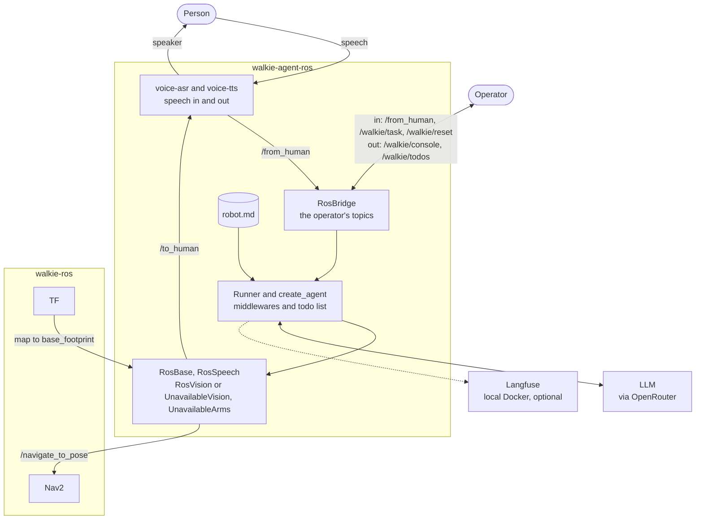
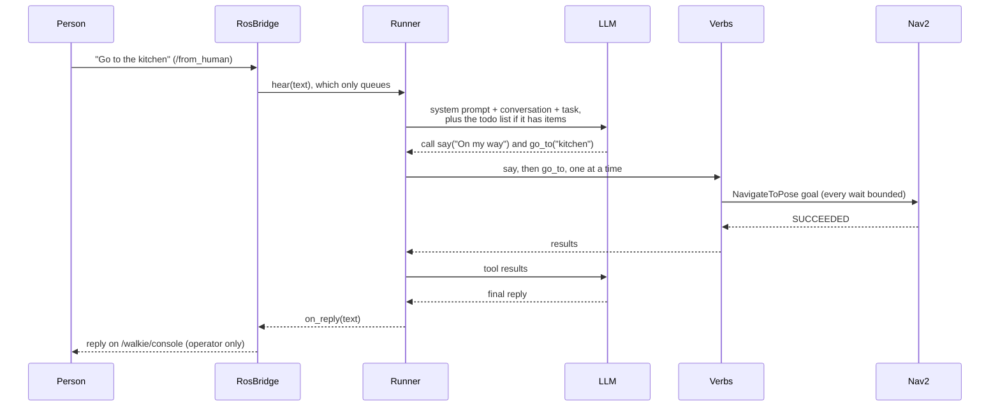
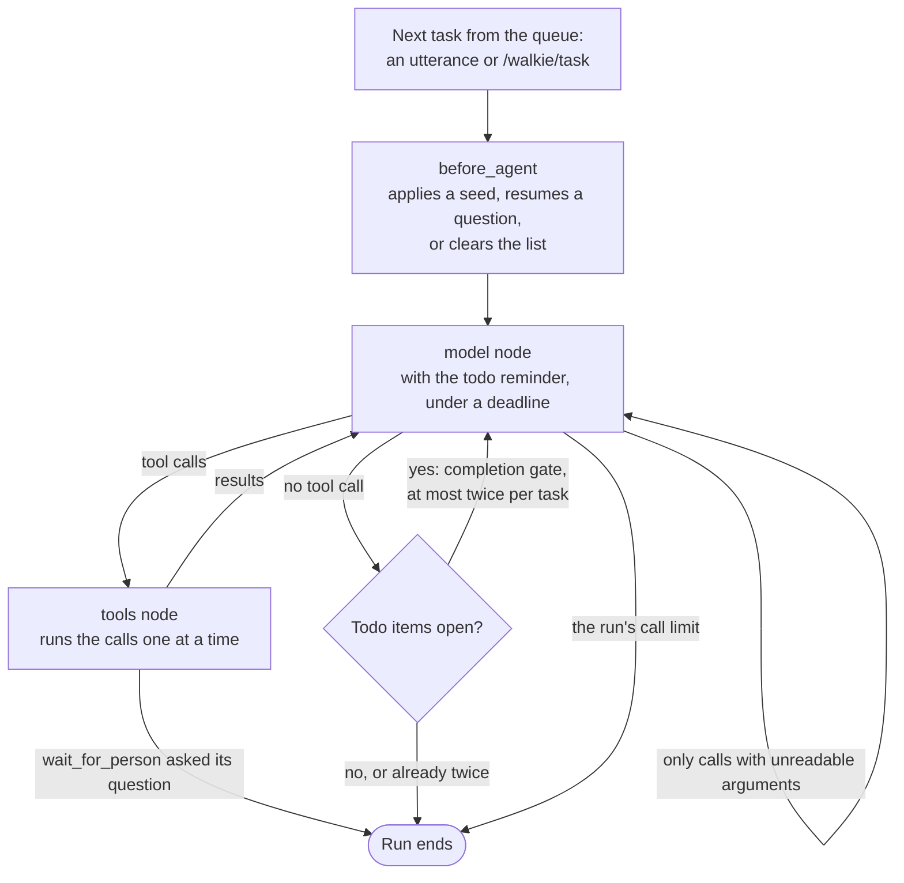
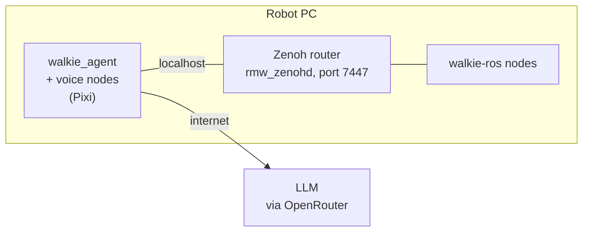

# The Agent

Walkie's agent is one ROS 2 node, `walkie_agent`. It receives tasks from
people, asks an LLM what to do, and acts through a small fixed set of tools.
The robot's own software, including navigation and manipulation, runs in
[walkie-ros](https://github.com/EIC-Robocup-2026/walkie-ros). The agent calls
it over ROS 2.

!!! warning "A provisional cutover, not a proven robot"
    The code described here replaces the old agent, but its evidence is limited.
    See [What has been tested](#what-has-been-tested). It has run two one-step
    tasks with a real model, on real Nav2 in walkie-ros's MuJoCo simulation of the
    Chula room, and never on the robot. Live vision and the arms are not connected.

For a guided tour with runnable examples, start at
[Learn the Agent](../learn/index.md). The public signatures of each layer are in
the [Mahoraga Demo Prototype](mahoraga-demo.md) contract. The larger redesign is
still a proposal: see [Self-Evolving Agent (Proposed)](self-evolving-agent.md).

## Summary

- **`create_agent` and one Runner.** The agent runs on LangChain's `create_agent`
  with a small stack of middlewares. One Runner thread takes tasks one at a time
  ([ADR-0061](decisions/0061-create-agent-runtime-and-cancellation.md)). RAI's agent
  host is gone from this entry point. Its connector, `HRIMessage` and voice agents
  stay ([ADR-0003](decisions/0003-rai-react-agent.md)).
- **Tools over capability verbs.** A tool is a plain typed function over `ctx`
  ([ADR-0060](decisions/0060-atomic-tools-and-adapter.md)). It reaches the robot
  only through verbs such as `ctx.base.go_to`, which have fake and ROS-backed
  backends ([ADR-0052](decisions/0052-capability-verbs-and-backends.md)).
- **One fixed tool set.** `--tool-set` picks `default`, `gpsr`, `hri` or `arms` at
  startup, and the whole set is bound for the life of the agent
  ([ADR-0067](decisions/0067-static-tool-sets.md)). There is no tool search and no
  tool is added at runtime.
- **A todo list for every task.** For a task with several steps, the LLM writes the
  steps with `update_todos` and marks them as it goes. The rules are enforced in
  code. For example, a step whose tool failed cannot be marked completed until that
  tool succeeds, unless a note explains why. A task can also arrive with its steps
  already seeded, from the operator on `/walkie/task`
  ([ADR-0041](decisions/0041-todo-list-and-seeding.md),
  [ADR-0069](decisions/0069-task-templates-by-name.md)).
- **Text in, speech and console out.** Tasks arrive as text on `/from_human` or
  `/walkie/task`. The agent speaks only through `say`, `wait_for_person` and the
  fixed stop line, all on `/to_human`
  ([ADR-0007](decisions/0007-speak-tool-and-console.md)). Replies and status lines
  go to the operator on `/walkie/console`, and the list goes on `/walkie/todos`.
- **Stop and reset.** A bare "stop" cancels at once and makes no model call. A
  message on `/walkie/reset` forgets the conversation
  ([ADR-0008](decisions/0008-reset-topic.md)).
- **Every model call is bounded.** Each run has a call limit, and each attempt has a
  deadline. The numbers are provisional, and no fallback model is chosen
  ([ADR-0062](decisions/0062-bounded-model-calls.md), which is still proposed).
- **Knows what it is.** One static file, `robot.md`, goes into the system prompt
  ([ADR-0068](decisions/0068-static-robot-description.md)).
- **Agent-side only.** This repository holds the agent, its configuration and fakes
  for testing. Robot nodes live in walkie-ros
  ([ADR-0015](decisions/0015-repository-boundary.md),
  [ADR-0016](decisions/0016-talk-to-walkie-ros-directly.md)). The vision models run
  in walkie-vision ([ADR-0034](decisions/0034-vision-models-in-walkie-vision.md)).
- **Not connected: memory, object vision and arms.** The agent does not read
  walkie-database. The old remembered-object tool is retired, because a remembered
  row is not a current view. `find_objects`, `object_info`, `pick`, `place_on` and
  `hand_over` all answer `UNAVAILABLE` on the robot's `ctx`. So does `find_people`,
  unless the agent runs with `--vision`: it then reads walkie-vision's people
  ([Perception](perception.md#what-is-built)).

## Layers

The runtime and everything under it know nothing about ROS. The ROS-backed verbs implement
the capability Protocols, and `main.py` wires them in.

| Layer | Module | ROS? |
| --- | --- | --- |
| Entry point: parse flags, signals, assembly | `walkie_agent/main.py` | Yes |
| Runtime: `create_agent`, middlewares, todo list, Runner | `walkie_agent/runtime/` | No |
| Adapter: from an atomic to a LangChain tool | `walkie_agent/adapter.py` | No |
| Atomics and tool sets | `walkie_agent/atomics/` | No |
| Capability verbs, guards, `Ctx`, `FakeRobot` | `walkie_agent/capabilities/` | No |
| ROS-backed verbs and the operator's topics | `walkie_agent/ros/` | Yes |

`tests/test_ros_free.py` checks in a fresh interpreter that the ROS-free layers never
import rclpy, rai, rai_interfaces or a ROS message. `voice.py` is separate: the two
voice entry points still run on RAI's `AgentRunner`, and do not use this runtime.

Threads matter here. The connector's executor runs ROS callbacks, which only validate
and queue. The Runner's thread, `walkie-runtime`, runs the graph and the todo listeners.
Synchronous tools run on worker threads that LangChain starts. So a blocking verb never
holds up the executor, and a stop can reach a verb that is waiting.

## Components



The voice box is two nodes, speech recognition and text-to-speech. Speech
recognition ignores the microphone while Walkie speaks, so Walkie does not
hear itself ([ADR-0029](decisions/0029-half-duplex-voice.md)). See
[Voice](../setup/07-voice.md) for how they connect.

`pixi run fake-walkie` stands in for the robot during development. It serves the
Nav2 action and TF, and listens on the speech topic. It proves nothing about real
Nav2.

### Topics

| Topic | Type | Direction | QoS | What it carries |
| --- | --- | --- | --- | --- |
| `/from_human` | `rai_interfaces/msg/HRIMessage` | In | Reliable, keep last 10 | Text only. A bare stop stops, and anything else is a task. |
| `/walkie/task` | `std_msgs/msg/String` | In | Reliable, keep last 10 | JSON: a task with its steps or a template name. |
| `/walkie/reset` | `std_msgs/msg/Empty` | In | Reliable, keep last 10 | Forget the conversation. |
| `/walkie/console` | `rai_interfaces/msg/HRIMessage` | Out | Reliable, keep last 10 | Plain-text replies, status lines and the failure line. Never spoken. |
| `/walkie/todos` | `std_msgs/msg/String` | Out | Reliable, transient-local, keep last 1 | The whole list as JSON. |
| `/to_human` | `rai_interfaces/msg/HRIMessage` | Out | Reliable, keep last 10 | `say`, `wait_for_person` and the stop line. |
| `/voice_commands` | `std_msgs/msg/String` | In | Reliable, keep last 10 | The exact word `stop` starts a new speech id. |
| `/navigate_to_pose` | `nav2_msgs/action/NavigateToPose` | Action client | Action defaults | Every drive. |
| TF | `map` to `base_footprint` | Read | Connector's buffer | The robot's pose. |

Input is text only. A `/from_human` message with an image or audio payload is logged at
warning level and refused, not stripped. That includes a bare "stop" that carries a
payload. A blank message is ignored with a log line. `/to_human` publishes succeed
without any acknowledgement of playback, so `say` means "sent", not "heard".

`--input-topic`, `--output-topic`, `--reset-topic`, `--task-topic` and `--todos-topic`
rename the operator's topics. A console topic that resolves to `/to_human` is refused at
startup.

## How a task runs



The Runner keeps a queue. When it is idle, it takes the oldest task and runs it until
the LLM stops calling tools. An utterance that arrives during a task waits until the
task ends. At a noisy booth, interrupting on any speech would let overheard words cancel
the current step, so only a bare stop or a reset interrupts
([ADR-0061](decisions/0061-create-agent-runtime-and-cancellation.md)). Every task joins
the same conversation, so the LLM also sees the earlier tasks until a reset.

### The agent's graph

`build_agent()` in `src/walkie_agent/runtime/agent.py` calls `create_agent`, which
builds a model node and a tools node. Everything Walkie adds is a middleware.
`build_middleware()` has the one order that works, and `tests/test_runtime.py` pins it.



| Middleware, in list order | What it guards |
| --- | --- |
| `ToolLog`, with `--tool-log` | Writes one JSON line per tool call, refusals included |
| `StopLatch` | Once the token is set: no model call, and every tool call refused |
| `SerialGuard` | A failed call or a question skips the later calls of its message. Only the first `update_todos` of a message runs. |
| `WalkieTodos` | The list, the reminder, the completion gate and the two todo tools |
| `EndAfterQuestion` | Ends the run after a successful question |
| `RepairHistory` | Answers calls left open by an earlier run and calls with unreadable arguments |
| `ModelCallLimitMiddleware` | Ends the run after `run_limit` model calls |
| `ModelFallbackMiddleware`, only when configured | Tries a fallback model. None is configured. |
| `Deadline` | `asyncio.timeout` around each model attempt |
| `tool_error_middleware()` | Turns a tool's error into an answer, so the ledger sees it as a result |

- **History repair.** OpenAI-compatible endpoints reject an AI message whose tool
  calls have no results. That happens when a run fails after the LLM asked for tools.
  At the start of the next run, each open call gets the answer "Interrupted before it
  ran." A call whose arguments are not valid JSON gets "The arguments were not a valid
  JSON object, so the call did not run." When the LLM made no other call, the graph goes
  straight back to the model.
- **One call at a time.** `Session.config()` sets `max_concurrency=1`, so the calls of
  one message run in order. That is observed behaviour of the installed versions, and
  it is not documented. Rerun `tests/test_runtime.py` on any dependency update.
- **A failed call skips the rest of its message.** Each later call is answered "Not run:
  X failed earlier in this message. Decide again." The calls were planned on the failed
  one working. A second `update_todos` in one message is refused and counts as a failed
  call. An unknown tool, such as `fly`, gets an error and the task goes on.
- **Completion gate.** The LLM may answer without a tool call while todo items are
  still open. The agent then saves "[todo] Open items: t3, t4. Finish them, or mark them
  failed or cancelled with a note." and calls the LLM again. It does this at most twice
  per task.
- **`wait_for_person` ends the run.** It speaks the question, and the step in progress
  becomes waiting. The person's answer arrives as the next task and puts that step back
  in progress, with the same attempt and the same gate budget. Later calls of the same
  message are answered "Not run". If the question could not be spoken, the call fails
  and the LLM decides again.
- **At most 25 model calls per run, 60 s per attempt.** Both are provisional. The call
  limit ends the run with a final message that names the limit, and that message goes to
  the console. A timeout ends the task with `FAILURE_LINE` on the console.

### The todo list in each turn

When the list has items, each LLM call gets it as one extra human message at the end.
That message is not saved in the history, so the history holds only what happened. It is
a human message, not a system message, because some providers reject a system message
that is not first.

```text title="Todo reminder"
<todos>
[x] t1 Go to the kitchen
[>] t2 Say hello
[ ] t3 Come back to the person
</todos>
```

`[ ]` is pending, `[>]` in progress, `[?]` waiting for an answer, `[x]` completed, `[!]`
failed and `[-]` cancelled.

A task with no seed clears the list when it starts, unless the last run ended on a
question. So a finished or abandoned list does not carry over, and an answer continues
the step that asked.

`Runner.submit(text, todos)` queues a task with its steps already written. The seed
replaces the list when that task starts, before the first LLM call. `todos=[]` is an
empty seed, and `todos=None` is no seed. Seeded steps cannot be reworded, reordered or
removed. A bad seed raises `TodoRejected` from `submit()` at once, not later on the
Runner's thread. Items are plain dictionaries in the graph's state, so a checkpoint
holds them.

### Seeding a task on /walkie/task

`/walkie/task` takes a `std_msgs/msg/String` that holds a JSON object in one of two
forms:

```json title="With its steps"
{"task": "Bring me a cup from the kitchen.",
 "todos": ["Go to the kitchen",
           {"content": "Pick up a cup", "active_form": "Picking up a cup"},
           "Come back"]}
```

```json title="With a template"
{"task": "Two guests are on their way.", "template": "tour"}
```

- **`todos`** is the same list that `submit()` takes. A step is a string, or an object
  with `content` and, optionally, `active_form` and `requires_tool`.
- **`template`** names a template by its exact name. The LLM gets the message's task, a
  blank line and the template's task text. The template's steps are seeded.
- **Seeded steps from this topic have the source `operator`.** The task joins the same
  queue as an utterance.
- **A malformed message is logged as a warning and ignored.** Examples are text that is
  not JSON, an unknown key, both or neither of `todos` and `template`, an unknown
  template or a bad step. The topic keeps working.
- **An inline step's `requires_tool` is not checked against the tool set.** Only
  templates are checked, at startup. A step that names a missing tool can only end as
  failed or cancelled.

### Task templates

`config/task_templates.toml` holds named templates, one `[templates.<name>]` table each.
The shipped file has only a commented example. `--task-templates` points the agent at
another file.

```toml title="config/task_templates.toml"
[templates.tour]
task = """
Show the person the main rooms. In each room, say what it is for.
"""
todos = [
  "Go to the kitchen",
  { content = "Say what the kitchen is for", requires_tool = "say" },
  "Come back to the person",
]
```

- **`task` and `todos` are required.** `todos` uses the seed format above.
- **Only the operator picks a template, by its exact name, on `/walkie/task`.** An
  utterance never starts one, so a stray word in speech cannot start the wrong plan
  ([ADR-0069](decisions/0069-task-templates-by-name.md)).
- **The file is checked at startup.** A missing file means no templates. A bad template
  stops the agent with an error that names the file and the template. So does a step
  whose `requires_tool` is outside the chosen tool set. A step may require an atomic or
  `wait_for_person`, but not `update_todos`.

### Following the list

- **`/walkie/todos`** carries the whole list as a JSON array of steps, after every
  change. Each step has its public fields: `id`, `content`, `active_form`, `status`,
  `note`, `source`, `locked`, `requires_tool`, `evidence` and `question`. It is reliable,
  transient-local and keeps one message, so a viewer that starts late still gets the
  current list. The agent publishes `[]` at startup and after a reset.
- **`/walkie/console`** gets one line for each change of a step's status. A step that
  goes in progress shows its active form: `t1: Going to the kitchen`. A step that is
  completed, failed, cancelled or waiting shows its content:
  `t1 completed: Go to the kitchen`. A new pending step shows no line. These lines are
  never spoken.

### Stop, reset and errors

- **Stop.** An utterance that is just "stop", "never mind" or "nevermind" stops the
  robot, even when the agent is idle. Case, extra spaces and `.`, `,`, `!` or `?` around
  it are ignored, so "Stop." counts. "Walkie, stop" and "stop the music" do not: they
  are ordinary tasks that wait in the queue.
    - The cancel token is set at once. That ends a drive through the verb and refuses
      every remaining call of the run.
    - Queued tasks are dropped, with their seeds. A queued reset is kept.
    - `STOP_LINE`, "Okay, stopping.", is spoken once on another thread, so a hung LLM
      call cannot delay it. It is not a tool call, so no model decides it.
    - After the active run ends, a graph pass with no model call marks the open steps
      cancelled, with the note "Stopped by the person."
    - The token stays set until the next task starts.
    - A `say` that is already publishing is not cut off.
- **Reset.** A message on `/walkie/reset` cancels and drops the queue. After the active
  run ends, the Runner deletes the conversation, starts a new session and publishes
  `[]` on `/walkie/todos` ([ADR-0008](decisions/0008-reset-topic.md)). A hung LLM call
  can delay this by up to the deadline.
- **Errors.** An exception or a timeout ends that task only. The Runner logs it and
  sends `FAILURE_LINE` to the console, and the next task runs on the same conversation.
  History repair answers any calls that it left open.
- **Shutdown.** The first SIGINT or SIGTERM closes input, cancels the goal and drains.
  If Nav2 has not answered, the agent keeps ROS running, keeps input closed, retries and
  logs what is unresolved. A second signal ends the process at once with exit code 3,
  and the robot's state is then unknown. A signal within 0.5 s of the last one counted
  (`SIGNAL_REPEAT_S`) is treated as the same signal, since `pixi run` forwards the one it gets
  and the agent gets it from its process group as well. A clean exit is code 0. Before ROS starts,
  the agent reads its inputs, and an error that reading raises as an OSError,
  ValueError or KeyError prints one line on stderr, `walkie-agent: <message>`, and
  exits with code 2. That covers a missing or broken file, a missing setting or API
  key, a bad `base_url` scheme, host or port, and a bad `[team]` table. Any other
  error ends with its traceback and code 1, as does a failure once ROS has started.
  A single value where a table belongs, such as `vendor = "openai"`, is one of those,
  because the TypeError it raises can also mean a bug.

## Tools

The tools the LLM can call come from one fixed list, chosen by `--tool-set`. Two more
come from the todo middleware, in every set.

| Tool | Sets | What it does on the robot's `ctx` |
| --- | --- | --- |
| `list_places` | default, hri, arms | Lists the named places in the `--locations` file |
| `go_to` | default, gpsr, hri, arms | Drives to a named place with Nav2, with every wait bounded. With `--arms`, refuses while an arm is out of every travel-safe pose ([ADR-0025](decisions/0025-travel-safe-interlock.md)) |
| `move_relative` | default, gpsr, hri, arms | Moves up to 3 m from here, then turns, through Nav2, with the same arm check as `go_to` |
| `say` | default, gpsr, hri, arms | Publishes one line on `/to_human` |
| `find_objects` | default, gpsr | `UNAVAILABLE`: live object perception is not connected |
| `object_info` | default, gpsr | `UNAVAILABLE`, for the same reason |
| `find_people` | default, gpsr, hri | With `--vision`, the people in the newest `/walkie_vision/people` array, left to right, with a pose, a gesture and the room. Without it, `UNAVAILABLE`: live people perception is not connected |
| `face_person` | default, hri | Turns once, on the spot, by the person's bearing from the newest people array, through Nav2. No turn within 10°. With no `--vision`, `UNAVAILABLE`, as for `find_people` |
| `remember_person`, `recognize_person` | hri | With `--people-memory mock` or `ros`, stores a person in view under a name, or says who they are, from the faces and appearances `--vision` collects ([ADR-0070](decisions/0070-people-memory-capability.md)). Otherwise `UNAVAILABLE` |
| `list_arm_poses` | hri, arms, with `--arms` | Lists the named arm poses offered here, with the arms each takes |
| `move_arm_to_pose` | hri, arms, with `--arms` | Moves one arm or both to a named pose through `bimanual_commander`'s `/set_joint_position`, then checks the joints against the pose ([ADR-0021](decisions/0021-arm-control-through-commander.md), [ADR-0022](decisions/0022-named-arm-poses.md)) |
| `set_gripper` | hri, arms, with `--arms` | Opens, half opens or closes one gripper or both through `/control_gripper`, and says whether a close is holding something. A close in the `receive` pose starts 5 s after the call |
| `get_arm_state` | hri, arms, with `--arms` | Reads both arms and the fingers, and says whether Walkie may drive |
| `pick`, `place_on`, `hand_over` | gpsr | `UNAVAILABLE`: Walkie has no grasp skill yet |
| `get_facts` | default, gpsr | Reads the time and the date from the computer's clock, in the timezone of `config.toml`'s `[team]`, and the team's name, country and affiliation from that table |
| `update_todos` | always | Adds, updates and removes steps by id, all or nothing |
| `wait_for_person` | always | Asks a question out loud and ends the run until the answer |

`FakeRobot` implements every verb, so all of these work in unit tests and in the gym.
That shows what a tool does with a verb. It shows nothing about real perception or arms.
An unavailable verb must keep raising `UNAVAILABLE`: an empty list would say that nothing
is in view, and a remembered database row is not a current view.

The four arm tools are the exception: without `--arms` they are not bound at all, rather
than bound to answer `UNAVAILABLE`. `--tool-set arms` needs `--arms`, and `--arms` needs
`hri` or `arms`; any other pair exits with code 2 before ROS starts. With `--arms` the
agent reads `config/arm_poses.toml` against `config/robot_model.toml` at startup, and a
bad pose file stops it there.

When a tool fails, the LLM reads `CODE: message`, for example `NOT_FOUND: Unknown place
'attic'. Known places: kitchen.`, and the result is marked as an error. The codes are
`UNAVAILABLE`, `TIMEOUT`, `NOT_FOUND`, `REFUSED`, `PRECONDITION_FAILED`, `SKILL_FAILED`,
`CANCELLED` and `INTERNAL`. The todo list counts only successful calls as evidence that a
step was done. Refused and skipped calls never reach the evidence
([ADR-0041](decisions/0041-todo-list-and-seeding.md)).

The arguments are checked strictly. A model that sends a JSON `true` or a numeric string
for a number gets a validation error back and can retry. Otherwise pydantic would turn
`true` into `1.0` and drive the base a meter.

The system prompt is built for the chosen set, by `build_system_prompt` in `main.py`, so
it names only tools that are bound. Each set that binds an unavailable tool also tells
the LLM to say that it cannot do this, not to guess. GPSR has no `list_places`, so its
prompt lists the configured places as data.

The [arm manipulation design](manipulation.md) proposes real arm verbs and, later, skill
tools. Neither exists.

### Limits of the navigation verbs

`RosBase` is about 640 lines because a goal can outlive the verb that sent it. These
limits matter on a real robot, and none has been measured:

- **Unmeasured budgets.** The 2 s discovery, 2 s acceptance and 1 s TF budgets are
  implementation defaults.
- **Stop latency.** A stop ends the wait within about 0.02 s, and then sends a cancel. A
  stop during a TF read can take about 0.1 s longer, because RAI's transform helper sleeps
  on a miss. The fake's 0.5 s terminal cancel is a test criterion, not a braking figure.
- **A cancel is not a stop.** A cancel acknowledgement ends nothing. Only a terminal
  result or a rejection frees the motion gate. It still does not prove the wheels stopped.
- **Unknown state holds the gate.** A failed acceptance future, a failed result future or
  `STATUS_UNKNOWN` keeps the goal's record. If Nav2 restarts and forgets a goal, motion
  stays refused until the agent restarts.
- **Clock skew.** A TF sample stamped more than 0.5 s ahead of the clock reads as stale,
  and the verb answers `TIMEOUT`. Check this on the robot.
- **Forced exit.** Holding the executor alive for an unanswered goal has only run against
  fakes.

## What Walkie knows about itself

`robot.md` at the repository root describes the robot: what it is, its hardware, what the
agent can do today and how it behaves. `main.py` reads it once at startup and appends it
to the system prompt ([ADR-0068](decisions/0068-static-robot-description.md)).

- To change it, edit `robot.md` and restart the agent. Nothing has to be built.
- `--robot-description` points at another file.
- A missing file stops the agent at startup.
- Whenever a capability becomes available or goes away, update the section "What the
  agent can do today". The LLM believes this file, and it should never offer what the
  robot cannot do.

There is no search tool over documents and no generated index. The `rai_whoami` tree and
its `whoami-build` task are gone.

## What has been tested

"Tested" means different things below. Read the column before you rely on a claim.

| Evidence | What it covers | What it does not cover |
| --- | --- | --- |
| Unit tests, ROS-free | The runtime, the todo rules, atomics, the adapter and `FakeRobot`, with a scripted model | ROS, any real model |
| Unit tests with fake ROS objects | `RosBase`, `RosSpeech` and `RosBridge`, including goal races | Real rclpy timing |
| Integration tests (`tests/test_ros_integration.py`) | The assembled agent on real rclpy and RAI's real connector, against a `FakeWalkie` node, on Fast DDS random domains | Real Nav2, real TF, rmw_zenoh |
| Silent demo (`tests/ros_demo.py`) | The same agent as separate processes on rmw_zenoh and a private router, with a scripted model and no audio | Real Nav2, real model, real speech |
| Provider test (`tests/test_runtime_model.py`) | Timeout and retry settings, against a local fake provider | Any real provider |
| Chula simulation ([Run the Chula Simulation](../setup/08-chula-simulation.md)), 2026-11-06 | The agent on rmw_zenoh and a private router, against MuJoCo, Nav2 and AMCL in the `chula_pat14_6` world, with a real model: one `go_to` and one `say`. Nav2 alone reached every Chula place | Long tasks, stops and cancels on real Nav2, the robot's graph, arms, memory, voice |

These have **not** run with this runtime:

- The robot's real ROS graph or its hardware.
- walkie-ros's blank-map simulation (`agent-sim`).
- A real LLM on more than the two one-step tasks above.
- Live vision or arms, which do not exist as backends.

So real Nav2 races, TF freshness on hardware and physical stop latency are all unknown.
The silent demo runs scripted driving and speech only. It is not a full HRI run, because
people perception and the arms are unavailable.

## Running on the robot

!!! note "Proposed"
    This has not been done with this runtime. `pixi run agent-sim` targets walkie-ros's
    MuJoCo simulation ([ADR-0030](decisions/0030-mujoco-sim-first.md)), and that has not
    been run with this runtime either.

The agent runs on the robot PC, next to walkie-ros. walkie-ros uses Zenoh as its ROS 2
middleware (`rmw_zenoh_cpp`) on domain 23. The agent must use the same middleware, the
same domain and the same message definitions, or it silently sees nothing
([ADR-0017](decisions/0017-rmw-zenoh-domain-23.md),
[ADR-0018](decisions/0018-pin-robot-interfaces.md)).



`config/locations.toml` ships empty, because no real place has been measured. Until an
operator adds reviewed map poses, `go_to` answers `NOT_FOUND` on the robot. Place names are
stored as trimmed lowercase keys, and lookup ignores case. A place may name its `room`,
which must be a place in the same file whose own `room` is itself, as the two rooms of
`config/locations.chula_pat14_6.toml` are. The room is not shown to the model yet; the
vision backend will use it to say which room a person is in.

Only the LLM calls leave the robot PC. The tests stay on Fast DDS, with fakes, so they
need neither a router nor a robot, and running them on the robot PC does not touch the
live robot ([ADR-0019](decisions/0019-test-fakes-fast-dds.md)).

## What lives where

| Piece                                                        | Repository                 |
| ------------------------------------------------------------ | -------------------------- |
| Agent runtime, atomics, capability verbs, forbidden names    | walkie-agent-ros           |
| Named locations, task templates, `robot.md`                  | walkie-agent-ros           |
| Voice nodes, Langfuse setup                                  | walkie-agent-ros           |
| Fake robot nodes for tests                                   | walkie-agent-ros           |
| Drivers, ros2_control, Nav2, MoveIt, `bimanual_commander`    | walkie-ros                 |
| URDF, SRDF, joint limits                                     | walkie-ros                 |
| `my_robot_interfaces` and future skill interfaces            | walkie-ros, pinned here    |
| `walkie_perception`: grasp pipeline, classic 3D positions    | walkie-ros                 |
| Vision: detection, embeddings, pose, faces, re-ID, captions  | walkie-vision              |
| `walkie_vision_msgs`                                         | walkie-vision, pinned here but not used by the agent yet |
| Long-term memory: maps, rooms, objects, people, conversations | walkie-database           |
| `walkie_database_msgs`                                       | walkie-database, pinned here but not used by the agent |
| Skill server, policy inference                               | walkie-ros (or another robot-side repository), proposed |

The agent does not load the URDF. MoveIt uses it on the robot, and `robot.md` describes
the hardware in words ([ADR-0020](decisions/0020-no-urdf-in-agent.md)).

## Decisions

Click a decision to expand it. Green blocks are accepted, blue blocks are proposed, and
gray blocks are superseded. See [Architecture](index.md) for how to add one.

??? success "ADR-0001: Record architecture decisions · Accepted"

    --8<-- "architecture/decisions/0001-record-architecture-decisions.md:body"

??? success "ADR-0002: Install ROS 2 and Python packages with Pixi and RoboStack · Accepted"

    --8<-- "architecture/decisions/0002-pixi-and-robostack.md:body"

??? success "ADR-0003: Build the agent on RAI's ReActAgent · Accepted, partly superseded by ADR-0038 and ADR-0061"

    --8<-- "architecture/decisions/0003-rai-react-agent.md:body"

??? success "ADR-0004: Build rai_interfaces from source in ros2_ws · Accepted"

    --8<-- "architecture/decisions/0004-build-rai-interfaces-from-source.md:body"

??? success "ADR-0005: Reach LLMs through OpenRouter with RAI's openai vendor · Accepted, with its loading path amended by proposed ADR-0062"

    --8<-- "architecture/decisions/0005-openrouter-via-openai-vendor.md:body"

??? success "ADR-0006: Trace agent runs with self-hosted Langfuse, off by default · Accepted"

    --8<-- "architecture/decisions/0006-self-hosted-langfuse.md:body"

??? success "ADR-0007: Speak only through the speak tool; plain replies go to the console · Accepted, amended by ADR-0052"

    --8<-- "architecture/decisions/0007-speak-tool-and-console.md:body"

??? success "ADR-0008: Reset the conversation with a message on /walkie/reset · Accepted, amended by ADR-0061"

    --8<-- "architecture/decisions/0008-reset-topic.md:body"

??? success "ADR-0009: Forbidden ROS names are a guard rail, not a security boundary · Accepted"

    --8<-- "architecture/decisions/0009-forbidden-names-guard-rail.md:body"

??? success "ADR-0010: Navigate to named places with every wait bounded · Accepted"

    --8<-- "architecture/decisions/0010-bounded-navigation-tool.md:body"

??? quote "ADR-0011: Give the agent Walkie's identity with rai_whoami · Superseded by ADR-0068"

    --8<-- "architecture/decisions/0011-whoami-identity.md:body"

??? success "ADR-0012: Install rai_s2s and rai_whoami from RAI's Git tag 2.12.2 · Accepted, partly superseded by ADR-0068"

    --8<-- "architecture/decisions/0012-rai-git-tag-2-12-2.md:body"

??? success "ADR-0013: Use the CUDA 12.1 PyPI builds of torch · Accepted"

    --8<-- "architecture/decisions/0013-cuda-torch.md:body"

??? success "ADR-0014: Document the project with MkDocs Material · Accepted"

    --8<-- "architecture/decisions/0014-mkdocs-material.md:body"

??? success "ADR-0015: Keep only agent-side code in this repository · Accepted, partly superseded by ADR-0034"

    --8<-- "architecture/decisions/0015-repository-boundary.md:body"

??? success "ADR-0016: Call walkie-ros directly and retire walkie-sdk · Accepted, amended by ADR-0052"

    --8<-- "architecture/decisions/0016-talk-to-walkie-ros-directly.md:body"

??? note "ADR-0017: Run the agent on the robot PC over rmw_zenoh_cpp on domain 23 · Proposed"

    --8<-- "architecture/decisions/0017-rmw-zenoh-domain-23.md:body"

??? note "ADR-0018: Pin walkie-ros message packages to the robot's deployed commit · Proposed"

    --8<-- "architecture/decisions/0018-pin-robot-interfaces.md:body"

??? note "ADR-0019: Test against in-repo fakes on Fast DDS · Proposed"

    --8<-- "architecture/decisions/0019-test-fakes-fast-dds.md:body"

??? note "ADR-0020: The agent does not load the robot's URDF · Proposed"

    --8<-- "architecture/decisions/0020-no-urdf-in-agent.md:body"

The arm manipulation decisions, ADR-0021 to ADR-0028, are on the
[Arm Manipulation](manipulation.md#decisions) page.

??? success "ADR-0029: Stop listening while Walkie speaks · Accepted"

    --8<-- "architecture/decisions/0029-half-duplex-voice.md:body"

??? success "ADR-0030: Drive walkie-ros's MuJoCo simulation before the real robot · Accepted, partly superseded by ADR-0033 and ADR-0036"

    --8<-- "architecture/decisions/0030-mujoco-sim-first.md:body"

??? success "ADR-0031: Move short distances relative to the robot, bounded in length · Accepted"

    --8<-- "architecture/decisions/0031-bounded-relative-moves.md:body"

??? success "ADR-0032: Build rmw_zenoh_cpp 0.2.11 from source and preload it · Accepted, partly superseded by ADR-0033"

    --8<-- "architecture/decisions/0032-rmw-zenoh-from-source.md:body"

??? success "ADR-0033: Use rmw_zenoh_cpp in every Pixi environment · Accepted"

    --8<-- "architecture/decisions/0033-zenoh-in-every-pixi-environment.md:body"

??? success "ADR-0034: Run the vision models in a new repository, walkie-vision · Accepted"

    --8<-- "architecture/decisions/0034-vision-models-in-walkie-vision.md:body"

??? success "ADR-0035: Read Walkie's memory through walkie-database's ROS 2 services · Accepted, amended by ADR-0052"

    --8<-- "architecture/decisions/0035-memory-through-walkie-database.md:body"

??? success "ADR-0036: Run agent-sim on the calling shell's ROS_DOMAIN_ID · Accepted"

    --8<-- "architecture/decisions/0036-agent-sim-shell-domain.md:body"

??? success "ADR-0052: Reach the robot through capability verbs with separate backends · Accepted"

    --8<-- "architecture/decisions/0052-capability-verbs-and-backends.md:body"

??? success "ADR-0060: Write tools as plain typed atomics behind one adapter · Accepted"

    --8<-- "architecture/decisions/0060-atomic-tools-and-adapter.md:body"

??? success "ADR-0061: Run the agent on create_agent, with one Runner and one cancel token · Accepted"

    --8<-- "architecture/decisions/0061-create-agent-runtime-and-cancellation.md:body"

??? note "ADR-0062: Bound every model call, with provisional numbers · Proposed"

    --8<-- "architecture/decisions/0062-bounded-model-calls.md:body"

??? success "ADR-0067: Bind one fixed tool set when the agent is built · Accepted"

    --8<-- "architecture/decisions/0067-static-tool-sets.md:body"

??? success "ADR-0068: Describe the robot in one static file · Accepted"

    --8<-- "architecture/decisions/0068-static-robot-description.md:body"

??? success "ADR-0069: Pick a task template only by its exact name on /walkie/task · Accepted"

    --8<-- "architecture/decisions/0069-task-templates-by-name.md:body"
