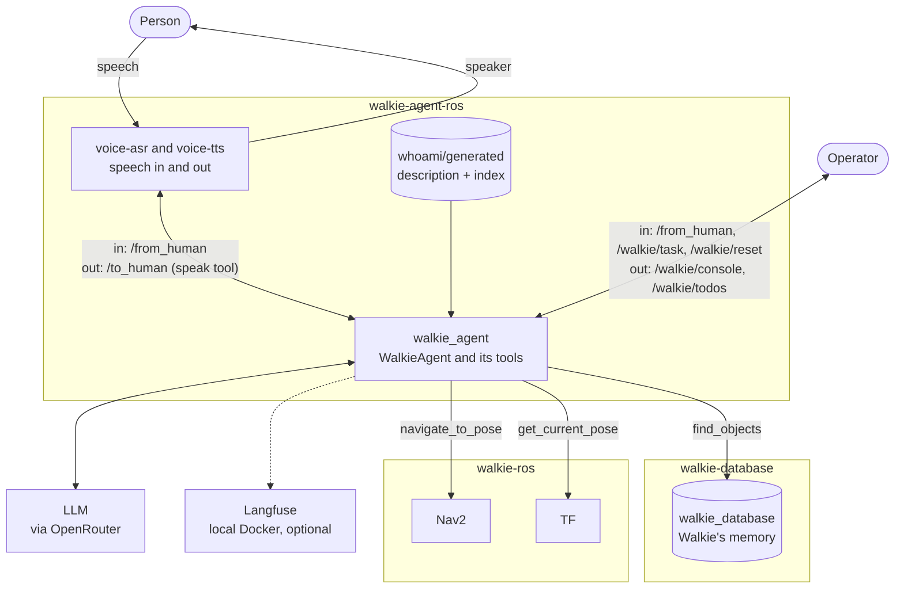
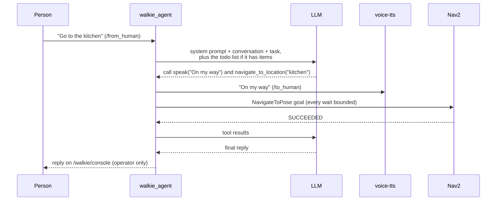
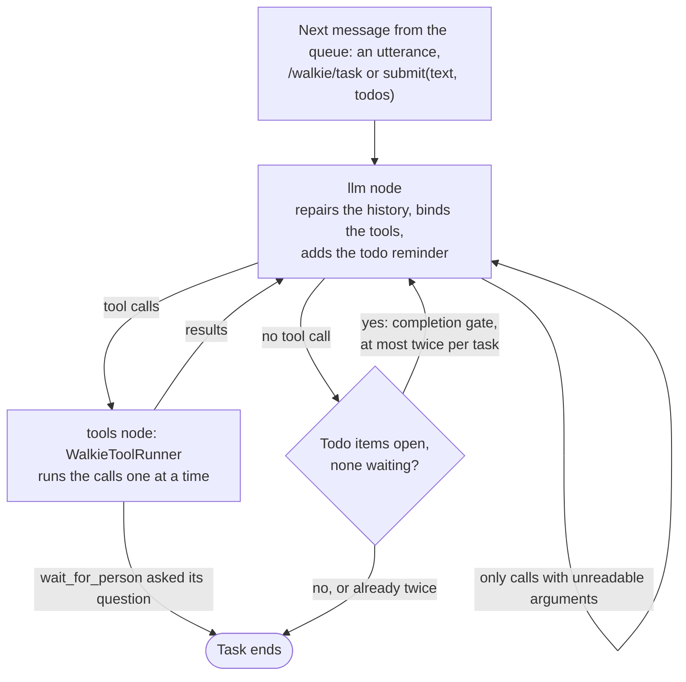
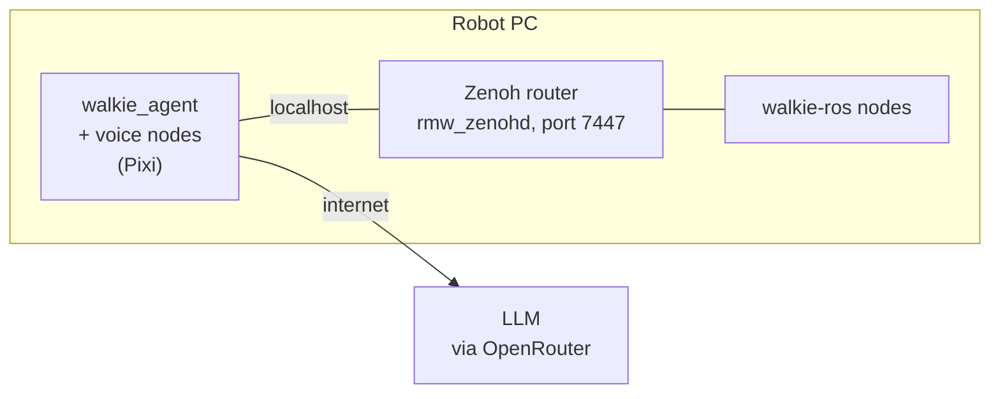

# The Agent

Walkie's agent is one ROS 2 node, `walkie_agent`. It receives tasks from
people, asks an LLM what to do, and acts through a small set of tools. The
robot's own software, including navigation and manipulation, runs in
[walkie-ros](https://github.com/EIC-Robocup-2026/walkie-ros). The agent calls
it over ROS 2.

!!! info "Redesign in progress"
    The agent is being redesigned into a self-evolving agent: see
    [Self-Evolving Agent (Proposed)](self-evolving-agent.md). Phase 1's host
    graph and todo list are built, and so are the toolbox core of phase 2,
    the HRI task's four people and seat atomics, and four arm atomics. The
    rest of the redesign is proposed.
    This page describes the agent as it is today. For a guided tour with
    runnable examples, start at [Learn the Agent](../learn/index.md).

## Summary

- **Built on RAI.** `WalkieAgent` runs its own small graph on RAI's
  `LangChainAgent`. It keeps RAI's connectors, `HRIMessage`, `ToolRunner`
  and tracing, binds the tools on every LLM call, and adds a reset
  ([ADR-0003](decisions/0003-rai-react-agent.md),
  [ADR-0038](decisions/0038-own-graph-per-turn-binding.md),
  [ADR-0008](decisions/0008-reset-topic.md)).
- **A todo list for every task.** For a task with several steps, the LLM
  writes the steps with `update_todos` and marks them as it goes. The rules
  are enforced in code: for example, a step whose tool failed cannot be
  marked completed until that tool succeeds, unless a note explains why.
  A task can also arrive with its steps already seeded, from the operator
  on `/walkie/task` or from a template that an utterance names
  ([ADR-0041](decisions/0041-todo-list-and-seeding.md)).
- **Tasks in, speech and console out.** Tasks arrive on `/from_human`, typed
  or from speech recognition, or on `/walkie/task` with their steps. The
  agent speaks only through the `speak` tool on `/to_human`. Its plain-text
  replies, and one line per change of a step's status, go to the operator
  on `/walkie/console` ([ADR-0007](decisions/0007-speak-tool-and-console.md)).
  The whole todo list is published on `/walkie/todos`.
- **Narrow tools.** Each tool does one named thing, such as "drive to the
  kitchen". There is no raw ROS access, and a forbidden list keeps generic
  tools away from motion topics
  ([ADR-0009](decisions/0009-forbidden-names-guard-rail.md),
  [ADR-0010](decisions/0010-bounded-navigation-tool.md)).
- **Typed atomic tools.** An atomic declares its arguments, output and
  effects, and fails with one of 13 error codes. It runs with a shared
  `ctx` and passes handles, short ids for what it saw
  ([ADR-0037](decisions/0037-tool-tiers-bundles-effects.md)). Four find
  people and seats, and recognize and remember people
  ([HRI Task](hri.md#atomics)). With `--arms`, four more move the arms and
  grippers to named poses through walkie-ros's commander
  ([Arm Manipulation](manipulation.md#tools)).
- **Knows what it is.** rai_whoami adds a description of Walkie to the system
  prompt and a search tool over its documents
  ([ADR-0011](decisions/0011-whoami-identity.md)).
- **Agent-side only.** This repository holds the agent, its configuration and
  fakes for testing. Robot nodes live in walkie-ros
  ([ADR-0015](decisions/0015-repository-boundary.md),
  [ADR-0016](decisions/0016-talk-to-walkie-ros-directly.md)). The vision
  models will run in a new robot-side repository, walkie-vision
  ([ADR-0034](decisions/0034-vision-models-in-walkie-vision.md)).
- **Reads Walkie's memory.** `find_objects` asks the walkie-database node
  where objects of one kind were last seen. The agent reads the memory only
  through the node's ROS 2 services
  ([ADR-0035](decisions/0035-memory-through-walkie-database.md)).
- **On the robot PC.** The agent will run next to walkie-ros and reach it
  over rmw_zenoh on the same computer
  ([ADR-0017](decisions/0017-rmw-zenoh-domain-23.md)). Every Pixi command
  already uses rmw_zenoh
  ([ADR-0033](decisions/0033-zenoh-in-every-pixi-environment.md)).

## Components



The voice box is two nodes, speech recognition and text-to-speech. Speech
recognition ignores the microphone while Walkie speaks, so Walkie does not
hear itself ([ADR-0029](decisions/0029-half-duplex-voice.md)). See
[Voice](../setup/07-voice.md) for how they connect.

`pixi run fake-walkie` stands in for the robot during development: it
serves the Nav2 action and TF, and listens on the speech topic. It has no
memory. `find_objects` needs the walkie-database node, see
[Getting Started](../getting-started.md#ask-walkies-memory). It publishes
no `/walkie_vision/people` or `/walkie_vision/objects`, so `find_people`
and `find_seats` fail with `UNAVAILABLE`.

## How a task runs



Messages wait in a queue. When the agent is idle, it takes the oldest one
and runs it as a task until the LLM stops calling tools. An utterance that
arrives during a task waits until the task ends. RAI's default would
interrupt the task instead, and at a noisy booth any overheard speech would
then cancel the current step
([ADR-0038](decisions/0038-own-graph-per-turn-binding.md)). Every task
joins the same conversation, so the LLM also sees the earlier tasks until a
reset.

### The agent's graph

`build_walkie_graph()` in `src/walkie_agent/graph.py` builds the graph.
Its nodes change RAI's message list in place, so a reset and the tests
work on the same history as the graph.



- **llm node.** It puts the system prompt first and repairs the history.
  Then it binds the tools in `agent.tools` and calls the LLM. The tools are
  bound on every call, so a tool added during a task is callable on the
  next turn. Phase 1 binds every tool. Above 20 tools it logs a warning,
  once per count, because a small local model copes poorly with that many.
- **History repair.** OpenAI-compatible endpoints reject an AI message
  whose tool calls have no results. That happens when a stop lands after
  the LLM asked for tools but before they ran, or when an error ends a
  turn halfway. Before every LLM call, each such call gets an
  error result, "Interrupted before it ran.", right after its AI message.
  A call whose arguments are not valid JSON never runs either. LangChain
  keeps it apart from the other calls, but still sends it back to the
  endpoint, so it gets the error "The arguments were not a valid JSON
  object, so the call did not run." When the LLM made no other call, the
  graph goes straight back to the llm node, so the LLM can try again.
- **tools node.** `WalkieToolRunner` is a subclass of RAI's `ToolRunner`,
  so the calls still run one at a time with RAI's error handling. It
  reports whether each call succeeded to the todo list's error ledger. A
  call to a tool that does not exist, such as `fly`, gets the error
  "Unknown tool fly." and the task goes on. Only the first `update_todos`
  call in one LLM answer is applied. Any later one gets an error that asks
  for all the changes in one call.
- **Completion gate.** The LLM may answer without a tool call while todo
  items are still open and none is waiting. The graph then saves this
  message in the history and calls the LLM again: "[todo] Open items: t3,
  t4. Finish them, or mark them failed or cancelled with a note." It does
  this at most twice per task.
- **`wait_for_person` ends the task.** It speaks the question and marks the
  step in progress as waiting. The task then ends, with no completion gate.
  The person's answer arrives as the next message and puts the step back in
  progress. Any tool calls after the question in the same LLM reply do not
  run; each is answered "Not run" so the LLM can repeat it after the answer.
  If the question could not be spoken, the call fails and the task goes on,
  so the LLM can try something else.
- **At most 100 graph steps per task,** about 50 rounds of tool calls.
  LangGraph's default of 25 is too few for a seeded task with several
  steps. Past the limit, the task stops with a logged error.

### The todo list in each turn

When the list has items, each LLM call gets it as one extra human message
at the end. That message is not saved in the history, so the history holds
only what happened. It is a human message, not a system message, because
some providers reject a system message that is not first.

```text title="Todo reminder"
<todos>
[x] t1 Go to the kitchen
[>] t2 Pick up the red mug
[ ] t3 Come back to the person
</todos>
```

`[ ]` is pending, `[>]` in progress, `[?]` waiting for an answer, `[x]`
completed, `[!]` failed and `[-]` cancelled.

When the next task starts, a list with no open items is cleared, so a
finished list does not carry over. A list with open items is kept, for
example while the agent waits for an answer.

`WalkieAgent.submit(text, todos)` queues a task with its steps already
written. The seed replaces the list when that task starts, before the first
LLM call. Seeded steps cannot be reworded or removed. A bad seed raises
`TodoRejected` from `submit()` at once, not later on the agent thread.
The operator can seed a task over ROS on `/walkie/task`, and an utterance
can start a template
([ADR-0041](decisions/0041-todo-list-and-seeding.md)).

### Seeding a task on /walkie/task

`/walkie/task` takes a `std_msgs/msg/String` that holds a JSON object in
one of two forms:

```json title="With its steps"
{"task": "Bring me a cup from the kitchen.",
 "todos": ["Go to the kitchen",
           {"content": "Pick up a cup", "active_form": "Picking up a cup"},
           "Come back"]}
```

```json title="With a template"
{"task": "Two guests are on their way.", "template": "hri"}
```

- **`todos`** is the same list that `submit()` takes. A step is a string,
  or an object with `content` and, optionally, `active_form` and
  `requires_tool`.
- **`template`** names a template in `config/task_templates.toml`. The LLM
  gets the message's task, a blank line and the template's task text. The
  template's steps are seeded.
- **Seeded steps from this topic have the source `operator`.** The task
  joins the same queue as an utterance.
- **A malformed message is logged as a warning and ignored.** Examples are
  text that is not JSON, an unknown key, both or neither of `todos` and
  `template`, an unknown template or a bad step. The topic keeps working.

### Task templates

`config/task_templates.toml` holds named templates, one
`[templates.<name>]` table each. The shipped file has only a commented
example. `--task-templates` points the agent at another file.

```toml title="config/task_templates.toml"
[templates.tour]
keywords = ["house tour", "show me around"]
task = """
Show the person the main rooms. In each room, say what it is for.
"""
todos = [
  "Go to the kitchen",
  { content = "Say what the kitchen is for", requires_tool = "speak" },
  "Come back to the person",
]
```

- **`task` and `todos` are required.** `todos` uses the seed format above.
- **`keywords` is optional.** A template without keywords can only be
  started on `/walkie/task`.
- **Matching happens when a task starts.** A task without a seed is matched
  only when no step is open. Its text is checked against each template's
  keywords, in file order, and the first match wins. A keyword matches as
  whole words in any case, so "house tour" matches "Give me a House Tour!"
  but not "a lighthouse tour".
- **A match seeds the template.** The LLM gets the utterance, a blank line
  and the template's task text. The steps get the source `seed`.
- **Why at task start.** A task that is still queued must not start a
  template while an earlier task may still open or finish steps. While a
  step is open, for example while the agent waits for an answer, an answer
  that contains a keyword is just an answer.
- **The file is checked at startup.** A missing file means no templates. A
  bad template, such as an unknown key, no task text or a bad step, stops
  the agent with an error that names the file and the template.

### Following the list

- **`/walkie/todos`** carries the whole list as a JSON array of steps, in a
  `std_msgs/msg/String`, after every change. Each step has all its fields,
  such as `id`, `content`, `status`, `note` and `source`. It is reliable,
  transient-local and keeps one message, so a viewer that starts late
  still gets the current list. The agent publishes `[]` at startup and
  after a reset.
- **`/walkie/console`** gets one line for each change of a step's status.
  A step that goes in progress shows its active form, or its content when
  it has none: `t1: Going to the kitchen`. A step that is completed,
  failed, cancelled or waiting shows its content:
  `t1 completed: Go to the kitchen`. A new pending step shows no line.
  These lines are never spoken.

### Stop, reset and errors

- **Stop.** An utterance that is just "stop", "never mind" or "nevermind"
  interrupts a running task. Case, extra spaces and `.`, `,`, `!` or `?`
  around it are ignored, so "Stop." counts, but "Walkie, stop" and "stop
  the music" do not. Messages queued before it are dropped, with their
  seeds. The stop message itself runs next, so the LLM can cancel the open
  steps and say so. While the agent is idle, "stop" is an ordinary message.
- **Reset.** A message on `/walkie/reset` drops the queued messages and
  their seeds, and stops the running task. Before the next task, the agent
  clears the history, the todo list and the handles, publishes `[]` on
  `/walkie/todos` and starts a new Langfuse session
  ([ADR-0008](decisions/0008-reset-topic.md)).
- **Both act between steps.** All tool calls from one LLM answer run inside
  one step of the graph, and a stop or a reset is noticed only between
  steps. A tool that is already running finishes first, unless it is an
  atomic waiting in `ctx.wait()`, which ends at once
  ([Stop, reset and the cancel](#stop-reset-and-the-cancel)). If the stop
  lands after the LLM asked for tools, those tools never run, and the
  history repair answers them.
- **Errors.** An error from the LLM or the graph is logged, and the agent
  goes on to the next message. In RAI's own loop, such an error ends the
  agent thread. If the error left tool calls without results, the history
  repair answers them on the next call.

## Tools

| Tool                              | From       | What it does                                                    |
| --------------------------------- | ---------- | --------------------------------------------------------------- |
| `speak`                           | this repo  | Says a sentence out loud through `/to_human`                    |
| `list_locations`                  | this repo  | Lists the named places in `config/locations.toml`               |
| `navigate_to_location`            | this repo  | Drives to a named place with Nav2, with every wait bounded      |
| `move_relative`                   | this repo  | Moves up to 3 m forward, back or sideways from here, then turns |
| `find_objects`                    | this repo  | Asks walkie-database where objects of one kind were last seen   |
| `update_todos`                    | this repo  | Adds, updates and removes steps on the task's todo list, by id  |
| `wait_for_person`                 | this repo  | Asks the person a question out loud and ends the task until they answer |
| `get_current_pose`                | RAI        | Reads the robot's position in the `map` frame from TF           |
| `get_ros2_topics_names_and_types` | RAI        | Lists ROS topics, minus the forbidden ones                      |
| `WaitForSecondsTool`              | RAI        | Waits a number of seconds                                       |
| `search_robot_docs`               | rai_whoami | Searches Walkie's documentation (only after `pixi run whoami-build`) |
| `find_people`                     | atomic     | Lists the people in view, left to right, as person handles with their posture and gestures |
| `find_seats`                      | atomic     | Lists the places to sit in view, left to right, as seat handles, each free or taken |
| `recognize_person`                | atomic     | Names people met before, by face, else by appearance. Only with `--mock-people-memory` |
| `remember_person`                 | atomic     | Stores a person's name, facts, and face and appearance vectors. Only with `--mock-people-memory` |
| `list_arm_poses`                  | atomic     | Lists the named arm poses, which arms each can move, and whether it is safe for driving. Only with `--arms` |
| `move_arm_to_pose`                | atomic     | Moves one arm or both to a named pose, then checks the joints. Only with `--arms` |
| `set_gripper`                     | atomic     | Opens, half-opens or closes one gripper or both; after a close, says whether it holds something. Only with `--arms` |
| `get_arm_state`                   | atomic     | Reports the named pose each arm is in, whether it is safe for driving, and each gripper's last command. Only with `--arms` |

`find_objects` calls `/walkie_database/find_objects` with a label and asks
for at most 5 objects. It returns each object's room and position on the
map, most recently seen first. The database node's `map_id` parameter
decides which map is searched. The tool waits up to 2 s for the node to
appear and reports memory as unavailable after that. It then waits up to
5 s for the answer. A node that does not answer in time is reported to the
LLM as busy, and the agent's log says that the node may have been built
from a different `walkie_database_msgs` than the pinned commit
([ADR-0035](decisions/0035-memory-through-walkie-database.md)).

When `navigate_to_location`, `move_relative`, `speak` or `find_objects`
fails, the LLM reads a sentence saying why, and the result is marked as an
error. The todo list counts only successful calls as evidence that a step
was done ([ADR-0041](decisions/0041-todo-list-and-seeding.md)). Finding no
remembered object is a successful search.

`update_todos` applies all its changes or none. A refused change, such as
completing a step whose tool failed, comes back to the LLM as an error that
says why. `wait_for_person` speaks through the same `speak` tool. When no
speech node is listening, it fails and the task goes on.

The [arm manipulation design](manipulation.md) adds two skill tools later.

The atomic tools come from `src/walkie_agent/tools/atomic/` and are added
after the others. A failure reaches the LLM as `CODE: message`, see
[Typed atomic tools](#typed-atomic-tools). `find_people` and `find_seats`
always load. `recognize_person` and `remember_person` need the
`people_memory` backend, which only `--mock-people-memory` adds today, see
[Where atomics live](#where-atomics-live). The HRI task's page shows what
each one returns ([HRI Task](hri.md#atomics)). The four arm atomics need
the `arm` backend, which only `--arms` adds. Every arm tool ends its answer
with "Arms: safe for driving.", "Arms: not safe for driving." or "Arms:
state unknown." ([Arm Manipulation](manipulation.md#tools)).

With `--arms`, `navigate_to_location` and `move_relative` also check the
arms before they drive
([ADR-0025](decisions/0025-travel-safe-interlock.md)). They refuse while an
arm is out of every pose that is safe for driving, or still moving. When the
commander does not answer, they drive, and add "Arm state unknown: the
commander did not answer." to the result.

For the full list of topics, see
[Getting Started](../getting-started.md).

## Typed atomic tools

The toolbox core of phase 2 is built in `src/walkie_agent/toolbox/`: typed
atomic tools, the `ctx` they run with, and handles
([ADR-0037](decisions/0037-tool-tiers-bundles-effects.md)). Eight atomics
ship. Four are the HRI task's people and seat tools: `find_people`,
`find_seats`, `recognize_person` and `remember_person`
([HRI Task](hri.md#atomics)). Four are arm tools: `list_arm_poses`,
`move_arm_to_pose`, `set_gripper` and `get_arm_state`
([Arm Manipulation](manipulation.md#tools)). Bundles, the linker, access
levels and tool search are not built
([Self-Evolving Agent](self-evolving-agent.md#tiers-and-folders)).

### An atomic

An atomic is one module in `src/walkie_agent/tools/atomic/`. It defines
four names:

| Name | What it is |
| ---- | ---------- |
| `META` | A `ToolMeta`: the tool's name, description, effects, questions and examples |
| `Args` | A pydantic model of the arguments. It is the schema the LLM sees, field descriptions included |
| `Out` | A subclass of `ToolOutput`. Its `summary` is all the LLM sees on success. Other fields are for Python callers |
| `run(ctx, args)` | Does the work and returns an `Out`, or raises `StepError` |

This example is not in the repository. It reads the robot's heading from
TF:

```python title="src/walkie_agent/tools/atomic/get_heading.py (example)"
"""Say which way the robot faces on the map."""

import math
from typing import Literal

from pydantic import BaseModel, Field

from walkie_agent.toolbox import Effect, ToolContext, ToolMeta, ToolOutput

META = ToolMeta(
    name="get_heading",
    description="Says which way the robot faces, as an angle from the map's x axis.",
    effects=frozenset({Effect.R}),
    questions=(
        "Which way are you facing?",
        "What is your heading?",
        "How far have you turned from the map's x axis?",
    ),
    examples=({}, {"unit": "radians"}),
)


class Args(BaseModel):
    unit: Literal["degrees", "radians"] = Field("degrees", description="The unit of the answer.")


class Out(ToolOutput):
    yaw_rad: float


def run(ctx: ToolContext, args: Args) -> Out:
    # Raises StepError UNAVAILABLE when TF has no map -> base_footprint.
    pose = ctx.robot_pose()
    if args.unit == "radians":
        summary = f"I face {pose.yaw:.2f} rad from the map's x axis."
    else:
        summary = f"I face {math.degrees(pose.yaw):.0f} degrees from the map's x axis."
    return Out(summary=summary, yaw_rad=pose.yaw)
```

The LLM calls `get_heading` with `{}` and reads "I face 90 degrees from the
map's x axis." Python code calls `AtomicTool.call(unit="radians")` and gets
the `Out` itself, `yaw_rad` included.

`ToolMeta` is frozen and rejects unknown fields, so a misspelt field fails
when the agent starts instead of being ignored.

| Field | Rule |
| ----- | ---- |
| `name` | 3 to 48 characters: a lowercase letter, then lowercase letters, digits or `_`. It must equal the module's name |
| `description` | Not blank. The LLM reads it as the tool's description |
| `effects` | A set of [effects](#effects). It may be empty |
| `questions` | 3 to 5 spoken-style requests the tool answers, for the future tool search |
| `examples` | At least one arguments dict. Each must fit `Args` |
| `status` | `"verified"`, the default, or `"draft"` |
| `created_by` | `"human"` by default |
| `runtime` | Only `"inprocess"`. Sandbox workers come later |
| `requires` | The backend names the tool needs, none by default. See [Where atomics live](#where-atomics-live) |

[ADR-0037](decisions/0037-tool-tiers-bundles-effects.md) also gives an
atomic `META.ros` and `META.net`, the ROS names and hosts it uses, for the
ctx to enforce. They are not built yet, so `ToolMeta` rejects them. Until
then the ctx enforces only the forbidden names.

### Effects

An atomic declares what it does to the world in `META.effects`.

| Effect | Meaning |
| ------ | ------- |
| `R` | reads stored or robot state |
| `P` | perceives or computes |
| `S` | speaks or plays a sound |
| `N` | moves the base |
| `M` | moves an arm or gripper |
| `W` | writes to the robot's memory. Provisional, see below |

- **`META.idempotent`** is true when the effects are only `R` and `P`, or
  none, so a retry is safe.
- **Nothing checks effects yet.** The linker and the access levels that use
  them are not built ([ADR-0039](decisions/0039-access-levels.md)).
- **`W` is provisional.** `remember_person` writes to the people memory,
  the mock today and walkie-database later, and no decided effect covers
  that
  ([Perception question 3](perception.md#open-questions)). Until the
  question is decided, a `W` tool is a reviewed atomic that generated tools
  may never call.

### Error codes

An atomic fails by raising `StepError(code, message, data)`. `message` is
a plain sentence for the LLM. `data` is an optional dict for code, such as
the candidates of an `AMBIGUOUS` match. `str(err)` is `"CODE: message"`,
and an unknown code raises `ValueError`. The codes and their meanings are
`ERROR_CODES` in `src/walkie_agent/toolbox/types.py`:

| Code | Meaning |
| ---- | ------- |
| `UNAVAILABLE` | a backend, server or topic is missing or not answering |
| `TIMEOUT` | the operation started but did not finish in time |
| `NOT_FOUND` | nothing matches: no one in view, an unknown handle or pose name |
| `AMBIGUOUS` | several things match and the tool will not guess |
| `OUT_OF_REACH` | the target is beyond what the arm or base may reach |
| `STALE` | a handle is too old, or the robot has moved since it was captured |
| `REFUSED` | a rule forbids the request as asked, such as a value out of range |
| `PRECONDITION_FAILED` | the robot is not in the state the call needs, such as an arm out before driving ([ADR-0025](decisions/0025-travel-safe-interlock.md)) |
| `SKILL_FAILED` | the robot-side motion or skill ran and failed, such as no MoveIt plan |
| `POSTCONDITION` | the backend reported success but the check after it failed, such as a joint off its target or an empty gripper |
| `SAFETY_STOP` | an emergency stop or safety controller ended the motion |
| `CANCELLED` | a reset, a stop or a newer command interrupted it |
| `INTERNAL` | a bug in the tool |

### How a failure reaches the LLM

`AtomicTool` wraps one atomic as a LangChain tool, with
`handle_tool_error` on.

| What happens | What the LLM reads | Status |
| ------------ | ------------------ | ------ |
| `run` returns its `Out` | the `summary` | `success` |
| `run` raises `StepError` | `CODE: message`, such as `NOT_FOUND: per_51c0.7 is not a known handle.` | `error` |
| `run` raises any other exception | `INTERNAL: <type>: <message>`. The traceback goes to the log | `error` |
| `run` returns something else | `INTERNAL: get_heading returned str instead of Out.` | `error` |
| The arguments do not fit `Args` | RAI's usual "Validation error in tool get_heading" message. `run` is not called | `error` |

- **Every error counts as a failed call** in the todo list's error ledger,
  as it does for today's tools. A step whose tool failed cannot be
  completed until the tool succeeds, unless a note explains why
  ([ADR-0041](decisions/0041-todo-list-and-seeding.md)).
- **No artifact.** The ToolMessage holds only text, because RAI pickles
  every artifact to disk. The full `Out` stays with Python callers.
- **`AtomicTool.call(**kwargs)`** runs the same path for Python code. It
  returns the `Out`, and raises `StepError`, `INTERNAL` included, or
  pydantic's `ValidationError`.

### Handles

A handle is a short id that stands for something a tool saw, such as a
person or a seat. A perception atomic stores what it found as a set, and
the LLM passes a member's id to a later call, in the same turn or after a
spoken question. `ctx.handles` is the `HandleStore` that keeps them.

- **`put_set(kind, payloads, pose=None)`** stores the payloads as one
  set, with the time and the robot's pose, from TF unless `pose` is
  given. It returns a `HandleSet`: the set's id, such
  as `per_51c0`, and one member id per payload, in order: `per_51c0.0`,
  `per_51c0.1`. An id is the kind's prefix, `_`, 4 hex digits that no
  other live set uses, `.` and the member's index.
- **`get(handle_id, kind=...)`** returns one `Handle`, with its `id`,
  `kind`, `payload`, `pose` and `captured_at`. **`get_set(set_id,
  kind=...)`** returns every member, in order. Both run the checks below.
- **At most 64 sets** are kept. The oldest is dropped first.

Each kind has a `KindPolicy`: its id prefix, three limits and, optionally,
the tool its handles come from. A limit of `None` is not checked. Three
kinds are registered:

| Kind | Prefix | Stale after | Source | Registered by |
| ---- | ------ | ----------- | ------ | ------------- |
| `object` | `obj` | 5 cm or 3 degrees of base motion, or 600 s | none | the store itself |
| `person` | `per` | 5 cm of base translation, or 600 s | `find_people` | `tools/atomic/_perception.py` |
| `seat` | `seat` | 5 cm of base translation, or 600 s | `find_seats` | `tools/atomic/_perception.py` |

- **600 s leaves time for a spoken question.**
- **A turn does not stale a person or seat handle.** The gaze loop turns
  the base, a person handle names a track, and a seat handle keeps a
  map-frame heading.
- **Kinds register at import,** with `register_kind(kind, policy)`, when
  the atomics load. Registering the same policy twice is fine.
- **Still open.** How long a person handle stays valid is
  [Perception question 8](perception.md#open-questions).

A lookup checks, in this order:

| Check | Error |
| ----- | ----- |
| The id is malformed or unknown, or the set has no such member | `NOT_FOUND: per_ffff.0 is not a known person handle.` |
| The handle is of another kind than the caller asked for | `NOT_FOUND: seat_09ab.1 is a seat, not a person.` |
| It is older than the kind's age limit | `STALE: obj_3f2a is stale: it was captured 700 s ago, and an object handle lasts 600 s.` |
| The base has moved farther than the limit since capture | `STALE: obj_3f2a.0 is stale: the robot has moved 0.12 m since it was captured, more than the 0.05 m allowed.` |
| The base has turned more than the limit, compared with wrap-around | `STALE: obj_3f2a.0 is stale: the robot has turned 10 degrees since it was captured, ...` |
| The kind has a motion limit, but the pose at capture or now is unknown | `UNAVAILABLE: The robot's position is unknown, so the handle cannot be checked.` |

- **A hint for a new handle.** When a kind names its source, its
  `NOT_FOUND` and `STALE` messages end with a hint, such as "Person handles
  come from find_people."
- **The pose comes from TF,** through `ctx.robot_pose()`. When TF has no
  pose, the set is stored without one, and the motion checks report
  `UNAVAILABLE`.
- **Person and seat handles pass the pose at the image's stamp.**
  `find_people` and `find_seats` look up `map` -> `base_footprint` at the
  stamp and give it as `pose`, so a drive between the image and the call
  counts. Without it they store nothing and fail with `UNAVAILABLE`.
- **Age is measured in real time,** on the agent's monotonic clock, not
  the node clock. Under sim time, a handle ages with the computer's clock.

Handles belong to a task. The store is cleared whenever a new task
replaces the todo list:

| When | Handles |
| ---- | ------- |
| A reset is applied, before the next task | Cleared |
| A seed from `submit()` or `/walkie/task` replaces the list | Cleared |
| A template seeds the list | Cleared |
| A finished list is cleared as the next task starts | Cleared |
| The answer to a `wait_for_person` question, or any message while steps are open | Kept |
| A message with no seed and no template while the list is empty | Kept, and still bounded by their limits |

The answer keeps them because the question may be about one of them: the
HRI task calls `find_people`, asks the guest's name, and calls
`remember_person` on the same handle in the next turn. The mock people
memory is cleared at the same moments, through `Toolbox.on_new_task`.

### The ctx

Every `run(ctx, args)` gets the same `ToolContext`. Atomics reach ROS,
their backends and the handles only through it, so the guard rails live in
one place.

| Member | What it does |
| ------ | ------------ |
| `connector`, `node`, `logger` | RAI's `ROS2Connector`, its rclpy node, and a logger |
| `backend(name)`, `has_backend(name)` | The clients passed to `Toolbox` by name, such as `"arm"`. A missing one raises `UNAVAILABLE`. Tests pass fakes |
| `handles` | The `HandleStore` above |
| `cancel`, `check_cancelled()` | A `threading.Event` that a stop or a reset sets. `check_cancelled()` then raises `CANCELLED` |
| `wait(future, timeout_s, what="The call")` | Waits for a future that the connector's executor completes, and returns its result. Raises `TIMEOUT: <what> did not finish within <timeout_s> s.`, or `CANCELLED` within 50 ms of a stop or a reset |
| `now()` | The node clock's time, which follows `/clock` under sim time |
| `robot_pose(timeout_s=1.0)` | A `Pose2D` (`x`, `y`, `yaw`) from the latest TF `map` -> `base_footprint`. Raises `UNAVAILABLE`, with `move_relative`'s hint when no node publishes `/tf` |
| `tf_buffer` | The node's TF buffer, for a transform at an image's stamp: the camera's, as `camera_transform` needs, and the base's, for a handle's pose at capture. It is RAI's private `connector._tf_buffer`, reused so that each node keeps one buffer and one listener. Recheck it on every rai-core upgrade |
| `subscription(msg_type, topic, callback, qos)`, `publisher(msg_type, topic, qos)`, `service_client(srv_type, name)`, `action_client(action_type, name)` | The node's entity for that name, created on the first call |

- **`wait()` leaves the future alone.** After a `TIMEOUT` or `CANCELLED`,
  the atomic cancels its goal or drops its request itself.
- **`robot_pose()` takes the latest transform, however old.**
  `move_relative` waits for one stamped after the call instead.
- **One entity per name.** rclpy entities must not be created per call, so
  each is kept by kind and name. Asking again with another type, callback
  or QoS raises `ValueError`.
- **Names as the node resolves them.** The check below and the cache use
  the resolved name, so a relative name such as `cmd_vel`, or a remap onto
  a forbidden name, is caught, and `cmd_vel` and `/cmd_vel` are one entity.
- **Forbidden names.** An entity on a name in `FORBIDDEN_NAMES` raises
  `ValueError`, unless the call passes that exact name in
  `allow_forbidden`. It is a `ValueError`, not a `StepError`, because it is
  a bug in reviewed code: it must fail the tests, not reach the LLM. The
  one planned exception is the gaze loop, which passes
  `allow_forbidden=("/cmd_vel",)`
  ([ADR-0051](decisions/0051-agent-side-gaze-loop.md)). Like the list
  itself, this is a guard rail, not a security boundary
  ([ADR-0009](decisions/0009-forbidden-names-guard-rail.md)).

### Stop, reset and the cancel

- **A stop or a reset cancels a running atomic at once.** `reset()`,
  `stop()` and a stop utterance during a task set `ctx.cancel`, so an
  atomic waiting in `ctx.wait()` ends with `CANCELLED` instead of finishing
  its step. Today's tools do not see the cancel, so a navigation goal
  still finishes first.
- **The cancel reaches the right run.** It is set under the agent's buffer
  lock, the same lock under which a starting run clears it. A cancel set
  after a run started cancels that run. One set before is cleared when the
  next run starts, so a new task never inherits an old cancel.
- **Listeners.** `Toolbox.on_interrupt(callback)` and
  `on_new_task(callback)` let later parts react, such as the gaze loop
  stopping on an interrupt. Interrupt listeners run after the lock is
  released, because one may block. A listener that raises is logged, and
  the others still run.
- **No run starts during the listeners.** The interrupt counts as
  pending from the cancel until its last listener returns. Until then
  `Toolbox.begin_task()` refuses, and the agent leaves the next message
  queued. Otherwise a slow listener could act on the new run, such as
  stopping a `look_at` the new task just started. The check and the clear
  of the cancel are one step under the toolbox's lock, so this holds for
  `Toolbox.interrupt()` from any thread too. The cost: a listener that
  never returns holds back every later task, so listeners must return
  promptly.

### Where atomics live

- **One module per atomic** in `src/walkie_agent/tools/atomic/`, named
  like its `META.name`. Modules whose names start with `_` are helpers and
  are not loaded as tools.
- **Checked at startup.** `create_walkie_agent` builds one
  `Toolbox(connector, backends)`, which imports every module and checks
  it: `META` is a `ToolMeta` named like the module, `Args` is a pydantic
  model, `Out`
  is a `ToolOutput` subclass, `run` is a plain function that can be called
  as `run(ctx, args)`, every example fits `Args`, and no two atomics share
  a name. All problems
  are collected into one `AtomicLoadError`, and the agent does not start.
  Atomics are reviewed code, so a broken one must stop the agent at
  startup, not at its first call in the middle of a task.
- **Backends.** An atomic whose `META.requires` names a backend the ctx
  lacks is skipped, with one info line in the log. `create_walkie_agent`
  builds every backend before the `Toolbox`.
- **`vision` is always there.** It is a `VisionFeed`, which subscribes to
  `/walkie_vision/people` and `/walkie_vision/objects` once. With no
  publisher it only holds two idle subscriptions, and its reads fail with
  `UNAVAILABLE`.
- **`people_memory` comes only with `--mock-people-memory`.** It is an
  `InMemoryPeopleMemory`, a mock of walkie-database's proposed people
  services. `Toolbox.on_new_task` clears it, so each task starts with no
  guests. `pixi run agent-sim` passes the flag, and `pixi run agent` does
  not. Without it, `recognize_person` and `remember_person` do not load,
  so a robot run never stores guests in a mock that forgets them on
  restart.
- **`arm` comes only with `--arms`.** It is a `CommanderClient`
  (`src/walkie_agent/arm/commander.py`), the agent's one client of
  walkie-ros's `bimanual_commander`. It loads `config/arm_poses.toml` and
  raises `ArmPoseError` when the file is wrong, so the agent does not
  start. `pixi run agent-sim` passes the flag, and `pixi run agent` does
  not, until the MotionSupervisor exists. With it, the arm rules are added
  to the system prompt, and `navigate_to_location` and `move_relative`
  check the arms before they drive. Without a commander running, the arm
  atomics fail with `UNAVAILABLE`, and the robot drives with the arm state
  unknown.
- **After the other tools.** `build_walkie_tools` appends the atomic
  tools. An atomic named like an existing tool stops the agent with a
  `ValueError`, because the agent keeps one tool per name and would
  silently replace the older one.
- **Eight ship.** `find_people`, `find_seats`, `recognize_person` and
  `remember_person`, with what they share in `_perception.py`. The rules
  they use, ported from walkie-agent-v2, are plain functions in
  `src/walkie_agent/perception/`, which tests run without LangChain.
  `list_arm_poses`, `move_arm_to_pose`, `set_gripper` and `get_arm_state`,
  with what they share in `_arm.py`. The pose loader and the pose matching
  are in `src/walkie_agent/arm/`.

## Running on the robot

!!! note "Proposed"
    This part is not built yet. Today the agent drives the fake robot, or
    walkie-ros's MuJoCo simulation with `pixi run agent-sim`
    ([ADR-0030](decisions/0030-mujoco-sim-first.md)). Both run over
    rmw_zenoh
    ([ADR-0033](decisions/0033-zenoh-in-every-pixi-environment.md)).

The agent runs on the robot PC, next to walkie-ros. walkie-ros uses Zenoh as
its ROS 2 middleware (`rmw_zenoh_cpp`) on domain 23. The agent must use the
same middleware, the same domain and the same message definitions, or it
silently sees nothing. A service client built from different definitions
still finds the server, but its requests are never answered
([ADR-0017](decisions/0017-rmw-zenoh-domain-23.md),
[ADR-0018](decisions/0018-pin-robot-interfaces.md),
[ADR-0035](decisions/0035-memory-through-walkie-database.md)).



Only the LLM calls leave the robot PC. The tests stay on Fast DDS, with
fakes, so they need neither a router nor a robot, and running them on the
robot PC does not touch the live robot
([ADR-0019](decisions/0019-test-fakes-fast-dds.md)).

## What lives where

| Piece                                                        | Repository                 |
| ------------------------------------------------------------ | -------------------------- |
| Agent, tools, system prompt, forbidden names                 | walkie-agent-ros           |
| Named locations, task templates, named arm poses             | walkie-agent-ros           |
| Voice nodes, whoami sources, Langfuse setup                  | walkie-agent-ros           |
| Fake robot nodes for tests                                   | walkie-agent-ros           |
| Drivers, ros2_control, Nav2, MoveIt, `bimanual_commander`    | walkie-ros                 |
| URDF, SRDF, joint limits                                     | walkie-ros                 |
| `my_robot_interfaces` and future skill interfaces            | walkie-ros, pinned here    |
| `walkie_perception`: grasp pipeline, classic 3D positions    | walkie-ros                 |
| Vision: detection, embeddings, pose, faces, re-ID, captions  | walkie-vision              |
| `walkie_vision_msgs`                                         | walkie-vision, pinned here |
| Long-term memory: maps, rooms, objects, people, conversations | walkie-database           |
| `walkie_database_msgs`                                       | walkie-database, pinned here |
| Skill server, policy inference                               | walkie-ros (or another robot-side repository) |

The agent does not load the URDF. MoveIt uses it on the robot, and rai_whoami
ignores it ([ADR-0020](decisions/0020-no-urdf-in-agent.md)).

## Decisions

Click a decision to expand it. Green blocks are accepted, blue blocks are
proposed. See [Architecture](index.md) for how to add one.

??? success "ADR-0001: Record architecture decisions · Accepted"

    --8<-- "architecture/decisions/0001-record-architecture-decisions.md:body"

??? success "ADR-0002: Install ROS 2 and Python packages with Pixi and RoboStack · Accepted"

    --8<-- "architecture/decisions/0002-pixi-and-robostack.md:body"

??? success "ADR-0003: Build the agent on RAI's ReActAgent · Accepted, partly superseded by ADR-0038"

    --8<-- "architecture/decisions/0003-rai-react-agent.md:body"

??? success "ADR-0004: Build rai_interfaces from source in ros2_ws · Accepted"

    --8<-- "architecture/decisions/0004-build-rai-interfaces-from-source.md:body"

??? success "ADR-0005: Reach LLMs through OpenRouter with RAI's openai vendor · Accepted"

    --8<-- "architecture/decisions/0005-openrouter-via-openai-vendor.md:body"

??? success "ADR-0006: Trace agent runs with self-hosted Langfuse, off by default · Accepted"

    --8<-- "architecture/decisions/0006-self-hosted-langfuse.md:body"

??? success "ADR-0007: Speak only through the speak tool; plain replies go to the console · Accepted"

    --8<-- "architecture/decisions/0007-speak-tool-and-console.md:body"

??? success "ADR-0008: Reset the conversation with a message on /walkie/reset · Accepted"

    --8<-- "architecture/decisions/0008-reset-topic.md:body"

??? success "ADR-0009: Forbidden ROS names are a guard rail, not a security boundary · Accepted"

    --8<-- "architecture/decisions/0009-forbidden-names-guard-rail.md:body"

??? success "ADR-0010: Navigate to named places with every wait bounded · Accepted"

    --8<-- "architecture/decisions/0010-bounded-navigation-tool.md:body"

??? success "ADR-0011: Give the agent Walkie's identity with rai_whoami · Accepted"

    --8<-- "architecture/decisions/0011-whoami-identity.md:body"

??? success "ADR-0012: Install rai_s2s and rai_whoami from RAI's Git tag 2.12.2 · Accepted"

    --8<-- "architecture/decisions/0012-rai-git-tag-2-12-2.md:body"

??? success "ADR-0013: Use the CUDA 12.1 PyPI builds of torch · Accepted"

    --8<-- "architecture/decisions/0013-cuda-torch.md:body"

??? success "ADR-0014: Document the project with MkDocs Material · Accepted"

    --8<-- "architecture/decisions/0014-mkdocs-material.md:body"

??? success "ADR-0015: Keep only agent-side code in this repository · Accepted, partly superseded by ADR-0034"

    --8<-- "architecture/decisions/0015-repository-boundary.md:body"

??? success "ADR-0016: Call walkie-ros directly and retire walkie-sdk · Accepted"

    --8<-- "architecture/decisions/0016-talk-to-walkie-ros-directly.md:body"

??? note "ADR-0017: Run the agent on the robot PC over rmw_zenoh_cpp on domain 23 · Proposed"

    --8<-- "architecture/decisions/0017-rmw-zenoh-domain-23.md:body"

??? note "ADR-0018: Pin walkie-ros message packages to the robot's deployed commit · Proposed"

    --8<-- "architecture/decisions/0018-pin-robot-interfaces.md:body"

??? note "ADR-0019: Test against in-repo fakes on Fast DDS · Proposed"

    --8<-- "architecture/decisions/0019-test-fakes-fast-dds.md:body"

??? note "ADR-0020: The agent does not load the robot's URDF · Proposed"

    --8<-- "architecture/decisions/0020-no-urdf-in-agent.md:body"

The arm manipulation decisions, ADR-0021 to ADR-0028, are on the
[Arm Manipulation](manipulation.md#decisions) page.

??? success "ADR-0029: Stop listening while Walkie speaks · Accepted"

    --8<-- "architecture/decisions/0029-half-duplex-voice.md:body"

??? success "ADR-0030: Drive walkie-ros's MuJoCo simulation before the real robot · Accepted, partly superseded by ADR-0033 and ADR-0036"

    --8<-- "architecture/decisions/0030-mujoco-sim-first.md:body"

??? success "ADR-0031: Move short distances relative to the robot, bounded in length · Accepted"

    --8<-- "architecture/decisions/0031-bounded-relative-moves.md:body"

??? success "ADR-0032: Build rmw_zenoh_cpp 0.2.11 from source and preload it · Accepted, partly superseded by ADR-0033"

    --8<-- "architecture/decisions/0032-rmw-zenoh-from-source.md:body"

??? success "ADR-0033: Use rmw_zenoh_cpp in every Pixi environment · Accepted"

    --8<-- "architecture/decisions/0033-zenoh-in-every-pixi-environment.md:body"

??? success "ADR-0034: Run the vision models in a new repository, walkie-vision · Accepted"

    --8<-- "architecture/decisions/0034-vision-models-in-walkie-vision.md:body"

??? success "ADR-0035: Read Walkie's memory through walkie-database's ROS 2 services · Accepted"

    --8<-- "architecture/decisions/0035-memory-through-walkie-database.md:body"

??? success "ADR-0036: Run agent-sim on the calling shell's ROS_DOMAIN_ID · Accepted"

    --8<-- "architecture/decisions/0036-agent-sim-shell-domain.md:body"
