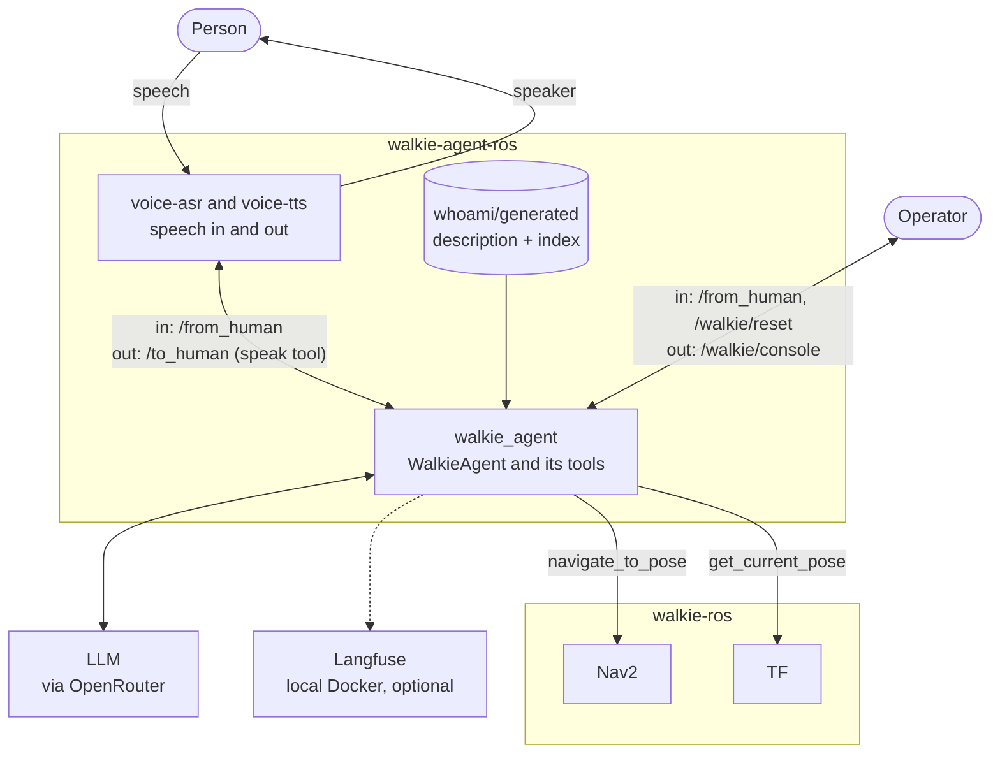
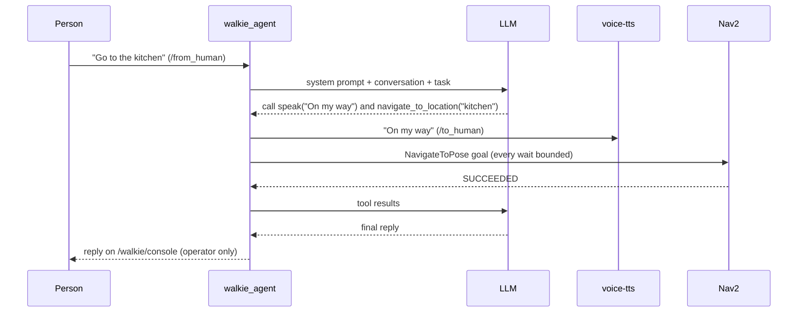
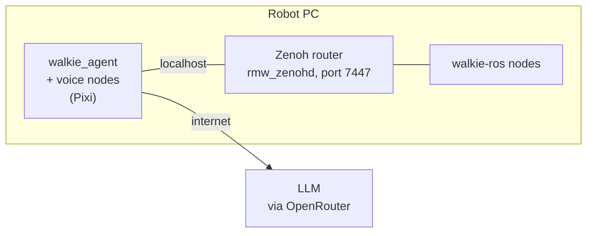

# The Agent

Walkie's agent is one ROS 2 node, `walkie_agent`. It receives tasks from
people, asks an LLM what to do, and acts through a small set of tools. The
robot's own software, including navigation and manipulation, runs in
[walkie-ros](https://github.com/EIC-Robocup-2026/walkie-ros). The agent calls
it over ROS 2.

## Summary

- **Built on RAI.** `WalkieAgent` is RAI's `ReActAgent` with a reset added
  ([ADR-0003](decisions/0003-rai-react-agent.md),
  [ADR-0008](decisions/0008-reset-topic.md)).
- **Tasks in, speech and console out.** Tasks arrive on `/from_human`, typed
  or from speech recognition. The agent speaks only through the `speak` tool
  on `/to_human`. Its plain-text replies go to the operator on
  `/walkie/console` ([ADR-0007](decisions/0007-speak-tool-and-console.md)).
- **Narrow tools.** Each tool does one named thing, such as "drive to the
  kitchen". There is no raw ROS access, and a forbidden list keeps generic
  tools away from motion topics
  ([ADR-0009](decisions/0009-forbidden-names-guard-rail.md),
  [ADR-0010](decisions/0010-bounded-navigation-tool.md)).
- **Knows what it is.** rai_whoami adds a description of Walkie to the system
  prompt and a search tool over its documents
  ([ADR-0011](decisions/0011-whoami-identity.md)).
- **Agent-side only.** This repository holds the agent, its configuration and
  fakes for testing. Robot nodes live in walkie-ros
  ([ADR-0015](decisions/0015-repository-boundary.md),
  [ADR-0016](decisions/0016-talk-to-walkie-ros-directly.md)).
- **On the robot PC.** The agent will run next to walkie-ros and reach it
  over rmw_zenoh on the same computer
  ([ADR-0017](decisions/0017-rmw-zenoh-domain-23.md)).

## Components

The voice box is two nodes, speech recognition and text-to-speech. See
[Voice](../setup/07-voice.md) for how they connect.

`pixi run fake-walkie` stands in for the robot during development: it
serves the Nav2 action and TF, and listens on the speech topic.

## How a task runs

RAI runs the tool calls one at a time. All tool calls from one LLM answer
run inside one step of the agent's graph, and a reset is noticed only
between steps. A tool that is already running finishes first.

## Tools

| Tool                              | From       | What it does                                                    |
| --------------------------------- | ---------- | --------------------------------------------------------------- |
| `speak`                           | this repo  | Says a sentence out loud through `/to_human`                    |
| `list_locations`                  | this repo  | Lists the named places in `config/locations.toml`               |
| `navigate_to_location`            | this repo  | Drives to a named place with Nav2, with every wait bounded      |
| `get_current_pose`                | RAI        | Reads the robot's position in the `map` frame from TF           |
| `get_ros2_topics_names_and_types` | RAI        | Lists ROS topics, minus the forbidden ones                      |
| `WaitForSecondsTool`              | RAI        | Waits a number of seconds                                       |
| `search_robot_docs`               | rai_whoami | Searches Walkie's documentation (only after `pixi run whoami-build`) |

The [arm manipulation design](manipulation.md) proposes four arm tools and,
later, two skill tools.

For the full list of topics, see
[Getting Started](../getting-started.md).

## Running on the robot

!!! note "Proposed"
    This part is not built yet. Today the agent runs on Fast DDS and talks
    only to the fake robot.

The agent runs on the robot PC, next to walkie-ros. walkie-ros uses Zenoh as
its ROS 2 middleware (`rmw_zenoh_cpp`) on domain 23. The agent must use the
same middleware, the same domain and the same message definitions, or it
silently sees nothing
([ADR-0017](decisions/0017-rmw-zenoh-domain-23.md),
[ADR-0018](decisions/0018-pin-robot-interfaces.md)).

Only the LLM calls leave the robot PC. The tests stay on Fast DDS, with
fakes, so they need neither a router nor a robot, and running them on the
robot PC does not touch the live robot
([ADR-0019](decisions/0019-test-fakes-fast-dds.md)).

## What lives where

| Piece                                                        | Repository                 |
| ------------------------------------------------------------ | -------------------------- |
| Agent, tools, system prompt, forbidden names                 | walkie-agent-ros           |
| Named locations, named arm poses                             | walkie-agent-ros           |
| Voice nodes, whoami sources, Langfuse setup                  | walkie-agent-ros           |
| Fake robot nodes for tests                                   | walkie-agent-ros           |
| Drivers, ros2_control, Nav2, MoveIt, `bimanual_commander`    | walkie-ros                 |
| URDF, SRDF, joint limits                                     | walkie-ros                 |
| `my_robot_interfaces` and future skill interfaces            | walkie-ros, pinned here    |
| Perception, skill server, policy inference                   | walkie-ros (or another robot-side repository) |

The agent does not load the URDF. MoveIt uses it on the robot, and rai_whoami
ignores it ([ADR-0020](decisions/0020-no-urdf-in-agent.md)).

## Decisions

Click a decision to expand it. Green blocks are accepted, blue blocks are
proposed. See [Architecture](index.md) for how to add one.

??? success "ADR-0001: Record architecture decisions · Accepted"

    --8<-- "architecture/decisions/0001-record-architecture-decisions.md:body"

??? success "ADR-0002: Install ROS 2 and Python packages with Pixi and RoboStack · Accepted"

    --8<-- "architecture/decisions/0002-pixi-and-robostack.md:body"

??? success "ADR-0003: Build the agent on RAI's ReActAgent · Accepted"

    --8<-- "architecture/decisions/0003-rai-react-agent.md:body"

??? success "ADR-0004: Build rai_interfaces from source in ros2_ws · Accepted"

    --8<-- "architecture/decisions/0004-build-rai-interfaces-from-source.md:body"

??? success "ADR-0005: Reach LLMs through OpenRouter with RAI's openai vendor · Accepted"

    --8<-- "architecture/decisions/0005-openrouter-via-openai-vendor.md:body"

??? success "ADR-0006: Trace agent runs with self-hosted Langfuse, off by default · Accepted"

    --8<-- "architecture/decisions/0006-self-hosted-langfuse.md:body"

??? success "ADR-0007: Speak only through the speak tool; plain replies go to the console · Accepted"

    --8<-- "architecture/decisions/0007-speak-tool-and-console.md:body"

??? success "ADR-0008: Reset the conversation with a message on /walkie/reset · Accepted"

    --8<-- "architecture/decisions/0008-reset-topic.md:body"

??? success "ADR-0009: Forbidden ROS names are a guard rail, not a security boundary · Accepted"

    --8<-- "architecture/decisions/0009-forbidden-names-guard-rail.md:body"

??? success "ADR-0010: Navigate to named places with every wait bounded · Accepted"

    --8<-- "architecture/decisions/0010-bounded-navigation-tool.md:body"

??? success "ADR-0011: Give the agent Walkie's identity with rai_whoami · Accepted"

    --8<-- "architecture/decisions/0011-whoami-identity.md:body"

??? success "ADR-0012: Install rai_s2s and rai_whoami from RAI's Git tag 2.12.2 · Accepted"

    --8<-- "architecture/decisions/0012-rai-git-tag-2-12-2.md:body"

??? success "ADR-0013: Use the CUDA 12.1 PyPI builds of torch · Accepted"

    --8<-- "architecture/decisions/0013-cuda-torch.md:body"

??? success "ADR-0014: Document the project with MkDocs Material · Accepted"

    --8<-- "architecture/decisions/0014-mkdocs-material.md:body"

??? success "ADR-0015: Keep only agent-side code in this repository · Accepted"

    --8<-- "architecture/decisions/0015-repository-boundary.md:body"

??? success "ADR-0016: Call walkie-ros directly and retire walkie-sdk · Accepted"

    --8<-- "architecture/decisions/0016-talk-to-walkie-ros-directly.md:body"

??? note "ADR-0017: Run the agent on the robot PC over rmw_zenoh_cpp on domain 23 · Proposed"

    --8<-- "architecture/decisions/0017-rmw-zenoh-domain-23.md:body"

??? note "ADR-0018: Pin walkie-ros message packages to the robot's deployed commit · Proposed"

    --8<-- "architecture/decisions/0018-pin-robot-interfaces.md:body"

??? note "ADR-0019: Test against in-repo fakes on Fast DDS · Proposed"

    --8<-- "architecture/decisions/0019-test-fakes-fast-dds.md:body"

??? note "ADR-0020: The agent does not load the robot's URDF · Proposed"

    --8<-- "architecture/decisions/0020-no-urdf-in-agent.md:body"

The arm manipulation decisions, ADR-0021 to ADR-0028, are on the
[Arm Manipulation](manipulation.md#decisions) page.
