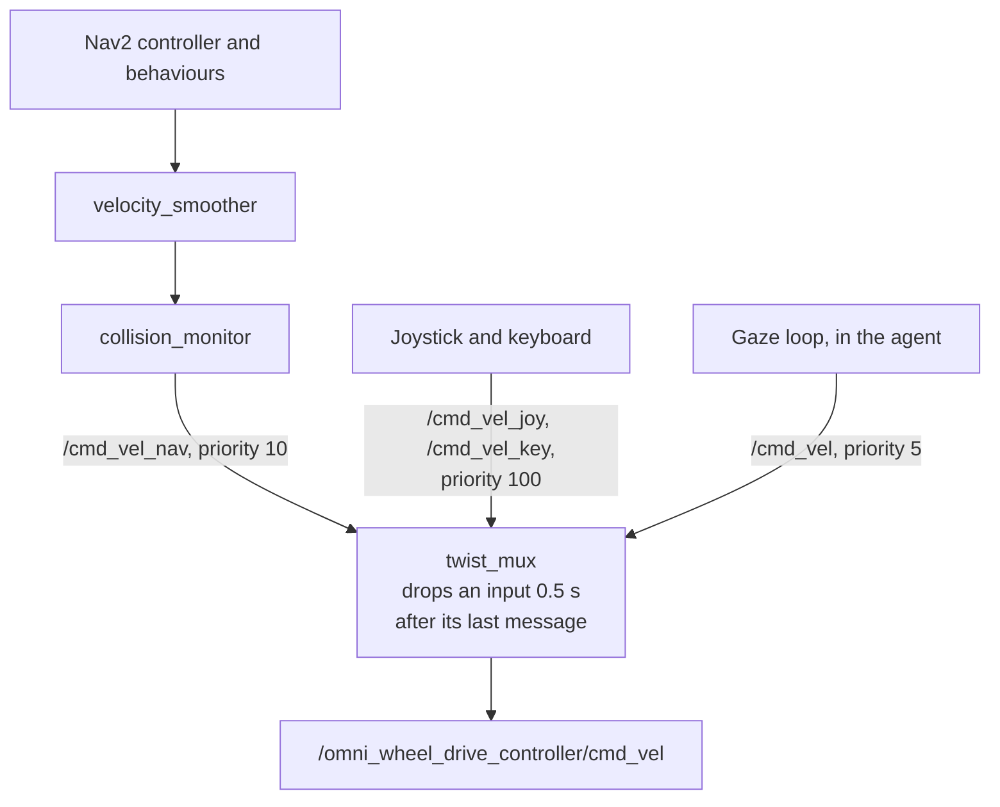
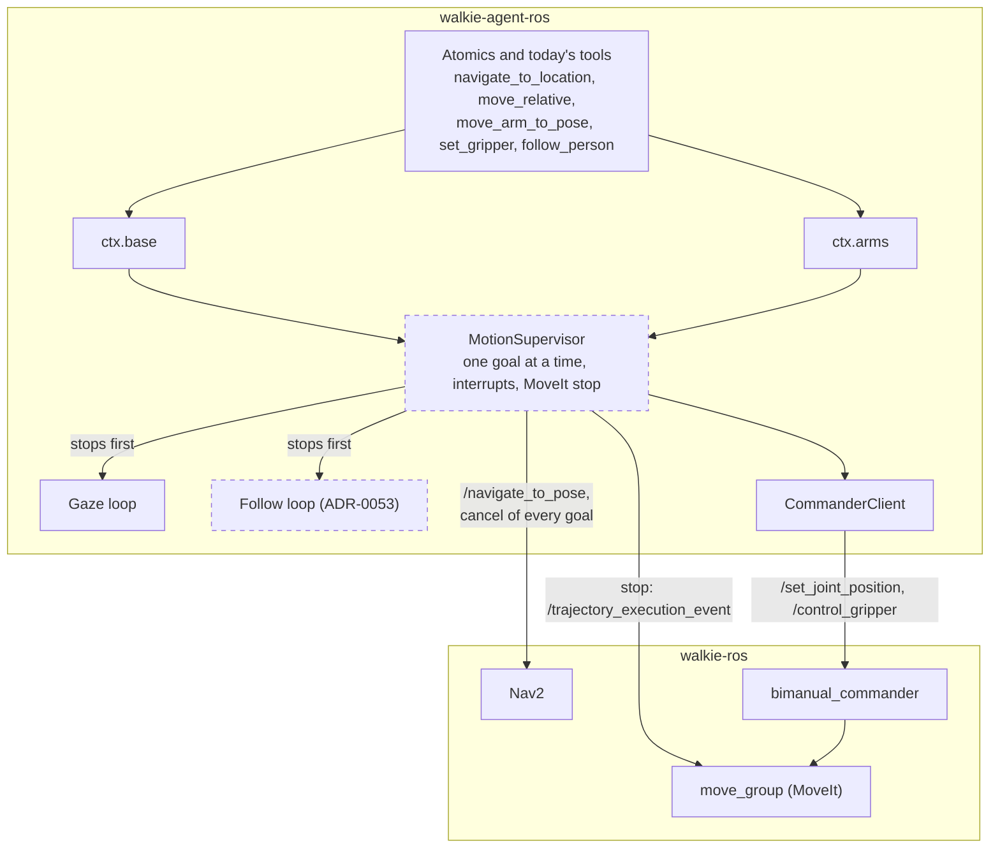

# Robot Capabilities (Proposed)

!!! note "Status: Proposed, PR A built"
    [PR A](#pr-a-types-and-fakes) is built: the Protocols and records,
    `ctx.pose`, `ctx.arms`, `ctx.gaze` and `ctx.vision` on ROS, and the
    fakes. PR B and PR C are not. The rest of the page is the design for
    team review, recorded in
    [ADR-0052](decisions/0052-typed-robot-capabilities-on-ctx.md). Where PR
    A differs from the design, an "As built" note says so. Each of the
    [open questions](#open-questions) says what it blocks.

Atomics are the reviewed tools the LLM calls
([The Agent](agent.md#typed-atomic-tools)). Most teammates who write them
do not know ROS 2. Today an atomic that drives or speaks has to build Nav2
goals and `HRIMessage`s itself, or call the LangChain tools that do. This
page gives atomics typed capabilities on `ctx` instead: `ctx.base`,
`ctx.speech`, `ctx.pose`, `ctx.arms`, `ctx.gaze` and `ctx.vision`. They hide
the ROS types, not the goal statuses or the cancel.

The same change puts the safety steps of a drive in one place, makes a
reset cancel a drive, and places the `MotionSupervisor` beneath
`ctx.base` and `ctx.arms`. The supervisor is the gate for `--arms` on the
robot ([Arm Manipulation](manipulation.md#roadmap)), and the follow loop of
[HRI slice 2](hri.md#slice-2-following-the-host) is `ctx.base.follow`.

## Summary

- **Six capabilities on `ctx`,** each bound to `ctx.cancel`. The Protocols
  import no rclpy. The ROS implementations stay in the agent process, for
  human-written atomics only
  ([ADR-0052](decisions/0052-typed-robot-capabilities-on-ctx.md)).
- **Errors keep Nav2's and the commander's answers.** Every failure is a
  `StepError` code, with the goal status and the cancel answer in `data`.
- **One safety order for every drive:** validate, stop the agent's own gaze
  and follow loops, cancel other clients' goals, check the arms, read a
  fresh pose for a relative move, then send one bounded goal.
- **No velocity verb.** `twist_mux` drops an input after 0.5 s, and every
  input but Nav2's skips `velocity_smoother` and `collision_monitor`. Turns
  are Nav2 goals. Phase 4b's raw base commands are dropped.
- **The head stays the robot's.** Robot runs start Nav2 with
  `head_tilt_near_goal:=false`, so the ZED is not tilted 45° down when the
  robot arrives.
- **Fakes for every capability** in `walkie_agent.testing`, held to the real
  implementations by contract tests.
- **Three pull requests.** PR A adds the types and fakes. PR B moves driving
  and speaking behind `ctx.base` and `ctx.speech`, and a reset then cancels
  a drive. PR C adds the MotionSupervisor, which unblocks `--arms` on the
  robot.

## Why not `ctx.nav.send_vel`

A raw velocity call looks like the simplest interface, but walkie-ros's
base does not work that way:



- **One call cannot hold a velocity.** It needs a control loop well inside
  0.5 s. The gaze loop runs one at 15 Hz, with its interlocks.
- **It would skip the safety chain.** Only Nav2's output passes
  `velocity_smoother` and `collision_monitor`.
- **`/cmd_vel` is taken.** The gaze loop is its only publisher
  ([ADR-0051](decisions/0051-agent-side-gaze-loop.md)). All five
  base-velocity names are in `FORBIDDEN_NAMES`.

What a teammate wants from `send_vel` maps onto these calls:

| Want | Call |
| ---- | ---- |
| Turn some degrees, or face a heading | `ctx.base.turn_by(degrees)` or `ctx.base.turn_to(heading_rad)`: one Nav2 goal, so the smoother, the collision monitor and the arm check apply |
| Nudge forward or sideways | `ctx.base.move_relative(forward_m=0.3)` |
| Keep facing a person | `ctx.gaze.look_at(handle)` |
| Stop | `ctx.base.stop()` |
| Follow someone | `ctx.base.follow`, ADR-0053's loop through `WalkieFollowPoint`, walkie-ros's copy of Nav2's FollowPoint tree |
| Visual servoing | A robot-side skill behind `run_skill` ([ADR-0027](decisions/0027-runskill-action.md)) |

A velocity verb waits for a collision-checked input in walkie-ros. It would
then be a bounded session, with a deadman, speed caps and a duration, not a
raw publish.

## The capabilities

```python title="src/walkie_agent/capabilities/__init__.py (outline)"
class Base(Protocol):                        # ctx.base, effect N
    def locations(self) -> Mapping[str, Location]: ...
    def go_to(self, location: str, *, timeout_s: float = 120.0) -> Moved: ...
    def move_relative(self, forward_m: float = 0.0, left_m: float = 0.0,
                      turn_deg: float = 0.0, *, timeout_s: float = 120.0) -> Moved: ...
    def turn_by(self, degrees: float, *, timeout_s: float = 30.0) -> Moved: ...
    def turn_to(self, heading_rad: float, *, timeout_s: float = 30.0) -> Moved: ...
    def stop(self) -> None: ...              # stops the gaze and follow loops, cancels the base's goal; never raises
    def busy(self) -> bool: ...              # a base goal of the agent's is active
    # follow: reserved for ADR-0053's loop, which sets its arguments


class Speech(Protocol):                      # ctx.speech, effect S
    def say(self, text: str) -> None: ...    # returns once published, not once spoken


class Pose(Protocol):                        # ctx.pose
    def latest(self, *, max_age_s: float) -> Pose2D: ...
    def fresh(self, *, timeout_s: float = 1.0) -> Pose2D: ...  # TF stamped after the call
    def at(self, stamp_ns: int, *, timeout_s: float) -> Pose2D: ...


class Arms(Protocol):                        # ctx.arms, effect M
    def poses(self) -> Mapping[str, ArmPose]: ...  # by name, in order; outside sim only those tried on the robot
    def state(self, *, read: bool | None = None) -> ArmsReport: ...  # read: None when unknown, True always, False never
    def move_to(self, pose: str, arm: Arm = "both") -> ArmsMoved: ...
    def gripper(self, arm: Gripper, state: GripperState) -> GripperMoved: ...  # one gripper


class Gaze(Protocol):                        # ctx.gaze, effect N
    def look_at(self, handle: str) -> Looking: ...  # returns once the loop has the target
    def face(self, looking: Looking, timeout_s: float) -> bool: ...  # True once the base faces it
    def stop(self, reason: str | None = None) -> str | None: ...  # STOP_LOOKING by default; the target it stopped, or None
    def status(self) -> GazeStatus: ...


class Vision(Protocol):                      # ctx.vision, effect P
    def people(self, *, max_age_s: float) -> list[PersonSeen]: ...
    def objects(self, labels: Sequence[str] = (), *, max_age_s: float) -> list[ObjectSeen]: ...


@dataclass(frozen=True)
class Moved:
    goal: Pose2D             # the goal Nav2 reached
    pose: Pose2D | None      # TF stamped after the result; None if none came within 1 s
    notes: tuple[str, ...]   # the arm check's notes, such as an arm state that was not read


@dataclass(frozen=True)
class ArmsReport:            # what CommanderClient.snapshot() holds
    arms: ArmsState
    unverified: str | None   # why the arms are unverified, or None
    unverified_count: int
    recovery: Recovery | None  # what the last recovery checked


@dataclass(frozen=True)
class ArmsMoved:             # a move the joint check confirmed
    pose: str                # as poses() spells it, such as "hands_up"
    arm: Arm
    status: str              # the commander's, such as "Success" or "Plan Only"
    max_error_rad: float
    report: ArmsReport       # the snapshot after the joint check


@dataclass(frozen=True)
class GripperMoved:          # one gripper goal and what the fingers did
    arm: Gripper
    state: GripperState
    outcome: str             # "moved", "not_reached", "holding", "empty", "not_closed", ...
    result: GripperResult
    finger_m: float | None   # the finger's travel read after a close
    read_error: str | None   # why the finger could not be read


@dataclass(frozen=True)
class Looking:               # a target the gaze loop has taken
    target: str              # the handle
    kind: Literal["person", "seat"]
    notes: tuple[str, ...]   # the arm check's notes
    lost_after_s: float | None  # for a person, how long after the last sighting the loop stops
    seat_label: str | None   # for a seat, such as "sofa"
    seat_part: str | None    # for a place on a sofa, such as "left"
```

`PersonSeen` and `ObjectSeen` give the handle, the third of the image, the
map heading and the image stamp. `PersonSeen` adds whether a face was seen
and the gestures, and `ObjectSeen` the label and the score.

`ToolContext` also gains `now_ns()`, `in_simulation`, `sleep(seconds)` and
`wait_until(ready, timeout_s, what)`. `sleep` and `wait_until` raise
`CANCELLED` within 50 ms of a stop or a reset, as `ctx.wait()` does. It
takes a clock, which `wait()`, `sleep()` and `wait_until()` use, so the fakes
can pass a fake one.

!!! note "As built"
    The clock, `ctx.clock`, also times `ctx.pose`'s waits and the handle
    ages. `ctx.gaze.face()` keeps `look_at`'s poll on the node clock, with
    its backstop on the monotonic clock, so a fake clock does not shorten
    it on ROS. A `ToolContext` also takes `capabilities`, a factory for
    each capability, and `in_simulation`, which otherwise reads the node's
    `use_sim_time` parameter. A missing capability raises
    `UNAVAILABLE: The <name> capability is not available.` Each factory
    runs once, on the capability's first use. A factory may read another
    capability; one that reads its own, directly or through another,
    raises `RuntimeError`.

| Capability | Built from | What it hides | Rules inside |
| ---------- | ---------- | ------------- | ------------ |
| `base` | `Nav2GoalTool`, `NavigateToLocationTool`, `MoveRelativeTool` | `NavigateToPose`, `PoseStamped`, quaternions, goal handles, the locations file, the fresh-TF wait | The [safety order](#the-bases-safety-order). Only configured places and moves of at most 3 m ([ADR-0010](decisions/0010-bounded-navigation-tool.md), [ADR-0031](decisions/0031-bounded-relative-moves.md)). No method takes a position |
| `speech` | `SpeakTool` | `HRIMessage`, `/to_human`, the 2 s discovery wait, the speech ID and its change on `"stop"` | One `SpeechClient`, shared with `speak`, `wait_for_person` and `follow_person`. `REFUSED` for blank text, `UNAVAILABLE` when nothing listens |
| `pose` | `ctx.robot_pose()`, `MoveRelativeTool`, the perception helpers | the `map` and `base_footprint` frames, the quaternion | The method names the staleness rule. `UNAVAILABLE` with the TF hint, or `STALE` |
| `arms` | the arm atomics and `CommanderClient` | MoveIt groups, joint values, the `use_sim_time` read | Named poses only ([ADR-0022](decisions/0022-named-arm-poses.md)). `move_to` stops the gaze loop first, as `move_arm_to_pose` does. `gripper` does not, as `set_gripper` does not. Both stop the follow loop first once it exists. Keeps the unverified state, the joint check ([ADR-0024](decisions/0024-verify-motion-from-joint-states.md)) and `CommanderClient`'s cancel rule. Offers only poses tried on the robot, outside sim |
| `gaze` | `look_at`, `stop_looking`, `GazeLoop` | track keys, image stamps, the facing poll, `look_at`'s arm check | ADR-0051 unchanged: rotation only, at most 0.6 rad/s and 3.2 rad/s², silent while a Nav2 goal is active |
| `vision` | `VisionFeed` and `_perception.py` | `walkie_vision_msgs`, `CameraInfo`, TF at the image stamp | Records with handles. `PersonSeen` gives the person's handle, map heading, whether a face was seen, and the image stamp |

`ctx.backend()`, `ctx.node`, `ctx.tf_buffer` and the entity methods stay
for the code that already uses them. New atomics should not need them.

### The base's safety order

Every base verb runs these steps in this order:

1. **Validate.** A known location, finite values, not an empty move, at most
   3 m. Nothing moves when a value is wrong.
2. **Stop the agent's own loops.** Stop the gaze loop and wait up to 0.5 s
   for its zero commands
   ([ADR-0051](decisions/0051-agent-side-gaze-loop.md)). Once the follow
   loop exists, stop it too, and wait for its goal to end and the base to
   be still, within the bounds ADR-0053 sets. The follow loop publishes no
   velocity, so there are no zeros to wait for. Stopping both before any
   Nav2 step keeps a live loop from sending again while step 4 cancels.
3. **One base goal at a time.** A second verb is refused while a goal of
   the agent's runs. The follow loop's goal is not counted, because step 2
   stopped it.
4. **Cancel other goals.** It cancels every active `navigate_to_pose` goal,
   whoever sent it, and waits up to 5 s for the status topic to show none
   active. A follow goal that a dead loop left active makes Nav2 abort, at
   once, every goal on another tree, and keeps the gaze loop silent
   ([ADR-0053](decisions/0053-follow-through-nav2-followpoint.md)).
5. **Check the arms** with `ctx.cancel`, keeping the check's code
   ([ADR-0025](decisions/0025-travel-safe-interlock.md)). Its notes, such as
   an arm state that could not be read, go into `Moved.notes`.
6. **Read the start pose,** for `move_relative`, `turn_by` and `turn_to`,
   from TF stamped after the call
   ([ADR-0031](decisions/0031-bounded-relative-moves.md)). `go_to` needs
   none.
7. **Send one goal** and wait for it, bounded. On a cancel or a timeout it
   cancels the goal, waits up to 1 s for the answer and up to 5 s for the
   goal to end.

`ctx.base` also cancels every active goal once at start-up. Today's
`navigate_to_location` and `move_relative` share the gaze stop and the arm
check in `Nav2GoalTool._navigate`, and validate first. Steps 3, 4, the
follow part of step 2 and the waits of step 7 are new. Step 6 is
`move_relative`'s, but today it reads the pose first, before the gaze stop
and the arm check. Running it after them is a change for `move_relative`,
which PR B's tests cover: the pose is read after the base stopped turning,
and a refused drive reads no TF.

### Errors

| Outcome | Code | `data` |
| ------- | ---- | ------ |
| Unknown location | `NOT_FOUND` | the known names |
| A value that is not finite, an empty move, or more than 3 m | `REFUSED` | |
| Another base goal of the agent's runs | `PRECONDITION_FAILED` | |
| Another client's goal still active 5 s after the cancel | `PRECONDITION_FAILED` | its status |
| The gaze loop's zeros not published within 0.5 s | `PRECONDITION_FAILED` | |
| An arm out, moving or unverified | as the arm check raises: `PRECONDITION_FAILED`, `TIMEOUT`, `CANCELLED` or `INTERNAL` | the check's data |
| No TF stamped after the call within 1 s | `UNAVAILABLE` | the TF hint |
| Nav2 not found within 2 s | `UNAVAILABLE` | |
| Nav2 rejects the goal | `REFUSED` | |
| Nav2 accepts the goal and aborts it at once, while the status topic shows a goal on another tree still active | `PRECONDITION_FAILED` | `status`, the other goal's status |
| Nav2 aborts the goal | `SKILL_FAILED` | `status`, `error_code`, `error_msg` |
| Another client cancels the goal | `CANCELLED` | `status` |
| The verb's timeout | `TIMEOUT` | `cancel`: `accepted`, `ended`, `refused`, `unknown`, `no answer` or `pending` |
| A reset, a stop or a "never mind" | `CANCELLED` | `cancel`, as above |

The legacy tools turn each code into the sentence the LLM reads today.
`navigate_to_location` and `move_relative` keep their names, arguments and
messages.

### Turns in place

`turn_by` and `turn_to` send one `navigate_to_pose` goal at the current
position, as `move_relative` does for a pure turn. No one has tested such a
goal in Nav2 ([ADR-0031](decisions/0031-bounded-relative-moves.md)).

- The sim and the robot load the same default tree,
  `nav_to_pose_real_recovery_bt.xml`. Its pre-rotation spins only for
  paths of 3 m or more, so a turn in place is left to the controller.
- `general_goal_checker` accepts 0.1 m and 0.01 rad, so a turn passes only
  when the controller can hold the position and finish the last half
  degree.
- `turn_to` takes a map heading. An atomic may pass one from the LLM. That
  is a new kind of input, though it reaches no heading that
  `move_relative`'s `turn_deg` cannot.
- PR B's [sim check](#pr-b-drive-and-speak-through-ctx) settles it, and a
  robot check follows. The guide for teammates does not teach turns before
  both pass.
- If turns fail, the fallback is Nav2's `spin` behaviour. walkie-ros loads
  it in `behavior_server`, whose output also passes `velocity_smoother` and
  `collision_monitor`. It is a second action, though, which the gaze loop
  and the supervisor would have to watch as they watch `navigate_to_pose`.

### Head tilt near goals

On the robot, walkie-ros starts `head_tilt_near_goal_node.py` with Nav2.
The sim does not.

| When | The ZED head |
| ---- | ------------ |
| A new `navigate_to_pose` goal | to 0.25 rad |
| Once a goal's remaining distance has been above 1.5 m, it drops to 1.5 m | down to 0.785 rad (45°) |
| The remaining distance is back at 1.7 m, or 2 s after the feedback stops | to 0.25 rad |
| The remaining distance is 0.3 m or less | no change, so turns in place never tilt |

The head ramps at 0.6 rad/s. After a drive longer than 1.5 m, the camera
looks at the floor for about 3 s after arrival. In the HRI task that is
when `find_people` looks at the door and `find_seats` at the sofa. The
follow is a run of goals, because the loop sends the goal again after an
abort, such as error 105. Each new goal resets the head to 0.25 rad. Within a goal, the remaining
distance is measured along the path to the host. Each time the host pulls
more than 1.5 m ahead and the robot catches up, the head tilts down. It
stays down until the gap is back above 1.7 m.

The tilt was made for STVL, which marks tabletops from the head camera.
STVL is disabled on the robot, because the head camera joint is broken, so
today the tilt only changes what the ZED sees.

- **Decided:** the agent never commands the head, and robot runs start
  Nav2 with `head_tilt_near_goal:=false`. The switch is commit `22dc4ef` in
  the navigation repository, walkie-ros's `navigation` submodule, on the
  branch `feat/hri-follow-and-head-tilt`, not yet pushed. walkie-ros picks
  it up with a submodule bump
  ([What changes in other repositories](#what-changes-in-other-repositories)).
- **Checked:** `ctx.base` logs a warning at start-up when a node named
  `head_tilt_near_goal` is on the graph.
- **Not chosen:** calling the node's `/head_tilt_near_goal/enable` service
  from `ctx.base`. That pins one more walkie-ros interface, and a launch
  switch is a deployment choice.
- **Not chosen:** waiting for the head to come back after each drive. That
  costs about 3 s per drive, and during the follow the head would still
  drop each time the robot catches up.
- If walkie-ros turns STVL back on, this reopens
  ([question 3](#open-questions)).

### Speech

`ctx.speech.say(text)` publishes on `/to_human` through one `SpeechClient`.
The client is `SpeakTool`'s publisher, its 2 s discovery wait and its speech
ID, moved out of the tool. `speak`, `wait_for_person`, `follow_person` and
`ctx.speech` share it, so text-to-speech never drops a sentence because two
callers used different IDs
([ADR-0007](decisions/0007-speak-tool-and-console.md)). Its speech ID is
also the one that `play_sound` and `fetch_sound` share
([ADR-0045](decisions/0045-play-sound-through-to-human.md)), once they are
built. It returns once the message is published, not once it is spoken.

### Pose, arms, gaze and vision

- **`ctx.pose`** names its staleness rule. `latest(max_age_s)` takes the
  newest transform and raises `STALE` when it is older. `fresh()` waits for
  one stamped after the call, as `move_relative` does. `at(stamp_ns)` takes
  the transform at an image's stamp, as perception does.
- **`ctx.arms`** is the arm atomics' steps behind one interface. It calls
  `bimanual_commander` through `CommanderClient`
  ([ADR-0021](decisions/0021-arm-control-through-commander.md)). In sim
  that is the real commander in walkie-ros's MuJoCo simulation. The
  `ArmsReport` is the client's snapshot: the arms, why they are
  unverified, and what the last recovery checked. The errors are
  `CommanderClient`'s. The arm atomics build their closing arm sentence
  from the report, so their answers do not change.
- **`ctx.gaze`** is `look_at` and `stop_looking` behind one interface, on
  the same `GazeLoop`. `stop()` returns the target it stopped, which
  `stop_looking`'s answer names.
- **`ctx.vision`** turns the newest `VisionFeed` arrays into records with
  handles. The perception atomics keep reading `VisionFeed` until a later
  change ports them.

!!! note "As built"
    - **`ctx.arms`:** the errors keep `CommanderClient`'s codes and `data`,
      with the arm atomics' full messages, which end with the arm sentence.
      `move_to()` returns `ArmsMoved`, and `gripper()` moves one gripper
      and returns `GripperMoved`, with the grasp band's outcome and the
      finger read. `state(read=None)` reads the arms only when their state
      is unknown; `True` always reads them and `False` never does.
      `poses()` is an ordered `Mapping` by name. `arms_report()` in
      `_arm.py` builds an `ArmsReport` from the client's `snapshot()`.
    - **`ctx.gaze`:** `look_at()` returns `Looking` once the loop has the
      target. `face(looking, timeout_s)` holds `look_at`'s facing poll and
      its TF read: `look_at` waits 4 s for a person, and a late turn is
      not an error, and 10 s for a seat, after which it calls
      `stop(TURN_TIMEOUT)` and raises `TIMEOUT`. `stop()` takes an
      optional reason, `STOP_LOOKING` by default.
    - **`ctx.vision`:** `people()` stores "person" handles and `objects()`
      "object" handles, the built-in kind. Nothing in view returns `[]` and
      stores nothing. `find_people`'s helpers moved into `_perception.py`
      (`people_left_to_right`, `face_box`, `person_payload` and
      `SeenPerson`), which `ctx.vision` shares; `find_people` itself still
      reads `VisionFeed`.
    - **`ctx.pose`:** `latest()` does not wait. `fresh()` repeats
      `MoveRelativeTool`'s wait for a transform stamped after the call,
      which PR B makes the one copy.

## An atomic on ctx

This example is not in the repository. It drives to a configured place and
says one line there:

```python title="src/walkie_agent/tools/atomic/guide_to.py (example)"
"""Drive to a configured place, then say one line there."""

from pydantic import BaseModel, Field

from walkie_agent.toolbox import Effect, ToolContext, ToolMeta, ToolOutput

META = ToolMeta(
    name="guide_to",
    description="Drives to a named place, then says one sentence there.",
    effects=frozenset({Effect.N, Effect.S}),
    requires=("base", "speech"),
    questions=(
        "Take me to the kitchen.",
        "Show the guest to the living room.",
        "Lead the way to the door and tell them it is here.",
    ),
    examples=({"location": "kitchen", "line": "Here is the kitchen."},),
)


class Args(BaseModel):
    location: str = Field(description="A place from list_locations.")
    line: str = Field(description="One sentence to say on arrival.")


class Out(ToolOutput):
    arrived: bool


def run(ctx: ToolContext, args: Args) -> Out:
    # Raises StepError: NOT_FOUND, PRECONDITION_FAILED, SKILL_FAILED, TIMEOUT, CANCELLED, ...
    moved = ctx.base.go_to(args.location)
    ctx.speech.say(args.line)
    notes = "".join(f" {note}" for note in moved.notes)
    return Out(summary=f"At {args.location}. Said: {args.line}{notes}", arrived=True)
```

Its tests run on `fake_ctx()`, with no fake nodes and no polling:

```python title="tests/test_guide_to.py (example)"
import pytest

from walkie_agent.testing import fake_ctx
from walkie_agent.toolbox import StepError
from walkie_agent.tools.atomic import guide_to as tool


def test_drives_then_speaks():
    ctx, robot = fake_ctx(locations={"kitchen": (2.0, 1.0, 0.0)})
    tool.run(ctx, tool.Args(location="kitchen", line="Here it is."))
    assert robot.calls == ["base.go_to", "speech.say"]


def test_arm_out_refuses_and_stays_quiet():
    ctx, robot = fake_ctx(locations={"kitchen": (2.0, 1.0, 0.0)}, arms="hands_up")
    with pytest.raises(StepError) as e:
        tool.run(ctx, tool.Args(location="kitchen", line="Here it is."))
    assert e.value.code == "PRECONDITION_FAILED"
    assert robot.base.goals == [] and robot.speech.said == []


def test_reset_mid_drive_cancels_the_goal():
    ctx, robot = fake_ctx(locations={"kitchen": (2.0, 1.0, 0.0)})
    robot.base.on_goal(ctx.cancel.set)
    with pytest.raises(StepError) as e:
        tool.run(ctx, tool.Args(location="kitchen", line="Here it is."))
    assert e.value.code == "CANCELLED" and robot.base.cancels == 1
```

!!! note "As built"
    `fake_ctx`'s `arms` takes a pose name from `arm_poses.toml`, so the
    arm that is out is `"hands_up"`, which is not safe for driving. The
    tests run as written on PR A's fakes, and `tests/test_capabilities.py`
    runs the same body inline. `META.requires` still names backends,
    which `build_atomic_tools` checks with `ctx.has_backend()`. There is
    no `base` or `speech` backend, so the module would not load until PR
    B lets `requires` name capabilities.

## The fakes

`walkie_agent.testing` is test code. `create_walkie_agent` never registers
it as a backend.

- **`fake_ctx(...)`** returns a real `ToolContext` with in-memory fakes of
  the six capabilities, and a `robot` object to inspect them.
- **A call log,** `robot.calls`, records every capability call in order.
  Atomic tests check only the calls the atomic makes, such as
  `base.go_to` and `speech.say`. A later change to the safety order then
  changes the contract tests, not every atomic's tests.
- **A step log** in each fake, such as `robot.base.steps`, records its
  safety steps that the ROS side can also observe: `gaze.stop`,
  `base.cancel_others`, `arms.check` and `base.goal`.
- **Scripted faults:** a rejected, aborted or slow goal, a refused or
  unanswered cancel, no speech node, an arm out, unverified arms, stale TF.
- **A fake clock,** which `fake_ctx` passes to `ToolContext`, so timeouts
  run without waiting.
- **Contract tests** run the same cases on each fake and on its ROS
  implementation, over `FakeWalkie` and `FakeCommander`
  ([ADR-0019](decisions/0019-test-fakes-fast-dds.md)). On the ROS side they
  build the same step log from what the fakes underneath record:
  `FakeWalkie`'s goals and cancels, the `GazeLoop`'s stop calls and
  `FakeCommander`'s reads. A fake that drifts from the real code fails
  them.

Tests on the fakes need no DDS traffic, but ROS must be importable and the
suite's `rclpy.init` still runs, because `ToolContext` imports rclpy.

!!! note "As built"
    - **The step logs:** `robot.base.steps` adds `pose.fresh` for a
      relative move or a turn, before `base.goal`. `robot.arms.steps`
      holds `gaze.stop` and `arms.goal` for a move, and `gripper.goal` for
      a gripper. `robot.gaze.steps` holds `arms.check` and `gaze.start`,
      and `robot.gaze.stops` every stop reason.
    - **The fakes share the real code** for what is not ROS: the pose
      checks of `_arm.py`, the arm sentences, `check_arms`, the handle
      payloads and `VisionFeed`'s staleness message. They model what the
      ROS side does around it: the client's unverified state and its
      recovery once a read follows a cleared fault, a gripper command
      number counted per arm, as `CommanderClient` counts per group, and
      Nav2's texts for a rejected, aborted, cancelled or slow goal, which
      PR B's `RosBase` must match. `turn_by(0)` is refused as "Nothing to
      do: the turn is zero."
    - **`robot.base`** refuses a second verb with `PRECONDITION_FAILED`
      while its own goal runs, after the gaze stop, as step 3 says. It
      cancels `other_goals` at step 4, and a goal whose cancel Nav2 refused
      or did not answer becomes one of them. An abort's `data` holds
      `abort_error_code` and `abort_error_msg`, and a message, when set,
      ends the error's text.
    - **`robot.arms`** keeps a goal it gave up on outstanding, as
      `CommanderClient` does: every call is refused with
      `PRECONDITION_FAILED` until `never_answer` is cleared, or until
      `ABANDON_AFTER_S` passes on the fake clock, when the arms become
      unverified. The client's `ABSENT_ABANDON_S` is not modelled, because
      the fake's commander never goes away. A move reads each group's
      joint order once, so `read_failure` fails a move with `UNAVAILABLE`
      only before that read, and a move after it with `POSTCONDITION`,
      since its check cannot read the arms. A close is judged by where the
      fingers settle, as `FakeCommander` and `RosArms` judge it: `empty`
      below the grasp band, `holding` inside it and `not_closed` near the
      open position. `unmeasured` and `not_reached` script the other
      outcomes.
    - **`robot.gaze`** counts its stop calls, as `GazeLoop.stop_calls()`
      does, so a stop during `look_at`'s arm check makes it `CANCELLED`. A
      person starts from the newer of the handle's sighting and the one in
      `robot.vision`'s people array, which counts only when no older than
      `lost_after_s` and showing the handle's track. An older handle of a
      person out of view is `STALE`.
    - **`robot.vision.seat(heading_map)`** stores one seat handle, as
      `find_seats` would, for a test of `look_at`.
    - **`fake_ctx`** builds the ctx on a `FakeConnector` and a `FakeNode`,
      whose clock is the fake clock. `ctx.tf_buffer` is `None`.
      `without=(...)` leaves capabilities out, which then raise
      `UNAVAILABLE`.
    - **The contract tests** cover `pose`, `arms`, `gaze` and `vision`.
      There are no base contract tests until PR B builds `RosBase`. On the
      ROS side, `ctx.pose` runs on a TF buffer the test writes, `ctx.arms`
      on `CommanderClient` over `FakeCommander`, `ctx.gaze` on a
      `GazeLoop` that turns `test_gaze`'s fake base, and `ctx.vision` on a
      `VisionFeed` that a test node feeds. The arms' step log comes from
      `FakeCommander`'s `joint_goals` and `gripper_goals` and from a
      stand-in gaze backend that logs each stop.

## The MotionSupervisor

The supervisor is the one owner of motion goals, beneath `ctx.base` and
`ctx.arms`. It replaces
[ADR-0023](decisions/0023-motion-supervisor.md)'s design and is built in
[PR C](#pr-c-the-motionsupervisor):



- **The agent's loops stop first.** An arm or gripper goal stops the follow
  loop and waits for the base to be still
  ([ADR-0053](decisions/0053-follow-through-nav2-followpoint.md)). An arm
  goal also stops the gaze loop. Today only `move_arm_to_pose` stops it, and
  that stays: `set_gripper` does not stop the gaze loop, because a gripper
  does not move the arm
  ([ADR-0051](decisions/0051-agent-side-gaze-loop.md)).
- **The follow hook is written once.** The follow change, which comes
  after PR B and before PR C, adds the follow loop's stop to `ctx.base`'s
  step 2 and to `ctx.arms`, before both arm and gripper goals. PR C moves
  that hook under the supervisor rather than adding a second one.
- **One goal at a time.** It then refuses an arm or gripper goal while any
  `navigate_to_pose` goal is active, whoever sent it. It refuses a base
  goal while an arm, gripper or skill goal runs, whoever sent it, or while
  the arms are unverified. It sees other clients' commander goals on the
  `_action/status` topics of `/set_joint_position` and `/control_gripper`,
  as the gaze loop watches Nav2's. So an arm goal left by an agent that
  died blocks drives until it ends.
- **The latch is `ctx.cancel`.** A reset, or a "stop" or "never mind"
  during a task, sets it, and `begin_task()` clears it when the next task
  starts. While it is set, every capability refuses motion at once, so the
  other tool calls of the same LLM answer do not move the robot.
- **On every interrupt, and on every "stop" or "never mind" between
  tasks,** it:
    1. stops the gaze and follow loops, so neither sends again;
    2. cancels every `navigate_to_pose` goal, with one cancel request whose
       goal ID and stamp are zero, which ROS 2 actions read as all goals;
    3. cancels the agent's arm, gripper and skill goals, including goals
       sent but not yet accepted. Between tasks `ctx.cancel` is not set,
       so this goes through a public cancel that `CommanderClient` gains
       in PR C;
    4. publishes `"stop"` on `/trajectory_execution_event`, every 200 ms
       until the cancelled goals end, at most 5 s.
- **Listeners return at once.** The Toolbox's listeners must return
  promptly ([The Agent](agent.md#stop-reset-and-the-cancel)), so a thread
  repeats the stop. The waiting tool wakes through `ctx.cancel` and reports
  "Stopped by reset".
- **Every wait is bounded.** A base goal's timeout cancels it and waits up
  to 5 s for it to end. An arm goal keeps `CommanderClient`'s rule: it
  waits up to 1 s for the cancel's answer and returns, and the goal stays
  outstanding until it ends. The 5 s bound of the interrupt is on the
  repeated stop, not on the arm call.
- **`CommanderClient` stays as built,** apart from the public cancel. It
  keeps its call lock, its unverified state and its recovery
  ([Arm Manipulation](manipulation.md#how-a-pose-move-works)). The
  supervisor adds the exclusion between base and arms above it.

| ADR-0023 | ADR-0052 |
| -------- | -------- |
| A supervisor beside the tools | Beneath `ctx.base` and `ctx.arms`, so the stops are written once |
| A reset latch, set on `/walkie/reset` | `ctx.cancel`, set on a reset, a "stop" or a "never mind" during a task |
| Cancels the agent's own goals | Also cancels every `navigate_to_pose` goal, from any client, and the follow goal between tasks |
| Refuses arm motion while Nav2 drives | Refuses it while any `navigate_to_pose` goal is active, an operator's or an orphan's included |
| Refuses navigation while an arm goal runs | Also while another client's commander goal runs, seen on the commander's status topics |
| "stop" repeated every 200 ms, at most 5 s | Unchanged |
| Every wait bounded, 5 s after a cancel | Unchanged for base goals. Arm goals keep `CommanderClient`'s rule: 1 s for the cancel's answer, then the goal stays outstanding |

## Reviewed exceptions to FORBIDDEN_NAMES

`ctx` raises `ValueError` for an entity on a name in `FORBIDDEN_NAMES`,
unless the call passes that exact name in `allow_forbidden`
([The Agent](agent.md#the-ctx)). Only reviewed components outside the tools
do:

| Component | Name | Status |
| --------- | ---- | ------ |
| Gaze loop | `/cmd_vel`, rotation only | Built ([ADR-0051](decisions/0051-agent-side-gaze-loop.md)) |
| Follow loop | `/goal_update` | HRI slice 2 ([ADR-0053](decisions/0053-follow-through-nav2-followpoint.md)) |
| MotionSupervisor | `/trajectory_execution_event`, `"stop"` only | PR C ([ADR-0052](decisions/0052-typed-robot-capabilities-on-ctx.md)) |

`/goal_update`, `/goals_update` and `/trajectory_execution_event` join the
list when their component lands. The comment on `FORBIDDEN_NAMES` then
names each exception, and so do ADR-0051's "only exception" and the "one
exception" lines in HRI Task and The Agent.

## Generated code

The capabilities live only on the in-process `ToolContext` of
human-written atomics. Generated code in the sandbox gets none of them
([Access Levels](access-levels.md#policy-per-level)):

- **M** only through atomics in `ctx.tools`, at Standard and Unrestricted,
  and not at all at Competition
  ([ADR-0039](decisions/0039-access-levels.md)).
- **N** through atomics at Standard and Unrestricted, and at Unrestricted
  also through the ROS bridge's raw Nav2 actions. Competition gets none.

- Phase 4b no longer adds raw base-command publishing. Like raw arm
  controllers, it is reconsidered only if the harvest's atomic wishlist
  shows tools blocked without it, and then as a reviewed `ctx.base` verb.
- The ROS bridge's raw Nav2 actions at Unrestricted bypass `ctx.base`. Once
  both exist, the bridge asks the supervisor before it starts one, so the
  arm check and the one-goal rule hold for them too.
- If the facade's `ctx_inproc.Ctx` replaces today's `ToolContext`
  ([Access Levels](access-levels.md#the-shared-ctx-api)), it carries the
  capabilities, and the sandboxed backing still does not.

## Delivery plan

Each PR is one feature on its own branch. PR A changes no behaviour. PR B
and PR C each change one, and each has a sim check before it merges.

### PR A: types and fakes

The capabilities that wrap code which exists today get their ROS
implementations here. `ctx.base` and `ctx.speech` get only their Protocols
and fakes.

- **Files:**
    - `src/walkie_agent/capabilities/__init__.py` (new): the six Protocols
      and their records. It imports no rclpy, and nothing from
      `walkie_agent.toolbox`, whose package imports rclpy.
      `walkie_agent.arm.state` and `walkie_agent.arm.poses` are ROS-free,
      so `ArmsState` and `ArmPose` are imported from there.
    - `src/walkie_agent/toolbox/handles.py`, `src/walkie_agent/gaze.py` and
      `src/walkie_agent/arm/commander.py` (changed): `Pose2D`,
      `GazeStatus`, `GripperResult` and `Recovery` move into
      `capabilities/`. These modules re-export them, so today's imports
      keep working.
    - `src/walkie_agent/toolbox/context.py` (changed): the typed members,
      `ctx.pose`'s three reads, `now_ns()`, `in_simulation`, `sleep()` and
      `wait_until()`, and a clock that `wait()`, `sleep()` and
      `wait_until()` use.
    - `src/walkie_agent/tools/atomic/_arm.py`, `_gaze.py` and
      `_perception.py` (changed): the ROS implementations of `ctx.arms`,
      `ctx.gaze` and `ctx.vision`, from the steps the atomics run today.
      The arm sentence helpers take an `ArmsReport` instead of the client.
    - `move_arm_to_pose.py`, `set_gripper.py`, `list_arm_poses.py`,
      `look_at.py` and `stop_looking.py` in `src/walkie_agent/tools/atomic/`
      (changed): they call `ctx.arms` and `ctx.gaze`. Their arguments and
      messages do not change.
    - `get_arm_state.py` stays on `CommanderClient` in PR A. Its answer
      comes from three snapshots taken across the call and a finger read
      per gripper, which `Arms.state()` does not return. It moves once
      `Arms` gains a method for it. As built, it changes only where it
      builds the arm sentence, which now takes an `ArmsReport`.
    - `find_people.py` (changed, as built): the helpers that `ctx.vision`
      shares move into `_perception.py`. It still reads `VisionFeed` and
      `ctx.tf_buffer`.
    - `src/walkie_agent/testing/__init__.py` (new): `fake_ctx()` and the
      fakes.
    - `docs/architecture/agent.md` (changed): the ctx table.
- **Tests:**
    - `tests/test_capabilities.py` (new): the contract cases for `pose`,
      `arms`, `gaze` and `vision`, on the fakes and on the ROS
      implementations over `fake_walkie` and `FakeCommander`; the fakes'
      call and step logs and faults; a subprocess that imports
      `walkie_agent.capabilities` and finds no rclpy loaded.
    - `tests/test_toolbox.py` (changed): a missing capability raises
      `UNAVAILABLE`, each member is bound to `ctx.cancel`, and a fake clock
      ends `wait()`, `sleep()` and `wait_until()` without real waiting.
    - Unchanged and passing: `test_arm_atomics.py`, `test_gaze_atomics.py`,
      `test_people_atomics.py`, `test_tools_ros.py`.
- **Sim check:** the HRI run passes `pixi run hri-check` again, with
  `agent-sim-hri`, since the arm and gaze atomics now run through `ctx`.
- **Unblocks:** new atomics on `ctx.pose`, `ctx.arms`, `ctx.gaze` and
  `ctx.vision`, tested on `fake_ctx()`; PR B.

!!! note "As built"
    - **The files** are as listed, with `find_people.py` and
      `get_arm_state.py` changed too.
    - **The tests:** `tests/test_capabilities.py` runs the contract cases
      on the ROS side over `FakeCommander`, a TF buffer, `GazeLoop` and
      `VisionFeed`, not over `fake_walkie`, since PR A has no `RosBase`.
      It also runs the guide_to example inline and the ported atomics on
      `fake_ctx()`. The other test files are unchanged, and
      `tests/test_toolbox.py` only gains tests.
    - **One log line moves:** the warning that a close is judged by the
      commander's default grasp detection band, because its band could not
      be read, is now logged by `walkie_agent.tools.atomic._arm`, not by
      `set_gripper`.
    - **The sim check** is run separately, before the pull request
      merges.

### PR B: drive and speak through ctx

- **Files:**
    - `src/walkie_agent/tools/navigation.py` (changed): `RosBase`, from
      `Nav2GoalTool._navigate` and `MoveRelativeTool`, with the full
      [safety order](#the-bases-safety-order), the start-up cancel and the
      head-tilt warning. `navigate_to_location` and `move_relative` become
      thin wrappers over it, bound to the toolbox's `ctx.cancel`.
    - `src/walkie_agent/tools/speech.py` (changed): `SpeechClient`, from
      `SpeakTool`. `speak` wraps it.
    - `src/walkie_agent/tools/__init__.py` (changed): `build_walkie_tools`
      takes the `RosBase` and the `SpeechClient`.
    - `src/walkie_agent/agent.py` (changed): it builds both as the `base`
      and `speech` backends. `reset()`'s docstring says a drive is now
      cancelled.
    - `src/walkie_agent/sim/fake_walkie.py` (changed): a rejected goal, an
      aborted goal, a slow or refused cancel, and a goal held active by
      another client. Goals on trees, as Nav2 handles them: a goal on the
      running goal's tree preempts it, and a goal that names another tree
      is accepted, then aborted at once. A log of goals and cancels, for
      the contract tests.
    - `docs/architecture/agent.md` (changed): stop, reset and the cancel.
- **Tests:**
    - `tests/test_base.py` (new): `RosBase` on `fake_walkie` and
      `FakeCommander`. The safety order. Each Nav2 outcome to its code, with
      the status in `data`. A timeout cancels and waits for the answer. A
      set `ctx.cancel` cancels a running goal. The start-up cancel of
      another client's goal. One base goal at a time. A drive while another
      client's goal on another tree runs: it succeeds because step 4
      cancels that goal, and the test fails when step 4 is skipped.
      `move_relative` reads its pose after the gaze stop and the arm
      check, and a refused drive reads none.
    - `tests/test_capabilities.py` (changed): the `base` and `speech`
      contract cases on `RosBase` and `SpeechClient`.
    - `tests/test_tools_ros.py` (changed): the legacy tools' cases pass
      unchanged, plus a reset mid-drive.
    - `tests/test_agent.py` (changed): a reset during `navigate_to_location`
      ends it with "Stopped by reset", and a later drive from the same LLM
      answer is refused.
    - Speech: `speak`, `wait_for_person` and `ctx.speech` share one speech
      ID, which changes on `"stop"`.
- **Sim checks,** on walkie-ros's MuJoCo simulation:
    1. **Turns in place.** On the blank map from `start`, and in
       `chula_pat14_6` from `living_room`, between the TV desk and the
       coffee table, facing the sofa: `turn_by` of +90°, −90°, 180°, 10°
       and 2°, and `turn_to` four map headings. A small script,
       `scripts/check_turns.py` (new), runs them and prints one line each.
       Each passes when:
        - Nav2 reports `SUCCEEDED` within 30 s;
        - the yaw from TF, `map` to `base_footprint`, ends within 0.01 rad
          of the goal. That is the pose `general_goal_checker` judges, from
          AMCL;
        - the change in ground-truth yaw, from `/mujoco_ground_truth/odom`,
          matches the commanded turn within 0.05 rad. The absolute
          ground-truth yaw is not compared, because AMCL is 0.1 to 0.2 m
          off the ground truth in sim
          ([ADR-0053](decisions/0053-follow-through-nav2-followpoint.md));
        - the base moved less than 0.1 m by ground truth.
    2. **Reset mid-drive.** During a `navigate_to_location`, a reset
       cancels the goal, and the base is still within 1 s of the cancel's
       answer, by ground truth.
    3. **An orphaned goal on another tree.** A script sends a goal on a
       follow tree, `WalkieFollowPoint` by its ID or a scratch copy by its
       path, as ADR-0053's smoke test does, and leaves it active. The tree
       can end a goal with error 105 on its own, so the script checks that
       the goal is still active and sends it again if not. Once before the
       agent starts: the start-up cancel ends it, and a drive succeeds.
       Once while the agent runs: the next drive cancels it first, then
       succeeds.
    4. The HRI run passes `pixi run hri-check` again.
- **Robot check:** the turns of check 1 on the robot, with an operator at
  the emergency stop, and Nav2 started with `head_tilt_near_goal:=false`.
- **Unblocks:** the follow loop of
  [HRI slice 2](hri.md#delivery-order-for-slice-2) on `ctx.base`; turn
  atomics, once check 1 passes; the guide for teammates. The follow change
  adds the follow loop's stop to `ctx.base`'s step 2 and to `ctx.arms`,
  before arm and gripper goals, so slice 2's sim run does not wait for
  PR C ([The MotionSupervisor](#the-motionsupervisor)).

### PR C: the MotionSupervisor

- **Files:**
    - `src/walkie_agent/motion.py` (new): the `MotionSupervisor`. It
      watches the `_action/status` topics of `navigate_to_pose`,
      `/set_joint_position` and `/control_gripper`, so goals from any
      client count.
    - `src/walkie_agent/tools/navigation.py` and
      `src/walkie_agent/tools/atomic/_arm.py` (changed): `RosBase` and the
      `ctx.arms` implementation ask the supervisor before each goal and
      report each goal to it. The loop stops that the follow change added
      move under the supervisor.
    - `src/walkie_agent/arm/commander.py` (changed): a public cancel of the
      client's running and outstanding goals, by the client's own goal IDs.
      It keeps the unverified bookkeeping, as a cancel from a call's own
      timeout does.
    - `src/walkie_agent/tools/__init__.py` (changed):
      `/trajectory_execution_event` joins `FORBIDDEN_NAMES`, and the comment
      lists the exceptions. The supervisor passes the name in
      `allow_forbidden`.
    - `src/walkie_agent/agent.py` (changed): it builds the supervisor and
      registers its interrupt, new-task and stop-heard listeners.
    - `src/walkie_agent/sim/fake_commander.py` (changed): it hears `"stop"`
      on `/trajectory_execution_event` and ends a running arm goal, as
      MoveIt does.
    - `docs/architecture/manipulation.md` and `agent.md` (changed): the
      supervisor as built.
- **Behaviour changes:** an arm or gripper goal is refused while any
  `navigate_to_pose` goal is active. Today `set_gripper` does not look at
  Nav2. A drive is refused while another client's commander goal runs. A
  gripper goal still does not stop the gaze loop.
- **Tests:**
    - `tests/test_motion.py` (new): an arm goal refused during a Nav2 goal,
      another client's included, and a drive refused during an arm goal,
      another client's included, or with unverified arms. The interrupt's
      four steps, in order. The stop repeated every 200 ms, for at most
      5 s. Listeners that return at once. `ctx.cancel` refusing motion
      until the next task. A "stop" between tasks cancelling a goal left
      active. Every base wait bounded.
    - `tests/test_commander.py` (changed): the public cancel of a running
      goal, of a goal sent but not yet accepted, and of a goal whose call
      gave up, with the unverified state kept as a timeout's cancel keeps
      it.
    - `tests/test_arm_atomics.py` (changed): a reset mid-move publishes
      `"stop"`, and `FakeCommander` ends the goal. `set_gripper` during a
      Nav2 goal is refused.
    - `tests/test_tools_ros.py` (changed): `/trajectory_execution_event` is
      refused to every other caller. `test_tools_hide_forbidden_topics`
      gains `"/trajectory_execution_event": String` in its `types`, so its
      check that `types` matches `FORBIDDEN_NAMES` still passes.
- **Sim checks,** with the commander started by
  `launch/commander_sim.launch.py`:
    1. A reset during `move_arm_to_pose` stops both arms. The time to stop
       is recorded.
    2. `move_arm_to_pose` during a goal sent from a script is refused, and
       runs once that goal ends.
    3. A reset mid-drive with `--arms` stops the base, as in PR B.
    4. The HRI run passes `pixi run hri-check` again.
- **Robot check:** Manipulation's step R4, a reset mid-move with both arms
  ([Testing](manipulation.md#testing)).
- **Unblocks:** `--arms` on the robot, the gate on Manipulation's
  real-backends track. `pixi run agent` and `pixi run agent-robot-hri` add
  the flag once Manipulation's robot steps R0 to R4 pass, which need
  walkie-ros's W8 and W9
  ([Testing](manipulation.md#testing)). With it, HRI slice 1 and slice 2
  can run on the robot.

### After PR C

- **The guide for teammates:** a page on writing an atomic against `ctx`,
  with an example module. It teaches turns only after PR B's checks pass. A
  checker warns on rclpy, tf2 and `*_msgs` imports in new atomics, and on
  `ctx.node`, `ctx.tf_buffer` and the entity methods. The modules that use
  them today are allowed. The checker fails instead once they are ported.
- **Porting perception:** `find_people`, `find_seats` and `look_at` move off
  `ctx.tf_buffer` onto `ctx.pose` and `ctx.vision`. As built in PR A,
  `look_at`'s facing wait and its TF read are already behind `ctx.gaze`,
  so only `find_people` and `find_seats` remain.

## What changes in other repositories

| Repository | Change | Status |
| ---------- | ------ | ------ |
| navigation (walkie-ros's `navigation` submodule) | A `head_tilt_near_goal` launch switch in `robot_navigation`'s `localization_Nav2_real.launch.py` and `mapping_Nav2_real.launch.py`, default `true`. Agent runs pass `false` | Commit `22dc4ef` on the local branch `feat/hri-follow-and-head-tilt`, not yet pushed or in a pull request. Needed before the HRI task runs on the robot |
| walkie-ros | Bump the `navigation` submodule from `7f15b1c` to a commit with `22dc4ef`, and with `53e4ed1`, the follow tree `WalkieFollowPoint` of [HRI slice 2](hri.md#what-changes-in-other-repositories) | Not started. The follow loop needs it in sim, and the robot run needs the switch. This is main's pin. The HRI world's branch `feat/chula-pat14-6-simulation` (PR #58) pins `359719f` and loads a params file that `7f15b1c` deleted, so it has to take main's unified Nav2 config (PR #60) before the bump reaches it ([ADR-0053](decisions/0053-follow-through-nav2-followpoint.md)). walkie-ros's docs for the switch are on its local branch `docs/head-tilt-launch-arg` (`e08d0ec`), not pushed |
| walkie-ros | A collision-checked velocity input | Only if a velocity verb is ever needed |

## Open questions

1. **Whether Nav2 turns in place.** A goal at the current position may fail
   under `general_goal_checker`'s 0.01 rad. Recommended: PR B's sim check,
   then the robot's. If either fails, use Nav2's `spin` behaviour, which
   the supervisor and the gaze loop then also watch. Blocks: turn atomics
   and the guide's turns, not PR B.
2. **How strict the checker is.** Recommended: it warns now, and fails once
   the modules that import ROS are ported. Blocks: the guide.
3. **Whether the head tilt comes back.** If the head camera joint is fixed
   and STVL is turned back on, drives want the tilt near goals and the
   agent wants the camera level on arrival. Then `ctx.base` could switch the
   tilt off with its service around perception, or wait for the head after
   each drive. Blocks: nothing while STVL is off.
4. **Whether a "stop" between tasks should spare an operator's goal.**
   Recommended: no. A person who says "stop" means the robot. Blocks:
   nothing.

## Decisions

Click a decision to expand it. See [Architecture](index.md) for how
decisions work.

??? note "ADR-0052: Reach the robot through typed capabilities on ctx, with no velocity verb · Proposed"

    --8<-- "architecture/decisions/0052-typed-robot-capabilities-on-ctx.md:body"
