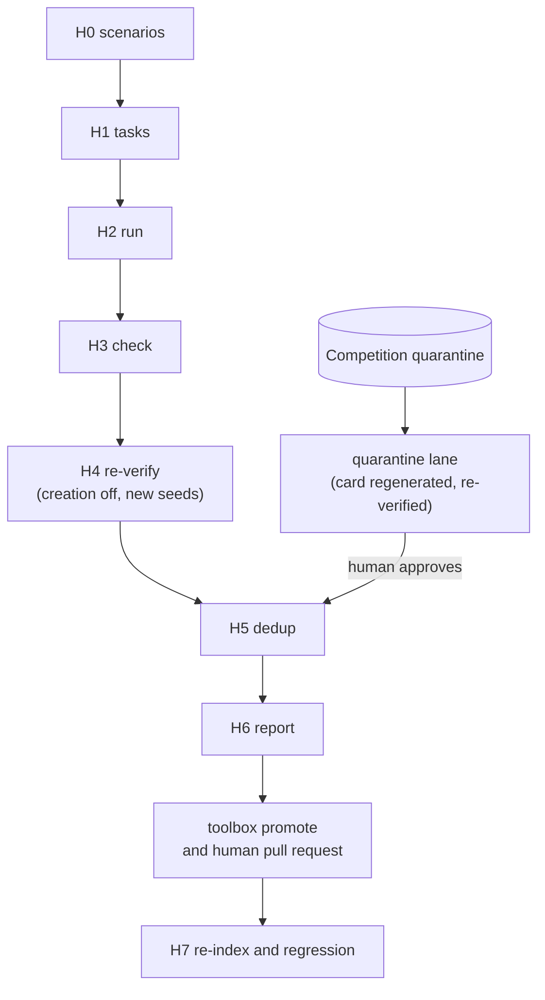

# Sim Harvest (Proposed)

!!! note "Status: Proposed"
    Nothing on this page is built yet. It is the design for team review.
    Harvest v0 is phase 5 of the [self-evolving agent](self-evolving-agent.md)
    roadmap, and it cannot start until its world has landed (see
    [Open questions](#open-questions)).

The self-evolving agent writes new tools while it works, and none reaches
git on its own. The sim harvest runs the full agent in walkie-ros's MuJoCo
simulation on generated tasks, checks each episode against ground truth,
re-runs the tools that seemed to help, and writes a report. A human reads it
and promotes the best drafts by pull request. Published work on
self-evolving agents reports that only a minority of drafts survive.

Harvest v0 is the smallest loop that answers "what does the agent come up
with": a task generator, programmatic checks, traces, simple dedup and a
report. Harvest v1 adds task sources, an LLM judge, ranking, start poses
away from the origin and runs on real detectors, but only after two v0
runs, and only if the reports are too long to read.

## Summary

- **Humans promote, nothing else does.** The planned `pixi run toolbox promote`
  prepares a branch, and a human opens, reviews and merges the pull request
  ([ADR-0048](decisions/0048-sim-harvest-promotion.md),
  [ADR-0037](decisions/0037-tool-tiers-bundles-effects.md)).
- **A fresh sim for every episode, scored on ground truth.** Each episode
  relaunches the sim stack at the map origin, because sim odometry drifts
  and cannot be reset. Position checks read `/mujoco_ground_truth/odom`,
  and failures are split into agent, navigation and localization.
- **One captured world.** Episodes run in chula_pat14_6, a captured living
  room and kitchen with twelve movable objects
  ([ADR-0030](decisions/0030-mujoco-sim-first.md)).
- **Behind the interlock.** GPSR episodes run at Standard or Unrestricted,
  the stranger and red-team sets at Competition. Unrestricted code is
  evidence, never a candidate ([ADR-0039](decisions/0039-access-levels.md),
  [ADR-0040](decisions/0040-sim-interlock.md)).
- **Mocked skills.** A `FakeSkillServer` returns the ADR-0027 outcomes for
  `run_skill` ([ADR-0044](decisions/0044-mocked-arm-atomics.md)). The pose
  and gripper atomics drive the simulated arms through walkie-ros's
  commander and MoveIt 2.
- **Isolated workers.** The harness sets each worker's domain and runs a
  loopback Zenoh router for it. `agent-sim` still follows the calling
  shell's domain ([ADR-0036](decisions/0036-agent-sim-shell-domain.md)).

## Pipeline



## The world: chula_pat14_6

walkie-ros's default sim world has a blank map and no free bodies, so it
cannot host a task like "bring me a mug from the kitchen". The harvest uses
chula_pat14_6, the living room and kitchen of the 16 October 2026
ChulaPat14_6 capture. It has a captured map, a keepout mask, and named
places in `source/30_16102026_ChulaPat14_6_world.toml` (`world.toml` on
this page), where each `pose` is a navigation approach goal.

| Name | Kind | Room | Reached when (H3) |
|---|---|---|---|
| `living_room`, `kitchen_room` | room | — | the base position is inside the room polygon |
| `tv`, `sofa` | location | `living_room` | the base is within 0.5 m of the approach pose |
| `shelf`, `bar`, `table` | location | `kitchen_room` | the base is within 0.5 m of the approach pose |
| `entrance_door` | door | — | the base is within 0.5 m of the approach pose |

The 0.5 m tolerance is a starting value. Location polygons in `world.toml`
are single points, so containment cannot be used for them. The world has
two each of six object kinds as free bodies named `task_<kind>_<i>`:
`apple`, `mug`, `chips_bag`, `pringles_can`, `red_plate` and
`water_bottle`. It has no person bodies, so people exist only as scenario
records served by oracle perception.

!!! warning "The world's home is still moving"
    On 23 October 2026 the assets sit in walkie-ros's `walkie_mujoco_worlds`
    package, under `simulation/mujoco/worlds/chula_pat14_6/`, on the branch
    `feat/chula-pat14-6-simulation` (walkie-ros PR #58), not on main. For a
    few commits they lived in a walkie-worlds repository, which has no
    remote and now keeps only local history. The migration is in progress,
    so paths here may change. Phase 5 should start only once the world and
    its tools are merged and pinned ([open question 4](#open-questions)).

## H0. Scenarios

A scenario is a YAML spec.

| Field | Contents | Used by |
|---|---|---|
| World | `chula_pat14_6` | the relaunch |
| Objects | placements of `task_<kind>_<i>`, with color, category and weight | `SetFreeJointState`, oracle perception, checkers |
| People | pose, gesture, clothing, name | oracle perception only |
| Door | an optional hinge angle | one `ResetWorld` call |
| GPSR data | a data directory built from the rooms and locations in `world.toml` and the six object kinds | the H1 generator |

**Placing objects.** One `SetFreeJointState` call places every object once
the relaunched sim is ready. It moves only the listed bodies. `ResetWorld`
restores the whole world, robot included, and may rewind sim time
(unverified), so the harness calls it only for a door override, before Nav2
is up. The `FakeSkillServer` mirrors picks and places with
`SetFreeJointState` too, and parks a held object away from the rooms until
it is placed.

**Ground truth and perception.** No component publishes ground-truth object
poses in sim today, so object ground truth comes from the spec and the `FakeSkillServer`'s
record. The arms and grippers collide with object bodies, so an object that
an arm knocks goes unrecorded until walkie-ros configures its installed
`FreeJointStatePublisherPlugin`, a config-only request
([ADR-0015](decisions/0015-repository-boundary.md)). Until the walkie-vision
nodes exist, `OraclePerception` in `src/walkie_agent/sim/oracle_perception.py`
publishes detections from a scene, with configurable noise and dropout
([Perception](perception.md#in-simulation)). It is built and knows
nothing of a task: it projects map-frame people and object boxes into each
camera image by TF, with no occlusion, and the HRI scenario already feeds
it. The harvest still owns its scenario fields above, and has to build the
`Scene` from them. Whether it also answers `DetectObjects` and `EmbedText`
in sim, and how it derives detection embeddings that `search_detections` can match, is still
open. walkie-vision's architecture page records the constraint: its fake
embedder's text and image vectors never match, so both sides must hash the
same key.

## H1. Task sources

| Source | How | v0 share | v1 share |
|---|---|---|---|
| GPSR generator | RoboCupAtHome/CommandGenerator pinned to a commit. A thin wrapper over `CommandGenerator(parse_data(dir)).generate_command_start(...)` records the template and follow-up keys, because the library returns only a string. Each command is rephrased with the official `alternativePhrasing` prompt at three difficulties: easy, moderate and hard. | about 80% | about 40% |
| Stranger set | Booth-style requests, multilingual, run at Competition | about 20% | about 15% |
| EGPSR setups | `EgpsrCommandGenerator.generate_setup(n)` for Finals-style episodes | — | about 10% |
| Curriculum proposer | An LLM that proposes the next task from the scenario, past successes and failures, and the toolbox. It starts with warm-up tasks. | — | about 20% |
| Red-team set | Injection, abuse and persistence attempts. The expected outcome is "contain or refuse". Run at Competition. | — | about 10% |
| Replayed intents | Real booth and competition requests, reduced to intents, with personal data stripped | — | about 5% |

The generator is third-party code in a harvest-only pixi environment, never
on the robot. Its HEAD notes that it needs a rewrite, so pin a commit and
confirm the module paths there. In v1, a constitution filter drops unsafe,
impossible or out-of-scope proposals before they run.

**Levels.** The harness passes the agent's `--access-level` flag for each
episode. Every episode runs with the `harvest` run profile, so creation and
search follow the access level, not a competition profile
([Competition Mode](competition.md#run-profiles)). Stranger-set and red-team
episodes therefore create and search only as the Competition level allows.

| Episodes | Starting level | Why |
|---|---|---|
| GPSR, about 30% | Unrestricted | so Unrestricted really explores and fills the atomic wishlist ([open question 1](#open-questions)) |
| GPSR, the rest | Standard | most promotable code is written here. A failed Standard episode is re-run once at Unrestricted. |
| Stranger set, red-team set | Competition | these test what a visitor can make the robot do |

## H2. Run

Each episode relaunches the sim stack, applies the scenario, restores the
walkie-database sim instance, starts a fresh agent at the episode's level,
runs in real time with a 7-minute limit, and records a trace.

| Trace part | Contents |
|---|---|
| Identity | task id, template key, paraphrase difficulty, level and seed |
| Tool calls | each call's arguments, result and latency |
| Creations | coder prompt hash, model, code, lint result, latency, tokens and cost |
| Outcome | spoken outputs and the final oracle world state |

### The world file

Once per run, the harness writes its own world file, and the report header
records how it was built and its hash. Earlier on walkie-ros's branch,
`integrate_world.py` built the file from `<world folder>/scene.xml` with
`--spawn-pose 0 0 0`. A later branch commit replaced that script and
`prepare_world.py` with `robot_bringup.world_loader.prepare_world()`. It takes a world name, a
variant, an output directory, and a named spawn or a spawn pose, writes
`<output dir>/<world>/<variant>/world.xml`, and runs in walkie-ros's sourced
environment. The proposed harness passes:

| Argument | Value | Why |
|---|---|---|
| `variant` | `lowpoly` | the lighter scene. The world's validation reports were made with it. |
| `spawn` | `origin` | the world manifest's default spawn is the living room |
| `output_dir` | the run directory | the launch's default, `$ROS_HOME/mujoco_worlds`, is shared with a developer's hand-run sim, and a harvest must never overwrite it |

!!! warning "Explicit model and map, not `world:=`"
    The launch's `world:=` mode runs AMCL with a spawn-matched start pose and
    the keepout and speed masks off. It would allow other start poses, but
    AMCL and Nav2 goal execution in this world have not had a live test. So
    harvest v0 passes the file with `mujoco_model:=` and the map with
    `map:=`, keeping the static identity `map` → `odom`
    ([Localization](#localization), [open question 3](#open-questions)). The
    harness follows whatever walkie-ros merges to main.

### Relaunch, per episode

Once per run, walkie-database's planned `pixi run db-seed-sim` writes the
seed, and the harness records its SHA-256. Each episode then runs these
steps on the worker's own domain and router, which stay up between episodes.

1. Stop the agent and the worker's database node, kill the sim launch's
   process group, and confirm that no node is left on the worker's domain.
2. Copy the seed to a new file in the episode's folder. A new path means
   nothing is ever restored into a file that a node still has open.
3. Start `nav_mujoco_omnibot.launch.py` with `mujoco_model:=` the world
   file, `map:=` the world's map, `headless:=true` and `use_rviz:=false`.
   In parallel, start the database node on the new file, with `map_id`
   `chula_pat14_6`.
4. If the scenario overrides the door, wait for `reset_world` and make the
   one `ResetWorld` call now, before Nav2 is up.
5. Wait until `reset_world` is served, `/clock` advances,
   `/robot_description` has arrived, Nav2's managed nodes are active, and
   `/mujoco_ground_truth/odom` reads the origin within 2 cm and 1°. Also
   wait until `/walkie_database/find_objects` answers with `success` true.
6. Place the objects with one `SetFreeJointState` call.
7. Start the agent with the episode's `--access-level`.

walkie-database's Sim Harvest Support page covers the database steps and
what the step 5 probe proves. A world-frame and a spawn-relative topic both
read zero at the origin, so the smoke run checks the frame once from the
living-room spawn, which should read about (1.76, −1.48).

| Step | Time | Status |
|---|---|---|
| Graceful stop | about 15 s. `planner_server` and `controller_server` ignore SIGINT and SIGTERM and get SIGKILL. | documented by walkie-ros, default world |
| Start | about 10 s | documented by walkie-ros, default world |
| Graceful relaunch | about 25 s | sum of the two |
| Relaunch, killing the process group | 12 to 17 s | estimated |
| Start with chula_pat14_6 | — | unmeasured |
| Database node start | runs while the sim starts | unmeasured |

**The interlock.** The agent stops before the sim goes down and starts only
after the new sim is ready, so the [sim interlock](access-levels.md) never
reads a relaunch as a reason to demote. chula_pat14_6 uses the default
world's MuJoCo launch and robot description, so the interlock sees the same
hardware plugin and node. `run_skill` is mocked; the pose and gripper
atomics move the simulated arms through the commander
([Arm Manipulation](manipulation.md)).

### Isolation

A worker never touches nodes that were already running on the machine.

| Per worker `i` | Value | Why |
|---|---|---|
| `ROS_DOMAIN_ID` | 77 + i, set by the harness | a shell export never applies. It stays off the robot's domain 23 and off every other worker. |
| Zenoh router | its own, on a localhost-only port | the interlock grants Unrestricted only with loopback-only Zenoh on a dedicated domain |
| Simulator | its own MuJoCo instance | one worker's relaunch never touches another |
| Database node | its own, restarted every episode on a new copy of the seed | no episode or worker sees another's memory |
| Audio | its own PipeWire null sink | speech runs and is traced, but nothing is audible |
| Drafts, index and episode files | `harvest/<run-id>/w<i>/` | workers never write one index at once. H5 merges their drafts. |

**Evaluator services.** Only the harness holds `reset_world`, `set_pause`,
`step_simulation`, `set_free_joint_state` and `controller_manager`, which are
on every level's never-list. A tool that reached them could move the robot
or objects, stop time or swap controllers, and so fake its own success.

**Spend and search.** The harvest uses `WALKIE_HARVEST_API_KEY`, with its
own spend limit, so hitting it cuts off no other role. In scored episodes
the agent's `look_up_online` uses `FakeSearchProvider`, so a score does not
depend on a search engine's results that day. The coder's web search goes
live on the sim search keys, `WALKIE_BRAVE_KEY_SIM` and
`WALKIE_TAVILY_KEY_SIM`, with a per-run cap, and traces keep the
query hash, result count and site names ([Competition Mode](competition.md)).

## Localization

Given an explicit model and map, `nav_mujoco_omnibot.launch.py` publishes
`map` → `odom` as a static identity, with no AMCL. `odom` is the omni-wheel
controller's open-loop odometry, the integral of the commanded velocity. So
the robot must start at the map origin, a Nav2 initial pose does nothing,
and the estimate drifts until the relaunch resets it. walkie-ros measured
0.17 to 0.43 m after one or two goals in its default and walled test
worlds. Drift in chula_pat14_6 is unmeasured.

In chula_pat14_6 the map frame is the MuJoCo world frame. The origin is
about 0.8 m outside the entrance doorway frame, facing it, on the invisible
physics plane outside the rooms. The map gives the costmap its static layer
and the checkers named regions, but does not localize. As odometry drifts,
the static layer slides against live lidar obstacles, which can create
doubled or phantom walls at the doorway. The captured map also holds scan
cells with no 3D geometry near the origin, which lidar never clears.

| Doorway quantity | Value | Source |
|---|---|---|
| Clear width of the entrance frame | 0.75 m | the world's `scene.xml` |
| Narrowest gap past the open door leaf | about 0.64 m | computed from the world's `scene.xml` |
| Door at start | 85° open | the world's `scene.xml` |
| Sim Nav2 footprint width | 0.478 m, plus 0.02 m padding | walkie-ros sim Nav2 parameters |
| Margin per side at the narrowest gap | about 6 cm | computed from the rows above |
| Clearance at the sofa approach | 13 mm | the world's 2D connectivity check |

From the origin, walkie-ros's connectivity check reaches all eight approach
goals. It tests a 0.30 m radius circle against 2D projections of the scene,
with the door open, on a 0.01 m grid, so it does not prove Nav2 end to end.
The 13 mm sofa margin is smaller than the global costmap's 0.02 m padding,
so the global planner may reject the sofa approach. The smoke run should
watch for it.

## H3. Check

Programmatic checkers, derived from the spec, decide success: the object is
inside the target region, counts and properties equal the spec, the right
person was reached, the required content was spoken, and the robot is in the
right place. The agent's own claim of success never counts. Trailing actions
after the success point are cut before a tool is credited. Open-ended tasks
with no programmatic check are listed as "unchecked" in v0. In v1, an LLM
judge from a different model family scores them with a rubric, calibrated
on about 100 human-labeled episodes, with Cohen's kappa in every report.

### Position checks

Position checks read the true base pose on `/mujoco_ground_truth/odom`
(`nav_msgs/Odometry`, no TF), which walkie-ros's MuJoCo hardware plugin
publishes on main. The world frame is the map frame, so the pose compares
directly with `world.toml`, using the rules in
[the places table](#the-world-chula_pat14_6). Only the arms and grippers
collide with static geometry, so physics never stops the base inside a
wall. A base inside a keepout or occupied cell is a navigation failure.

Each check, and every Nav2 abort or failure, records the localization
error, the distance between Nav2's estimate and the true pose:

| Failure | When | What it points at |
|---|---|---|
| Localization | the localization error at the failing check or abort was above the threshold | the sim stack. These count towards the ground-truth localization request ([open question 3](#open-questions)). |
| Navigation | the error was below the threshold, and the base entered a keepout or occupied cell. Proposed, not settled: also a Nav2 abort on a valid goal ([open question 7](#open-questions)). | Nav2 in this world, keepout, the doorway |
| Agent | the error was below the threshold, and the task failed for any other reason | the agent, its tools and its prompts |

## H4. Re-verify

A successful episode can be luck. For each one that created a tool, the
harness pre-registers the draft, switches creation off, and re-runs the task
on 3 new seeds (v1: 5 seeds plus 2 to 3 neighboring tasks from the same
template). The score is the tool's own step: the call returned ok and its
programmatic postcondition held. Episode success also depends on navigation
and perception, so a good tool still gets credit if the doorway fails.

### Quarantine lane

Tools made at Competition land in quarantine, which is never loaded
automatically ([Competition Mode](competition.md)). Each harvest imports
them into `quarantine_lane/`, never into the draft pool. Their docstring,
questions and examples are dropped, and the card is regenerated from the
code. They are re-verified with creation off, stay hidden from every coder
and from `find_tools`, and join the pool only after a human approves them.
So stranger-authored and web-derived text never reach the sim coders.

## H5. Dedup

In v0, drafts with the same normalized AST hash merge. The hash strips
names, comments and constants, so drafts that differ only in naming or a
literal count as one. Drafts with the same atomic dependencies and effects
are grouped for the human, but not merged.

A near-duplicate of a git tool is logged as a retrieval miss: the agent
rebuilt something it had, so the fix is that tool's description or
questions. Near means a card cosine above τ_review, the cut-off above which
a draft is kept with a `similar_to` edge. Its first guess is 0.80, until
about 100 labeled pairs calibrate it
([ADR-0046](decisions/0046-hybrid-tool-index.md)).

v1 adds behavioral fingerprints on a fixed probe set, and clustering with
`AgglomerativeClustering(n_clusters=None, metric="cosine", linkage="average",
distance_threshold=1 - τ_review)` (scikit-learn 1.9.1, installed here).

## H6. Report and human review

Each run writes `$WALKIE_TOOLS_HOME/harvest/<run-id>/report.json` and
`report.md`.

| Part | Contents |
|---|---|
| Header | this repository's commit, the world, the walkie-ros commit with its submodule pointers and whether its tree was clean, the walkie-worlds commit if the world's assets live there, how the world file was built and its hash, the localization mode, the generator commit, models, episodes per level, wall time and spend |
| Success | by level, source and template, with failures split into agent, navigation and localization |
| Competition creation rate | on the GPSR set. It should fall towards zero over the season ([open question 9](#open-questions)). |
| Every draft | stamp, effects, dependencies, step outcomes on re-verification, traces, latency, nearest existing tool, failure codes, paths and promote command |
| Also | retrieval misses, the atomic wishlist, creation latency per level, policy violations and coverage per template |

Each draft's lint stamp sits next to the highest level its traces reached.
A tool stamped Standard only for a computed name, whose traces never left
Competition, is flagged for a rewrite ([Access Levels](access-levels.md)).

**Review.** In v0, a human picks candidates directly from the report, with
no gates. In v1, clusters are sorted by trials, the Wilson lower bound at
95% (a pessimistic success rate that punishes small samples), distinct
tasks, novelty and weak-model lift, as sort keys, not filters. A cluster is
"ready for review" from about 10 tool-step trials with a lower bound of at
least 0.6, so at 10 trials only 10/10 qualifies (9/10 gives 0.596).

### Promote targets

| Target | When | What happens |
|---|---|---|
| `bundled_preset` | the tool only composes atomics through `ctx.tools` and fits the bundle DSL | `toolbox promote` renders it as data |
| `atomic` | code stamped Competition or Standard, and useful at Competition | moved with its manifest, with `runtime = "sandbox"` ([ADR-0047](decisions/0047-sandbox-and-bridges.md)) |
| Atomic wishlist | stamped Unrestricted, or failed at Standard and passed at Unrestricted | grouped by the raw interfaces it touched. A human writes the atomic, with an interface ADR first if a new interface is needed (ADR-0015 order). Unrestricted code is evidence, not a candidate. |
| Discard | anything else | — |

```bash title="Promote a candidate"
pixi run toolbox promote <tool-or-cluster-id> --tier bundled_preset|atomic
```

The command creates a branch and writes the tool file, generated tests,
scenario fixtures and a doc stub. A human opens, reviews and merges the pull
request ([open question 2](#open-questions)). For `--tier atomic`, the
command moves the file into `src/walkie_agent/tools/atomic/` and adds a
fake-backed test stub. It writes `META.effect`; `META.ros` as
`{read, call, publish, action}` and `META.net`, both from the lint and the
run traces; `META.origin`; `META.provenance` with the draft id, coder model
and harvest run; and `META.runtime = "sandbox"`. It refuses
Unrestricted-stamped code unless `--rewrite` is given.

Once in git, the reviewed manifest replaces the level policy
([Access Levels](access-levels.md)). A generated tool runs in the agent
process only after a human rewrites or audits it and sets
`META.runtime = "inprocess"` with a `META.reviewer`. A new CI test fails
when a file in `tools/atomic/` has generated provenance and `"inprocess"`
with no reviewer, or an Unrestricted stamp with no rewrite note.

**Drafts from practice sessions** are the one exception to the harvest
route. Such a draft needs at least 2 successful traced runs and a replay
test against the planned `FakeScene`, and still reaches git only through
`toolbox promote` and a reviewed pull request.

## H7. Re-index and regression

After a merge, the harness rebuilds the tool index
([ADR-0046](decisions/0046-hybrid-tool-index.md)), runs the fixed regression
set with the cloud model and the local fallback, and compares the results
with the baseline. Git tools unused in the last few harvest runs are flagged
for deprecation review, so the toolbox does not only grow.

## Cost control

Each run has a spend cap, enforced by the harvest key's limit, and a
wall-time cap. A full run's cost is unknown until the first one, so v0
starts at about 100 episodes. With the 7-minute limit and a 25 s relaunch,
that pass takes at most about 12.4 hours on one worker (computed, not
measured), before agent start-up, H4 re-verification and Unrestricted
re-runs of failed Standard episodes.

**Pre-bake list.** Research into competition tasks suggests building or
harvesting these first: `tell_time` and `tell_date` (GPSR talk list),
`count_people_by_clothing`, `count_objects_on_placement`,
`compare_object_property` with an object-property table (weight cannot be
seen), `countdown`, `weather_forecast`, `exchange_rate`,
`wikipedia_summary`, and the curated sound pack for `play_sound`.

## Testing

- **Unit tests** cover the report schema, the AST-hash dedup and the
  position checkers, with recorded ground-truth poses: inside and outside a
  room polygon, near and far from an approach pose, inside a keepout cell,
  and the localization-versus-agent split, including at a Nav2 abort. A
  `FakeSkillServer` test checks that it leaves the robot pose alone.
- **The smoke run**, `pixi run harvest-smoke`, runs 3 scenarios in
  consecutive relaunched episodes on one worker. It checks that the
  interlock grants the requested level after every relaunch, that Nav2
  reaches `living_room` from the origin, and, once, that the ground-truth
  topic is in the world frame. It logs ground truth against odometry at the
  kitchen goals. `pixi run test` never runs it. Wilson and clustering tests
  come with v1.

## Risks

| Risk | Mitigation |
|---|---|
| Harvest yield is low or costly | Start at about 100 episodes, the harvest key's limit, and tool-step scoring. Expect a minority of drafts to survive: published skill-induction work reports low yield. |
| Sim localization distorts navigation results | Position checks read ground truth. Each check and every Nav2 abort logs the localization error, so drift failures are reported apart. The relaunch resets drift. Ground-truth localization is requested if more than about 10% of first-run episodes fail on localization. |
| The harvest world is not landed | The world and walkie-ros's world tools are on a branch. The recommendation is to start phase 5 only once they are merged and pinned. The report header records the commits and how the world file was built. |
| Every episode starts by passing a narrow doorway | About 6 cm per side at the narrowest gap. The smoke run drives from the origin to `living_room`, navigation failures are reported apart, and H4 scores the tool's own step. Fallback: a living-room start ([open question 6](#open-questions)). |
| Drafts crowd retrieval | Cluster representatives only, per-namespace caps, stamps and level filters, and deprecation flags |
| The interlock demotes during harvest runs by mistake | Pause is not a demotion, viewers do not count as drivers, the agent stops before each relaunch and starts only once the new sim is ready, check values are logged, and the smoke run covers consecutive episodes. |
| Unrestricted code mistaken for a promotion candidate | It is stamped Unrestricted and reported as wishlist only. `toolbox promote` refuses it for `--tier atomic` without `--rewrite`, and a CI check backs that up. |
| The LLM judge is miscalibrated (v1) | Programmatic checkers first, a different model family, and Cohen's kappa on about 100 labels reported every run |
| The GPSR generator is unstable | A pinned commit, a thin wrapper that records template keys, and a harvest-only environment |

## What harvest needs from other repositories

Each of these is a request, not a change made here
([ADR-0015](decisions/0015-repository-boundary.md)).

| Repository | Request | Why | Blocks v0 |
|---|---|---|---|
| walkie-ros | Merge the world to main: the chula_pat14_6 assets, the world manifest, `robot_bringup.world_loader` and the launch changes. This repository then pins the commit. | runs must be reproducible, and the harness calls the world loader and the launch | yes |
| walkie-ros | Land the navigation pointer change that keeps the omni base facing its travel direction under MPPI | it changes Nav2 behavior, so results before and after do not compare | yes, as part of landing the world |
| walkie-ros | Keepout in sim Nav2 | the real robot runs with keepout. Without it, sim Nav2 may plan through the sofa, shelf and bar. | no. Until then, the H3 keepout check flags those episodes. |
| walkie-ros | Ground-truth localization in sim: a sim-only `map` → `odom` from ground truth | removes drift as a failure cause and allows other start poses | only if more than about 10% of first-run episodes fail on localization |
| walkie-ros | Configure `FreeJointStatePublisherPlugin` in the sim plugin config | publishes object poses, needed once real detectors run on rendered frames | no |
| walkie-worlds | Nothing while the world's assets stay in walkie-ros. If they move back, push it to a remote and pin its commit too. | it has no remote and keeps only local history | only if the assets move back |
| walkie-database | No change to the node. The planned `pixi run db-seed-sim` builds the sim seed from the new `config/locations.chula_pat14_6.toml` and the world's `world.toml`. Details are on its Sim Harvest Support page. | every episode restores a seeded instance, so no episode's memories leak into the next | yes, for the per-episode restore |
| walkie-vision | None for harvest v0 | `oracle_perception` stands in for its nodes. Real detectors on rendered frames come later, once those nodes exist. | no |

## What lives where

| Piece | Repository | Location |
|---|---|---|
| Harness: scenarios, task sources, relaunch and readiness wait, position checkers, dedup, report, promote | walkie-agent-ros | `src/walkie_agent/toolsmith/harvest/` (new) |
| Oracle perception and `FakeSkillServer` | walkie-agent-ros | `src/walkie_agent/sim/oracle_perception.py` (built, with `scene.py` and `projection.py`; the harvest's scenario feeds it), `src/walkie_agent/sim/fake_skill_server.py` (new) |
| Named places of the harvest world, and of `agent-sim` | walkie-agent-ros | `config/locations.chula_pat14_6.toml` (built for HRI with `door`, `living_room` and `kitchen`; the harvest adds its own names), `config/locations.sim.toml` (unchanged) |
| Harvest-only environment with the pinned GPSR generator, and the `harvest-smoke` and `toolbox` tasks | walkie-agent-ros | `pixi.toml` (new environment and tasks) |
| Promoted tools | walkie-agent-ros | `src/walkie_agent/tools/atomic/`, `src/walkie_agent/tools/bundled_preset/` (new) |
| Reports, per-worker drafts, indexes and episode database files, quarantine lane | local, never in git | `$WALKIE_TOOLS_HOME/harvest/<run-id>/`, `$WALKIE_TOOLS_HOME/quarantine_lane/` (new) |
| World assets: scenes, map, keepout mask, `world.toml` | walkie-ros, `walkie_mujoco_worlds` package | `simulation/mujoco/worlds/chula_pat14_6/`, on a branch, moving (see [The world file](#the-world-file)) |
| World loader | walkie-ros | `bringup/robot_bringup/world_loader.py`, on a branch |
| Sim launch and ground-truth odometry | walkie-ros | `nav_mujoco_omnibot.launch.py`, MuJoCo hardware plugin (no change requested here) |
| Sim memory seed builder | walkie-database | `pixi run db-seed-sim`, `walkie_database.seed_sim` (new) |
| GPSR generator | RoboCupAtHome/CommandGenerator | a pinned commit, harvest environment only |

## Open questions

1. **What share of GPSR episodes starts at Unrestricted?** Recommended:
   about 30%, so Unrestricted explores while most episodes produce
   promotable Standard code. Alternatives: only re-runs of failed Standard
   episodes (cheapest, but Unrestricted sees only failures), or half and
   half (more wishlist evidence, fewer candidates). Blocks: the schedule.
2. **Who reviews harvest reports, and how often?** Recommended: one named
   reviewer per tier, weekly. Alternatives: after every run (faster
   feedback, more load), or before each competition only (least load, large
   risky batches). Blocks: phase 5's done-when.
3. **Which localization does v0 use?** Recommended: the static identity
   launch. Ask walkie-ros for ground-truth localization if more than about
   10% of first-run episodes fail on localization, counting Nav2 aborts.
   Blocks: nothing in v0.
4. **When does the world land?** Recommended: merge walkie-ros's world
   change (assets, world loader, launch) and the MPPI navigation pointer
   change to main, and pin the commit before phase 5. If the assets move
   back to walkie-worlds, push and pin it too. Blocks: the start of phase 5.
5. **Keepout in sim Nav2?** Recommended: request it with the merge, but do
   not block v0. Blocks: nothing in v0. Until it lands, the H3 keepout check
   flags affected episodes.
6. **What is the fallback if the doorway fails often?** The origin start is
   settled. Recommended fallback: start in the living room with a
   spawn-matched static `map` → `odom`, which needs no walkie-ros change.
   The harness runs `mujoco_omnibot.launch.py`, its own
   `static_transform_publisher` set to the spawn, and Nav2 bringup with
   `use_localization:=false`. Blocks: the smoke run's pass criteria.
7. **Which localization-error threshold, approach tolerance and Nav2-abort
   rule?** The tolerance starts at 0.5 m, the threshold has no value, and
   the abort rule is a proposal. A suggestion, not yet decided: set all
   three from the smoke run and the first run. Blocks: a trustworthy
   failure split.
8. **Which GPSR generator commit?** Recommended: one whose library and data
   parser work with the wrapper, recorded in the report header. Blocks: H1.
9. **Which episodes measure the Competition creation rate?** No GPSR
   episode runs at Competition, and there is no recommendation yet. Option
   a: re-run a fixed slice of GPSR tasks at Competition in every harvest
   run, which compares like with like but costs episodes. Option b: count
   the logged harvest misses from Competition runs with the `gpsr` profile,
   which costs nothing extra but comes only from real events. Blocks: that
   line of the report.

## Decisions

Click a decision to expand it. All of these are proposed. See
[Architecture](index.md) for how decisions work.

??? note "ADR-0048: Promote generated tools only from a sim harvest, through a human-reviewed pull request · Proposed"

    --8<-- "architecture/decisions/0048-sim-harvest-promotion.md:body"
