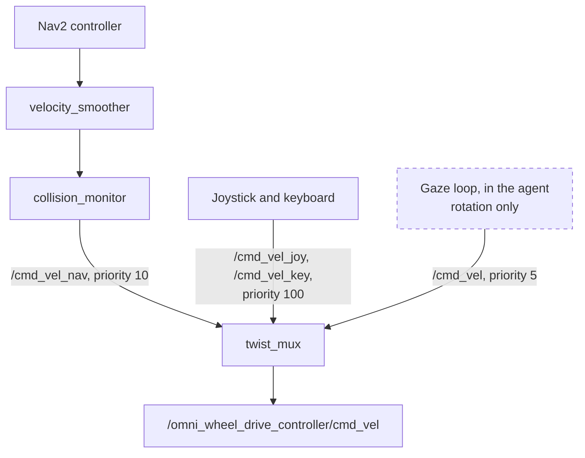
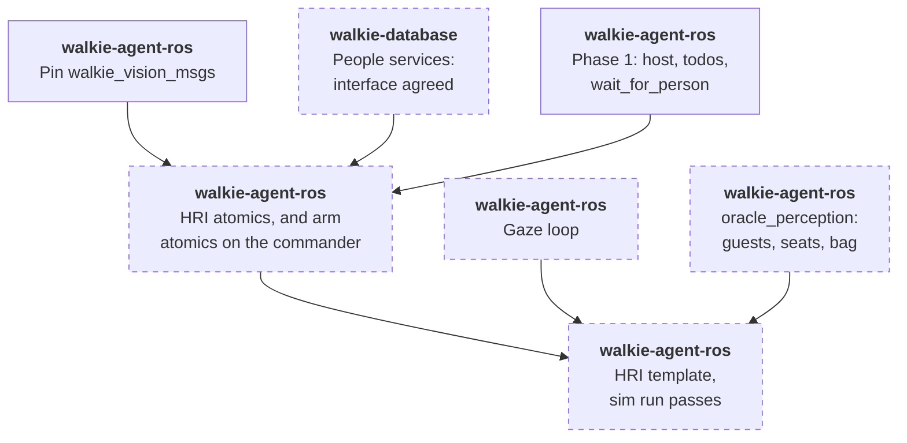
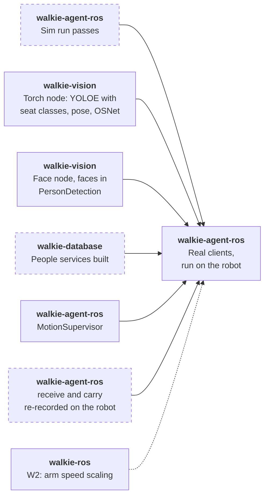

# HRI Task (Proposed)

!!! note "Status: Proposed, six atomics built"
    The four people and seat atomics are built and tested on fakes. The arm
    atomics `move_arm_to_pose` and `set_gripper` are built too, and call the
    commander. Their status is in the [Atomics](#atomics) table. The rest of
    this page is the design for team review. Each of the
    [open questions](#open-questions) says what it blocks.

The HRI task (RoboCup@Home 2026 rulebook, section 5.1) is the first task
the [self-evolving agent](self-evolving-agent.md) will run end to end. It
needs people, seats, gaze and one simple arm motion, but no object search,
no skill server and no embedding bake-off, so it is the shortest path to a
test on the robot. This page plans that first slice, on top of
[Perception](perception.md) and [Arm Manipulation](manipulation.md).

## Summary

- **Slice 1 scores the main goal up to the bag hand-over:** up to 600 of
  the task's 1,450 points, plus 60 bonus points for asking no confirmation
  questions.
- **Off its path:** `DetectObjects`, `EmbedText`, the embedding bake-off,
  walkie-database's migration after it, person depth, the bundle runtime
  and the skill server.
- **On its path:** walkie-vision's torch and face nodes, walkie-database's
  people services, and in this repository phase 1, six atomics (four are
  built), the arm atomics (built) and an HRI template. On the robot, also
  the MotionSupervisor.
- **The bag goes in the left hand.** The robot holds out its hand, the
  guest says when the bag is in it, and the gripper closes. The two poses
  it needs, `receive` and `carry`, come from walkie-agent-v2's hand-over.
- **Gaze turns the base.** An agent-side loop publishes rotation only, on
  `/cmd_vel`, below Nav2 and the joystick in `twist_mux`. It is the one
  exception to `FORBIDDEN_NAMES`
  ([ADR-0051](decisions/0051-agent-side-gaze-loop.md)).
- **The LLM runs the task** from a todo template. Presets come later, from
  the slice's traces.
- **Sim first,** with `oracle_perception` publishing guests who pace and
  switch seats, then the robot.

## The task

The robot starts in the living room, near the seats. Two guests arrive at
the door, one after the other. For each guest, the robot meets them at the
door, learns their name and favourite drink, guides them to the living
room and offers a free seat. When both are seated, it introduces them to
each other: it looks at one guest and says the other's name and drink, for
both guests. The second guest brings a bag for the host, who then leads
the robot to a drop spot. The test lasts 6 minutes.

Rules that shape the design:

- **Gaze is scored only when continuous.** Guests pace slightly left and
  right while they talk, and other people may appear behind them.
- **The robot approaches.** It may not ask a guest to step in front of it.
- **No confirmation questions.** "Did you say James?" loses the bonus.
  Asking again after not hearing an answer is allowed. Continuing with a
  wrong name or drink costs 40 points each.
- **Seats change.** Passive guests may sit on the couch, referees may add
  chairs, and seated guests may switch seats before the introductions.
- **No help with identities.** Asking who is who costs 200 points per
  guest.
- **The bag comes from the guest's hand.** Telling the guest to put it on
  the robot scores nothing for the hand-over and costs 50 points. Asking
  the guest for help during the hand-over reduces the score.
- **Names and drinks are open.** Names are any popular English name, and
  drinks any popular drink, not only those in the object list.
- **Only the two guests are introduced.** walkie-agent-v2 also introduced
  the host, from environment variables. The 2026 score sheet does not ask
  for it.

| Score item | Points | Slice 1 |
| ---------- | ------ | ------- |
| Offer a free seat | 2×100 | Yes |
| Look in the direction of navigation | 2×15 | Yes, from Nav2 |
| Look at the person talking, when receiving a guest | 2×50 | Yes, the gaze loop |
| Introduce the guests: each one's name and drink | 4×30 | Yes |
| Look at the correct guest while introducing | 2×50 | Yes, the gaze loop |
| Take the bag from the guest's hand | 50 | Yes, with the left gripper |
| Follow the host, drop the bag | 200, 50 | No: following is open ([Perception question 5](perception.md#open-questions)) |
| Bonus: detect the doorbell | 2×30 | No |
| Bonus: open the door | 2×200 | No |
| Bonus: describe the first guest to the second | 4×20, and −20 per wrong attribute | No ([Perception question 4](perception.md#open-questions)) |
| Bonus: no confirmation questions | 4×15 | Yes |

Penalties the slice must avoid: wrong information memorized (4×−40), not
recognizing people (2×−200), an alternative input such as a keyboard
(6×−20), and telling the guest to put the bag on the robot (−50).

## One run


- **Every navigation atomic stops the gaze loop** before it sends a goal,
  so the robot faces where it drives. walkie-ros's MPPI parameters already
  run `PathAngleCritic` in forward-preference mode. Nothing more is built
  for "look in the direction of navigation", but the sim checks it.
- **The robot drives to fixed locations,** `door` and `living_room` in
  `config/locations.toml`, set on the setup days. It never drives to a
  person, so `localize_person` and a person's depth stay off the path
  ([Perception question 1](perception.md#open-questions)).
- **`wait_for_person` ends the turn,** and the guest's answer starts the
  next one. The gaze loop keeps running in between.

## Atomics

| Atomic | Effect | Status | What it does |
| ------ | ------ | ------ | ------------ |
| `find_people(gesture=None)` | P | Built (sim) | Person handles, left to right. Each line gives where the person is in the image (left, centre or right), their box height as a share of the image height, their posture and gestures, and whether the face is seen well enough to recognize them: `face seen`, `face too small or unclear to recognize`, or `no face seen`. The height lets the LLM pick the nearest. The first line names the set. With `gesture`, only the people who show it |
| `recognize_person(person)` | R | Built (sim) | Takes one handle or the whole set from one `find_people` call. Matches the face first, else the appearance, else `UNKNOWN`. Each model among the person's vectors is matched on its own, within that model's distance limit. Over a set, names go to people closest match first, so no name is given twice |
| `remember_person(person, name, facts={})` | W | Built (sim) | Stores the name, `facts` such as `{"drink": "milk"}`, the handle's own face and appearance vectors, and those collected for its track, minus outliers. On the robot, walkie-database will keep the facts in `person.attributes`. Takes one handle, not a set. Declares the code's provisional `W` effect until [Perception question 3](perception.md#open-questions) is decided |
| `find_seats()` | P | Built (sim) | Seat handles, one per place to sit, left to right by the place's centre. A sofa gives a left, a middle and a right place. Each is `free` or `taken`, and the last line counts the free places |
| `look_at(target)` | N | New ([ADR-0051](decisions/0051-agent-side-gaze-loop.md)) | Starts the gaze loop on a person, or turns to a seat and holds. Returns at once |
| `stop_looking()` | N | New | Stops the gaze loop |
| `wait_for_person(question)` | — | Phase 1, a core tool | Speaks, marks the todo item waiting and ends the turn |
| `move_arm_to_pose(pose, arm)` | M | Built (sim), as on [Manipulation](manipulation.md#tools), with two new poses | Moves the left arm to `receive` or `carry`, and checks the joints |
| `set_gripper(arm, state)` | M | Built (sim), as on [Manipulation](manipulation.md#tools) | Opens or closes the left gripper. After a close, says whether it holds something |

`navigate_to_location` and `speak` exist today. `refind_person` is not
needed: the gaze loop follows the track, and the face is matched again at
the introductions.

**Built (sim)** means built and tested in this repository, not yet run on
the robot or with walkie-vision. The two arm atomics are tested on the
`FakeCommander` and load only with `--arms`
([Manipulation](manipulation.md#backends)). For the people and seat
atomics:

- **Where the code is.** Each atomic is a module in
  `src/walkie_agent/tools/atomic/`, with what they share in
  `_perception.py`. The rules they use, ported from walkie-agent-v2 with
  its defaults, are plain functions in `src/walkie_agent/perception/`:
  `gestures.py`, `seating.py`, `identity.py` and `geometry.py`.
- **Two backends.** `vision` is a `VisionFeed`, which subscribes to
  `/walkie_vision/people` and `/walkie_vision/objects`.
  `create_walkie_agent` always adds it. `people_memory` is an
  `InMemoryPeopleMemory`, a mock of walkie-database's proposed people
  services. The agent adds it only with the `--mock-people-memory` flag,
  which `pixi run agent-sim` passes, and clears it at every new task.
  Without the flag, `recognize_person` and `remember_person` do not load
  ([The Agent](agent.md#where-atomics-live)).
- **Tested over ROS.** The tests run all four against a fake publisher of
  both arrays, with vectors from `src/walkie_agent/sim/fake_vectors.py`
  and the transforms from `map` to the camera on `/tf_static`. A test
  that drives the base publishes it on `/tf`.
- **Nothing publishes in sim yet.** All four load under `agent-sim`, but
  until `oracle_perception` exists, `find_people` and `find_seats` fail
  with `UNAVAILABLE`. So no handle exists for the other two.
- **Handles.** Person and seat handles go stale after 5 cm of base
  translation or 10 minutes. A turn does not stale them, because the gaze
  loop turns the base. Each keeps `heading_map`, the map-frame heading of
  the face, the body or the place, computed from `camera_info` and TF at
  the image's stamp. The gaze loop and `look_at` will turn to it.
- **Motion counts from the image.** A handle set is stored with the base's
  pose at the image's stamp, so a drive between the image and the call
  counts toward the 5 cm. If TF has no pose at the stamp within 0.2 s, or
  the array has no stamp, the atomic stores nothing and fails with
  `UNAVAILABLE`. The pose at the call would let up to a second of motion
  pass unseen, and without the transform at the stamp no box has a
  heading either.
- **One TF lookup per image.** The camera's transform at the stamp is
  looked up once, and each box's ray is turned with it. Without the
  transform, no box has a heading. A ray with no yaw, such as the centre
  ray of a camera that looks straight down, gets none, and the other
  boxes keep theirs.
- **A stop stores nothing.** A stop or a reset ends `find_people` and
  `find_seats` with `CANCELLED`, also when a fresh array was at hand. They
  check again just before they store the handles.

What the LLM reads from three calls, with two guests remembered:

```text
find_people()
per_51c0: 3 people in view, left to right.
per_51c0.0: left, height 0.83, standing, waving, face seen
per_51c0.1: centre, height 0.62, sitting, face seen
per_51c0.2: right, height 0.41, sitting, face too small or unclear to recognize

recognize_person(person="per_51c0")
per_51c0.0 (left): UNKNOWN
per_51c0.1 (centre): Sam, drink: milk
per_51c0.2 (right): Ana, drink: tea

find_seats()
seat_7a1e.0: chair, free, left
seat_7a1e.1: sofa, left place, taken, centre
seat_7a1e.2: sofa, middle place, free, centre
seat_7a1e.3: sofa, right place, taken, right
Free places: 2 of 4.
```

Ana's face is too small or unclear to match, so her appearance names her.

### Seats

- **Seat classes.** The torch node's streaming class list includes
  `chair`, `sofa`, `armchair` and `stool`, the classes walkie-agent-v2
  used (`HRI_SEAT_CLASSES`). How a task sets that list is
  [question 1](#open-questions). `find_seats` reads the seat classes from
  `SeatingConfig` in `perception/seating.py`. When the objects message's
  class list holds none of them, its `NOT_FOUND` says the detector is not
  looking for seats.
- **People from the same image.** `find_seats` takes the newest
  `/walkie_vision/objects` message, at most 1 s old, and the
  `/walkie_vision/people` message with the same `header.stamp`. It waits
  up to 0.5 s more for that one, then fails with `UNAVAILABLE`.
- **Occupancy.** A seat is taken when a person's seating anchor lies in
  its box: the hips, or else the lower centre of the person's box. A sofa
  splits into left, middle and right places, each with its own handle.
  This and its tests are ported from walkie-agent-v2's
  `tasks/skills/seating.py`.
- **Left to right by place.** The places are sorted by their own box
  centre, after each sofa is split. So a chair in front of a sofa's middle
  comes between the sofa's left and right places, and the first free
  handle is the leftmost free place. Places with the same centre keep the
  detector's order.
- **Everyone in view counts as seated,** as in walkie-agent-v2. The guest
  the robot brought stands beside it, outside the view of the seats. A
  person whose anchor is on no seat takes none.
- **One view.** The robot looks from one living-room pose that sees every
  seat. walkie-agent-v2 turned to several headings and merged what it saw.
  Whether slice 1 needs that is [question 2](#open-questions).
- **Showing the seat.** The robot turns to the free place with `look_at`
  and says which one it is, for example "the left side of the sofa". A
  pointing arm pose comes with the real arms. A seat handle keeps its
  heading from when the image was seen, because the handle outlives the
  TF buffer's 10 s.

### Faces collected while talking

`VisionFeed` collects face and appearance vectors for every visible
track, not only the one the gaze loop follows, so the collection works
before the gaze loop exists. For each track it keeps, with each vector's
model name and the stamp of its image:

- **20 face vectors,** the newest by stamp, of faces that walkie-agent-v2
  trusted: a detection score of at least 0.5 and a face box that spans at
  least 0.0469 rad, √((width / fx) × (height / fy)) with the camera's
  focal lengths. That is v2's 2,500 px² (50 × 50 px) on the robot's ZED 2i
  at Stereolabs' nominal fx of 1,066 px, to check against the robot's own
  calibration. An angle holds on any camera: the simulation's 640 × 360
  head camera has fx 224 px, where the same face needs only 10.5 px;
- **20 appearance vectors,** the newest by stamp;
- **for at most 32 tracks,** dropping a track unseen for 60 s. Track id 0
  means untracked and is never collected.

How a collection stays with one person:

- **By stamp, not by arrival.** A late array's vectors go in their place,
  and a full collection drops its oldest stamp first.
- **A generation per collection.** A collection takes the next number of
  one count when it starts: at its track's first sighting, and again after
  it was dropped, since the track id may name someone else by then. The
  count is never reset. A person handle keeps the track id and the
  generation its person had in the handle's image.
- **A clock that jumps back starts over.** A people array stamped more
  than 5 s before the newest one, as after a simulation restart, clears
  the history and every collection. The restarted tracker numbers its
  tracks anew, so a new run's track does not join an old run's
  collection. A smaller jump back is not detected: the newest array is
  right again once the new stamps pass the old ones, but the collections
  are not cleared. A restart less than 5 s into the old run, with the
  tracker restarted too, can therefore put a new person in a held
  handle's collection. The robot's clock never jumps back; a simulation
  run that short has no handles worth keeping.

The vectors of a person handle, for `recognize_person` and
`remember_person`:

- **The handle's own vectors always count,** its face only when trusted.
  A collection keeps only its newest 20, so it may have dropped them.
- **Plus its generation's collection,** without the sample of the
  handle's own image, which has the handle's stamp. So no vector counts
  twice.
- **Only its own** when the person is untracked, or when the generation's
  collection was dropped. A handle lasts 10 minutes, a collection 60 s
  after its track was last seen. If the track id now names someone else,
  the handle never reads their vectors.

`remember_person` sends these vectors, minus the ones far from the mean of
their model, as walkie-agent-v2's enrollment did.

Faces from several angles help at the introductions, when the guest is
seated and seen from elsewhere. At the camera's 15 Hz, though, 20 vectors
are only the last 1.3 s or so before the call, so they show the angles of
that moment. Faces from the whole conversation would need `VisionFeed` to
space its samples out.

### Introductions

- **Recognize again.** The guests may have switched seats, so the robot
  matches every visible face, as walkie-agent-v2 did. A passive guest
  beyond the face limit comes back `UNKNOWN`.
- **Never ask who is who.** If a guest is not found, the LLM may turn to
  other seats with `look_at` and call `find_people` again.
- **Look at the listener.** For each guest, `look_at` them, then say the
  other guest's name, drink and side. Sides are from the listener's view,
  the mirror of the camera's left to right.
- **Names, not pronouns.** The robot calls guests by name and never says
  "he" or "she", since it cannot know their pronouns. The system prompt
  has this rule, and another: a person or seat handle comes only from
  `find_people` or `find_seats`.

## The bag hand-over

The second guest's bag is taken at the door, right after
`remember_person`, as walkie-agent-v2 did. The guest is already in front of
the robot there, and the arm is back in a travel-safe pose before the robot
drives.

1. **Warn.** `speak("I will hold out my hand for your bag.")`. The system
   prompt already says to tell people before moving the arms.
2. **Hold out the hand.** `set_gripper("left", "open")`, then
   `move_arm_to_pose("receive", "left")`.
3. **Wait for the guest.** `wait_for_person("Please hang your bag on my
   hand, and tell me when it is there.")` ends the turn.
4. **Close.** In the next turn, `speak("Thank you. I will close my hand
   now.")`, then `set_gripper("left", "close")`, which says whether the
   gripper holds something.
5. **Carry.** `move_arm_to_pose("carry", "left")`, then guide the guest as
   before. The bag stays in the hand until the end of the run.

Why it works this way:

- **The guest says when.** The gripper closes only after the guest's
  answer, so it does not close on a hand that is still placing the bag.
  walkie-agent-v2 waited instead for joint 4's effort to change by 0.4,
  after asking the guest to press down on the hand. That needs efforts
  from `/joint_states`, which no atomic reads. v2 also went on as if it
  held the bag when that wait timed out.
- **One retry.** If the gripper holds nothing, the robot opens it and asks
  once more. After a second miss it moves to `carry` empty, says it will
  go on without the bag, and guides the guest. The template says so, so
  the LLM does not keep asking. The rulebook lowers the score when the
  robot asks the guest for help during the hand-over, without saying by
  how much. Whether the first request already counts is unclear. v2's
  request to press on the hand was the same kind of request.
- **No new atomics.** The two arm atomics from
  [Manipulation](manipulation.md#tools) do it. `move_arm_to_pose` checks
  the joints after the move, and `set_gripper` reads the fingers after a
  close and judges it from that read and the commander's `grasped` flag.
- **Two new poses** in `config/arm_poses.toml`, both from walkie-agent-v2's
  hand-over:

    | Pose | Arms | `travel_safe` | What it is |
    | ---- | ---- | ------------- | ---------- |
    | `receive` | left | false | The left hand held out in front, open, for the guest to hang the bag on |
    | `carry` | left, right | true | The arm folded close to the body, holding the bag. The right table mirrors the left, as `home`'s does |

- **Recorded in the simulation, to be re-recorded on the robot.** v2
  reached both poses with Cartesian goals through the commander's
  `/go_to_pose`, which the agent never calls
  ([Forbidden names](manipulation.md#forbidden-names)). On 2026-10-23 the
  two goals were sent once in walkie-ros's MuJoCo simulation, with the lift
  at 0.7435 m, and the joint values read from `/get_joint_states` were
  copied into the file. From then on they are joint poses like the SRDF
  ones. Before the robot run, a team member records them the same way on
  the robot, and tries them with collision checking on. Until then they
  have `tried_on_robot = false`, so only the simulation offers them.
- **Speed.** The arm moves toward a person, and the commander runs at full
  speed until walkie-ros change W2 lands
  ([Manipulation](manipulation.md#safety)). Until then the hand-over runs
  on the robot only with a team member as the guest and an operator at the
  emergency stop. Recommended: W2 before anyone else plays the guest
  ([Manipulation question 4](manipulation.md#open-questions)).
- **The robot stays still.** The gaze loop turns only while both arms are
  travel-safe ([ADR-0051](decisions/0051-agent-side-gaze-loop.md)), so it
  stops when the arm goes out and `look_at` works again in `carry`.
- **Thin handles.** Whether `grasped` sees a bag's handles is
  [question 5](#open-questions).

## Gaze

The gaze loop is the one place where the agent drives the base directly
([ADR-0051](decisions/0051-agent-side-gaze-loop.md)). It joins the
velocity inputs that walkie-ros already muxes:



- **Setpoint.** A map-frame heading toward the face's column. It comes
  from `camera_info` and TF at the message's stamp, so turning during
  detection does not skew it. `box_heading` in `perception/geometry.py`
  computes it for one box. `find_people` already keeps it in each
  handle, with `camera_transform` once per image and `ray_heading` per
  box.
- **Control.** walkie-agent-v2's loop at 15 Hz: gain 1.2, 0.15 to
  0.6 rad/s, no command inside 6°, acceleration capped at 3.2 rad/s².
- **Stops.** After 1 s without the target, on `stop_looking`, before any
  navigation goal or arm motion, on reset, "stop" or "never mind", and on
  shutdown. If the agent dies, `twist_mux` drops `/cmd_vel` after 0.5 s.
- **Arms in.** It turns only while both arms are in a travel-safe pose,
  the check navigation makes
  ([ADR-0025](decisions/0025-travel-safe-interlock.md)).
- **Why `/cmd_vel`.** It is `twist_mux`'s lowest priority, so Nav2 and a
  person holding the joystick always win. The cost: it bypasses
  `collision_monitor` ([question 4](#open-questions)).
- **Why not a skill.** A robot-side skill behind `run_skill`
  ([ADR-0027](decisions/0027-runskill-action.md)) is the long-term home,
  but no skill server exists, and `look_at` can keep its interface when it
  moves.

## The template

A template in `config/task_templates.toml` seeds the todo list
([ADR-0041](decisions/0041-todo-list-and-seeding.md)). The format is on
[The Agent](agent.md#task-templates). The template is not in the file yet,
because it needs the atomics above:

```toml title="config/task_templates.toml"
[templates.hri]
keywords = ["hri", "receptionist", "guests"]
task = """
Receive two guests, one at a time, at the door. Learn each guest's name and
favourite drink, guide them to the living room and offer a free seat. Then
introduce them to each other.
Keep looking at the person you talk to. Ask for the name, then the drink.
Never ask a guest to confirm or correct an answer. Ask again only if you
heard nothing. Never ask who is who. Call guests by name, never "he" or "she".
Take the second guest's bag in your left hand before guiding them. Say
before you move the arm. Close the hand only after the guest says the bag is
in it. If you hold nothing, ask once more, then go on without the bag. Keep
the bag in the carry pose until the end.
"""
todos = [
  "Meet the first guest at the door and learn their name and drink",
  "Guide the first guest to the living room and offer a free seat",
  "Meet the second guest at the door and learn their name and drink",
  "Take the second guest's bag",
  "Guide the second guest to the living room and offer a free seat",
  "Introduce the guests to each other",
]
```

The run uses no preset. Each step is two to four atomic calls, the
hand-over about six over two turns, and the first goal is to see how the new agent loop handles a real task. Presets
such as `greet_guest` and `offer_seat` can be promoted from the slice's
traces once the bundle runtime exists.

## Delivery order

What blocks the slice, across the three repositories. A dashed box is new
work this page or [Perception](perception.md) asks for.

The sim run:



The run on the robot:



- **The sim run needs no other repository** beyond the agreed interface
  and the pinned messages. walkie-vision and walkie-database are needed
  only for the robot.
- **From phase 2,** the slice takes only the toolbox core and the atomics
  above ([ADR-0044](decisions/0044-mocked-arm-atomics.md)). The arm
  atomics call the real commander through `CommanderClient`. In sim the
  commander runs in walkie-ros's MuJoCo simulation, started with
  `launch/commander_sim.launch.py`
  ([Getting Started](../getting-started.md#arms-in-the-simulation)). The
  linker, the bundle runtime, the presets and the level checks are not
  needed, because the run calls reviewed atomics only.
- **On the robot,** the arm atomics need the MotionSupervisor from
  Manipulation's real-backends track, and the agent then runs with
  `--arms`. W2 is drawn dotted: the run works without it, but only with
  team members and an operator at the emergency stop
  ([The bag hand-over](#the-bag-hand-over)).
- **The order on the robot** is: the gaze loop alone, with someone pacing
  and the joystick at hand, then the seats in the arena's living room,
  then the hand-over with a team member as the guest, then the whole run.
  The face distance limit is tuned there, with team members
  ([Perception question 2](perception.md#open-questions)).

## In simulation

`oracle_perception` gets HRI scenarios
([Perception](perception.md#in-simulation)):

- **Guests** with a name, a drink, and face and appearance vectors from
  `hash_vector` in `src/walkie_agent/sim/fake_vectors.py`, under the model
  names `fake_face` and `fake_reid`. One guest paces about
  0.3 m left and right while talking, and a bystander walks behind them.
- **The living room** with seats, a passive guest on the sofa, and a
  switch of seats before the introductions.
- **Projection.** Each person is projected into the camera with its
  `camera_info` and TF, so the boxes move as the base turns, and the gaze
  loop closes in sim.
- **Answers.** The scenario answers each question on `/from_human` after
  the robot's line on `/to_human`. Once, it answers with nothing, to test
  asking again.
- **The bag.** The world has no bag, so an empty close would end near a
  gap of 0 and read as holding nothing. When the second guest answers the
  hand-over request, the scenario sets the commander's `grasp_detect_min`
  parameter to -1 through `/bimanual_commander/set_parameters`, so the next
  close reads as holding the bag. In one variant the guest answers before
  hanging the bag, to test the retry.

A run passes when:

- the people memory, the mock in sim, holds each guest's name and drink
  as in the scenario;
- the heading stays within 10° of the talking guest for at least 80% of
  each conversation;
- each seat offer faces a free place, never a taken one;
- each introduction faces the listener;
- the only questions are the four essential ones and the hand-over
  request, plus one repeat after the empty answer, and one more hand-over
  request in the early-answer variant;
- the robot speaks before every arm motion, and closes the gripper only
  after the guest's answer;
- the left gripper holds the bag before the second guest is guided, and
  no navigation is refused because an arm is out;
- every `/cmd_vel` message has zero linear velocity, and none is sent
  while a Nav2 goal is active or an arm is out of a travel-safe pose;
- it finishes within 6 minutes of sim time.

The 10° and 80% are first targets, to be tuned. Unit tests in
`tests/test_perception.py` cover the seating and gesture rules ported from
walkie-agent-v2, and the name assignment of `recognize_person`. The gaze
loop's tests, with a fake clock and fake TF, come with the loop.

## What changes in other repositories

| Repository | Change | Status |
| ---------- | ------ | ------ |
| walkie-vision | The torch node, with the seat classes in its streaming list | Planned there. How a task sets the list is new here ([question 1](#open-questions)) |
| walkie-vision | The face node, and which process puts faces into `PersonDetection` | Open there |
| walkie-database | People services: remember a person with facts and several vectors, and recognize a set of faces | New ([Perception question 2](perception.md#open-questions)) |
| walkie-ros | W2, arm speed scaling, before the hand-over runs with anyone but team members ([The bag hand-over](#the-bag-hand-over)) | Planned on [Manipulation](manipulation.md#changes-needed-in-walkie-ros) |
| walkie-ros | A collision-checked input for the gaze loop, if [question 4](#open-questions) asks for one | — |

## Open questions

1. **How a task sets the streaming class list.** walkie-vision's torch node
   has no interface for it, and a new list costs about 1.5 s and may reset
   track ids (walkie-vision's `vision.md`). Recommended: a launch
   parameter per task for now, so the list never changes during a run.
   Blocks: `find_seats` on the robot.
2. **Whether one view sees every seat.** If the arena's living room is
   wider than the camera's view, `find_seats` needs walkie-agent-v2's
   sweep: turn with `look_at`, look again, and merge places by heading.
   Blocks: `find_seats` in such a room.
3. **Names through speech-to-text.** A wrong name costs 40 points. The
   rulebook's predefined names (section 3.2.7), announced on the setup
   days, could be passed to speech-to-text as hints, but HRI guests may
   have any popular name. Blocks: nothing in sim.
4. **Whether the gaze loop goes through `collision_monitor`.** `/cmd_vel`
   bypasses its rotation polygon. Publishing into Nav2's
   `cmd_vel_controller` instead would pass the monitor, but would share
   `velocity_smoother`'s input with Nav2, which `twist_mux` cannot
   arbitrate. Recommended: `/cmd_vel` for slice 1, measured on the robot,
   and a collision-checked input in walkie-ros later if needed. Blocks:
   nothing in sim.
5. **Whether `grasped` sees a bag's handles.** Handles are thin and soft.
   The fingers may close almost fully on them, below the commander's
   detection band, so `grasped` reads false while the bag hangs in the
   hand. The robot then asks again and loses points. Recommended: try bags
   with thin and thick handles while the band is calibrated
   ([Manipulation](manipulation.md#safety)). If thin handles read as
   empty, judge the hand-over by the gripper's effort on `/joint_states`
   instead. Blocks: the hand-over on the robot, not in sim.
6. **The next slice.** Following the host is worth 200 points, and
   dropping the bag where the host shows another 50. The bag is already in
   the left hand, so the drop is mostly `set_gripper("left", "open")`.
   Following needs a follow skill
   ([Perception question 5](perception.md#open-questions)). The doorbell
   is worth 60 and needs a sound detector. Describing the first guest is
   worth up to 80, and loses 20 per wrong attribute
   ([Perception question 4](perception.md#open-questions)). Recommended:
   following and the drop, the largest block left. Blocks: planning
   slice 2.

## Decisions

Click a decision to expand it. See [Architecture](index.md) for how
decisions work.

??? note "ADR-0051: Turn the base toward a person from an agent-side gaze loop · Proposed"

    --8<-- "architecture/decisions/0051-agent-side-gaze-loop.md:body"
