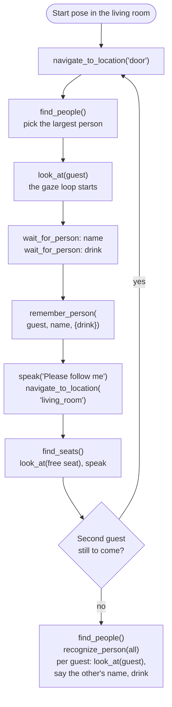
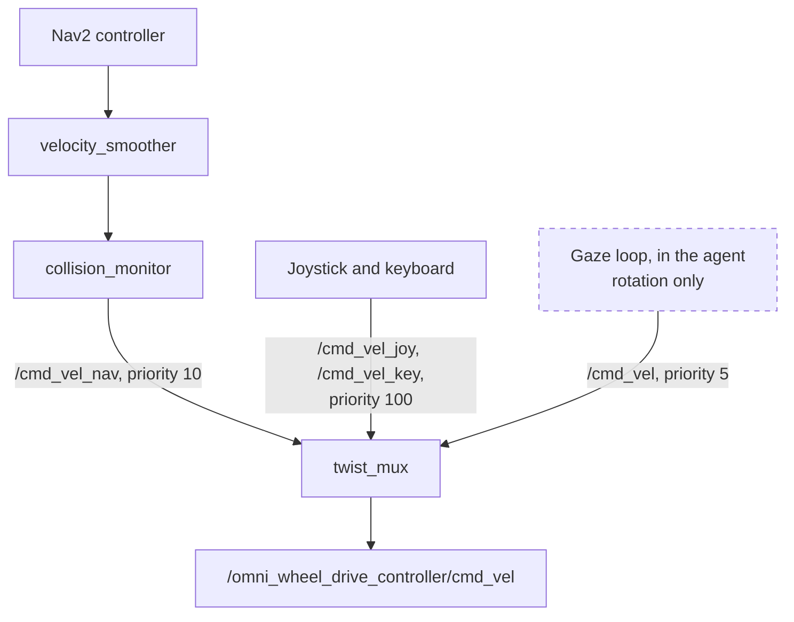
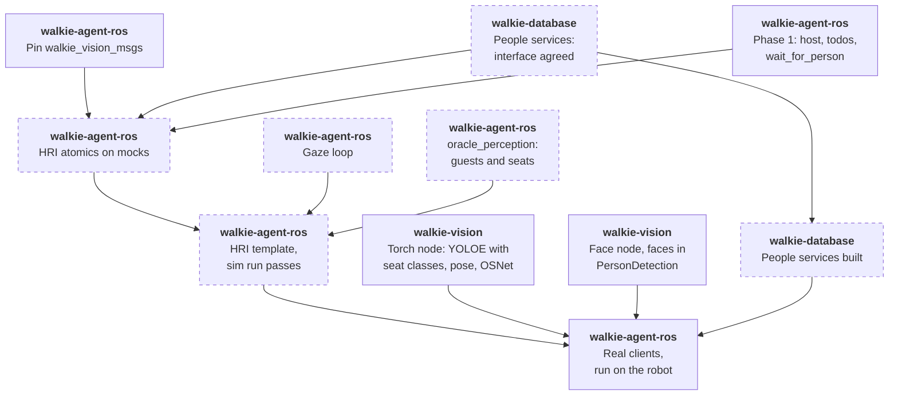

# HRI Task (Proposed)

!!! note "Status: Proposed"
    Nothing on this page is built yet. It is the design for team review. Each
    of the [open questions](#open-questions) says what it blocks.

The HRI task (RoboCup@Home 2026 rulebook, section 5.1) is the first task
the [self-evolving agent](self-evolving-agent.md) will run end to end. It
needs people, seats and gaze, but no object search, no arm and no
embedding bake-off, so it is the shortest path to a test on the robot. This
page plans that first slice, on top of [Perception](perception.md).

## Summary

- **Slice 1 scores the main goal without the bag:** up to 550 of the
  task's 1,450 points, plus 60 bonus points for asking no confirmation
  questions.
- **Off its path:** `DetectObjects`, `EmbedText`, the embedding bake-off,
  walkie-database's migration after it, person depth, the bundle runtime
  and the arms.
- **On its path:** walkie-vision's torch and face nodes, walkie-database's
  people services, and in this repository phase 1, six atomics and an
  HRI template.
- **Gaze turns the base.** An agent-side loop publishes rotation only, on
  `/cmd_vel`, below Nav2 and the joystick in `twist_mux`. It is the one
  exception to `FORBIDDEN_NAMES`
  ([ADR-0051](decisions/0051-agent-side-gaze-loop.md)).
- **The LLM runs the task** from a todo template. Presets come later, from
  the slice's traces.
- **Sim first,** with `oracle_perception` publishing guests who pace and
  switch seats, then the robot.

## The task

The robot starts in the living room, near the seats. Two guests arrive at
the door, one after the other. For each guest, the robot meets them at the
door, learns their name and favourite drink, guides them to the living
room and offers a free seat. When both are seated, it introduces them to
each other: it looks at one guest and says the other's name and drink, for
both guests. The second guest brings a bag for the host, who then leads
the robot to a drop spot. The test lasts 6 minutes.

Rules that shape the design:

- **Gaze is scored only when continuous.** Guests pace slightly left and
  right while they talk, and other people may appear behind them.
- **The robot approaches.** It may not ask a guest to step in front of it.
- **No confirmation questions.** "Did you say James?" loses the bonus.
  Asking again after not hearing an answer is allowed. Continuing with a
  wrong name or drink costs 40 points each.
- **Seats change.** Passive guests may sit on the couch, referees may add
  chairs, and seated guests may switch seats before the introductions.
- **No help with identities.** Asking who is who costs 200 points per
  guest.
- **Names and drinks are open.** Names are any popular English name, and
  drinks any popular drink, not only those in the object list.
- **Only the two guests are introduced.** walkie-agent-v2 also introduced
  the host, from environment variables. The 2026 score sheet does not ask
  for it.

| Score item | Points | Slice 1 |
| ---------- | ------ | ------- |
| Offer a free seat | 2×100 | Yes |
| Look in the direction of navigation | 2×15 | Yes, from Nav2 |
| Look at the person talking, when receiving a guest | 2×50 | Yes, the gaze loop |
| Introduce the guests: each one's name and drink | 4×30 | Yes |
| Look at the correct guest while introducing | 2×50 | Yes, the gaze loop |
| Bag handover, following the host, dropping the bag | 50, 200, 50 | No: the arms are mocked, and following is open ([Perception question 5](perception.md#open-questions)) |
| Bonus: detect the doorbell | 2×30 | No |
| Bonus: open the door | 2×200 | No |
| Bonus: describe the first guest to the second | 4×20, and −20 per wrong attribute | No ([Perception question 4](perception.md#open-questions)) |
| Bonus: no confirmation questions | 4×15 | Yes |

Penalties the slice must avoid: wrong information memorized (4×−40), not
recognizing people (2×−200), and an alternative input such as a keyboard
(6×−20).

## One run



- **Every navigation atomic stops the gaze loop** before it sends a goal,
  so the robot faces where it drives. walkie-ros's MPPI parameters already
  run `PathAngleCritic` in forward-preference mode. Nothing more is built
  for "look in the direction of navigation", but the sim checks it.
- **The robot drives to fixed locations,** `door` and `living_room` in
  `config/locations.toml`, set on the setup days. It never drives to a
  person, so `localize_person` and a person's depth stay off the path
  ([Perception question 1](perception.md#open-questions)).
- **`wait_for_person` ends the turn,** and the guest's answer starts the
  next one. The gaze loop keeps running in between.

## Atomics

| Atomic | Effect | Status | What it does |
| ------ | ------ | ------ | ------------ |
| `find_people(gesture=None)` | P | As on [Perception](perception.md#people) | Person handles, left to right. Each one also has its box height as a share of the image, so the LLM can pick the nearest |
| `recognize_person(person)` | R | Changed | Also takes the whole set from one `find_people` call. Names then go to people closest match first, so no name is given twice |
| `remember_person(person, name, facts={})` | write | Changed | Adds `facts` such as `{"drink": "milk"}`, stored in walkie-database's `person.attributes`. Sends every face and appearance vector kept for the track |
| `find_seats()` | P | New | Seat handles, left to right, each `free` or `taken` |
| `look_at(target)` | N | New ([ADR-0051](decisions/0051-agent-side-gaze-loop.md)) | Starts the gaze loop on a person, or turns to a seat and holds. Returns at once |
| `stop_looking()` | N | New | Stops the gaze loop |
| `wait_for_person(question)` | — | Phase 1, a core tool | Speaks, marks the todo item waiting and ends the turn |

`navigate_to_location` and `speak` exist today. `refind_person` is not
needed: the gaze loop follows the track, and the face is matched again at
the introductions.

### Seats

- **Seat classes.** The torch node's streaming class list includes
  `chair`, `sofa`, `armchair` and `stool`, the classes walkie-agent-v2
  used (`HRI_SEAT_CLASSES`). How a task sets that list is
  [question 1](#open-questions).
- **People from the same image.** `find_seats` takes the newest
  `/walkie_vision/objects` message and the `/walkie_vision/people` message
  with the same `header.stamp`.
- **Occupancy.** A seat is taken when a person's seating anchor lies in
  its box: the hips, or else the lower centre of the person's box. A sofa
  splits into left, middle and right places, each with its own handle.
  This and its tests are ported from walkie-agent-v2's
  `tasks/skills/seating.py`.
- **One view.** The robot looks from one living-room pose that sees every
  seat. walkie-agent-v2 turned to several headings and merged what it saw.
  Whether slice 1 needs that is [question 2](#open-questions).
- **Showing the seat.** The robot turns to the free place with `look_at`
  and says which one it is, for example "the left side of the sofa". A
  pointing arm pose comes with the real arms.

### Faces collected while talking

While the gaze loop follows a track, the handle store keeps that track's
face and appearance vectors: up to 20, from faces above a detection
score. `remember_person` sends all of them, minus the ones far from their
mean, as walkie-agent-v2's enrollment did. The guest turns while pacing, so
walkie-database gets faces from several angles. That helps at the
introductions, when the guest is seated and seen from elsewhere.

### Introductions

- **Recognize again.** The guests may have switched seats, so the robot
  matches every visible face, as walkie-agent-v2 did. A passive guest
  beyond the face limit comes back `UNKNOWN`.
- **Never ask who is who.** If a guest is not found, the LLM may turn to
  other seats with `look_at` and call `find_people` again.
- **Look at the listener.** For each guest, `look_at` them, then say the
  other guest's name, drink and side. Sides are from the listener's view,
  the mirror of the camera's left to right.
- **Names, not pronouns.** The robot calls guests by name and never says
  "he" or "she", since it cannot know their pronouns.

## Gaze

The gaze loop is the one place where the agent drives the base directly
([ADR-0051](decisions/0051-agent-side-gaze-loop.md)). It joins the
velocity inputs that walkie-ros already muxes:



- **Setpoint.** A map-frame heading toward the face's column. It comes
  from `camera_info` and TF at the message's stamp, so turning during
  detection does not skew it.
- **Control.** walkie-agent-v2's loop at 15 Hz: gain 1.2, 0.15 to
  0.6 rad/s, no command inside 6°, acceleration capped at 3.2 rad/s².
- **Stops.** After 1 s without the target, on `stop_looking`, before any
  navigation goal, on reset, "stop" or "never mind", and on shutdown. If
  the agent dies, `twist_mux` drops `/cmd_vel` after 0.5 s.
- **Why `/cmd_vel`.** It is `twist_mux`'s lowest priority, so Nav2 and a
  person holding the joystick always win. The cost: it bypasses
  `collision_monitor` ([question 4](#open-questions)).
- **Why not a skill.** A robot-side skill behind `run_skill`
  ([ADR-0027](decisions/0027-runskill-action.md)) is the long-term home,
  but no skill server exists, and `look_at` can keep its interface when it
  moves.

## The template

A template in `config/task_templates.toml` seeds the todo list
([ADR-0041](decisions/0041-todo-list-and-seeding.md)). The file's format is
not designed yet; this is a sketch:

```toml title="config/task_templates.toml"
[hri]
keywords = ["hri", "receptionist", "guests"]
task = """
Receive two guests, one at a time, at the door. Learn each guest's name and
favourite drink, guide them to the living room and offer a free seat. Then
introduce them to each other.
Keep looking at the person you talk to. Ask for the name, then the drink.
Never ask a guest to confirm or correct an answer. Ask again only if you
heard nothing. Never ask who is who. Call guests by name, never "he" or "she".
"""
todos = [
  "Meet the first guest at the door and learn their name and drink",
  "Guide the first guest to the living room and offer a free seat",
  "Meet the second guest at the door and learn their name and drink",
  "Guide the second guest to the living room and offer a free seat",
  "Introduce the guests to each other",
]
```

The run uses no preset. Each step is two to four atomic calls, and the
first goal is to see how the new agent loop handles a real task. Presets
such as `greet_guest` and `offer_seat` can be promoted from the slice's
traces once the bundle runtime exists.

## Delivery order

What blocks the slice, across the three repositories. A dashed box is new
work this page or [Perception](perception.md) asks for.



- **The sim run needs no other repository** beyond the agreed interface
  and the pinned messages. walkie-vision and walkie-database are needed
  only for the robot.
- **From phase 2,** the slice takes only the toolbox core and the atomics
  above. The linker, the bundle runtime, the presets and the level checks
  are not needed, because the run calls reviewed atomics only.
- **On the robot,** the order is: the gaze loop alone, with someone pacing
  and the joystick at hand, then the seats in the arena's living room,
  then the whole run. The face distance limit is tuned there, with team
  members ([Perception question 2](perception.md#open-questions)).

## In simulation

`oracle_perception` gets HRI scenarios
([Perception](perception.md#in-simulation)):

- **Guests** with a name, a drink, and face and appearance vectors from
  `hash_vector`, under `fake_...` model names. One guest paces about
  0.3 m left and right while talking, and a bystander walks behind them.
- **The living room** with seats, a passive guest on the sofa, and a
  switch of seats before the introductions.
- **Projection.** Each person is projected into the camera with its
  `camera_info` and TF, so the boxes move as the base turns, and the gaze
  loop closes in sim.
- **Answers.** The scenario answers each question on `/from_human` after
  the robot's line on `/to_human`. Once, it answers with nothing, to test
  asking again.

A run passes when:

- walkie-database holds each guest's name and drink as in the scenario;
- the heading stays within 10° of the talking guest for at least 80% of
  each conversation;
- each seat offer faces a free place, never a taken one;
- each introduction faces the listener;
- the only questions are the four essential ones, plus one repeat after
  the empty answer;
- every `/cmd_vel` message has zero linear velocity, and none is sent
  while a Nav2 goal is active;
- it finishes within 6 minutes of sim time.

The 10° and 80% are first targets, to be tuned. Unit tests cover the gaze
loop with a fake clock and fake TF, the seating predicates ported from
walkie-agent-v2, and the name assignment in `recognize_person`.

## What changes in other repositories

| Repository | Change | Status |
| ---------- | ------ | ------ |
| walkie-vision | The torch node, with the seat classes in its streaming list | Planned there. How a task sets the list is new here ([question 1](#open-questions)) |
| walkie-vision | The face node, and which process puts faces into `PersonDetection` | Open there |
| walkie-database | People services: remember a person with facts and several vectors, and recognize a set of faces | New ([Perception question 2](perception.md#open-questions)) |
| walkie-ros | Nothing for slice 1. A collision-checked input for the gaze loop, if [question 4](#open-questions) asks for one | — |

## Open questions

1. **How a task sets the streaming class list.** walkie-vision's torch node
   has no interface for it, and a new list costs about 1.5 s and may reset
   track ids (walkie-vision's `vision.md`). Recommended: a launch
   parameter per task for now, so the list never changes during a run.
   Blocks: `find_seats` on the robot.
2. **Whether one view sees every seat.** If the arena's living room is
   wider than the camera's view, `find_seats` needs walkie-agent-v2's
   sweep: turn with `look_at`, look again, and merge places by heading.
   Blocks: `find_seats` in such a room.
3. **Names through speech-to-text.** A wrong name costs 40 points. The
   rulebook's predefined names (section 3.2.7), announced on the setup
   days, could be passed to speech-to-text as hints, but HRI guests may
   have any popular name. Blocks: nothing in sim.
4. **Whether the gaze loop goes through `collision_monitor`.** `/cmd_vel`
   bypasses its rotation polygon. Publishing into Nav2's
   `cmd_vel_controller` instead would pass the monitor, but would share
   `velocity_smoother`'s input with Nav2, which `twist_mux` cannot
   arbitrate. Recommended: `/cmd_vel` for slice 1, measured on the robot,
   and a collision-checked input in walkie-ros later if needed. Blocks:
   nothing in sim.
5. **The next slice.** Following the host is worth 200 points and needs
   no arm if the guest puts the bag on the robot (−50 instead of +50 for
   the handover). It needs a follow skill
   ([Perception question 5](perception.md#open-questions)). The doorbell
   is worth 60 and needs a sound detector. Describing the first guest is
   worth up to 80, and loses 20 per wrong attribute
   ([Perception question 4](perception.md#open-questions)). Recommended:
   following, since it is the largest block without arms. Blocks:
   planning slice 2.

## Decisions

Click a decision to expand it. See [Architecture](index.md) for how
decisions work.

??? note "ADR-0051: Turn the base toward a person from an agent-side gaze loop · Proposed"

    --8<-- "architecture/decisions/0051-agent-side-gaze-loop.md:body"
