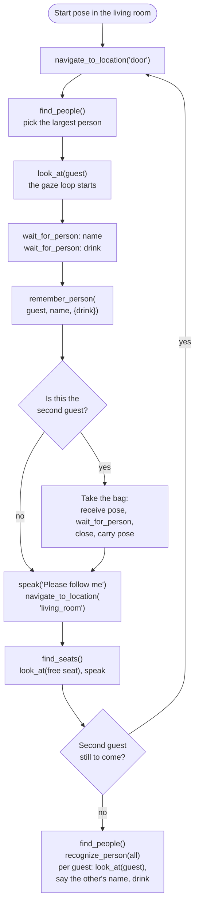
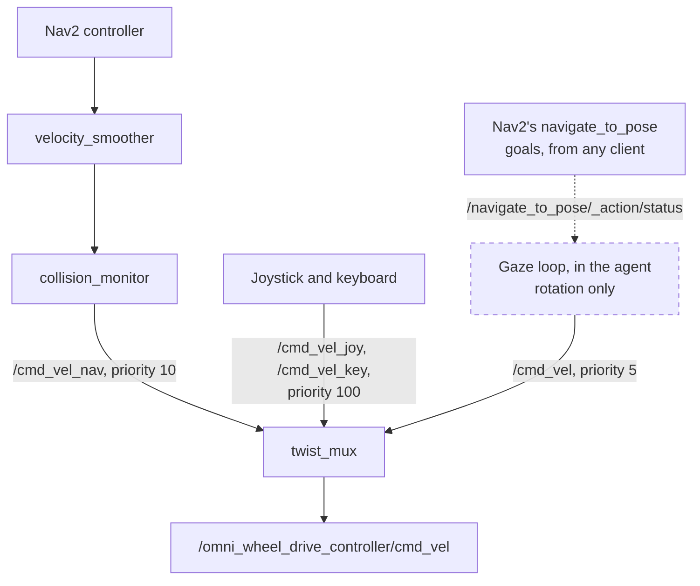
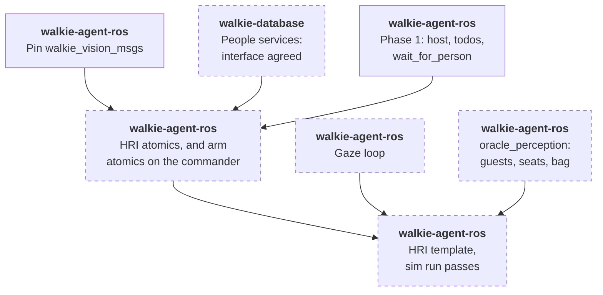
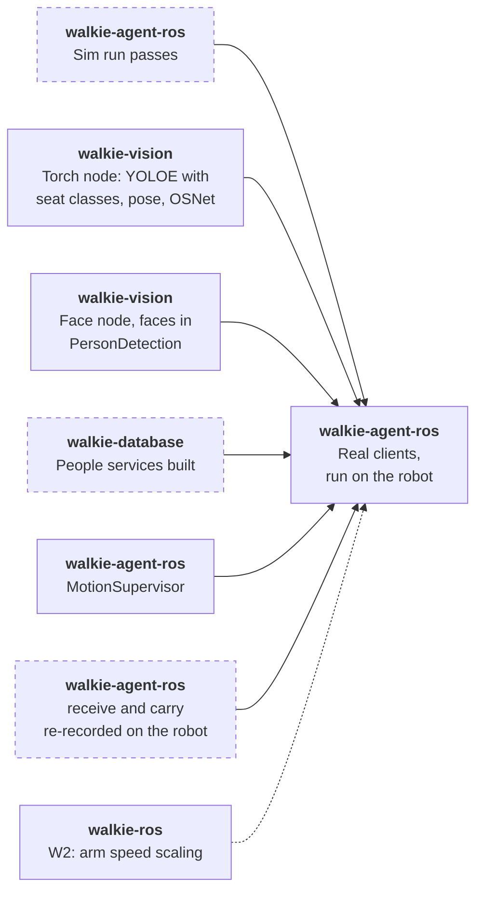

# HRI Task (Proposed)

!!! note "Status: Proposed, eight atomics and the gaze loop built"
    The four people and seat atomics are built and tested on fakes. So are
    the gaze loop and its atomics `look_at` and `stop_looking`. The arm
    atomics `move_arm_to_pose` and `set_gripper` are built too, and call the
    commander. Their status is in the [Atomics](#atomics) table. The rest of
    this page is the design for team review. Each of the
    [open questions](#open-questions) says what it blocks.

The HRI task (RoboCup@Home 2026 rulebook, section 5.1) is the first task
the [self-evolving agent](self-evolving-agent.md) will run end to end. It
needs people, seats, gaze and one simple arm motion, but no object search,
no skill server and no embedding bake-off, so it is the shortest path to a
test on the robot. This page plans that first slice, on top of
[Perception](perception.md) and [Arm Manipulation](manipulation.md).

## Summary

- **Slice 1 scores the main goal up to the bag hand-over:** up to 600 of
  the task's 1,450 points, plus 60 bonus points for asking no confirmation
  questions.
- **Off its path:** `DetectObjects`, `EmbedText`, the embedding bake-off,
  walkie-database's migration after it, person depth, the bundle runtime
  and the skill server.
- **On its path:** walkie-vision's torch and face nodes, walkie-database's
  people services, and in this repository phase 1, six atomics and the
  arm atomics (all built), the gaze loop (built) and an HRI template. On
  the robot, also the MotionSupervisor.
- **The bag goes in the left hand.** The robot holds out its hand, the
  guest says when the bag is in it, and the gripper closes. The two poses
  it needs, `receive` and `carry`, come from walkie-agent-v2's hand-over.
- **Gaze turns the base.** An agent-side loop publishes rotation only, on
  `/cmd_vel`, below Nav2 and the joystick in `twist_mux`. It is the one
  exception to `FORBIDDEN_NAMES`
  ([ADR-0051](decisions/0051-agent-side-gaze-loop.md)).
- **The LLM runs the task** from a todo template. Presets come later, from
  the slice's traces.
- **Sim first,** with `oracle_perception` publishing guests who pace and
  switch seats, then the robot.

## The task

The robot starts in the living room, near the seats. Two guests arrive at
the door, one after the other. For each guest, the robot meets them at the
door, learns their name and favourite drink, guides them to the living
room and offers a free seat. When both are seated, it introduces them to
each other: it looks at one guest and says the other's name and drink, for
both guests. The second guest brings a bag for the host, who then leads
the robot to a drop spot. The test lasts 6 minutes.

Rules that shape the design:

- **Gaze is scored only when continuous.** Guests pace slightly left and
  right while they talk, and other people may appear behind them.
- **The robot approaches.** It may not ask a guest to step in front of it.
- **No confirmation questions.** "Did you say James?" loses the bonus.
  Asking again after not hearing an answer is allowed. Continuing with a
  wrong name or drink costs 40 points each.
- **Seats change.** Passive guests may sit on the couch, referees may add
  chairs, and seated guests may switch seats before the introductions.
- **No help with identities.** Asking who is who costs 200 points per
  guest.
- **The bag comes from the guest's hand.** Telling the guest to put it on
  the robot scores nothing for the hand-over and costs 50 points. Asking
  the guest for help during the hand-over reduces the score.
- **Names and drinks are open.** Names are any popular English name, and
  drinks any popular drink, not only those in the object list.
- **Only the two guests are introduced.** walkie-agent-v2 also introduced
  the host, from environment variables. The 2026 score sheet does not ask
  for it.

| Score item | Points | Slice 1 |
| ---------- | ------ | ------- |
| Offer a free seat | 2×100 | Yes |
| Look in the direction of navigation | 2×15 | Yes, from Nav2 |
| Look at the person talking, when receiving a guest | 2×50 | Yes, the gaze loop |
| Introduce the guests: each one's name and drink | 4×30 | Yes |
| Look at the correct guest while introducing | 2×50 | Yes, the gaze loop |
| Take the bag from the guest's hand | 50 | Yes, with the left gripper |
| Follow the host, drop the bag | 200, 50 | No: following is open ([Perception question 5](perception.md#open-questions)) |
| Bonus: detect the doorbell | 2×30 | No |
| Bonus: open the door | 2×200 | No |
| Bonus: describe the first guest to the second | 4×20, and −20 per wrong attribute | No ([Perception question 4](perception.md#open-questions)) |
| Bonus: no confirmation questions | 4×15 | Yes |

Penalties the slice must avoid: wrong information memorized (4×−40), not
recognizing people (2×−200), an alternative input such as a keyboard
(6×−20), and telling the guest to put the bag on the robot (−50).

## One run



- **Every navigation atomic stops the gaze loop** before it sends a goal,
  so the robot faces where it drives. walkie-ros's MPPI parameters already
  run `PathAngleCritic` in forward-preference mode. Nothing more is built
  for "look in the direction of navigation", but the sim checks it.
- **The robot drives to fixed locations,** `door` and `living_room` in
  `config/locations.toml`, set on the setup days. In the simulation they
  are in `config/locations.chula_pat14_6.toml`
  ([In simulation](#in-simulation)). It never drives to a person, so
  `localize_person` and a person's depth stay off the path
  ([Perception question 1](perception.md#open-questions)).
- **`wait_for_person` ends the turn,** and the guest's answer starts the
  next one. The gaze loop keeps running in between.

## Atomics

| Atomic | Effect | Status | What it does |
| ------ | ------ | ------ | ------------ |
| `find_people(gesture=None)` | P | Built (sim) | Person handles, left to right. Each line gives where the person is in the image (left, centre or right), their box height as a share of the image height, their posture and gestures, and whether the face is seen well enough to recognize them: `face seen`, `face too small or unclear to recognize`, or `no face seen`. The height lets the LLM pick the nearest. The first line names the set. With `gesture`, only the people who show it |
| `recognize_person(person)` | R | Built (sim) | Takes one handle or the whole set from one `find_people` call. Matches the face first, else the appearance, else `UNKNOWN`. Each model among the person's vectors is matched on its own, within that model's distance limit. Over a set, names go to people closest match first, so no name is given twice |
| `remember_person(person, name, facts={})` | W | Built (sim) | Stores the name, `facts` such as `{"drink": "milk"}`, the handle's own face and appearance vectors, and those collected for its track, minus outliers. On the robot, walkie-database will keep the facts in `person.attributes`. Takes one handle, not a set. Declares the code's provisional `W` effect until [Perception question 3](perception.md#open-questions) is decided |
| `find_seats()` | P | Built (sim) | Seat handles, one per place to sit, left to right by the place's centre. A sofa gives a left, a middle and a right place. Each is `free` or `taken`, and the last line counts the free places |
| `look_at(target)` | N | Built (sim) ([ADR-0051](decisions/0051-agent-side-gaze-loop.md)) | Starts the gaze loop on a person handle, or turns to a seat handle and holds. For a person it returns at once, and the loop follows them. For a seat it returns once the base faces it, within 10 s. Refuses with an arm out, as the drives do ([Gaze](#gaze)) |
| `stop_looking()` | N | Built (sim) | Stops the gaze loop. When nothing runs, says which target ran last, why it stopped and how long ago. Never fails |
| `wait_for_person(question)` | — | Phase 1, a core tool | Speaks, marks the todo item waiting and ends the turn |
| `move_arm_to_pose(pose, arm)` | M | Built (sim), as on [Manipulation](manipulation.md#tools), with two new poses | Moves the left arm to `receive` or `carry`, and checks the joints |
| `set_gripper(arm, state)` | M | Built (sim), as on [Manipulation](manipulation.md#tools) | Opens or closes the left gripper. After a close, says whether it holds something |

`navigate_to_location` and `speak` exist today. `refind_person` is not
needed: the gaze loop follows the track, and the face is matched again at
the introductions.

**Built (sim)** means built and tested in this repository, not yet run on
the robot or with walkie-vision. The two arm atomics are tested on the
`FakeCommander` and load only with `--arms`
([Manipulation](manipulation.md#backends)). The two gaze atomics load in
every run; [Gaze](#gaze) says how they are built. For the people and seat
atomics:

- **Where the code is.** Each atomic is a module in
  `src/walkie_agent/tools/atomic/`, with what they share in
  `_perception.py`. The rules they use, ported from walkie-agent-v2 with
  its defaults, are plain functions in `src/walkie_agent/perception/`:
  `gestures.py`, `seating.py`, `identity.py` and `geometry.py`.
- **Two backends.** `vision` is a `VisionFeed`, which subscribes to
  `/walkie_vision/people` and `/walkie_vision/objects`.
  `create_walkie_agent` always adds it. `people_memory` is an
  `InMemoryPeopleMemory`, a mock of walkie-database's proposed people
  services. The agent adds it only with the `--mock-people-memory` flag,
  which `pixi run agent-sim` passes, and clears it at every new task.
  Without the flag, `recognize_person` and `remember_person` do not load
  ([The Agent](agent.md#where-atomics-live)).
- **Tested over ROS.** The tests run all four against a fake publisher of
  both arrays, with vectors from `src/walkie_agent/sim/fake_vectors.py`
  and the transforms from `map` to the camera on `/tf_static`. A test
  that drives the base publishes it on `/tf`.
- **In the simulation,** the HRI scenario's `OraclePerception` publishes
  both arrays ([In simulation](#in-simulation)). Without it, as under
  plain `agent-sim`, `find_people` and `find_seats` fail with
  `UNAVAILABLE`, so no handle exists for the other two.
- **Handles.** Person and seat handles go stale after 5 cm of base
  translation or 10 minutes. A turn does not stale them, because the gaze
  loop turns the base. Each keeps `heading_map`, the map-frame heading of
  the face, the body or the place, computed from `camera_info` and TF at
  the image's stamp. `look_at` turns to it: a seat's for good, a person's
  until the gaze loop sees them again.
- **Motion counts from the image.** A handle set is stored with the base's
  pose at the image's stamp, so a drive between the image and the call
  counts toward the 5 cm. If TF has no pose at the stamp within 0.2 s, or
  the array has no stamp, the atomic stores nothing and fails with
  `UNAVAILABLE`. The pose at the call would let up to a second of motion
  pass unseen, and without the transform at the stamp no box has a
  heading either.
- **One TF lookup per image.** The camera's transform at the stamp is
  looked up once, and each box's ray is turned with it. Without the
  transform, no box has a heading. A ray with no yaw, such as the centre
  ray of a camera that looks straight down, gets none, and the other
  boxes keep theirs.
- **A stop stores nothing.** A stop or a reset ends `find_people` and
  `find_seats` with `CANCELLED`, also when a fresh array was at hand. They
  check again just before they store the handles.

What the LLM reads from three calls, with two guests remembered:

```text
find_people()
per_51c0: 3 people in view, left to right.
per_51c0.0: left, height 0.83, standing, waving, face seen
per_51c0.1: centre, height 0.62, sitting, face seen
per_51c0.2: right, height 0.41, sitting, face too small or unclear to recognize

recognize_person(person="per_51c0")
per_51c0.0 (left): UNKNOWN
per_51c0.1 (centre): Sam, drink: milk
per_51c0.2 (right): Ana, drink: tea

find_seats()
seat_7a1e.0: chair, free, left
seat_7a1e.1: sofa, left place, taken, centre
seat_7a1e.2: sofa, middle place, free, centre
seat_7a1e.3: sofa, right place, taken, right
Free places: 2 of 4.
```

Ana's face is too small or unclear to match, so her appearance names her.

### Seats

- **Seat classes.** The torch node's streaming class list includes
  `chair`, `sofa`, `armchair` and `stool`, the classes walkie-agent-v2
  used (`HRI_SEAT_CLASSES`). How a task sets that list is
  [question 1](#open-questions). `find_seats` reads the seat classes from
  `SeatingConfig` in `perception/seating.py`. When the objects message's
  class list holds none of them, its `NOT_FOUND` says the detector is not
  looking for seats.
- **People from the same image.** `find_seats` takes the newest
  `/walkie_vision/objects` message, at most 1 s old, and the
  `/walkie_vision/people` message with the same `header.stamp`. It waits
  up to 0.5 s more for that one, then fails with `UNAVAILABLE`.
- **Occupancy.** A seat is taken when a person's seating anchor lies in
  its box: the hips, or else the lower centre of the person's box. A sofa
  splits into left, middle and right places, each with its own handle.
  This and its tests are ported from walkie-agent-v2's
  `tasks/skills/seating.py`.
- **Left to right by place.** The places are sorted by their own box
  centre, after each sofa is split. So a chair in front of a sofa's middle
  comes between the sofa's left and right places, and the first free
  handle is the leftmost free place. Places with the same centre keep the
  detector's order.
- **Everyone in view counts as seated,** as in walkie-agent-v2. The guest
  the robot brought stands beside it, outside the view of the seats. A
  person whose anchor is on no seat takes none.
- **One view.** The robot looks from one living-room pose that sees every
  seat. walkie-agent-v2 turned to several headings and merged what it saw.
  Whether slice 1 needs that is [question 2](#open-questions).
- **Showing the seat.** The robot turns to the free place with `look_at`
  and says which one it is, for example "the left side of the sofa". A
  pointing arm pose comes with the real arms. A seat handle keeps its
  heading from when the image was seen, because the handle outlives the
  TF buffer's 10 s.

### Faces collected while talking

`VisionFeed` collects face and appearance vectors for every visible
track, not only the one the gaze loop follows, so the collection does not
depend on whom the robot looks at. For each track it keeps, with each
vector's model name and the stamp of its image:

- **20 face vectors,** the newest by stamp, of faces that walkie-agent-v2
  trusted: a detection score of at least 0.5 and a face box that spans at
  least 0.0469 rad, √((width / fx) × (height / fy)) with the camera's
  focal lengths. That is v2's 2,500 px² (50 × 50 px) on the robot's ZED 2i
  at Stereolabs' nominal fx of 1,066 px, to check against the robot's own
  calibration. An angle holds on any camera: the simulation's 640 × 360
  head camera has fx 224 px, where the same face needs only 10.5 px;
- **20 appearance vectors,** the newest by stamp;
- **for at most 32 tracks,** dropping a track unseen for 60 s. Track id 0
  means untracked and is never collected.

How a collection stays with one person:

- **By stamp, not by arrival.** A late array's vectors go in their place,
  and a full collection drops its oldest stamp first.
- **A generation per collection.** A collection takes the next number of
  one count when it starts: at its track's first sighting, and again after
  it was dropped, since the track id may name someone else by then. The
  count is never reset. A person handle keeps the track id and the
  generation its person had in the handle's image.
- **A clock that jumps back starts over.** A people array stamped more
  than 5 s before the newest one, as after a simulation restart, clears
  the history and every collection. The restarted tracker numbers its
  tracks anew, so a new run's track does not join an old run's
  collection. A smaller jump back is not detected: the newest array is
  right again once the new stamps pass the old ones, but the collections
  are not cleared. A restart less than 5 s into the old run, with the
  tracker restarted too, can therefore put a new person in a held
  handle's collection. The robot's clock never jumps back; a simulation
  run that short has no handles worth keeping.

The vectors of a person handle, for `recognize_person` and
`remember_person`:

- **The handle's own vectors always count,** its face only when trusted.
  A collection keeps only its newest 20, so it may have dropped them.
- **Plus its generation's collection,** without the sample of the
  handle's own image, which has the handle's stamp. So no vector counts
  twice.
- **Only its own** when the person is untracked, or when the generation's
  collection was dropped. A handle lasts 10 minutes, a collection 60 s
  after its track was last seen. If the track id now names someone else,
  the handle never reads their vectors.

`remember_person` sends these vectors, minus the ones far from the mean of
their model, as walkie-agent-v2's enrollment did.

Faces from several angles help at the introductions, when the guest is
seated and seen from elsewhere. At the camera's 15 Hz, though, 20 vectors
are only the last 1.3 s or so before the call, so they show the angles of
that moment. Faces from the whole conversation would need `VisionFeed` to
space its samples out.

### Introductions

- **Recognize again.** The guests may have switched seats, so the robot
  matches every visible face, as walkie-agent-v2 did. A passive guest
  beyond the face limit comes back `UNKNOWN`.
- **Never ask who is who.** If a guest is not found, the LLM may turn to
  other seats with `look_at` and call `find_people` again.
- **Look at the listener.** For each guest, `look_at` them, then say the
  other guest's name, drink and side. Sides are from the listener's view,
  the mirror of the camera's left to right.
- **Names, not pronouns.** The robot calls guests by name and never says
  "he" or "she", since it cannot know their pronouns. The system prompt
  has this rule, and another: a person or seat handle comes only from
  `find_people` or `find_seats`.

## The bag hand-over

The second guest's bag is taken at the door, right after
`remember_person`, as walkie-agent-v2 did. The guest is already in front of
the robot there, and the arm is back in a travel-safe pose before the robot
drives.

1. **Warn.** `speak("I will hold out my hand for your bag.")`. The system
   prompt already says to tell people before moving the arms.
2. **Hold out the hand.** `set_gripper("left", "open")`, then
   `move_arm_to_pose("receive", "left")`.
3. **Wait for the guest.** `wait_for_person("Please hang your bag on my
   hand, and tell me when it is there.")` ends the turn.
4. **Close.** In the next turn, `speak("Thank you. I will close my hand
   now.")`, then `set_gripper("left", "close")`, which says whether the
   gripper holds something.
5. **Carry.** `move_arm_to_pose("carry", "left")`, then guide the guest as
   before. The bag stays in the hand until the end of the run.

Why it works this way:

- **The guest says when.** The gripper closes only after the guest's
  answer, so it does not close on a hand that is still placing the bag.
  walkie-agent-v2 waited instead for joint 4's effort to change by 0.4,
  after asking the guest to press down on the hand. That needs efforts
  from `/joint_states`, which no atomic reads. v2 also went on as if it
  held the bag when that wait timed out.
- **One retry.** If the gripper holds nothing, the robot opens it and asks
  once more. After a second miss it moves to `carry` empty, says it will
  go on without the bag, and guides the guest. The template says so, so
  the LLM does not keep asking. The rulebook lowers the score when the
  robot asks the guest for help during the hand-over, without saying by
  how much. Whether the first request already counts is unclear. v2's
  request to press on the hand was the same kind of request.
- **No new atomics.** The two arm atomics from
  [Manipulation](manipulation.md#tools) do it. `move_arm_to_pose` checks
  the joints after the move, and `set_gripper` reads the fingers after a
  close and judges it from that read and the commander's `grasped` flag.
- **Two new poses** in `config/arm_poses.toml`, both from walkie-agent-v2's
  hand-over:

    | Pose | Arms | `travel_safe` | What it is |
    | ---- | ---- | ------------- | ---------- |
    | `receive` | left | false | The left hand held out in front, open, for the guest to hang the bag on |
    | `carry` | left, right | true | The arm folded close to the body, holding the bag. The right table mirrors the left, as `home`'s does |

- **Recorded in the simulation, to be re-recorded on the robot.** v2
  reached both poses with Cartesian goals through the commander's
  `/go_to_pose`, which the agent never calls
  ([Forbidden names](manipulation.md#forbidden-names)). On 2026-10-23 the
  two goals were sent once in walkie-ros's MuJoCo simulation, with the lift
  at 0.7435 m, and the joint values read from `/get_joint_states` were
  copied into the file. From then on they are joint poses like the SRDF
  ones. Before the robot run, a team member records them the same way on
  the robot, and tries them with collision checking on. Until then they
  have `tried_on_robot = false`, so only the simulation offers them.
- **Speed.** The arm moves toward a person, and the commander runs at full
  speed until walkie-ros change W2 lands
  ([Manipulation](manipulation.md#safety)). Until then the hand-over runs
  on the robot only with a team member as the guest and an operator at the
  emergency stop. Recommended: W2 before anyone else plays the guest
  ([Manipulation question 4](manipulation.md#open-questions)).
- **The robot stays still.** `move_arm_to_pose` stops the gaze loop
  before the arm moves, and `look_at` refuses while the left arm is in
  `receive` ([ADR-0051](decisions/0051-agent-side-gaze-loop.md)). It
  works again in `carry`, which is travel-safe.
- **Thin handles.** Whether `grasped` sees a bag's handles is
  [question 5](#open-questions).

## Gaze

The gaze loop is the one place where the agent drives the base directly
([ADR-0051](decisions/0051-agent-side-gaze-loop.md)). It joins the
velocity inputs that walkie-ros already muxes:



- **Setpoint.** A map-frame heading toward the face's column, or the
  body's when no face was found. It comes from `camera_info` and TF at
  the message's stamp, so turning during detection does not skew it.
  `find_people` keeps one in each handle, and the loop computes a new one
  from each array that shows the person, with the same `camera_transform`
  and `ray_heading` in `perception/geometry.py`.
- **Control.** walkie-agent-v2's loop at 15 Hz: gain 1.2, 0.15 to
  0.6 rad/s, no command inside 6°, acceleration capped at 3.2 rad/s².
  0.6 rad/s and 3.2 rad/s² are hard ceilings in `gaze.py`: the config
  may set lower values, never higher ones.
- **Stops.** 1 s after the person's last sighting, on `stop_looking`,
  before any drive or arm motion, when any `navigate_to_pose` goal
  becomes active, on reset, on "stop" or "never mind" during a task or
  between tasks, at a new task, and on shutdown. A drive or an arm motion
  waits up to 0.5 s for the stop's zero commands to be published, and
  refuses, sending nothing, when they are not. If the agent dies, or a
  publish blocks, `twist_mux` drops `/cmd_vel` 0.5 s after its last
  message, and the drive controller stops the base 0.5 s after its last
  command. Neither timeout stops a command that a blocked publish sends
  later.
- **Arms in.** `look_at` refuses with an arm out of every travel-safe
  pose, while a commander goal may still move an arm or a gripper, and on
  a reading that cannot show the arms are safe, with the check the drives
  make ([ADR-0025](decisions/0025-travel-safe-interlock.md)). Like that
  check, it fails open when the commander is not found, does not answer
  or gives no reading, so the base turns, but never while the arms are
  unverified.
- **Why `/cmd_vel`.** It is `twist_mux`'s lowest priority, so Nav2 and a
  person holding the joystick always win. The cost: it bypasses
  `collision_monitor` ([question 4](#open-questions)).
- **Why not a skill.** A robot-side skill behind `run_skill`
  ([ADR-0027](decisions/0027-runskill-action.md)) is the long-term home,
  but no skill server exists, and `look_at` can keep its interface when it
  moves.

### The loop

- **Where the code is.** `src/walkie_agent/gaze.py` holds `GazeLoop`, the
  `gaze` backend. Its control law, `GazeControl`, is plain logic with a
  clock passed in, so its tests need no ROS. `look_at` and `stop_looking`
  are modules in `src/walkie_agent/tools/atomic/`, with what they share
  in `_gaze.py`.
- **Always created.** `create_walkie_agent` builds the loop before the
  `Toolbox`, with the `vision` backend and, with `--arms`, the commander
  client. So `look_at` and `stop_looking` load in every run,
  `pixi run agent` included. Until `look_at` gives it a target, the loop
  publishes nothing.
- **A ctx of its own.** The `Toolbox` needs the backend when it is built,
  so the loop cannot use the Toolbox's ctx. It builds its own
  `ToolContext` for its two entities, with the same check on forbidden
  names.
- **A thread of its own.** The loop ticks on a daemon thread, `gaze_loop`,
  which starts with the first target. It is not the LLM's thread, so the
  loop runs between turns. Nor is it the connector's executor, which
  delivers the TF and the arrays a tick reads. The executor's
  callbacks never wait: they store the arrays that show the target and
  the goal status, and never look up TF.
- **One person, by `TrackKey`.** The loop follows the track id and the
  generation a person handle keeps. `VisionFeed.on_people` hands it every
  people array as it arrives, and it keeps those that show that key. A
  track id that comes back under a new generation, after `VisionFeed`
  dropped it, may be someone else, and the loop does not follow it.
- **The start.** The base turns first toward the newer of two
  sightings: the handle's `heading_map` at its stamp, and the newest
  array's, if that array is at most 1 s old and shows the person. With
  neither, `look_at` fails with `UNAVAILABLE`. With only the handle's,
  and that more than 1 s old, it fails with `STALE` and turns nothing,
  since the loop would lose the person at once.
- **Lost at the start.** `follow_person` checks the sighting's age before
  it sets the target, and the newest array's before its wait for TF, of
  up to 0.2 s, so the sighting can be more than 1 s old once the loop
  takes the person. Before it answers, `look_at` reads
  the loop's status and applies the loop's own rule once. For a person
  last seen more than 1 s ago, it stops the loop for `lost` and fails with
  `STALE`, saying how long ago they were last seen and to call
  `find_people`. A person the loop has already stopped for another
  reason, such as a navigation goal that became active, fails as a seat's
  ended turn does. Only a person the loop still follows gets "Looking at".
- **Each sighting.** The gaze thread looks up the camera's transform at
  the array's stamp without waiting. An array whose stamp TF has not
  reached yet is tried again on the next ticks, for up to 0.2 s after it
  arrived, and at most 4 wait at once. Only a sighting newer than the
  last moves the setpoint, so a late array cannot turn the base back. An
  array without the transform gives no sighting.
- **Lost.** A person is lost 1 s after their last sighting, by the
  arrays' stamps against the node clock, with no allowance for the
  `look_at` call. A clock that jumps back by more than 1 s, as at a
  simulation restart, loses them too. A seat's heading is never lost.
- **The live heading.** Each tick reads the newest `map` ->
  `base_footprint`. Without one, or when its stamp is more than 0.5 s
  from the node clock, the command is 0 for that tick, so a TF that
  stopped cannot keep the base turning.
- **What it publishes.** `geometry_msgs/TwistStamped` on `/cmd_vel`,
  stamped with the node clock, in `base_footprint`, with only `angular.z`
  set. One command per tick while a target runs, three zeros at every
  stop, then nothing. The publisher is reliable and volatile and keeps
  the last 10, so a slow subscriber costs old samples rather than a
  growing queue, and one that joins late never gets an old command.
- **One writer, on a fixed schedule.** Only the gaze thread publishes,
  outside the loop's lock. A new target takes effect at the next tick
  rather than at once, and a tick that runs late moves the schedule
  rather than catching up, so two commands never go out back to back.
  Each command differs from the last by at most 3.2 rad/s² times the time
  since the last went out, counted as at most one tick. A stop's zeros
  are not capped.
- **Only rotation, only `/cmd_vel`.** `RotationPublisher` is the loop's
  one way onto `/cmd_vel`. Its `publish(angular_z)` takes nothing else.
  It raises `ValueError` for a value that is not finite, and sends one
  above 0.6 rad/s either way as 0.6 rad/s, with a warning, whatever its
  config says. It is made through the ctx helper with
  `allow_forbidden=("/cmd_vel",)`. The config refuses any other topic.
  A remap onto another `twist_mux` input stops the agent at startup:
  those inputs are in `FORBIDDEN_NAMES` too, and the exception covers
  `/cmd_vel` alone. The publisher also checks the name as the node
  resolved it, so a remap onto a name `twist_mux` does not read fails the
  same way. `/cmd_vel` stays in `FORBIDDEN_NAMES`, and a test checks that
  every other tool and helper is still refused it.

### Stops

| When | Stopped by | Reason in `status()` |
| ---- | ---------- | -------------------- |
| The LLM calls `stop_looking` | `stop_looking` | `stop_looking` |
| "stop" or "never mind", during a task or between tasks, once the agent has queued the stop and, during a task, set the cancel. During a task the interrupt listener runs next; with the loop already stopped, it changes nothing | the Toolbox's stop-heard listener | `stop heard` |
| A reset | the Toolbox's interrupt listener | `interrupt` |
| A new task replaces the todo list, and with it the handles | the new-task listener | `new task` |
| `navigate_to_location` or `move_relative` is called, before its arm check, so also for a drive that the check refuses | the drive | `navigation` |
| A `navigate_to_pose` goal becomes active, from any client | the loop | `navigation goal active` |
| `move_arm_to_pose` has passed its argument checks, before its first commander call for the move. `set_gripper` does not stop the loop | `move_arm_to_pose` | `arm motion` |
| The commander's last reading shows an arm out of every travel-safe pose | the loop | `arm out` |
| An arm that the commander's reading knew at the start becomes unknown, as when a goal is sent for it | the loop | `arm motion` |
| A commander goal runs, or one an earlier call gave up on may still run (`busy()`), while an arm is unknown. A gripper goal with both arms known does not stop the loop while the arms are verified | the loop | `arm motion` |
| The arms are unverified (`unverified`): the commander client abandoned a goal before its end was known, or the commander accepted one after it was abandoned. This stops the loop even when both arms are known and travel-safe and no goal is in `busy()`, as after an abandoned gripper goal, since the drives refuse then too | the loop | `arm motion` |
| 1 s has passed since the person's last sighting | the loop | `lost` |
| The base does not face a seat within 10 s | `look_at` | `turn timeout` |
| A tick raises | the loop | `error` |
| The agent stops. `WalkieAgent.stop()` runs the interrupt listeners, then calls `GazeLoop.shutdown()`, which refuses later targets, has the gaze thread send the zeros, and waits up to 2 s for it to end | the agent | `interrupt`, or `shutdown` when nothing stopped the loop first |

- **A stop returns at once.** `stop()` takes the loop's one lock only to
  mark the target stopped and queue its three zeros, wakes the gaze
  thread and returns, unless it is asked to wait (next item). The thread
  sends the zeros when it next wakes, after any command it computed
  before the stop. No holder of the lock publishes or waits while holding
  it, so a publish that blocks in the transport holds up no executor
  callback and no listener. The interrupt and stop-heard listeners return
  promptly, as the Toolbox requires
  ([The Agent](agent.md#stop-reset-and-the-cancel)). Tests hold the gaze
  thread in a tick, and in a publish, and measure `Toolbox.interrupt()`,
  `Toolbox.stop_heard()`, the new-task listener, both callbacks and
  `stop()` under 50 ms.
- **A drive and an arm motion wait for the zeros.** The drives and
  `move_arm_to_pose` call `stop()` with `wait_s=0.5`, `STOP_WAIT_S`: it
  returns once the zeros of every stop so far are published. When they
  are not, it raises `TIMEOUT`, and the caller refuses with nothing sent,
  neither a Nav2 goal nor a commander call
  ([What the LLM reads](#what-the-llm-reads)). The gaze thread is then
  held up, or its publish of the zeros failed, so the base may still be
  turning, and a command it computed before the stop may still go out.
  The stop stands either way. The listeners and the callbacks never wait
  and never get the error.
- **A failed publish of the zeros is tried again.** The zeros stay
  queued, ahead of every tick, and the gaze thread tries them again a
  tick later. Only the first failure in a row is logged with its
  exception, and the attempt that then succeeds is logged once.
  `shutdown()` has the thread make one more attempt, waits up to 2 s for
  it to end, and logs when it has not.
- **Nothing after the zeros.** A tick that overlapped a stop or a new
  target drops its command. `look_at` reads the loop's stop generation,
  `stop_calls()`, before anything else, and passes it to
  `follow_person()` or `hold_heading()`. Every `stop()` changes it, so a
  `look_at` that a stop overtook anywhere in the call, as during its arm
  check or its wait for TF, starts nothing and fails with `CANCELLED`,
  even when nothing was running to stop.
- **The last reason stays.** `stop()` with nothing running changes
  nothing, so `stop_looking` after a loss still says the person was lost.
- **A stop between tasks.** While the agent is idle, "stop" interrupts
  nothing and waits as an ordinary message
  ([The Agent](agent.md#stop-reset-and-errors)), but the loop outlives the
  task and may still turn the base. So every "stop" or "never mind" goes
  to the Toolbox's stop-heard listeners, on the thread that delivered it,
  and the loop stops for `stop heard`. The agent calls them once it has
  queued the stop and decided, under its buffer lock, whether a task
  runs, and before the interrupt listeners. Called before that decision,
  they could stop the loop during a `look_at` of a task that then ended,
  and the stop would count as idle, with no interrupt and no cancel.
  Between tasks, the stop's own run may start while they run: a
  `look_at` in it that began before the stop fails with `CANCELLED`, or
  has its target stopped. If that run calls `stop_looking`, the answer
  says the last target was stopped because someone said "stop" or "never
  mind".
- **Goals the agent did not send.** ADR-0051 does not say how the loop
  learns of them. It subscribes to `/navigate_to_pose/_action/status`,
  which lists the goals of every client, an operator's included. A goal
  that is ACCEPTED, EXECUTING or CANCELING counts as active, since Nav2
  may still drive until a cancel completes. When one becomes active, the
  loop stops with its three zeros. They rank below `/cmd_vel_nav`, so
  Nav2 still wins, and the loop's last command is a zero. While a goal is
  active, `look_at` is refused. The loop does not start again when the
  goal ends; the LLM calls `look_at` again. A goal stops counting when
  its status publisher, Nav2's action server, is gone, so a Nav2 that
  died during a goal does not refuse `look_at` until it restarts.

### Arms

- **The drives' check.** `look_at` calls `check_arms` in
  `tools/navigation.py`, the check `navigate_to_location` and
  `move_relative` make. Where a drive's refusal says "Not driving", it
  says "Not starting a turn toward" and the handle. It refuses with
  `PRECONDITION_FAILED` while an arm is out of every travel-safe pose,
  while a commander goal may still move an arm or a gripper (`busy()`),
  and while the arms are unverified and the check's recovery cannot
  clear that. It refuses with `INTERNAL` when the commander answers with a reading
  that cannot show the arms are safe, such as one that lacks an arm's
  joints.
- **A refusal names this call's turn.** A gripper goal with both arms
  known does not stop the loop, so during one the loop may still follow
  a target from an earlier call, even the same person. "Not starting a
  turn toward per_51c0.1" stays true then, where "Not turning" would not.
  The refusal says nothing of that target, since the loop may stop it at
  its next tick, on the reading the check has just made.
- **It fails open, as the drives do.** Without `--arms` there is no
  check. When the commander is not discovered, does not answer, or gives
  no reading of the arms, the base turns, and the answer ends with a
  note, such as "Arm state unknown: the commander did not answer." While
  the arms are unverified, it refuses in those cases too, as the drives
  do.
- **Never a commander call while running.** A goal may hold the
  commander client's call lock for many seconds, so the loop reads only
  the client's last reading, `busy()` and `unverified`, which take only
  the client's short state lock. Arms unknown from the start, as when no
  commander runs, do not stop it, unless a commander goal runs or the
  arms are unverified.
- **Unverified arms stop it, as they stop a drive.** While the arms are
  unverified, after the client abandoned a goal or the commander accepted
  one late, the loop stops for `arm motion`. `busy()` and the last
  reading may not show it: an abandoned goal is no longer in `busy()`,
  and an abandoned gripper goal leaves both arms known. Each tick takes
  the last reading and the unverified state from one `snapshot()`, since
  a recovery changes both in one step. Then it calls `busy()`, which
  catches a goal that started after the snapshot while an arm was unknown
  in it, and reads the unverified state again, since `busy()` may itself
  abandon a goal. So the tick that abandons a goal stops the loop rather
  than turning once more. When the snapshot shows both arms known, a goal
  that starts after it stops the next tick, which sees its arm unknown.
  `busy()` runs on every tick that passes the snapshot's checks, not only
  while an arm is unknown, so the loop itself abandons a gripper goal
  that a call gave up on, on time.

### What the LLM reads

```text
look_at(target="per_51c0.1")
Looking at per_51c0.1. The robot turns to keep them in view, and stops once it has not seen them for 1 s.

look_at(target="seat_7a1e.2")
Turned toward seat_7a1e.2 (sofa, middle).

stop_looking()
Not looking at anyone. The last target, per_51c0.1, was lost 12 s ago.
```

- **A person returns at once.** The loop keeps following them while
  `wait_for_person` waits for their answer.
- **A seat returns once the base faces it,** within the 6° deadband, so a
  `speak` or a `find_people` that follows sees the right place. After
  10 s the loop stops and `look_at` fails with `TIMEOUT`.
- **`stop_looking` never fails.** With a target running it answers
  "Stopped looking at per_51c0.1." With none, it says what ran last, as
  above, or "Not looking at anyone." before the first `look_at`. A stop
  other than a loss reads "was stopped 2 s ago" and its cause, such as
  "when a drive was asked for" or 'because someone said "stop" or "never
  mind"'.
- **The prompt.** The system prompt tells the LLM to look at the person
  it is talking to with `look_at`, and to stop with `stop_looking` before
  it does something else. With `--arms`, the arm rules add: never call
  `look_at` with an arm out.

How `look_at` fails:

| Case | Error |
| ---- | ----- |
| The id is not a known handle | `NOT_FOUND: per_0000.0 is not a known handle. look_at takes one person handle from find_people, such as per_51c0.1, or one seat handle from find_seats.` |
| A handle of another kind | `NOT_FOUND: obj_3f2a.0 is a handle of kind object, not a person or a seat.`, then the same hint |
| The handle is stale, as after a drive | The store's `STALE`, ending with where a new handle comes from, such as "Person handles come from find_people." |
| An untracked person | `REFUSED: per_51c0.1 is not tracked, cannot follow. Call find_people again for a handle the robot can follow.` |
| A person with no stored heading, and not in view now | `UNAVAILABLE: No heading toward per_51c0.1: none was stored when they were seen, and they are not in view now. Call find_people again.` |
| A person seen more than 1 s ago, and not in the newest array | `STALE: Not turning toward per_51c0.1: the handle saw them 5.2 s ago, and the newest people array does not show them. The robot stops following a person 1 s after the last sighting. Call find_people for a current handle.` The reason may instead be that no people array came in the last 1 s, or that the newest array gives no heading toward them |
| A person last seen more than 1 s ago once the loop takes them, as after a slow wait for TF | `STALE: Not turning toward per_51c0.1: they were last seen 1.3 s ago. The robot stops following a person 1 s after the last sighting. Call find_people for a current handle.` The loop is stopped for `lost`. After a clock that moved back, the reason is instead that their last sighting is stamped ahead of the robot's clock |
| A seat with no stored heading | `UNAVAILABLE: No heading toward seat_7a1e.2: TF had no camera position when it was seen. Call find_seats again.` |
| One arm out | `PRECONDITION_FAILED: Not starting a turn toward per_51c0.1: the left arm is not in a pose that is safe for driving. Move it with move_arm_to_pose first, for example 'carry' or 'home'.` |
| Both arms out | `PRECONDITION_FAILED: Not starting a turn toward per_51c0.1: the arms are not in a pose that is safe for driving. Move them with move_arm_to_pose first, for example 'home'.` |
| A commander goal runs (`busy()`) | `PRECONDITION_FAILED: Not starting a turn toward per_51c0.1. Cannot check the arms for driving while the left_gripper command is running. Wait for it to finish.` |
| A goal from an earlier call has not ended, or the arms are unverified | `PRECONDITION_FAILED: Not starting a turn toward per_51c0.1.`, then the commander's message, which says why an arm or a gripper may still be moving and to try again in a few seconds |
| Another arm call keeps the commander past the check's timeout | `TIMEOUT: Not starting a turn toward per_51c0.1.`, then the commander's message, and "Try again in a few seconds." |
| A reading that cannot show the arms are safe | `INTERNAL: Not starting a turn toward per_51c0.1: the commander's reading does not show that the arms are safe for driving.`, then the commander's message, such as "The commander's reading of both_arms lacks openarm_left_joint3, so it cannot say where the left arm is.", and "Tell the person that the arms cannot be checked." |
| A navigation goal is active | `REFUSED: Not turning toward per_51c0.1: a navigation goal is active.` |
| The loop has shut down | `UNAVAILABLE: The gaze loop has shut down.` |
| A stop or a reset during the call | `CANCELLED: A stop or a reset interrupted the call.` |
| Any other stop of the loop since the call began, one that sets no cancel, such as "stop" heard between tasks, during the arm check or the wait for TF | `CANCELLED: Not turning toward per_51c0.1: the gaze loop was stopped (stop heard) during the call. Call look_at again if the robot should still look at per_51c0.1.`, with the stop's reason |
| The base does not face a seat within 10 s | `TIMEOUT: The robot did not face seat_7a1e.2 within 10 s, so it stopped turning.` |
| The loop ends a seat's turn first, or stops a person before `look_at` answers, as when a navigation goal becomes active | "Stopped turning toward seat_7a1e.2" and the cause: `REFUSED` for a navigation goal, `PRECONDITION_FAILED` for an arm, `UNAVAILABLE` at shutdown, `INTERNAL` after an error in the loop, else `CANCELLED`. A newer target gives `CANCELLED: Stopped turning toward seat_7a1e.2: another target replaced it.` |

The handle checks come first, so a handle that cannot be looked at never
calls the commander.

How a drive or `move_arm_to_pose` fails when the loop's stop is not
confirmed:

| Case | Answer |
| ---- | ------ |
| `navigate_to_location` or `move_relative`, when the loop's zeros are not published within 0.5 s | `Not driving. The gaze loop's stop was not confirmed: its zero commands on /cmd_vel were not published within 0.5 s, so the base may still be turning. No navigation goal was sent. Try again in a few seconds; if it fails again, tell the person that the base cannot be confirmed stopped.` The arms are not checked |
| `move_arm_to_pose`, in the same case | `TIMEOUT: Could not move to 'home': The gaze loop's stop was not confirmed: its zero commands on /cmd_vel were not published within 0.5 s, so the base may still be turning. No arm goal was sent. Try again in a few seconds; if it fails again, tell the person that the base cannot be confirmed stopped. Arms: safe for driving.` The commander is not called, so the arm state is the client's last |
| Either, when the gaze thread's last attempt to publish the zeros raised | The same answer, with "publishing its zero commands on /cmd_vel failed" in place of "its zero commands on /cmd_vel were not published within 0.5 s" |

### Gaze in simulation

- **Handles from the scenario.** `look_at` and `stop_looking` load under
  `agent-sim`. Their handles come from the HRI scenario's
  `OraclePerception`, which redraws the guests from TF at every image, so
  the boxes move as the base turns and the loop closes in the simulation
  ([In simulation](#in-simulation)). Without the scenario,
  `find_people` and `find_seats` fail, so `look_at` has nothing to look
  at.
- **Tested on fakes.** `tests/test_gaze.py` covers the control law with
  fake clocks, and the loop over ROS with static TF or a fake base that
  turns at the last `/cmd_vel` command. A spy on the loop's publisher
  records when each command went out, for the acceleration cap and the
  schedule, and can block it as a stuck transport would.
  `tests/test_gaze_atomics.py` runs
  both atomics through a real `Toolbox`, with the fake walkie-vision
  publisher, a fake goal status, FakeWalkie's `navigate_to_pose` and the
  `FakeCommander`. Every test runs on Fast DDS on a random domain, so its
  `/cmd_vel` reaches no robot
  ([ADR-0019](decisions/0019-test-fakes-fast-dds.md)).

## The template

A template in `config/task_templates.toml` seeds the todo list
([ADR-0041](decisions/0041-todo-list-and-seeding.md)). The format is on
[The Agent](agent.md#task-templates). The template is not in the file yet.
The atomics it needs and the simulated scenario are built, and it comes
with the sim run and its pass check ([Delivery order](#delivery-order)):

```toml title="config/task_templates.toml"
[templates.hri]
keywords = ["hri", "receptionist", "guests"]
task = """
Receive two guests, one at a time, at the door. Learn each guest's name and
favourite drink, guide them to the living room and offer a free seat. Then
introduce them to each other.
Keep looking at the person you talk to. Ask for the name, then the drink.
Never ask a guest to confirm or correct an answer. Ask again only if you
heard nothing. Never ask who is who. Call guests by name, never "he" or "she".
Take the second guest's bag in your left hand before guiding them. Say
before you move the arm. Close the hand only after the guest says the bag is
in it. If you hold nothing, ask once more, then go on without the bag. Keep
the bag in the carry pose until the end.
"""
todos = [
  "Meet the first guest at the door and learn their name and drink",
  "Guide the first guest to the living room and offer a free seat",
  "Meet the second guest at the door and learn their name and drink",
  "Take the second guest's bag",
  "Guide the second guest to the living room and offer a free seat",
  "Introduce the guests to each other",
]
```

The run uses no preset. Each step is two to four atomic calls, the
hand-over about six over two turns, and the first goal is to see how the new agent loop handles a real task. Presets
such as `greet_guest` and `offer_seat` can be promoted from the slice's
traces once the bundle runtime exists.

## Delivery order

What blocks the slice, across the three repositories. A dashed box is new
work this page or [Perception](perception.md) asks for.

The sim run:



The run on the robot:



- **The sim run needs no other repository** beyond the agreed interface,
  the pinned messages and walkie-ros's `chula_pat14_6` world. The world is
  on walkie-ros's branch `feat/chula-pat14-6-simulation` until its PR #58
  merges. walkie-vision and walkie-database are needed only for the
  robot.
- **From phase 2,** the slice takes only the toolbox core and the atomics
  above ([ADR-0044](decisions/0044-mocked-arm-atomics.md)). The arm
  atomics call the real commander through `CommanderClient`. In sim the
  commander runs in walkie-ros's MuJoCo simulation, started with
  `launch/commander_sim.launch.py`
  ([Getting Started](../getting-started.md#arms-in-the-simulation)). The
  linker, the bundle runtime, the presets and the level checks are not
  needed, because the run calls reviewed atomics only.
- **On the robot,** the arm atomics need the MotionSupervisor from
  Manipulation's real-backends track, and the agent then runs with
  `--arms`. W2 is drawn dotted: the run works without it, but only with
  team members and an operator at the emergency stop
  ([The bag hand-over](#the-bag-hand-over)).
- **The order on the robot** is: the gaze loop alone, with someone pacing
  and the joystick at hand, then the seats in the arena's living room,
  then the hand-over with a team member as the guest, then the whole run.
  The face distance limit is tuned there, with team members
  ([Perception question 2](perception.md#open-questions)).

## In simulation

The HRI scenario plays the guests in walkie-ros's MuJoCo world
`chula_pat14_6`, a reconstruction of a real living room and kitchen with a
captured occupancy map, AMCL and Nav2. The world has no person bodies, so
the people exist only in the scenario. `src/walkie_agent/sim/hri_scenario.py`
runs as the node `hri_scenario` on the simulation's clock
([Getting Started](../getting-started.md#run-the-hri-scenario)).
Its file, `config/scenarios/hri.yaml`, places everyone in the world's map
frame. It reads `door` and `living_room` from
`config/locations.chula_pat14_6.toml`, the file that `pixi run
agent-sim-hri` gives the agent, so both use one pose each.

- **Perception.** The node owns an `OraclePerception`
  ([Perception](perception.md#in-simulation)). For each image of the head
  camera, it projects the scenario's people and the sofa with that image's
  `camera_info` and TF, so the boxes move as the base turns and the gaze
  loop closes in the simulation. Faces and appearances are hash vectors
  from `src/walkie_agent/sim/fake_vectors.py`, under the model names
  `fake_face` and `fake_reid`. The faces clear `VisionFeed`'s angular face
  gate on the simulation's camera, so recognition uses faces and
  appearance, as on the robot.
- **Guests.** Guest 1 waits in the hallway outside the entrance from the
  start, facing the robot. Guest k+1 arrives once guest k is seated. The
  guest at the door paces while talking, up to 0.2 m to either side of
  the line to the robot, with a 6 s period. The hallway is only 0.64 m
  wide there. A bystander walks once across the doorway's view, 1 m behind
  the guest, 3 s after the first question. It faces along its path, so it
  shows no face.
- **Following.** Once the base is more than 0.5 m from `door`, the guest
  who talked follows the robot and is in no view.
- **Seats.** The seats are the world's sofa, with its three cushions as
  the left, middle and right places. The host sits on the left place from
  the start. One view from `living_room` sees the whole sofa.
- **Seat offers.** A robot line that mentions sitting or a seat, while a
  guest follows, is an offer. It seats the guest at the place with the
  smallest bearing from the base, by TF, if that bearing is within 25° and
  the place is free. Otherwise the scenario logs a bad offer, and the
  guest keeps following. The rule works in the map, not on image thirds:
  after a turn to a side third, the image's centre column no longer falls
  inside that third. A turn to `box_heading` of a third leaves its place
  up to 17.5° off the heading, because perspective biases the ray through
  a third's centre outward, so 25° leaves room for the turn's own error.
- **The seat switch.** Two guests and the host need four places for a
  switch, and the sofa has three. By default the two guests swap places
  before the introductions, which the rulebook allows
  ([Introductions](#introductions)). The swap fires when the todo item
  whose text contains "introduce" goes in progress or waiting, as soon as
  both guests are seated. So a robot that starts the introductions before
  it seats guest 2 still sees it. The scenario file can choose another
  option instead (below).
- **Answers.** The current guest answers each robot line on `/to_human`
  that asks something, on `/from_human` 1 s later: "My name is Sam." for
  the name, "I would like milk." for the drink, both for a line that asks
  both, and "Okay." for any other question, which the log counts as an
  extra question. Guest 1's first drink question gets "Hmm." instead, to
  test asking again. It is a mumble with no answer in it, not an empty
  message, because the agent puts the text into an LLM message, which
  rejects a blank one.
- **The bag.** The world has no guest's bag, so an empty close ends near a
  gap of 0 and reads as holding nothing. When the robot asks guest 2 for
  the bag, in a question or a "please" sentence that mentions it, the
  scenario sets the real commander's `grasp_detect_min` parameter to -1
  through `/bimanual_commander/set_parameters`. Then it answers "It is on
  your hand.", and the next close reads as holding the bag. The commander
  runs in the simulation, started with `launch/commander_sim.launch.py`.
  `config/scenarios/hri_early_bag.yaml` (`pixi run
  hri-scenario-early-bag`) answers the first request without hanging the
  bag, so the first close reads empty, and the second request hangs it.
  On a reset (`/walkie/reset`) and on exit, the parameter goes back to the
  value read at start. Without a commander, the bag events are logged as
  skipped, and the guest still answers.
- **`door` keeps the hand clear of the door leaf.** The door has no
  actuator and stays open into the room. At `door`, the left gripper in
  `receive` is 0.205 m from the leaf, and at least 0.10 m anywhere in
  Nav2's goal tolerance. `tests/test_door_clearance.py` computes this from
  `config/arm_poses.toml`, so a retuned `receive` that comes nearer fails.
- **The event log.** One JSON object per line, with the sim time, in
  `logs/hri_scenario_<time>.jsonl` or the file given with `--log`. The
  first line has the world, the file, the seed and the resolved `door` and
  `living_room`. Then come robot lines, answers, guest states, seats taken
  and bad offers (each with the heading and every place's bearing), seat
  switches, bag events, the todo list on each change, and every `/cmd_vel`
  message. At 10 Hz it adds the robot pose from TF, the ground-truth pose
  from `/mujoco_ground_truth/odom`, the talking guest's bearing, whether a
  conversation is on, whether a Nav2 goal is active, and whether both arms
  are travel-safe. The module's docstring lists every record and field.

The seat options, each a change of the scenario file's `seats`, `seated`
and `seat_switch`, not of the code:

| Option | Scenario file | Cost |
| ------ | ------------- | ---- |
| Swap guests 1 and 2 (the default) | `seat_switch: {mode: swap, people: [guest1, guest2]}` | The switch waits until guest 2 is seated, so it can come mid-introduction. Guest 2 gets the only free place, so their offer has one right answer |
| A virtual armchair | add a `seats` entry; `mode: move, people: [guest1]` | Not in MuJoCo, so a camera-based run later disagrees with the oracle. There is little free space for one, and from `living_room` it is mostly out of view or confused with a sofa place by the offer rule |
| The host stands | `seated: []`, the host out of the sofa's view; `mode: move` | No taken place when guest 1 is offered a seat, so "never a taken one" goes untested for guest 1 |
| A kitchen stool | the stools as seats; `mode: move` | 2.8 to 4.4 m from `living_room`, far to its right, so the introductions need a second view, and faces are small |
| No switch | `mode: off` | No re-recognition after a change of places |

`mode: move` takes each listed person to `to: <place>` if given, else to
the first free place in file order. When the todo item finishes or leaves
the list before the switch fires, the log has `seat_switch_skipped`.

The pass check reads only the event log. It comes with the template. A run
passes when:

- the people memory, the mock in sim, holds each guest's name and drink
  as in the scenario;
- the heading stays within 10° of the talking guest for at least 80% of
  each conversation;
- each seat offer faces a free place, never a taken one;
- each introduction faces the listener;
- the only questions are the four essential ones and the hand-over
  request, plus one repeat after the mumble, and one more hand-over
  request in the early-answer variant;
- the robot speaks before every arm motion, and closes the gripper only
  after the guest's answer;
- the left gripper holds the bag before the second guest is guided, and
  no navigation is refused because an arm is out;
- every `/cmd_vel` message has zero linear velocity, and none but a
  stop's three zeros is sent while a Nav2 goal is active or an arm is out
  of a travel-safe pose;
- it finishes within 6 minutes of sim time.

The 10° and 80% are first targets, to be tuned. Unit tests in
`tests/test_perception.py` cover the seating and gesture rules ported from
walkie-agent-v2, and the name assignment of `recognize_person`. The gaze
loop's tests are listed under [Gaze in simulation](#gaze-in-simulation).
`tests/test_hri_scenario.py` runs the scenario's rules on a fake clock,
checks the default files against the simulation's camera (each seated
hip well inside its third of the sofa, a turn to each third's
`box_heading` picking that third's place, the guest's face and hips in
view over the whole pacing), and runs the node over ROS with a fake
commander. `tests/test_projection.py` and `tests/test_oracle_perception.py`
cover the oracle ([Perception](perception.md#in-simulation)).

## What changes in other repositories

| Repository | Change | Status |
| ---------- | ------ | ------ |
| walkie-vision | The torch node, with the seat classes in its streaming list | Planned there. How a task sets the list is new here ([question 1](#open-questions)) |
| walkie-vision | The face node, and which process puts faces into `PersonDetection` | Open there |
| walkie-database | People services: remember a person with facts and several vectors, and recognize a set of faces | New ([Perception question 2](perception.md#open-questions)) |
| walkie-ros | W2, arm speed scaling, before the hand-over runs with anyone but team members ([The bag hand-over](#the-bag-hand-over)) | Planned on [Manipulation](manipulation.md#changes-needed-in-walkie-ros) |
| walkie-ros | A collision-checked input for the gaze loop, if [question 4](#open-questions) asks for one | — |

## Open questions

1. **How a task sets the streaming class list.** walkie-vision's torch node
   has no interface for it, and a new list costs about 1.5 s and may reset
   track ids (walkie-vision's `vision.md`). Recommended: a launch
   parameter per task for now, so the list never changes during a run.
   Blocks: `find_seats` on the robot.
2. **Whether one view sees every seat.** If the arena's living room is
   wider than the camera's view, `find_seats` needs walkie-agent-v2's
   sweep: turn with `look_at`, look again, and merge places by heading.
   In the simulation, one view from `living_room` sees the whole sofa
   ([In simulation](#in-simulation)), so this stays open for the arena.
   Blocks: `find_seats` in such a room.
3. **Names through speech-to-text.** A wrong name costs 40 points. The
   rulebook's predefined names (section 3.2.7), announced on the setup
   days, could be passed to speech-to-text as hints, but HRI guests may
   have any popular name. Blocks: nothing in sim.
4. **Whether the gaze loop goes through `collision_monitor`.** `/cmd_vel`
   bypasses its rotation polygon. Publishing into Nav2's
   `cmd_vel_controller` instead would pass the monitor, but would share
   `velocity_smoother`'s input with Nav2, which `twist_mux` cannot
   arbitrate. Recommended: `/cmd_vel` for slice 1, measured on the robot,
   and a collision-checked input in walkie-ros later if needed. Blocks:
   nothing in sim.
5. **Whether `grasped` sees a bag's handles.** Handles are thin and soft.
   The fingers may close almost fully on them, below the commander's
   detection band, so `grasped` reads false while the bag hangs in the
   hand. The robot then asks again and loses points. Recommended: try bags
   with thin and thick handles while the band is calibrated
   ([Manipulation](manipulation.md#safety)). If thin handles read as
   empty, judge the hand-over by the gripper's effort on `/joint_states`
   instead. Blocks: the hand-over on the robot, not in sim.
6. **The next slice.** Following the host is worth 200 points, and
   dropping the bag where the host shows another 50. The bag is already in
   the left hand, so the drop is mostly `set_gripper("left", "open")`.
   Following needs a follow skill
   ([Perception question 5](perception.md#open-questions)). The doorbell
   is worth 60 and needs a sound detector. Describing the first guest is
   worth up to 80, and loses 20 per wrong attribute
   ([Perception question 4](perception.md#open-questions)). Recommended:
   following and the drop, the largest block left. Blocks: planning
   slice 2.

## Decisions

Click a decision to expand it. See [Architecture](index.md) for how
decisions work.

??? note "ADR-0051: Turn the base toward a person from an agent-side gaze loop · Proposed"

    --8<-- "architecture/decisions/0051-agent-side-gaze-loop.md:body"
