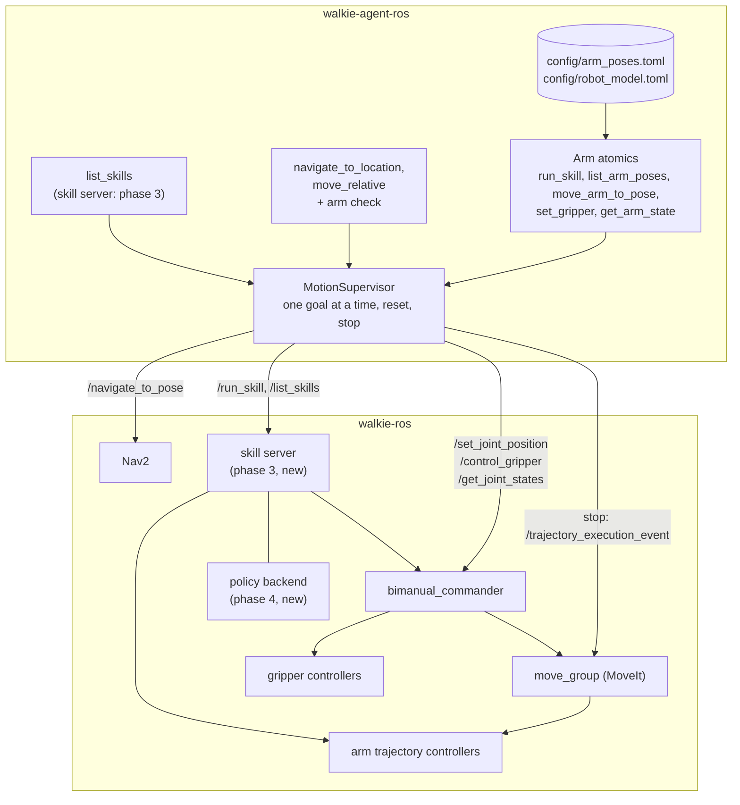
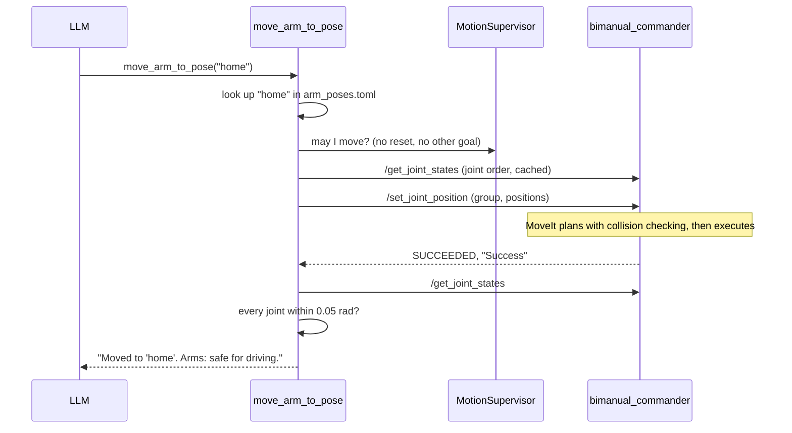
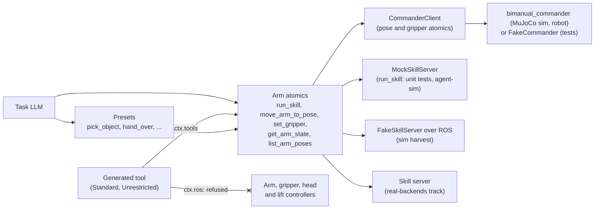
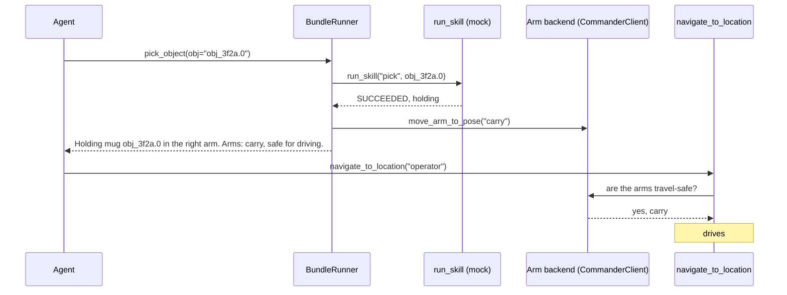

# Arm Manipulation (Proposed)

!!! note "Status: Proposed, four arm tools built"
    `list_arm_poses`, `move_arm_to_pose`, `set_gripper` and `get_arm_state`
    are built, with the commander client and the drive check. They load only
    with `--arms`. The rest of this page is the design for team review. Most
    of the [open questions](#open-questions) say which phase they block.

Walkie has two 7-DOF OpenArm arms with grippers, on a lift. walkie-ros runs
MoveIt and `bimanual_commander`, which plan and execute arm motion. This page
describes how the agent will use them, and how complex skills such as
folding a shirt with a VLA policy fit in later.

The [self-evolving agent](self-evolving-agent.md) changes the order of the
work. Its arm tools are built first as typed atomics. The pose and gripper
atomics call the commander, `run_skill` calls a mock, and the skill-server
client follows on a parallel track. Generated tools are meant to reach the
arms only through those atomics. See
[Arms in the self-evolving agent](#arms-in-the-self-evolving-agent).

Phase numbers on this page are the arm phases in the [Roadmap](#roadmap).
The self-evolving agent has its own phases 0 to 6, which this page always
names in full, for example "phase 2 of the self-evolving agent".

## Summary

- **Named poses only.** The LLM picks a pose by name, such as `home`. It
  never sees joint values. Poses live agent-side in `config/arm_poses.toml`,
  start as copies of the SRDF presets the team used in competition, and are
  checked at startup against the robot's joint limits
  ([ADR-0022](decisions/0022-named-arm-poses.md)).
- **Through the commander.** The agent sends poses with the commander's
  `/set_joint_position`, so MoveIt plans every motion with collision checking
  ([ADR-0021](decisions/0021-arm-control-through-commander.md)).
- **Trust, but verify.** After every motion, the agent reads the joint
  states and checks that the arm really arrived
  ([ADR-0024](decisions/0024-verify-motion-from-joint-states.md)).
- **Reset stops the robot.** A `MotionSupervisor` owns every motion goal.
  `/walkie/reset` stops MoveIt and cancels every goal, Nav2 included
  ([ADR-0023](decisions/0023-motion-supervisor.md)).
- **No driving with arms out.** Navigation refuses unless the arms are in a
  pose marked safe for driving
  ([ADR-0025](decisions/0025-travel-safe-interlock.md)).
- **Skills run on the robot.** Picking, folding and other complex tasks run
  behind a robot-side `RunSkill` action. Each skill is scripted with MoveIt
  or runs a learned policy, and the LLM cannot tell which
  ([ADR-0027](decisions/0027-runskill-action.md)).
- **Typed atomics, `run_skill` mocked first.** The arm tools become typed
  atomics of the self-evolving agent. The pose and gripper atomics call the
  commander, which also runs in walkie-ros's MuJoCo simulation. `run_skill`
  calls a
  mock at the ADR-0027 contract until the skill server lands
  ([ADR-0044](decisions/0044-mocked-arm-atomics.md)).
- **Generated tools only through atomics.** In simulation, at the Standard
  and Unrestricted levels, generated tools are to move the arms only through
  the atomics `run_skill`, `move_arm_to_pose` and `set_gripper`. At
  Competition they cannot move the arms at all. Every arm, gripper, head and
  lift controller, and the commander's `/go_to_home` and collision services,
  are refused at every level. `/set_joint_position`, `/control_gripper` and
  `RunSkill`, once its name is pinned, are refused everywhere except in the
  human-written arm atomics' manifests
  ([ADR-0044](decisions/0044-mocked-arm-atomics.md),
  [The never-list](access-levels.md#the-never-list)).

## Components



The diagram shows the full design. Built today: the four pose and gripper
atomics and the drive check. They call the commander directly through
`CommanderClient` (`src/walkie_agent/arm/commander.py`), which allows one
call at a time. The `MotionSupervisor`, `list_skills`, `run_skill` and the
skill server are not built
([Arms in the self-evolving agent](#arms-in-the-self-evolving-agent)).

## How a pose move works



Until the `MotionSupervisor` lands, `CommanderClient` answers "may I move?".
It refuses a second call at once while a goal runs. On a cancel or a
timeout it asks the commander to cancel the goal, and its message says how
the commander answered. The error's data gives that answer as `cancel`:
`accepted`, `ended`, `refused`, `unknown` or `no answer`, or `pending` when
the commander had not answered the send, so no cancel was sent. An arm
cancel stops both arms, because MoveIt's stop is global. A gripper cancel
is accepted, but the gripper finishes its current motion. A goal outlives
the call that sent it: until the commander reports that the goal ended,
every call is refused with `PRECONDITION_FAILED`.

The client abandons such a goal once the commander's action server has
stayed undiscovered for 5 s, or 60 s after its call gave up. Neither bounds
the motion, since MoveIt lets a goal run for twice its planned duration
plus 60 s, so the goal is then unresolved and the arms are unverified
(`CommanderClient.unverified`). Reads are still taken, but every goal is
refused with `PRECONDITION_FAILED`, and the drive check does not fail open,
until recovery clears that state. `get_arm_state` and the drive check
recover while the arms are unverified, all within the call's timeout.

First the commander must show that every unresolved goal is no longer
active. A goal's result or rejection resolves it. Otherwise recovery sends
it a cancel by its id, which the client made when it sent the goal, so even
a goal whose send the commander never answered can be cancelled. It sends
none while a cancel sent since the goal was abandoned, less than 1 s ago,
still waits for an answer. The answer decides:

- `unknown`: the commander does not know the goal, as after a restart. The
  goal is resolved.
- `ended`: the goal is no longer active, and is resolved, unless a cancel of
  it was accepted or is unanswered. The commander also answers `ended` to a
  second cancel while it still stops the goal.
- `accepted`: the commander has stopped both arms, or the gripper finishes
  its current motion. The goal's result resolves it; recovery asks for the
  result again by the goal's id, since an earlier answer may have been
  lost.
- `refused`, or no answer: the goal may still move an arm or a gripper, and
  stays unresolved.

Recovery fails with `PRECONDITION_FAILED` while a goal is left unresolved,
with the goals in the error's `unresolved` data. Once every goal is
resolved, a settled read must agree: two reads of both arms, 0.3 s apart,
within 0.01 rad, and two reads of the finger of every gripper whose command
was abandoned, within 1 mm. The state clears only when both steps pass and
the arms did not become unverified again meanwhile.
`CommanderClient.last_recovery` then says how each goal was resolved.

The settled read only supplements the commander's answers. It cannot see a
motion slower than 0.01 rad in 0.3 s. That matters only for a trajectory
that move_group still executes after the commander restarted, since the new
commander does not know its goal and answers `unknown`. The full answer is
the MotionSupervisor's stop ([ADR-0023](decisions/0023-motion-supervisor.md)),
which ends every MoveIt execution. The client's state lives in the agent
process, so an agent restart forgets it, abandoned goals included. A
restart is not evidence that a motion ended.

A goal that the commander accepts after its call gave up is cancelled at
once. When it had been abandoned, it is unresolved again, the arms become
unverified again, and the call of a newer arm goal fails with
`SKILL_FAILED`, since the cancel stops both arms; its message says to call
`get_arm_state`. A joint cancel does not stop a gripper, so a gripper goal
never fails that way. No goal starts until recovery clears the state, and
the commander stops both arms for a joint cancel only while the cancelled
goal is active. So a cancel of an older goal that reaches the commander
after that goal ended cannot stop a newer one.

Each gripper command the client sends gets a number,
`GripperResult.command`, and a command that the commander accepts late
counts again. `joint_states_since()` reads a gripper only while that
command is still the latest for its group, so a read after a close does not
show where a newer command from the agent left the fingers. Commands from
other nodes are not counted.

## Tools

| Tool                  | Arguments                                         | Effect | What it does                                                                 |
| --------------------- | ------------------------------------------------- | ------ | ---------------------------------------------------------------------------- |
| `list_arm_poses`      | none                                              | R      | Lists the named poses, which arms each can move, whether it is safe for driving, and its description |
| `move_arm_to_pose`    | `pose`; `arm`: left, right, both (default both)   | M      | Moves one arm or both to a named pose, waits, and checks the joints          |
| `set_gripper`         | `arm`: left, right, both; `state`: open, half, close | M   | Moves the grippers; after a close, reads the fingers and says whether it is holding something |
| `get_arm_state`       | none                                              | R      | Reports the named pose each arm is in, or none, whether it is safe for driving, and how far each gripper is open |
| `list_skills`         | none                                              | R      | Phase 3. Lists the skills the robot offers. Not in the first set of atomics |
| `run_skill`           | `skill`, `target`, `arm`                          | M      | Runs a skill and reports whether success was verified. Mocked from phase 2 of the self-evolving agent; the real skill server is phase 3 |

Every tool except `list_skills` is an atomic of the self-evolving agent
([ADR-0044](decisions/0044-mocked-arm-atomics.md)). The first four are
built. They need the `arm` backend, which the agent creates only with
`--arms`, and are not loaded without it. `run_skill` will run against a mock
until the skill server lands. The Effect column uses
the self-evolving agent's letters: R reads, and M moves an arm or gripper
([ADR-0037](decisions/0037-tool-tiers-bundles-effects.md)).

Every tool answers with a plain sentence. As an atomic, it returns a typed
result whose summary is that sentence. On failure it raises a `StepError`,
and the LLM gets the same kind of sentence in an error tool message. Every
arm tool ends with the arm state, so the LLM always knows whether it may
drive. While the arms are unverified, it never says that they are safe for
driving: it then says "Arms: state unknown." instead. Some example answers:

- "Moved to 'home'. Arms: safe for driving."
- "Could not move to 'standby': MoveIt found no path (Planning Failed). The
  arms did not move. Arms: safe for driving."
- "The commander reported success, but openarm_left_joint4 is 0.31 rad from
  'standby'. Treat this as a failure. Arms: not safe for driving."
- "Already at 'home'. The commander runs in plan-only mode, so it moved
  nothing. Arms: safe for driving."
- "Closed the right gripper. It is holding something. Arms: safe for
  driving."
- "The left gripper did not open fully (the commander reported 'Failed').
  Arms: safe for driving."
- "A stop or a reset interrupted the move of both_arms; the arms were told
  to stop. They may take a moment to stop, so call get_arm_state before
  relying on where they are. Arms: state unknown."
- "Not driving: the arms are not in a pose that is safe for driving. Move
  them with move_arm_to_pose first, for example 'home'."

A gripper's group in `/get_joint_states` has one joint, the finger whose
travel the commander's grasp detection reads. After a close, `set_gripper`
reads it to say whether the gripper holds something, or that it cannot tell
([Grasp detection](#safety)). `get_arm_state` reads both fingers. It names
each gripper closed at or below 0.03 m, the commander's close threshold,
and otherwise half open or open, whichever position is nearer, with the
gap: "Left gripper: closed (gap 0.020 m)." When a finger cannot be read,
the line gives the last command the agent sent that gripper instead.

While the arms are unverified, `get_arm_state` recovers first, as the drive
check does. Its answer is built after its last read, from what the client
knows then. When the call cleared the state, the answer starts with why the
arms had to be checked and what was checked: "The arms had to be checked,
as the move of left_arm from an earlier call was given up on before its end
was known. The commander confirmed that the move of left_arm from an
earlier call ended, and two reads of both arms 0.3 s apart agree. Arm and
gripper tools can be used again." The second sentence says how the
commander showed each goal to be no longer active: that the goal ended, by
its result or by its answer to a cancel; that the commander rejected it; or
that the commander does not know it, as after a restart. The reads also
name each gripper whose finger the settled read checked.

A goal from an earlier call can make the arms unverified again during the
call, as when the commander accepts it late. The answer then starts with
what happened and says to call `get_arm_state` again in a few seconds. It
says neither that the tools can be used again nor that the robot may drive:
it ends with "Arms: state unknown.", or with "Arms: not safe for driving."
when an arm is known to be in a pose that is not safe for driving. When
recovery fails, so does the call, with the error that recovery raised. Its
message says what failed, such as the joint that moved or the cancel that
the commander refused, and, unless a stop or a reset ended the call, why
the arms had to be checked.

With `--arms`, the system prompt gets matching rules (`ARM_RULES` in
`src/walkie_agent/agent.py`): tell people before moving the arms, tuck the
arms before driving, call `get_arm_state` after a failure and retry at most
once, and never improvise a pick from poses and grippers.

## Pose configuration

`config/arm_poses.toml` copies the arm presets in walkie-ros's SRDF
(`manipulate/openarm_bimanual_moveit_config/config/openarm_bimanual.srdf`).
The team tuned them on the robot, and walkie-agent-v2 used them in
competition through the commander's `/go_to_home`.

| Pose          | Arms in the SRDF                 | What it is                                                                                          | Lift when tuned | Offered to the LLM            | `travel_safe`            |
| ------------- | -------------------------------- | --------------------------------------------------------------------------------------------------- | --------------- | ----------------------------- | ------------------------ |
| `home`        | left, right, both                | Arms down at the sides, elbows almost straight. walkie-agent-v2 drove and carried objects in it, since it is narrower than `standby` | top, 0.7435 m | yes       | true                     |
| `hands_up`    | left, right, both                | Shoulders out, elbows bent up. walkie-agent-v2 raised a grasped object clear with it                | top             | yes                           | false                    |
| `standby`     | left, right, both                | `hands_up` with joint 7 at ±90° instead of ±12°. walkie-agent-v2 stopped driving in it because the elbows stick out and clipped door frames | top | yes         | false                    |
| `pre_place`   | left; both keeps the right arm in `standby` | The left arm's approach before a place, used by walkie-agent-v2's place skill            | 0.735 m         | no: a step of the place skill | false                    |
| `tray`        | both only                        | Both arms set for a tray. walkie-agent-v2's code never calls it                                     | top             | in simulation only, until tried on the robot | false, to be confirmed |
| `basket`      | left, right; both keeps the right arm in `standby` | The left arm at a basket, with the lift lowered                                  | 0.303 m         | no: needs the lift            | false                    |
| `basket_hold` | left, right, both                | The same left arm as `basket` with the lift at the top, so the lift raised the basket. Its own right-arm pose | top   | no: needs the lift            | false                    |

The SRDF's three gripper states also carry over: `open` (0.044 m) and
`closed` (0) as they are, and `half_closed` (0.022 m) replaced, as the
example below explains.

```toml title="config/arm_poses.toml (excerpt)"
[grippers]
# Travel of one finger, in metres. The jaw opens about twice as wide.
open_position = 0.044    # the SRDF's "open"
half_position = 0.036    # above 0.03, or it counts as a close (the SRDF's
                         # "half_closed", 0.022, does)
closed_position = 0.0    # the SRDF's "closed". At most 0.03, so grasp
                         # detection runs

[poses.home]
srdf_state = "home"
travel_safe = true       # walkie-agent-v2 drove and carried objects in it
tried_on_robot = true
description = "Both arms down beside the body, elbows almost straight."

[poses.home.left]
openarm_left_joint1 = 0.2618
openarm_left_joint2 = 0.0
openarm_left_joint3 = 0.0
openarm_left_joint4 = 0.2618
openarm_left_joint5 = 0.0
openarm_left_joint6 = 0.0
openarm_left_joint7 = 0.0

[poses.home.right]
openarm_right_joint1 = -0.2618
openarm_right_joint2 = 0.0
# ... joints 3 to 7 as on the left

# Left arm only: the SRDF has no right-arm pre-place.
[poses.pre_place]
srdf_state = "pre-place"
travel_safe = false
offered = false          # a step of the place skill, which runs robot-side
tried_on_robot = true
description = "Left hand raised over a surface, before placing."
# [poses.pre_place.left] only

# No SRDF state. Recorded in the MuJoCo simulation; re-record on the robot.
[poses.receive]
travel_safe = false
tried_on_robot = false
description = "Left hand held out in front, to take a bag from a person."
# [poses.receive.left] only

# No SRDF state. Recorded like receive; the right table mirrors the left.
[poses.carry]
travel_safe = true       # required: the robot guides the guest holding the bag
both_arms = false        # both in carry, the hands meet in front of the body
                         # and MoveIt finds no plan
tried_on_robot = false
description = "Holding an object close to the body."
# [poses.carry.left] and [poses.carry.right]
```

- **One table per arm.** Each pose has a `left` and a `right` joint table,
  copied from the SRDF's `left_arm` and `right_arm` states.
  `move_arm_to_pose(pose, arm)` sends one table as a `left_arm` or
  `right_arm` goal, or both as one `both_arms` goal, so MoveIt plans the two
  arms together. A pose with no table for an arm refuses it: "'pre_place'
  is for the left arm only." A pose with `both_arms = false` has both
  tables but takes one arm at a time: "'carry' is for one arm at a time:
  left or right."
- **Both-arm states.** The SRDF's both-arm states are its two single-arm
  states together, with three exceptions. Both-arm `basket` and `pre-place`
  keep the right arm in `standby`, which the agent gets by moving the right
  arm to `standby` and the left to `basket` or `pre_place`. `tray` exists
  only for both arms, so its left and right tables are cut from that state.
  Moving both arms to `basket` is a pairing the SRDF never had, and is tried
  on the robot like a new pose.
- **Not offered.** `offered = false` keeps a pose out of `list_arm_poses`
  and `move_arm_to_pose`. It still passes the startup check, so it is ready
  once its blocker clears. `move_arm_to_pose` answers a hidden pose as it
  answers an unknown one.
- **Tried on the robot.** A pose with `tried_on_robot = false` is offered
  only when the agent runs on sim time (`--use-sim-time`). Today that is
  `tray`, `receive` and `carry`.
- **No lift.** Lift heights are not copied
  ([ADR-0026](decisions/0026-exclude-lift.md)). The agent does not move the
  lift, so a pose runs at whatever height the lift is at. Only `basket` was
  tuned well below the top. walkie-agent-v2 often sent the `*_lift` states,
  which also moved the lift to the top.
- **Kept in step.** `srdf_state` names the SRDF state a pose copies. The
  loader checks those tables against the state in
  `config/robot_model.toml`, so a retune in walkie-ros fails the startup
  check until someone copies it on purpose. A pose retuned agent-side drops
  `srdf_state`.
- **Not from the SRDF.** `carry` and `receive` come from walkie-agent-v2's
  HRI bag hand-over, which reached them with Cartesian goals through
  `/go_to_pose`. The agent never sends those. They were recorded in the
  MuJoCo simulation on 2026-10-23: the two goals were sent once, with the
  lift at 0.7435 m, and the joint values copied from `/get_joint_states`.
  They are to be re-recorded on the robot the same way
  ([HRI Task](hri.md#the-bag-hand-over)).
- **Right joint 2.** `real_omnibot.launch.py` defaults `right_joint2_fixed`
  to false, and the snapshot is generated the same way.
  Every right-arm preset has joint 2 at 0, so the presets hold either way.
  When `/get_joint_states` lists no `openarm_right_joint2`, the tool drops
  that joint, and a pose with a non-zero value there is refused. `carry`'s
  right table has 0.50 rad there.
- **Joint limits.** The loader checks against `joint_limits.yaml`, which
  widens joints 4 and 7 by 0.02 rad, joint 7 past the URDF's ±1.570796.
  `standby`, `pre_place` and `tray` need that margin: `tray`'s right joint 7 is
  −1.5882. `basket`'s left joint 2, 0.1745, sits 0.00003 rad under its
  limit, so the values are copied without rounding.
- `pick_object` and `pickup_object_in_view` end in `carry`, and the robot
  then drives. So `carry` must have `travel_safe = true`, or the
  [ADR-0025](decisions/0025-travel-safe-interlock.md) interlock refuses the
  drive. When a bundle fails after an arm step started, the bundle runner
  stows the arms in `home`, so `home` must be travel-safe too.
- Joint values are keyed by name. The order sent to the robot comes from
  `/get_joint_states` at run time.
- `config/robot_model.toml` is a snapshot of the SRDF groups and states and
  of `joint_limits.yaml` from the pinned walkie-ros commit, the clone in
  `ros2_ws/src/walkie-ros`. `scripts/snapshot_robot_model.py` writes it, and
  `tests/test_arm_poses.py` fails when it no longer matches the pin. Without
  the clone that test is skipped, except in CI, where it fails. The script
  stops on a group or a group state inside a xacro element, other than the
  `right_joint2_fixed` wrappers inside group states, since it cannot tell
  whether xacro keeps it. The loader checks every pose against the snapshot,
  and lists every error at once.
- Poses of the `*_lift` groups are rejected, so the LLM never gets one
  ([ADR-0026](decisions/0026-exclude-lift.md)).
- Every pose is tried on the robot through `/set_joint_position`, with
  collision checking on, before the LLM gets it outside the simulation
  (`tried_on_robot`). walkie-agent-v2 also sent
  joint arrays written inline in its task code, with collision checking
  off, to drag the laundry basket and open a door. They are not in the SRDF
  and are not copied.

## Safety

- **One motion at a time.** RAI already runs one tool at a time. The
  MotionSupervisor also refuses arm motion while Nav2 drives, and the other
  way round. Until it lands, `CommanderClient` refuses a second commander
  call while a goal runs, and while a goal whose call gave up has not
  ended. While the arms are unverified, it refuses every goal. The drive
  check refuses to drive in the first two cases, and in the third unless
  recovery clears the state: the commander shows that every abandoned goal
  is no longer active, and a settled read shows the arms still. It makes
  the whole decision under the client's call lock (`check_for_driving()`),
  within its 3 s limit, so no arm goal can start between its steps.
- **Reset.** `/walkie/reset` publishes `"stop"` on
  `/trajectory_execution_event`, cancels every goal, and blocks every motion
  tool until the reset is applied. The physical emergency stop stays the real
  safety boundary, because a software stop needs ROS, MoveIt and the
  controllers to be working. Until the MotionSupervisor lands, a stop or a
  reset sets the atomics' cancel event: a running arm atomic cancels its
  commander goal at once. A stop before the goal is sent answers "Stopped
  by reset before the arms moved." or "Stopped by reset before the left
  gripper moved." Otherwise the answer is the client's message, which says
  how the commander answered the cancel, then what to do, then the arm
  state:
    - an arm cancel it accepted: the arms may take a moment to stop, so
      call `get_arm_state` before relying on where they are;
    - a gripper cancel it accepted: the gripper finishes its current
      motion, so wait a few seconds;
    - a cancel it refused, did not know or did not answer, or a goal it had
      not accepted yet: an arm or the gripper may still be moving, so wait a
      few seconds, then call `get_arm_state`;
    - a goal that had already ended: nothing more.
- **Collision.** MoveIt plans around the robot and the planning scene. The
  agent never turns collision checking off. Held objects are not in the
  planning scene by default, so poses used while holding something need
  clearance.
- **Speed.** The commander runs at full speed: velocity and acceleration
  scaling are hard-coded to 1.0, ignoring the 0.5 and 0.3 in
  `joint_limits.yaml`. Until walkie-ros change W2 lands, hardware tests need
  an operator at the emergency stop and short motions.
- **Lift.** Excluded until it can be cancelled
  ([ADR-0026](decisions/0026-exclude-lift.md)).
- **Grasp detection.** The commander's `grasped` flag can be wrong when the
  gripper controller is down, or when "half" is set at or below 0.03 m. A
  close the commander did not measure, with `grasp_detect_enable` off or
  before its first finger reading, reports `grasped` false and a gap of 0,
  and so does a close that a newer command superseded, also one from
  another node. The detection band must be calibrated on real objects. An
  open or a "half" that the commander reports failed fails `set_gripper`.
  When the tool cannot tell whether a close holds something, the answer
  says so and to call `get_arm_state`, and the step does not fail on that
  alone. After a close:
    - when the commander reports it failed with `grasped` false and a gap
      of 0, the tool does not read the finger, which may show a newer
      command, and says that it cannot tell;
    - otherwise the tool reads the finger, but only while the close is
      still the gripper's latest command from the agent
      (`joint_states_since()`); after a newer one, and when the finger
      cannot be read, it says that it cannot tell;
    - within 4 mm of fully open, the gripper did not close, and the tool
      fails;
    - otherwise `grasped` is the answer when the commander's gap is within
      2 mm of the read;
    - when it is not, as after a close reported reached but not measured,
      the read is judged by the commander's default detection band, 0.005
      to 0.044 m.
- **Generated code.** Tools written by the self-evolving agent can never
  reach the arm controllers or the MoveIt and commander planning names. They
  move the arms only in simulation, and only through the atomics: the
  commander's motion and collision names, and `RunSkill` once its name is
  pinned, are on the never-list too
  ([The never-list](access-levels.md#the-never-list)).

### Forbidden names

Exact-string matching means every name must be listed, including each
action's `/_action/feedback` and `/_action/status` topics.

**Dedicated names** are used only by their own tool, and hidden from every
generic tool: `/navigate_to_pose`, `/set_joint_position`,
`/control_gripper`, `/get_joint_states`, and later `/run_skill` and
`/list_skills`.

**Forbidden names** are never touched by any tool:

| Kind                         | Names                                                                                                                                                                                                                                                          |
| ---------------------------- | -------------------------------------------------------------------------------------------------------------------------------------------------------------------------------------------------------------------------------------------------------------- |
| Base velocity                | `/cmd_vel`, `/cmd_vel_nav`, `/cmd_vel_joy`, `/cmd_vel_key`, `/omni_wheel_drive_controller/cmd_vel`                                                                                                                                                             |
| Agent                        | `/walkie/reset`                                                                                                                                                                                                                                                |
| Stop                         | `/trajectory_execution_event` (only the MotionSupervisor publishes here)                                                                                                                                                                                       |
| Commander, unused actions    | `/go_to_home`, `/go_to_pose`, `/go_to_pose_relative`, `/go_to_pose_quat`                                                                                                                                                                                       |
| Commander services           | `/execute_stored_plan`, `/clear_collision_objects`, `/toggle_octomap_collision`, `/toggle_all_collision_checking`, `/toggle_gripper_collision`, `/bimanual_commander/set_parameters`                                                                            |
| MoveIt                       | `/apply_planning_scene`, `/get_planning_scene`                                                                                                                                                                                                                 |
| Arm and gripper controllers  | `/left_joint_trajectory_controller/joint_trajectory`, `/right_joint_trajectory_controller/joint_trajectory`, `/left_joint_trajectory_controller/follow_joint_trajectory`, `/right_joint_trajectory_controller/follow_joint_trajectory`, `/left_gripper_controller/gripper_cmd`, `/right_gripper_controller/gripper_cmd`, `/left_forward_position_controller/commands`, `/right_forward_position_controller/commands` |
| Lift and head                | `/lift_controller/follow_joint_trajectory`, `/lift_controller/commands`, `/lift/cmd`, `/head_servo_controller/commands`                                                                                                                                         |
| Controller manager           | `/controller_manager/switch_controller`                                                                                                                                                                                                                        |

These lists guard the agent's own ROS tools
([ADR-0009](decisions/0009-forbidden-names-guard-rail.md)). One reviewed
component outside the tools, the gaze loop, publishes rotation only on
`/cmd_vel` ([ADR-0051](decisions/0051-agent-side-gaze-loop.md)). Generated code
goes through a separate never-list in `config/access_levels.toml`, which
uses glob patterns such as `/*_joint_trajectory_controller/*`
([The never-list](access-levels.md#the-never-list)).

## Skills and VLA policies

Some tasks, such as picking up a cup or folding a shirt, are more than a few
poses. They run as **skills** in a new robot-side skill server
([ADR-0027](decisions/0027-runskill-action.md)):

```text title="RunSkill.action (sketch)"
string skill            # name from ListSkills
string target           # free text, for example "red cup"; may be empty
string arm              # "left", "right", or "" to let the skill decide
string params_json      # optional skill parameters
float32 timeout_sec     # 0 = the skill's default
---
uint8 outcome           # SUCCEEDED, FINISHED_UNVERIFIED, FAILED, PRECONDITION_FAILED,
                        # CANCELED, SAFETY_STOP, TIMED_OUT
bool success_verified   # true only if a check independent of the policy confirmed it
string message          # one plain sentence for the LLM
string end_pose         # named pose the arms ended in
bool holding_left
bool holding_right
---
string phase            # checking, moving_to_start, running, verifying, restoring
float32 progress        # 0 to 1, or -1 if unknown
```

When a skill runs a policy, the skill server:

1. checks preconditions: the base is still, no other arm goal is running,
   the cameras publish, and the policy backend is alive;
2. moves to the skill's start pose through the commander, and checks it;
3. streams the policy's joint targets to the arm trajectory controllers
   (fallback: switch to forward position controllers);
4. passes every target through a safety filter: joint limits, maximum step
   per cycle, no NaN, and a watchdog that holds position if the policy
   stalls;
5. checks success independently of the policy, for example with the gripper
   gap or the end-effector pose;
6. restores the controllers and reports the outcome.

A cancel stops the policy, holds position and restores the controllers
within 2 s. Images and inference stay in robot-side nodes, outside the
agent ([ADR-0028](decisions/0028-images-and-policy-robot-side.md)).

## Arms in the self-evolving agent

The [self-evolving agent](self-evolving-agent.md) wires atomic tools into
bundles, and writes new tools in simulation. For the arms that means three
changes, recorded in [ADR-0044](decisions/0044-mocked-arm-atomics.md): the
arm tools become typed atomics, `run_skill` calls a mock until the skill
server exists, and generated tools are to reach the arms only through them.
The pose and gripper atomics call the commander. The
contracts on this page stay. The atomics keep the sentences in
[Tools](#tools), and `run_skill` keeps the `RunSkill` outcomes of ADR-0027.



### Typed arm atomics

Each atomic is one file in `src/walkie_agent/tools/atomic/`, with a `META`,
typed `Args` and `Out`, and a `run(ctx, args)` function
([ADR-0037](decisions/0037-tool-tiers-bundles-effects.md)). A bundle can
wire only typed fields, never sentences, so this refactor comes first.
`move_arm_to_pose` and `get_arm_state` are bound every turn. The other three
are reached through `find_tools`, and `run_skill` usually through a preset
([What the agent sees each turn](self-evolving-agent.md#what-the-agent-sees-each-turn)).
Until `find_tools` is built, the four built arm atomics are all bound every
turn when the agent runs with `--arms`.

- `run_skill` returns a `SkillResult` with `outcome`, `arm` (left or right)
  and `holding`. In the pick presets its `target` is an object handle from
  perception, such as `obj_3f2a.0`, never a literal (linker rule L08).
- The linker checks literal arguments against the tool's validator (L06). A
  `pose` that `config/arm_poses.toml` does not offer fails to link, for
  example `basket`, which needs the lift. So does an `arm` the pose has no
  table for, such as `pre_place` on the right.
- The bundle runner retries only idempotent R or P steps, so it never
  retries an arm step on its own (L07). The prompt rule above still allows
  the agent one retry.

### Outcomes as typed failures

Outcomes are errors, not optional fields. A failed pick raises a
`StepError`, so the next step of a bundle never runs on a result it might
misread, and the runner can say which step failed with which code.
`SUCCEEDED` and `FINISHED_UNVERIFIED` return a `SkillResult`. The other five
ADR-0027 outcomes raise `SKILL_FAILED`, `PRECONDITION_FAILED`, `CANCELLED`,
`SAFETY_STOP` and `TIMEOUT` ([ADR-0044](decisions/0044-mocked-arm-atomics.md)).

A `FINISHED_UNVERIFIED` pick returns, because the skill may have worked. The
pick presets add the postcondition `expect={"holding": True}`, so a pick
that ends without holding anything fails with `POSTCONDITION`. The pose and
gripper atomics fail the same way, with the sentences in [Tools](#tools).
After a failed pick inside a bundle, the agent reads:

```text title="Tool message, status error"
pickup_object_in_view FAILED at step 4/5 'pick' (run_skill): SKILL_FAILED
Skill server reported FAILED: grasp slipped on obj_3f2a.0 (mug, 0.62 m ahead, 0.15 m left).
Done: dets, match, where. Not run: carry.
Recovery: runtime stow, move_arm_to_pose('home') ok. Arms: home, safe for driving.
```

### Backends

The atomics reach the arms through backends. The pose and gripper atomics
use the real commander, and `run_skill` starts on a mock at the ADR-0027
contract:

| Backend           | File                                | What it does |
| ----------------- | ----------------------------------- | ------------ |
| `CommanderClient` | `src/walkie_agent/arm/commander.py` | Built. The `arm` backend, created only with `--arms`. Calls `/set_joint_position`, `/control_gripper` and `/get_joint_states` on `bimanual_commander`, one call at a time, and cancels a running goal on a cancel or a timeout. A goal whose call gave up still holds off every call until it ends, or until it is abandoned, after its action server stayed undiscovered for 5 s or 60 s after its call gave up. The arms are then unverified, and goals are refused, until recovery clears that: the commander shows the goal to be no longer active, by its result or its answer to a cancel by the goal's id, which the client made, and a settled read of both arms, and of the finger of an abandoned gripper command, shows them still. `check_for_driving()` makes the drive check's whole decision under the call lock. A reading with a position that is not a finite number is refused, and an arm whose joints a reading lacks becomes unknown. It loads `config/arm_poses.toml`, remembers the arms' last read state and each gripper's last command, and counts each gripper's commands for `joint_states_since()`. In simulation it talks to the real commander in walkie-ros's MuJoCo simulation. |
| `FakeCommander`   | `src/walkie_agent/sim/fake_commander.py` | Built. A ROS-level fake of `bimanual_commander` ([ADR-0019](decisions/0019-test-fakes-fast-dds.md)) for the tests. It serves the same three names, and has knobs for slow moves, a joint speed (`joint_speed_rad_s`), planning time, a plan held until a test releases it (`plan_gate`), plan and execution failures, plan-only mode, joint errors, rejected goals, no answer, an acceptance held until a test releases it (`accept_gate`), late results, refused and slow cancels, a cancel answer held until a test releases it (`cancel_gate`), failed and incomplete reads, `right_joint2_fixed`, and object widths for grasps. `vanish()` takes all or some of its servers off the graph, and `come_back()` serves them again as new instances that do not know the old goals. `supersede()` commands a gripper as another node can, which ends the ramp of the gripper's goal. Its docstring lists where it differs from the commander. |
| `MockSkillServer` | `src/walkie_agent/sim/mock_skill.py` (new) | Serves `run_skill` with the seven ADR-0027 outcomes. Each skill has fault knobs: a forced outcome and a delay. A successful pick attaches the `FakeScene` object to the arm. |
| `FakeScene`       | `src/walkie_agent/sim/fake_scene.py` (new) | Loads a TOML scene of objects (label, description, map pose, size, graspable) for the perception mocks and the picks. |

- Each atomic declares its backends in `META.requires`. The registry hides
  a tool whose backend is missing. The design adds that it hides a tool
  whose backend is a mock unless the agent runs in simulation, and that a
  real run refuses to start if a required backend is a mock. A mocked pick
  never runs on the real robot.
- `MockSkillServer` is a protocol mock for unit tests and `agent-sim`, not a
  ROS-level fake of ADR-0019. ADR-0037 records that gap. The mock can drift
  from the real interface, so the bundle tests rerun against the real
  client on the real-backends track.
- Until the MotionSupervisor ([ADR-0023](decisions/0023-motion-supervisor.md))
  lands, a reset trips the session's cancel token. The bundle runner checks
  it between steps. A running arm atomic cancels its commander goal; any
  other running step stops only when its own wait checks the token.

### Presets that move the arms

Presets are human-reviewed bundles in
`src/walkie_agent/tools/bundled_preset/`. All four are bound every turn.

| Preset                  | Arguments                       | Steps                                                                     |
| ----------------------- | ------------------------------- | ------------------------------------------------------------------------- |
| `find_object_in_view`   | `object`, `description`         | `detect_objects`, `search_detections`, `localize_object`. No arm motion; returns the object handle |
| `pick_object`           | `obj`, `arm`                    | `localize_object`, `run_skill("pick")`, `move_arm_to_pose("carry")`       |
| `pickup_object_in_view` | `object`, `description`, `arm`  | All five steps of the two above                                           |
| `hand_over`             | `arm`                           | `run_skill("hand_over")`                                                  |

- `arm` is left, right or auto.
- Presets stop at decision points before any arm moves. When
  `search_detections` finds several close matches (`AMBIGUOUS`, up to 3
  candidates) or none (`NOT_FOUND`), `pickup_object_in_view` returns
  "Nothing moved". The agent asks the person, then calls `pick_object` with
  the chosen handle. Picking is `run_skill` reached through a preset, which
  is how the agent keeps the rule "never improvise a pick from poses and
  grippers".
- **Runtime stow.** When recovery runs after an arm step started, the runner
  calls `get_arm_state`, and moves to `home` if the arms are not
  travel-safe. It covers every bundle, including ones without recovery
  steps, and also runs when the sim interlock demotes the session in the
  middle of a bundle with arm steps.
- A preset may add `Recover(tool, args, if_ran="pick")`, which runs only if
  the named step started. No recovery step is unconditional, so a perception
  failure can never move an arm.
- A bundle can link and still do the wrong thing, for example with left and
  right swapped. Postconditions, the stops at decision points, arm motion
  from generated code only in simulation, and human promotion are the
  guards ([Risks](self-evolving-agent.md#risks)).
- Presets cannot call presets. A `place_object` preset comes later.

### Generated tools and the arms

Generated tools are meant to move the arms only by calling the atomics.

| Level        | Where it runs | Arm motion in generated tools                       | Arm atomics in `ctx.tools` |
| ------------ | ------------- | --------------------------------------------------- | -------------------------- |
| Unrestricted | Simulation    | Only through `run_skill`, `move_arm_to_pose`, `set_gripper` | All five           |
| Standard     | Simulation    | Only through `run_skill`, `move_arm_to_pose`, `set_gripper` | All five           |
| Competition  | Anywhere      | None. Generated tools may have effects R, P and S only | `get_arm_state`         |

- **Never-list.** At every level and for every verb, `ctx.ros` refuses the
  arm, gripper, head and lift controllers, `/controller_manager/*` and the
  MoveIt and commander planning names
  ([The never-list](access-levels.md#the-never-list)). In simulation these
  controllers exist: walkie-ros's MuJoCo launch spawns the joint trajectory,
  gripper, lift and head controllers. The reviewed manifests of tools
  promoted to git obey the same list.
- **Commander and skill names.** The never-list also names the commander's
  `/go_to_home` and collision services at every level, and
  `/set_joint_position`, `/control_gripper` and the `RunSkill` action, once
  its name is pinned, everywhere except in the human-written arm atomics'
  manifests. Unrestricted allows any action or service off that list, so
  these entries land in phase 4a with raw actions at Unrestricted. Until
  `RunSkill`'s name is pinned, whatever the `FakeSkillServer` serves in the
  sim harvest needs the same entry ([open question 9](#open-questions)).
  walkie-ros's MuJoCo launch starts neither the commander nor MoveIt today.
- **Stamps and fresh checks.** A draft that calls `run_skill` is stamped
  Standard, so it never loads at Competition
  ([Level stamps](access-levels.md#level-stamps)). At Standard and
  Unrestricted, every M call through `ctx.tools` first re-runs the sim
  interlock's domain and real-driver checks, and a failure demotes the
  session ([ADR-0040](decisions/0040-sim-interlock.md)).
- **No raw controllers.** Code that drives the controllers skips MoveIt's
  planning and collision checking, so it could never be promoted as-is, and
  cleaning up after it needs controller-aware stops. If phase 4b of the
  self-evolving agent ships, which happens only on harvest evidence, it adds
  raw base-command publishing at Unrestricted but no arm controllers. Raw
  arm controllers are reconsidered only if the harvest's atomic wishlist
  shows tools blocked without them
  ([ADR-0044](decisions/0044-mocked-arm-atomics.md)).

At Competition the task LLM also loses its M tools once untrusted web text
enters a turn ([Turn taint](competition.md#turn-taint-and-the-history-scrub)).
A generated tool that composes the arm atomics is what the harvest can turn
into a new preset, by a human-reviewed pull request
([ADR-0048](decisions/0048-sim-harvest-promotion.md)).

### The FakeSkillServer in the sim harvest

The [sim harvest](harvest.md) runs the agent in MuJoCo on many tasks. Its
arms are served by `FakeSkillServer` (`src/walkie_agent/sim/fake_skill_server.py`,
new in phase 5 of the self-evolving agent), a ROS-level fake in the spirit
of ADR-0019:

- It runs in the harvest harness and answers with the ADR-0027 outcomes.
- It updates the harness's record of the world, and mirrors every pick and
  place into MuJoCo with one `SetFreeJointState` call
  (`mujoco_ros2_control_msgs/srv/SetFreeJointState`). That service moves
  only the listed bodies. `ResetWorld` is never used for this, because it
  would also put the robot back at its spawn.
- A held object is parked away from the rooms until it is placed.
- The harness alone holds the simulator's services. No agent tool exposes
  them, and they are on every level's never-list, so neither the agent nor
  generated code can move an object.

No component of the stack publishes ground-truth object poses in simulation
today, so the harvest takes object positions from the scenario and from the
`FakeSkillServer`, by construction.

### Pick, then drive

`navigate_to_location` and `move_relative` ask the arm backend whether the
arms are travel-safe ([ADR-0025](decisions/0025-travel-safe-interlock.md)).
So a pick followed by a drive exercises the interlock against the commander:



- If `carry` were not travel-safe, `navigate_to_location` would answer with
  the interlock sentence instead of driving. A failed pick ends in `home`
  through the runtime stow, which is travel-safe too.
- After the drive, the object handles captured before it are `STALE`: a
  handle expires once the base has moved more than 5 cm or 3° since capture.
  A later pick needs a fresh detection. `pick_object` with an old handle
  fails with `STALE` at `localize_object`, before any arm moves.

The [self-evolving agent](self-evolving-agent.md) page follows the same task
from the spoken request to the hand-over.

## What lives where

| Piece                                                            | Repository       | Location                                             |
| ---------------------------------------------------------------- | ---------------- | ---------------------------------------------------- |
| Arm atomics, one file per tool                                   | walkie-agent-ros | `src/walkie_agent/tools/atomic/` (four built; `run_skill` new) |
| Commander client, pose loader, arm state                         | walkie-agent-ros | `src/walkie_agent/arm/` (`commander.py`, `poses.py`, `state.py`) |
| Presets `find_object_in_view`, `pick_object`, `pickup_object_in_view`, `hand_over` | walkie-agent-ros | `src/walkie_agent/tools/bundled_preset/` (new) |
| Typed results, `StepError`, the bundle runner and its runtime stow | walkie-agent-ros | `src/walkie_agent/toolbox/types.py`, `src/walkie_agent/toolbox/runner.py` (new) |
| The navigation arm check                                         | walkie-agent-ros | `src/walkie_agent/tools/navigation.py` (changed)     |
| MotionSupervisor                                                 | walkie-agent-ros | `src/walkie_agent/motion.py` (new)                   |
| Named poses, robot-model snapshot and its generator              | walkie-agent-ros | `config/arm_poses.toml`, `config/robot_model.toml`, `scripts/snapshot_robot_model.py` |
| The commander launch for the MuJoCo simulation                   | walkie-agent-ros | `launch/commander_sim.launch.py`                     |
| Never-list of arm, gripper, head and lift controllers            | walkie-agent-ros | `config/access_levels.toml` (new)                    |
| Protocol mocks: `MockSkillServer`, `FakeScene`                   | walkie-agent-ros | `src/walkie_agent/sim/mock_skill.py`, `fake_scene.py` (new) |
| ROS-level fake skill server for the sim harvest                  | walkie-agent-ros | `src/walkie_agent/sim/fake_skill_server.py` (new)    |
| Fake commander                                                   | walkie-agent-ros | `src/walkie_agent/sim/fake_commander.py`             |
| Arm summary for the LLM                                          | walkie-agent-ros | `whoami/documentation/arms.md` (new)                 |
| `my_robot_interfaces`, including future skill interfaces         | walkie-ros       | `manipulate/my_robot_interfaces`, pinned here        |
| Commander, MoveIt, SRDF, joint limits                            | walkie-ros       | `manipulate/` (unchanged in phases 0 and 1)          |
| Controllers, lift node, Nav2, URDF                               | walkie-ros       | `bringup/`, `navigation/`, `description/`            |
| Skill server, safety filter, controller switching                | walkie-ros       | new package                                          |
| Policy inference, success checks, perception                     | walkie-ros or another robot-side repository | new                       |

The linker, the ROS bridge and the sim interlock are listed on
[Access Levels](access-levels.md#what-lives-where).

## Changes needed in walkie-ros

Phases 0 and 1 need none. Later phases need:

| Change | Phase | What |
| ------ | ----- | ---- |
| W1 | 2 | Lift action: accept cancel and stop in place; report failure, not success, when the 60 s timeout runs out. |
| W2 | before arm hardware tests | Commander: make velocity and acceleration scaling ROS parameters, defaulting to `joint_limits.yaml`'s 0.5 and 0.3. |
| W3 | optional | Commander: make a gripper cancel actually stop the gripper. |
| W4 | 3 | Add `RunSkill`, `ListSkills` and `SkillInfo` to `my_robot_interfaces`, or to a new package. |
| W5 | 3 | New skill server package. |
| W6 | 4, fallback only | Spawn the forward position controllers inactive, for the policy fallback. |
| W7 | 4 | Policy backend and success checks. |
| W8 | before hardware tests | Commander launch: declare and pass a `plan_only` argument, for a safe dry run on the real robot. Today the launch file cannot set it. |
| W9 | before mock tests | A MoveIt mock launch without `pick_and_place_isaac2`. The current `moveit_demo_with_commander.launch.py` starts it, and it moves the arms and adds collision objects on its own. |

The built arm atomics and the mocked `run_skill` need none of these. W4
would also fix the interface
the `FakeSkillServer` serves in the sim harvest
([open question 9](#open-questions)).

## Testing

- **Protocol mocks first.** From phase 2 of the self-evolving agent,
  `run_skill` and the presets run against `MockSkillServer` and
  `FakeScene`, with no ROS. Tests check the structured result: the step,
  the tool and the code.
    - `test_runner` covers the bundle runner. Proposed cases include a clean
      stop on `AMBIGUOUS`, a skill failure and its stow, and a cancel
      between steps.
    - `test_nav_interlock`: pick, then drive, against the `FakeCommander`.
    - A mocked fetch runs end to end on `agent-sim` with injected faults.
- **No hardware.** `FakeCommander` (`src/walkie_agent/sim/fake_commander.py`)
  serves the commander's actions and service with the same names and
  quirks. It has settings for scrambled joint order, planning time, a plan
  held until the test releases it, planning and execution failure, slow
  motion, a joint speed, plan-only mode, joints that stop off target,
  rejected goals, goals that never finish, an acceptance or a cancel answer
  held until the test releases it, late results, refused and slow cancels,
  failed and incomplete reads, `right_joint2_fixed` and grasping an object.
  `vanish()` takes all or some of its servers off the graph, as when the
  commander stops, and `come_back()` serves them again, as a restarted
  commander. `supersede()` commands a gripper from outside the agent. Tests
  run on Fast DDS ([ADR-0019](decisions/0019-test-fakes-fast-dds.md)).
  `tests/test_commander.py` covers `CommanderClient`, including goals that
  outlive their call, each answer to a cancel, abandoned goals and their
  recovery, the settled read of the arms and the fingers, and goals that
  the commander accepts late. Recovery is tested for each answer to its
  cancel, a goal that still plans, a send never answered and a restarted
  commander. `tests/test_arm_atomics.py` covers the four arm atomics and
  the drive check against it. Those tests include the answer to a stop or
  a reset for each answer to its cancel, grippers that fail, close
  unmeasured or are commanded again before the read, plan-only mode,
  readings that lack a joint or hold one that is not a number, a move too
  slow for the settled read to see, and a recovery that must end within
  the drive check's timeout. `tests/test_arm_poses.py` covers the pose
  loader, the pose match and the snapshot.
- **Fake skill server.** Next to it, `FakeSkillServer` serves the skill
  interface over ROS with the ADR-0027 outcomes, for the sim harvest. Its
  tests should show that a pick and a place move only the object, through
  `SetFreeJointState`, and leave the robot where it is.
- **Generated code.** `test_ros_bridge` (phase 4a of the self-evolving
  agent) runs the access policy per level on `fake_walkie`. Every arm,
  gripper, head and lift controller name is refused at every level.
- **Robot software, mock hardware.** The real commander and MoveIt with mock
  controllers (needs W9).
- **Real robot,** step by step. The steps are R0 to R7, so they are not
  confused with the harvest stages H0 to H7:

| Step | What                                           | Passes when                                                        |
| ---- | ---------------------------------------------- | ------------------------------------------------------------------ |
| R0   | Zenoh connection on the robot PC               | `/set_joint_position` is visible; `get_arm_state` answers          |
| R1   | Mock hardware                                  | All arm tools work against it                                      |
| R2   | Real robot, commander in plan-only mode (W8)   | `move_arm_to_pose` reports plan-only, and verification sees no motion |
| R3   | Arms powered, emergency stop in hand           | A small single-arm move                                            |
| R4   | Both arms, `home` to `standby`; reset mid-move | Measure how long the arms take to stop after a reset               |
| R5   | Grippers on nothing, and on a bottle           | Grasp detection calibrated                                         |
| R6   | Navigation with arms out                       | Navigation refuses, then drives after `home`                       |
| R7   | Full voice scenario                            | End to end works                                                   |

## Roadmap

| Phase | What                                                                                       | Needs from walkie-ros |
| ----- | ------------------------------------------------------------------------------------------ | --------------------- |
| 0     | Zenoh, the walkie-ros pin, tests on Fast DDS, a "run on the robot PC" page                 | nothing               |
| 1     | Poses and snapshot, MotionSupervisor, the four arm tools, the navigation arm check, forbidden names, FakeCommander, `arms.md` | nothing (W2, W8, W9 for hardware tests) |
| 2     | Named lift heights, then the lift-dependent presets `basket` and `basket_hold`             | W1                    |
| 3     | Skills: `list_skills`, `run_skill`, a scripted pick                                        | W4, W5                |
| 4     | VLA policies                                                                               | W7, maybe W6          |

Built so far from phase 1: the poses and snapshot, the four arm tools, the
navigation arm check and the `FakeCommander`. The MotionSupervisor, the
forbidden names and `arms.md` are not.

The [self-evolving agent](self-evolving-agent.md#roadmap) builds the arm
tools in a different order: typed first, with `run_skill` mocked and the
real backends in parallel
([ADR-0044](decisions/0044-mocked-arm-atomics.md)). The arm phases
above line up with its phases like this:

| Self-evolving agent phase | Arm work | Arm phase it covers |
| ------------------------- | -------- | ------------------- |
| 0. Decisions | `config/arm_poses.toml`: the seven SRDF presets in [Pose configuration](#pose-configuration) and the three gripper positions, copied by joint name, plus `carry` and `receive`, recorded in the MuJoCo simulation, each pose with a `travel_safe` flag | part of 1 |
| 2. Typed atomics, mocks, bundles | ADR-0044. The four pose and gripper atomics on `CommanderClient` (built), `run_skill` on `MockSkillServer`, the presets, `META.requires`, the navigation arm check (built), the controller patterns in `config/access_levels.toml`, `test_runner`, `test_nav_interlock`, a mocked fetch on `agent-sim` | 1, and 3 mocked |
| 3. Index and atomic agent | `find_tools` reaches `set_gripper`, `list_arm_poses` and `run_skill`. Linker rules L07, L08 and L13 | none |
| 4a. Sandbox and coder (sim) | The ROS bridge refuses every arm, gripper, head and lift controller at every level (`test_ros_bridge`). Fresh interlock checks before every M call | none |
| 4b. Unrestricted extras | On harvest evidence: raw base commands, `ctx.handles.load` and `cv2`. No raw arm controllers | none |
| 5. Harvest v0 | `FakeSkillServer`, mirroring picks and places into MuJoCo | none |
| Real backends, from phase 2 | The MotionSupervisor and the forbidden names (needs arm phase 0), and the skill-server client (W4, W5). The commander client and `FakeCommander` are built. Done when the bundle tests rerun against the real clients | 1 and 3, real |

- Phase 1 of the self-evolving agent changes nothing for the arms. Phase 6
  adds the taint filter, which hides the M tools together with the N tools
  ([Competition Mode](competition.md)).
- Arm phase 2, the lift, is not scheduled by the self-evolving agent. The
  lift stays out of the agent until W1 lands
  ([ADR-0026](decisions/0026-exclude-lift.md)), and generated tools can
  never command it.
- Arm phase 4, VLA policies, stays behind the skill server
  ([ADR-0027](decisions/0027-runskill-action.md)).

## Open questions

1. **Which `rmw_zenoh_cpp` version does walkie-ros run?** It decides between
   RoboStack's 0.2.10 and 0.2.11. Once walkie-ros is on Pixi, its
   `pixi.lock` answers this. Blocks phase 0.
2. **Which walkie-ros commit is checked out on the robot PC?** Message
   definitions must match exactly. Blocks phase 0.
3. **Which poses should the LLM get, and which are safe for driving?** The
   draft copies the SRDF presets and proposes flags from how walkie-agent-v2
   used them ([Pose configuration](#pose-configuration)): `home` safe,
   `standby` and `hands_up` not, since their elbows stick out. The runtime
   stow relies on `home`. Is `tray` safe to drive with? And `basket_hold`,
   once the lift lands? Blocks phase 1, and the presets on the real arms.
   `carry` is settled: kept as its own travel-safe pose, not replaced by
   `home`. walkie-agent-v2 carried most objects in `home` (its
   `WALKIE_CARRY_POSE`), but held the HRI bag in a pose closer to the body,
   which seeds `carry` ([HRI Task](hri.md#the-bag-hand-over)).
4. **Will W2 (speed scaling) land before arm hardware tests,** or do we test
   at full speed with an operator at the emergency stop? The HRI bag
   hand-over moves an arm toward a person, so it makes W2 more pressing.
   Recommended: W2 before anyone but a team member plays the guest.
5. **Is `right_joint2_fixed` ever true on the real robot?**
   `real_omnibot.launch.py` defaults it to false. The commander builds its
   robot model without that setting, so it and `move_group` could disagree.
   The poses do not depend on it: every right-arm preset has joint 2 at 0.
6. **Is `getCurrentState()` really unsafe to call during motion?** If not,
   `get_arm_state` can answer while the arms move.
7. **Should walkie-ros enforce the drive-with-arms-out rule itself?** The
   agent's check is advisory.
8. **For the VLA:** can the robot PC's GPU run the policy, which cameras exist (the
   wrist cameras have device names but no ROS publisher yet), and who owns
   the skill server?
9. **Which ROS interface does the `FakeSkillServer` serve before W4?** The
   target is `RunSkill` from ADR-0027, but walkie-ros has not added it yet.
   Until it does, the fake could serve a stand-in with the same fields, and
   switch to `RunSkill` once W4 is pinned. Whatever it serves needs the
   same never-list entry as `RunSkill`. Needed before the
   `FakeSkillServer` is written in phase 5 of the self-evolving agent. W4
   itself is not a precondition of phase 5.
10. **How does `run_skill` pass an object handle to the real skill server?**
    The presets give it an object handle from perception, but `RunSkill`'s
    `target` is free text. The mock accepts the handle. The real client
    needs either a new field or a convention for the text. Blocks the
    skill-server client on the real-backends track.

## Decisions

Click a decision to expand it. All of these are proposed. See
[Architecture](index.md) for how decisions work.

??? note "ADR-0021: Move the arms only through bimanual_commander · Proposed"

    --8<-- "architecture/decisions/0021-arm-control-through-commander.md:body"

??? note "ADR-0022: Offer the LLM named arm poses from config/arm_poses.toml · Proposed"

    --8<-- "architecture/decisions/0022-named-arm-poses.md:body"

??? note "ADR-0023: One MotionSupervisor owns every motion goal and the emergency stop · Proposed"

    --8<-- "architecture/decisions/0023-motion-supervisor.md:body"

??? note "ADR-0024: Verify arm motion from joint states, not goal status · Proposed"

    --8<-- "architecture/decisions/0024-verify-motion-from-joint-states.md:body"

??? note "ADR-0025: Refuse to drive unless the arms are in a travel-safe pose · Proposed"

    --8<-- "architecture/decisions/0025-travel-safe-interlock.md:body"

??? note "ADR-0026: Leave the lift out until its action supports cancel · Proposed"

    --8<-- "architecture/decisions/0026-exclude-lift.md:body"

??? note "ADR-0027: Run manipulation skills, including VLA policies, behind a robot-side RunSkill action · Proposed"

    --8<-- "architecture/decisions/0027-runskill-action.md:body"

??? note "ADR-0028: Keep camera images and policy inference out of the agent · Proposed"

    --8<-- "architecture/decisions/0028-images-and-policy-robot-side.md:body"

??? note "ADR-0044: Mock run_skill first, and let generated tools move the arms only through the arm atomics · Proposed"

    --8<-- "architecture/decisions/0044-mocked-arm-atomics.md:body"
