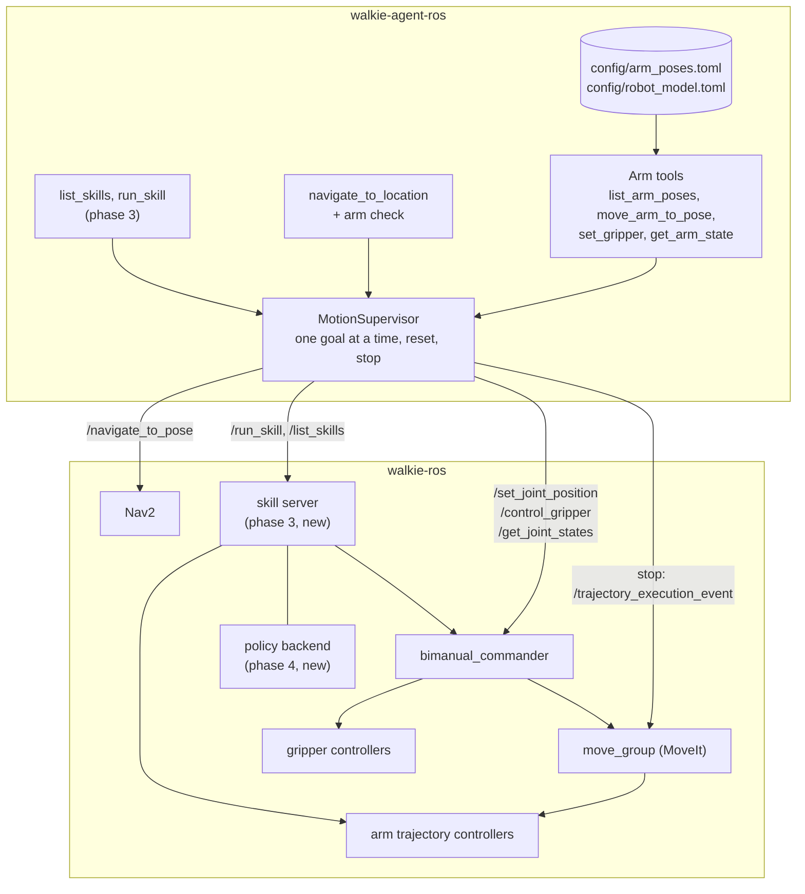
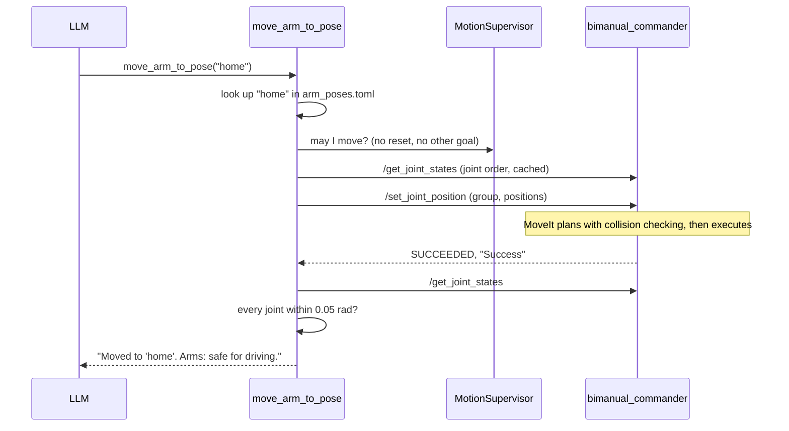

# Arm Manipulation (Proposed)

!!! note "Status: Proposed"
    Nothing on this page is built yet. It is the design for team review. The
    [open questions](#open-questions) must be answered before phase 1 is
    finished.

Walkie has two 7-DOF OpenArm arms with grippers, on a lift. walkie-ros runs
MoveIt and `bimanual_commander`, which plan and execute arm motion. This page
describes how the agent will use them, and how complex skills such as
folding a shirt with a VLA policy fit in later.

## Summary

- **Named poses only.** The LLM picks a pose by name, such as `home`. It
  never sees joint values. Poses live agent-side in `config/arm_poses.toml`
  and are checked at startup against the robot's joint limits
  ([ADR-0022](decisions/0022-named-arm-poses.md)).
- **Through the commander.** The agent sends poses with the commander's
  `/set_joint_position`, so MoveIt plans every motion with collision checking
  ([ADR-0021](decisions/0021-arm-control-through-commander.md)).
- **Trust, but verify.** After every motion, the agent reads the joint
  states and checks that the arm really arrived
  ([ADR-0024](decisions/0024-verify-motion-from-joint-states.md)).
- **Reset stops the robot.** A `MotionSupervisor` owns every motion goal.
  `/walkie/reset` stops MoveIt and cancels every goal, Nav2 included
  ([ADR-0023](decisions/0023-motion-supervisor.md)).
- **No driving with arms out.** Navigation refuses unless the arms are in a
  pose marked safe for driving
  ([ADR-0025](decisions/0025-travel-safe-interlock.md)).
- **Skills run on the robot.** Picking, folding and other complex tasks run
  behind a robot-side `RunSkill` action. Each skill is scripted with MoveIt
  or runs a learned policy, and the LLM cannot tell which
  ([ADR-0027](decisions/0027-runskill-action.md)).

## Components



## How a pose move works



## Tools

| Tool                  | Arguments                                         | What it does                                                                 |
| --------------------- | ------------------------------------------------- | ---------------------------------------------------------------------------- |
| `list_arm_poses`      | none                                              | Lists the named poses, which arms each moves, and whether it is safe for driving |
| `move_arm_to_pose`    | `pose`                                            | Moves to a named pose, waits, and checks the joints                          |
| `set_gripper`         | `arm`: left, right, both; `state`: open, half, close | Moves the grippers; after a close, says whether it is holding something   |
| `get_arm_state`       | none                                              | Reports the nearest named pose for each arm and how far each gripper is open |
| `list_skills`         | none                                              | Phase 3. Lists the skills the robot offers                                   |
| `run_skill`           | `skill`, `target`, `arm`                          | Phase 3. Runs a skill and reports whether success was verified               |

Every tool returns a plain sentence and never raises an error. Every arm
tool ends with the arm state, so the LLM always knows whether it may drive.
Some example answers:

- "Moved to 'home'. Arms: safe for driving."
- "Could not move to 'standby': MoveIt found no path (Planning Failed). The
  arms did not move. Arms: safe for driving."
- "The commander reported success, but openarm_left_joint4 is 0.31 rad from
  'standby'. Treat this as a failure. Arms: not safe for driving."
- "Closed the right gripper. It is holding something."
- "Stopped by reset. Arms: state unknown."
- "Not driving: the arms are not in a pose that is safe for driving. Move
  them with move_arm_to_pose first, for example 'home'."

The system prompt gets matching rules: tell people before moving the arms,
tuck the arms before driving, call `get_arm_state` after a failure and retry
at most once, and never improvise a pick from poses and grippers.

## Pose configuration

```toml title="config/arm_poses.toml (example)"
[grippers]
# Travel of one finger, in metres. The jaw opens about twice as wide.
open_position = 0.044
half_position = 0.036    # above 0.03, or it counts as a close (the SRDF's
                         # "half" state, 0.022, does)
closed_position = 0.0    # must be at most 0.03, so grasp detection runs

[poses.home]
group = "both_arms"
srdf_state = "home"
travel_safe = true       # to be confirmed by the team
description = "Both arms down beside the body. Safe for driving."

[poses.home.joints]
openarm_left_joint1 = 0.2618
openarm_left_joint2 = 0.0
# ... every joint of the group, by name
```

- Joint values are keyed by name. The order sent to the robot comes from
  `/get_joint_states` at run time.
- `config/robot_model.toml` is a snapshot of the SRDF groups and states and
  of `joint_limits.yaml` from the pinned walkie-ros commit. The loader checks
  every pose against it, and lists every error at once.
- Poses copied from walkie-agent-v2 must be tried on the robot first. It
  sent some of them with collision checking turned off.

## Safety

- **One motion at a time.** RAI already runs one tool at a time. The
  MotionSupervisor also refuses arm motion while Nav2 drives, and the other
  way round.
- **Reset.** `/walkie/reset` publishes `"stop"` on
  `/trajectory_execution_event`, cancels every goal, and blocks every motion
  tool until the reset is applied. The physical emergency stop stays the real
  safety boundary, because a software stop needs ROS, MoveIt and the
  controllers to be working.
- **Collision.** MoveIt plans around the robot and the planning scene. The
  agent never turns collision checking off. Held objects are not in the
  planning scene by default, so poses used while holding something need
  clearance.
- **Speed.** The commander runs at full speed: velocity and acceleration
  scaling are hard-coded to 1.0, ignoring the 0.5 and 0.3 in
  `joint_limits.yaml`. Until walkie-ros change W2 lands, hardware tests need
  an operator at the emergency stop and short motions.
- **Lift.** Excluded until it can be cancelled
  ([ADR-0026](decisions/0026-exclude-lift.md)).
- **Grasp detection.** The commander's `grasped` flag can be wrong when the
  gripper controller is down, or when "half" is set at or below 0.03 m. The
  tool checks the finger gap too, and the detection band must be calibrated
  on real objects.

### Forbidden names

Exact-string matching means every name must be listed, including each
action's `/_action/feedback` and `/_action/status` topics.

**Dedicated names** are used only by their own tool, and hidden from every
generic tool: `/navigate_to_pose`, `/set_joint_position`,
`/control_gripper`, `/get_joint_states`, and later `/run_skill` and
`/list_skills`.

**Forbidden names** are never touched by any tool:

| Kind                         | Names                                                                                                                                                                                                                                                          |
| ---------------------------- | -------------------------------------------------------------------------------------------------------------------------------------------------------------------------------------------------------------------------------------------------------------- |
| Base velocity                | `/cmd_vel`, `/cmd_vel_nav`, `/cmd_vel_joy`, `/cmd_vel_key`, `/omni_wheel_drive_controller/cmd_vel`                                                                                                                                                             |
| Agent                        | `/walkie/reset`                                                                                                                                                                                                                                                |
| Stop                         | `/trajectory_execution_event` (only the MotionSupervisor publishes here)                                                                                                                                                                                       |
| Commander, unused actions    | `/go_to_home`, `/go_to_pose`, `/go_to_pose_relative`, `/go_to_pose_quat`                                                                                                                                                                                       |
| Commander services           | `/execute_stored_plan`, `/clear_collision_objects`, `/toggle_octomap_collision`, `/toggle_all_collision_checking`, `/toggle_gripper_collision`, `/bimanual_commander/set_parameters`                                                                            |
| MoveIt                       | `/apply_planning_scene`, `/get_planning_scene`                                                                                                                                                                                                                 |
| Arm and gripper controllers  | `/left_joint_trajectory_controller/joint_trajectory`, `/right_joint_trajectory_controller/joint_trajectory`, `/left_joint_trajectory_controller/follow_joint_trajectory`, `/right_joint_trajectory_controller/follow_joint_trajectory`, `/left_gripper_controller/gripper_cmd`, `/right_gripper_controller/gripper_cmd`, `/left_forward_position_controller/commands`, `/right_forward_position_controller/commands` |
| Lift and head                | `/lift_controller/follow_joint_trajectory`, `/lift_controller/commands`, `/lift/cmd`, `/head_servo_controller/commands`                                                                                                                                         |
| Controller manager           | `/controller_manager/switch_controller`                                                                                                                                                                                                                        |

## Skills and VLA policies

Some tasks, such as picking up a cup or folding a shirt, are more than a few
poses. They run as **skills** in a new robot-side skill server
([ADR-0027](decisions/0027-runskill-action.md)):

```text title="RunSkill.action (sketch)"
string skill            # name from ListSkills
string target           # free text, for example "red cup"; may be empty
string arm              # "left", "right", or "" to let the skill decide
string params_json      # optional skill parameters
float32 timeout_sec     # 0 = the skill's default
---
uint8 outcome           # SUCCEEDED, FINISHED_UNVERIFIED, FAILED, PRECONDITION_FAILED,
                        # CANCELED, SAFETY_STOP, TIMED_OUT
bool success_verified   # true only if a check independent of the policy confirmed it
string message          # one plain sentence for the LLM
string end_pose         # named pose the arms ended in
bool holding_left
bool holding_right
---
string phase            # checking, moving_to_start, running, verifying, restoring
float32 progress        # 0 to 1, or -1 if unknown
```

When a skill runs a policy, the skill server:

1. checks preconditions: the base is still, no other arm goal is running,
   the cameras publish, and the policy backend is alive;
2. moves to the skill's start pose through the commander, and checks it;
3. streams the policy's joint targets to the arm trajectory controllers
   (fallback: switch to forward position controllers);
4. passes every target through a safety filter: joint limits, maximum step
   per cycle, no NaN, and a watchdog that holds position if the policy
   stalls;
5. checks success independently of the policy, for example with the gripper
   gap or the end-effector pose;
6. restores the controllers and reports the outcome.

A cancel stops the policy, holds position and restores the controllers
within 2 s. Images and inference stay in robot-side nodes, outside the
agent ([ADR-0028](decisions/0028-images-and-policy-robot-side.md)).

## What lives where

| Piece                                                            | Repository       | Location                                             |
| ---------------------------------------------------------------- | ---------------- | ---------------------------------------------------- |
| Arm, gripper and skill tools; the navigation arm check           | walkie-agent-ros | `src/walkie_agent/tools/`                            |
| MotionSupervisor                                                 | walkie-agent-ros | `src/walkie_agent/motion.py`                         |
| Named poses, robot-model snapshot and its generator              | walkie-agent-ros | `config/arm_poses.toml`, `config/robot_model.toml`, `scripts/` |
| Fake commander and fake skill server                             | walkie-agent-ros | `src/walkie_agent/sim/`                              |
| Arm summary for the LLM                                          | walkie-agent-ros | `whoami/documentation/arms.md`                       |
| `my_robot_interfaces`, including future skill interfaces         | walkie-ros       | `manipulate/my_robot_interfaces`, pinned here        |
| Commander, MoveIt, SRDF, joint limits                            | walkie-ros       | `manipulate/` (unchanged in phases 0 and 1)          |
| Controllers, lift node, Nav2, URDF                               | walkie-ros       | `bringup/`, `navigation/`, `description/`            |
| Skill server, safety filter, controller switching                | walkie-ros       | new package                                          |
| Policy inference, success checks, perception                     | walkie-ros or another robot-side repository | new                       |

## Changes needed in walkie-ros

Phases 0 and 1 need none. Later phases need:

| Change | Phase | What |
| ------ | ----- | ---- |
| W1 | 2 | Lift action: accept cancel and stop in place; report failure, not success, when the 60 s timeout runs out. |
| W2 | before arm hardware tests | Commander: make velocity and acceleration scaling ROS parameters, defaulting to `joint_limits.yaml`'s 0.5 and 0.3. |
| W3 | optional | Commander: make a gripper cancel actually stop the gripper. |
| W4 | 3 | Add `RunSkill`, `ListSkills` and `SkillInfo` to `my_robot_interfaces`, or to a new package. |
| W5 | 3 | New skill server package. |
| W6 | 4, fallback only | Spawn the forward position controllers inactive, for the policy fallback. |
| W7 | 4 | Policy backend and success checks. |
| W8 | before hardware tests | Commander launch: declare and pass a `plan_only` argument, for a safe dry run on the real robot. Today the launch file cannot set it. |
| W9 | before mock tests | A MoveIt mock launch without `pick_and_place_isaac2`. The current `moveit_demo_with_commander.launch.py` starts it, and it moves the arms and adds collision objects on its own. |

## Testing

- **No hardware.** A `FakeCommander` in `src/walkie_agent/sim/` serves the
  commander's actions and service with the same names and quirks. It has
  settings for scrambled joint order, planning failure, slow motion,
  plan-only mode, "success" without moving, ignored cancels and grasping an
  object. Tests run on Fast DDS
  ([ADR-0019](decisions/0019-test-fakes-fast-dds.md)).
- **Robot software, mock hardware.** The real commander and MoveIt with mock
  controllers (needs W9).
- **Real robot,** step by step:

| Step | What                                           | Passes when                                                        |
| ---- | ---------------------------------------------- | ------------------------------------------------------------------ |
| H0   | Zenoh connection on the robot PC               | `/set_joint_position` is visible; `get_arm_state` answers          |
| H1   | Mock hardware                                  | All arm tools work against it                                      |
| H2   | Real robot, commander in plan-only mode (W8)   | `move_arm_to_pose` reports plan-only, and verification sees no motion |
| H3   | Arms powered, emergency stop in hand           | A small single-arm move                                            |
| H4   | Both arms, `home` to `standby`; reset mid-move | Measure how long the arms take to stop after a reset               |
| H5   | Grippers on nothing, and on a bottle           | Grasp detection calibrated                                         |
| H6   | Navigation with arms out                       | Navigation refuses, then drives after `home`                       |
| H7   | Full voice scenario                            | End to end works                                                   |

## Roadmap

| Phase | What                                                                                       | Needs from walkie-ros |
| ----- | ------------------------------------------------------------------------------------------ | --------------------- |
| 0     | Zenoh, the walkie-ros pin, tests on Fast DDS, a "run on the robot PC" page                 | nothing               |
| 1     | Poses and snapshot, MotionSupervisor, the four arm tools, the navigation arm check, forbidden names, FakeCommander, `arms.md` | nothing (W2, W8, W9 for hardware tests) |
| 2     | Named lift heights                                                                         | W1                    |
| 3     | Skills: `list_skills`, `run_skill`, a scripted pick                                        | W4, W5                |
| 4     | VLA policies                                                                               | W7, maybe W6          |

## Open questions

1. **Which `rmw_zenoh_cpp` version does walkie-ros run?** It decides between
   RoboStack's 0.2.10 and 0.2.11. Once walkie-ros is on Pixi, its
   `pixi.lock` answers this. Blocks phase 0.
2. **Which walkie-ros commit is checked out on the robot PC?** Message
   definitions must match exactly. Blocks phase 0.
3. **Which poses should the LLM get, and which are safe for driving?** Is
   the SRDF's `home` safe to drive with? Is a "carry" pose needed for
   driving with an object? Blocks phase 1.
4. **Will W2 (speed scaling) land before arm hardware tests,** or do we test
   at full speed with an operator at the emergency stop?
5. **Is `right_joint2_fixed` ever true on the real robot?** The commander
   builds its robot model without that setting, so it and `move_group` could
   disagree.
6. **Is `getCurrentState()` really unsafe to call during motion?** If not,
   `get_arm_state` can answer while the arms move.
7. **Should walkie-ros enforce the drive-with-arms-out rule itself?** The
   agent's check is advisory.
8. **For the VLA:** can the robot PC's GPU run the policy, which cameras exist (the
   wrist cameras have device names but no ROS publisher yet), and who owns
   the skill server?

## Decisions

Click a decision to expand it. All of these are proposed. See
[Architecture](index.md) for how decisions work.

??? note "ADR-0021: Move the arms only through bimanual_commander · Proposed"

    --8<-- "architecture/decisions/0021-arm-control-through-commander.md:body"

??? note "ADR-0022: Offer the LLM named arm poses from config/arm_poses.toml · Proposed"

    --8<-- "architecture/decisions/0022-named-arm-poses.md:body"

??? note "ADR-0023: One MotionSupervisor owns every motion goal and the emergency stop · Proposed"

    --8<-- "architecture/decisions/0023-motion-supervisor.md:body"

??? note "ADR-0024: Verify arm motion from joint states, not goal status · Proposed"

    --8<-- "architecture/decisions/0024-verify-motion-from-joint-states.md:body"

??? note "ADR-0025: Refuse to drive unless the arms are in a travel-safe pose · Proposed"

    --8<-- "architecture/decisions/0025-travel-safe-interlock.md:body"

??? note "ADR-0026: Leave the lift out until its action supports cancel · Proposed"

    --8<-- "architecture/decisions/0026-exclude-lift.md:body"

??? note "ADR-0027: Run manipulation skills, including VLA policies, behind a robot-side RunSkill action · Proposed"

    --8<-- "architecture/decisions/0027-runskill-action.md:body"

??? note "ADR-0028: Keep camera images and policy inference out of the agent · Proposed"

    --8<-- "architecture/decisions/0028-images-and-policy-robot-side.md:body"
