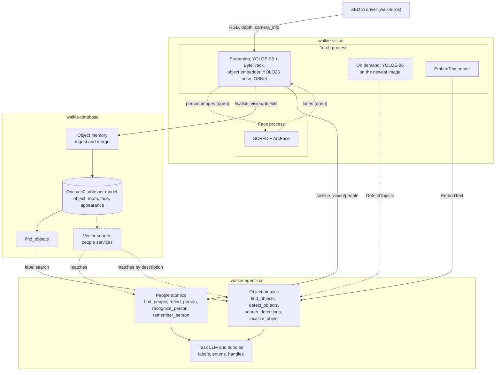
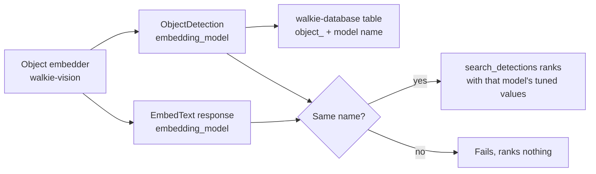
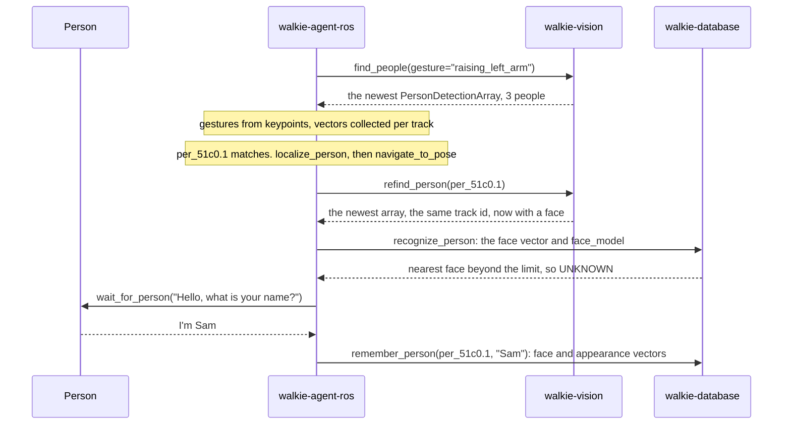
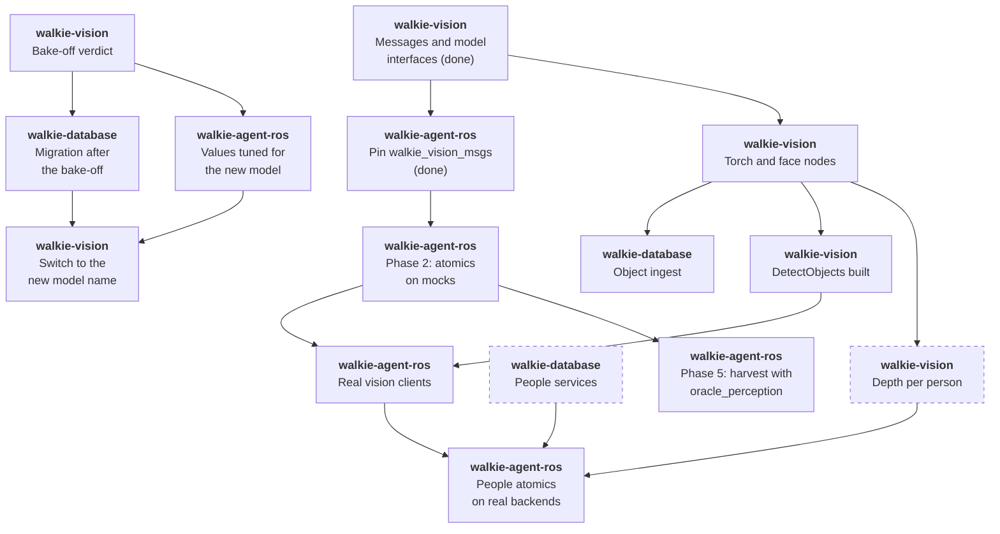

# Perception (Proposed)

!!! note "Status: Proposed, three people atomics built"
    `find_people`, `recognize_person` and `remember_person` are built and
    tested on fakes, with a mock people memory ([People](#people)). The
    rest of this page is the design for team review. Each of the
    [open questions](#open-questions) says what it blocks.

walkie-vision runs the robot's vision models, and walkie-database
remembers what they saw
([ADR-0034](decisions/0034-vision-models-in-walkie-vision.md)). This page
plans how the [self-evolving agent](self-evolving-agent.md) uses both. It
follows walkie-vision's model choices (walkie-vision ADR-0008, proposed,
pending its [embedding bake-off](https://eic-robocup-2026.github.io/walkie-vision/guides/bakeoff/))
and its on-demand `DetectObjects` service (walkie-vision ADR-0009,
proposed).

## Summary

- **Atomics only.** The agent reaches walkie-vision through perception
  atomics. The LLM sees labels, enums, scores and handles, never vectors or
  images ([ADR-0050](decisions/0050-perception-atomics-over-walkie-vision.md)).
- **Objects: memory, then the camera.** `find_objects` asks walkie-database,
  `detect_objects` asks `DetectObjects`, and `search_detections` ranks with
  `EmbedText`
  ([Finding objects](self-evolving-agent.md#finding-objects-with-search_detections)).
- **People are new.** `find_people` reads the newest `/walkie_vision/people`
  message and classifies gestures from its keypoints, as walkie-agent-v2
  did. walkie-database matches faces and appearance.
- **One embedding model at a time.** Every vector comes with its model's
  name, and the agent never compares across models. After the bake-off,
  walkie-database migrates, the torch process switches, and the agent's
  thresholds are tuned again, together.
- **Gaps in other repositories.** A person's position needs depth, people
  need walkie-database services, and captions have no interface yet.

## How the pieces connect

Arrows show where data goes. A dashed box or arrow is proposed: on this
page, or in walkie-vision's ADR-0009. Florence-2 is left out, since nothing
serves its captions yet ([Captions](#captions)).

| Interface | Owner | Status | Used by |
| --------- | ----- | ------ | ------- |
| `/walkie_vision/objects` (`ObjectDetectionArray`) | walkie-vision | Message built, node not yet | walkie-database's object memory, which `find_objects` reads. `find_seats`, through the agent's `VisionFeed` |
| `/walkie_vision/people` (`PersonDetectionArray`) | walkie-vision | Message built, node not yet | `find_people`, `find_seats`, and the vectors of `recognize_person` and `remember_person`, through the agent's `VisionFeed`. Later `refind_person` |
| `/walkie_vision/embed_text` (`EmbedText`) | walkie-vision | Service type built, server not yet | `search_detections` |
| `/walkie_vision/detect_objects` (`DetectObjects`) | walkie-vision | Proposed (its ADR-0009) | `detect_objects` |
| `/walkie_database/find_objects` | walkie-database | Exists | `find_objects` |
| Vector search and people services | walkie-database | Not designed ([questions 2 and 6](#open-questions)) | `recognize_person`, `remember_person`, a later `find_objects` by description |

## From model to tool

Each model in walkie-vision's ADR-0008, and where the agent meets it:

| Model | Runs in | What the agent gets | Agent tools | Waits on |
| ----- | ------- | ------------------- | ----------- | -------- |
| YOLOE-26 s or m, streaming, with ByteTrack | torch process | Remembered objects, through walkie-database | `find_objects` | The torch node, walkie-database's ingest |
| YOLOE-26, on-demand instance | torch process | Boxes, embeddings, `points` and crops of the newest image | `detect_objects`, then `localize_object` | walkie-vision ADR-0009 |
| Object embedder: SigLIP 2 B/16 proposed, CLIP ViT-B/16 the baseline, EmbeddingGemma 2 the challenger | torch process | `ObjectDetection.embedding` and `EmbedText` vectors, with `embedding_model` | `search_detections` | The bake-off |
| YOLO26s-pose (or m) | torch process | 17 keypoints, box and track id per person | `find_people`, `refind_person` | The torch node |
| SCRFD + ArcFace (`buffalo_l`) | face process | `face_embedding`, `face_model` | `recognize_person`, `remember_person` | The face process interface, walkie-database services |
| OSNet x1.0, MSMT17 weights | torch process | `appearance_embedding`, `appearance_model` | `refind_person` when a track breaks, `remember_person` | walkie-database services |
| Florence-2 base | not placed yet | Nothing yet | `describe_person`, if it is built | An interface ([question 4](#open-questions)) |

The cascade for objects is on
[Self-Evolving Agent](self-evolving-agent.md#finding-objects-with-search_detections),
and the work it asks of walkie-vision is in walkie-vision's architecture
page, "Proposed: on-demand DetectObjects for the self-evolving agent".

## One embedding model at a time

A vector is only comparable with vectors from the same model. The model's
name travels with every vector, and three places must agree on it:

- **Tuned values per model.** The minimum score and the top-1 to top-2
  margin of `search_detections`, and the face and appearance distance
  limits of `recognize_person`, live in config keyed by model name. A
  model without tuned values fails the call. `recognize_person` is the
  exception: a person whose model has no limit comes back `UNKNOWN`, and
  the line names the model. Margins compare only within one model, as the
  bake-off guide warns.
- **The switch after the bake-off.** walkie-database adds the winner's
  tables in one migration, renames the CLIP tables to name their weights,
  and computes new vectors for everything it remembers (bake-off guide,
  "Follow-up: the walkie-database migration"). The torch process emits the
  new model name only after that migration is on the robot, or the
  ingest finds no table. The agent's values for the new model are tuned on
  the bake-off data before the switch.
- **Sim never mixes in.** Fake and oracle vectors are named `fake_...`, so
  they never reach a real table (walkie-vision's open question 5).

## People

walkie-agent-v2 found people by gesture and posture in GPSR, and described
the seated host in its HRI task. Restaurant needs waving customers too,
which v2 left as a stub. It classified keypoints with plain functions in
`tasks/GPSR/gestures.py`, with eight ids: `waving`, `raising_left_arm`,
`raising_right_arm`, `pointing_left`, `pointing_right`, `sitting`,
`standing` and `lying_down`. The agent ports those functions and their
tests ([ADR-0050](decisions/0050-perception-atomics-over-walkie-vision.md)).

"Find the person raising their left arm and learn their name":

| Atomic | Effect | Reads | Returns to the LLM |
| ------ | ------ | ----- | ------------------ |
| `find_people(gesture=None, in_front=False)` | P | The newest `/walkie_vision/people` message, at most 1 s old, waiting at most 1 s. With `in_front`, also the base's pose from TF at the image's stamp | Person handles such as `per_51c0.1`, left to right, each with its gestures and postures and whether its face is seen well enough to recognize: `face seen`, `face too small or unclear to recognize`, or `no face seen`. With `in_front`, handles only for the people with a clear face of at least 0.10 rad within 25° of the base's heading, and a count of those left out by reason, for the guest at the door ([HRI Task](hri.md#one-run)). `NOT_FOUND` when no one matches |
| `refind_person(person)` | P | The newest message again | A new handle for the same person: same track id, else the closest appearance embedding over a limit. `NOT_FOUND` otherwise |
| `localize_person(person)`, internal | P | The person's depth, which the message lacks ([question 1](#open-questions)) | A pose handle for `navigate_to_pose`, as `localize_object` gives ([ADR-0043](decisions/0043-navigate-to-pose-provenance.md)) |
| `recognize_person(person)` | R | walkie-database's face table, then its appearance table. Until its services exist, the mock people memory | A name and stored facts, or `UNKNOWN`. `NOT_FOUND` when one handle has neither a face nor an appearance vector. Also takes a whole set, giving each name to one person at most ([HRI Task](hri.md#atomics)) |
| `remember_person(person, name, facts={})` | W, provisional ([question 3](#open-questions)) | Writes the person, its facts such as a drink, the handle's own face and appearance vectors, and those collected for its track ([HRI Task](hri.md#faces-collected-while-talking)), through walkie-database. Until its services exist, into the mock people memory | Confirmation, with the number of face and appearance vectors stored. The person is forgotten with the session (walkie-database ADR-0010). The mock forgets everyone on a reset or when a new task replaces the todo list |

- **Built on a mock memory.** `find_people`, `recognize_person` and
  `remember_person` are built ([HRI Task](hri.md#atomics)).
  `refind_person` and `localize_person` are not. Until walkie-database's
  people services exist, the `people_memory` backend is
  `InMemoryPeopleMemory`, in `src/walkie_agent/perception/people_memory.py`.
  It follows the services' proposed interface, `PeopleMemory`, and matches
  by cosine distance within one model name.
- **Only with `--mock-people-memory`.** `create_walkie_agent` adds the mock
  only when `main.py` gets this flag, and `pixi run agent-sim` passes it.
  Without it, as in `pixi run agent`, `recognize_person` and
  `remember_person` do not load, so a robot run never names a guest from a
  mock.
- **The limits,** as cosine distance. A face of `arcface_w600k_r50`
  matches at 0.4 or less, walkie-agent-v2's value for the same weights. An
  appearance of `osnet_x1_0_msmt17` matches at 0.5 or less, still to be
  tuned on the robot. The fake models `fake_face` and `fake_reid` match at
  0.2 or less. The limits live in `IdentityConfig`, in
  `perception/identity.py`.
- **One query per model.** A track holds vectors of two models after a
  model switch, and the stored person may have been met under either. So
  `recognize_person` averages a person's vectors of each model with a
  limit, minus outliers, and queries each model on its own. A model with
  no limit is never queried, and an `UNKNOWN` line names it.
- **Scores across models.** Each match is scored as its distance over its
  model's limit, so 1 is every model's limit, and a stored person found
  by two models keeps the better score. The names then go lowest score
  first, so no name is given twice. Vectors of two models are never
  compared. The distance in the result is the cosine distance of the
  model that named the person.
- **Face first.** Appearance is matched only for the people no face
  named, and only against the stored people not named yet.

- **Why gestures live in the agent.** They are task words, not model
  output. Keeping them agent-side needs no message change, and the
  predicates run in tests without a GPU, as they did in walkie-agent-v2.
  The cost: a new gesture is an agent change, and walkie-database cannot
  search by gesture.
- **Why walkie-database matches faces.** It owns the face and appearance
  tables, and walkie-database ADR-0006 has callers send vectors. The
  database always returns a nearest face, so the agent applies a distance
  limit per `face_model`, tuned on the robot.
- **Re-finding.** The streaming tracker keeps a track id while it can see
  the person. Driving up to someone can break the track, so
  `refind_person` falls back to OSNet appearance, compared in the agent
  within one `appearance_model`.

## Captions

Florence-2 runs in walkie-vision, but nothing serves its captions.
walkie-agent-v2 captioned the seated host in its HRI task, then had an LLM
cut the caption down to the person. A caption is free text from the camera,
so a sign held up to it could carry instructions (threat T8 on
[Access Levels](access-levels.md#safety-model)). Generated tools never get
caption text at Competition. Whether reviewed atomics do is
[question 4](#open-questions).

## In simulation

Until the walkie-vision nodes exist, `OraclePerception` in
`src/walkie_agent/sim/oracle_perception.py` stands in for them. It
publishes both arrays in `walkie_vision_msgs` types, one of each per image
of the robot's camera, also when empty. People come only from it, because
walkie-ros's MuJoCo worlds have no person bodies. It knows nothing of a
task: a simulation tool attaches it to its own node and gives it a
callable that returns a `Scene` (`src/walkie_agent/sim/scene.py`), the
people and objects in the map frame at an image's stamp, or `None` when it
does not know them then. The HRI scenario
does so now ([HRI Task](hri.md#in-simulation)). The harvest still owns its
scenario fields ([Sim Harvest](harvest.md#h0-scenarios)).

- **Projection.** For each `camera_info` on the head camera's topic,
  `/zed_head/zed_node/depth/camera_info` by default, it looks up TF from
  `map` to the camera's frame at that stamp, waiting up to 0.1 s. It then
  projects the scene with a pinhole model from `camera_info.k`, ignoring
  lens distortion, in `src/walkie_agent/sim/projection.py`, which has no
  ROS. An image with no transform is skipped with a throttled warning that
  names the missing transform. Until the simulation's AMCL runs, every
  image is. An image whose stamp the scene callable does not know, such as
  one older than the history it keeps, is skipped the same way. So is one
  during which the clock went back, when the tool gives the oracle a count
  of the clock's jumps: its pose and its scene may come from different
  clocks.
- **TF, not ground truth.** The agent turns and judges headings with the
  same TF, so the boxes always agree with its frame. AMCL's error then
  moves the whole virtual scene against the simulated room, which nothing
  here looks at.
- **People** are flat figures of the 17 COCO keypoints, standing or
  sitting, with walkie-agent-v2's gestures. A test checks that
  `classify_gestures` reads each gesture back from the projected
  keypoints at 1.2 m and at 3 m, so the oracle and the classifier cannot
  drift apart. The person box is the keypoints' bounds, padded, and the
  face box is the projection of a 0.18 m square around the head.
- **Faces** are drawn only for a person who faces the camera within 60°.
  The oracle never enlarges a face to pass the face gate, but the gate is
  an angle, so on the simulation's 640 × 360 camera a guest at the door
  and the seated people give trusted faces. Otherwise the face fields stay
  empty with score 0, and the face keypoints score 0.2. The HRI
  scenario's two onlookers at the door give trusted faces too, so
  recognition can use them, but `find_people(in_front=True)` leaves them
  out. The one in the hallway behind the guest has too small a face, about
  0.064 rad against the 0.10 rad limit, and the one beside the robot is
  more than 25° to the side.
- **Objects** are map-frame boxes, each detected as the bounds of its 8
  projected corners, only for a class in the configured list. The default
  is the seat classes, since `find_seats` is the only reader so far.
- **No occlusion.** Furniture, walls and door frames hide nobody, and
  people do not hide each other. A box partly in the image is clipped to
  it, and one with no part in it is not detected.
- **Noise,** all from one seeded `numpy` generator, so a run repeats image
  by image: Gaussian noise of 2 px on boxes and keypoints, 0.005 on each
  vector element before the vector is made unit length again, 5% of
  vectors replaced by a random unit vector for the outlier rejection to
  drop, and a per-person dropout rate, 0 by default. `OracleConfig` sets
  each, and a scenario file's `oracle` section overrides them. Its comment
  gives the arithmetic: the default moves a vector by a cosine distance of
  about 0.013 from another of the same person, far from the fake models'
  limit of 0.2.

The vectors are walkie-vision's `hash_vector`, copied exactly into
`src/walkie_agent/sim/fake_vectors.py`, under the fake model names
`fake_face` and `fake_reid`: a face hashes `"face:"` and the person's face
key, an appearance `"reid:"` and its appearance key. So rankings are
deterministic in the tests and in the simulation. Hash vectors match only
on equal input, so a sim detection's embedding and the query text must
hash the same key (walkie-vision's open question 7).

## Delivery order

What blocks what, across the three repositories. A dashed box is new work
this page asks for.

- **The HRI task goes first.** It needs only the people half of this graph,
  plus seats from the streaming detector, and skips `DetectObjects`, the
  bake-off and person depth ([HRI Task](hri.md#delivery-order)).
- **Pinned.** `walkie_vision_msgs` is pinned in `ros2_ws.repos` and built
  by `pixi run build-ros2`, as
  [ADR-0034](decisions/0034-vision-models-in-walkie-vision.md) planned.
  After a message change in walkie-vision, move the pin and build again.
- **Phase 2 of the self-evolving agent** adds `refind_person` next to the
  object atomics, on mocks. `find_people` is built already, and so are
  `recognize_person` and `remember_person`, on the mock people memory. On
  the robot, those two wait for walkie-database's services.
- **The real-backends track** adds the people clients next to the
  `DetectObjects` and `EmbedText` clients, and reruns the bundle tests.

## What changes in other repositories

| Repository | Change | Status |
| ---------- | ------ | ------ |
| walkie-vision | The torch and face nodes | Planned there |
| walkie-vision | `DetectObjects` with its own YOLOE instance | Proposed (its ADR-0009) |
| walkie-vision | Depth for each person, for example `points` as in `ObjectDetection` | New here ([question 1](#open-questions)) |
| walkie-vision | A captions interface, if `describe_person` is built | New here ([question 4](#open-questions)) |
| walkie-database | Ingest from `/walkie_vision/objects`, building `walkie_vision_msgs` | Proposed there |
| walkie-database | One migration after the bake-off | In the bake-off guide |
| walkie-database | Vector search for objects, and services to recognize and remember people | New here ([questions 2 and 6](#open-questions)) |

## Open questions

1. **Where a person's position comes from.** `PersonDetection` has a box
   and keypoints, but no depth. Recommended: walkie-vision adds `points`,
   cut from the depth image with the box or the keypoints, as
   `ObjectDetection` has. The alternative is a robot-side service, which
   needs the image the detection came from. Blocks: `localize_person`.
2. **walkie-database's people services.** Their requests, the session rules
   of walkie-database ADR-0010, and who tunes the face distance limit. The
   HRI task needs a person stored with facts and several vectors, and a
   set of faces recognized at once. `PeopleMemory` in
   `perception/people_memory.py` is the interface the atomics call today.
   Blocks: `recognize_person` and `remember_person` on the robot, and so
   the HRI task there. In sim they run on the mock.
3. **No effect covers a memory write.** R, P, S, N and M cover reading,
   perceiving, speaking and moving. Proposed: `remember_person` stays a
   reviewed atomic that generated tools cannot call at any level, until a
   write effect is decided. Until then, the code has a provisional `W`
   effect for it ([The Agent: effects](agent.md#effects)). Blocks:
   `remember_person`.
4. **Describing a person.** Either a Florence-2 caption service, its text
   capped and marked untrusted like web text, or attributes picked from a
   fixed list, such as shirt colours, with the object embedder on the
   person's crop. The second returns enums only, but needs a person-crop
   embedding in `PersonDetection`. Blocks: `describe_person`.
5. **Following a person.** Following is a closed loop at camera rate,
   which an LLM turn cannot run. A robot-side skill behind `run_skill`
   ([ADR-0027](decisions/0027-runskill-action.md)) fits, but nothing owns
   it yet. Blocks: tasks where the robot follows someone.
6. **Memory search by description.** "The red mug I saw in the kitchen"
   needs a walkie-database service that takes an `EmbedText` vector and its
   table name. Blocks: nothing in phase 2. `find_objects` stays
   label-only until then.
7. **Which people atomics Competition code may call.** `find_people`
   returns handles and enums only, like `detect_objects`, which
   Competition allows. Recommended: add it, and keep the rest out. Blocks:
   generated tools that look for people at Competition.
8. **How long a person handle stays valid.** People move, so the object
   rule (5 cm or 3° of base motion, 10 minutes) is too loose. For now a
   person handle goes stale after 5 cm of base translation or 10 minutes,
   and a turn does not stale it: the gaze loop turns the base, and the
   handle names a track. How long a handle may serve `localize_person`,
   which needs where the person stands, is still open. Blocks:
   `localize_person`.

## Decisions

Click a decision to expand it. See [Architecture](index.md) for how
decisions work.

??? note "ADR-0050: Perceive objects and people through atomics over walkie-vision · Proposed"

    --8<-- "architecture/decisions/0050-perception-atomics-over-walkie-vision.md:body"
