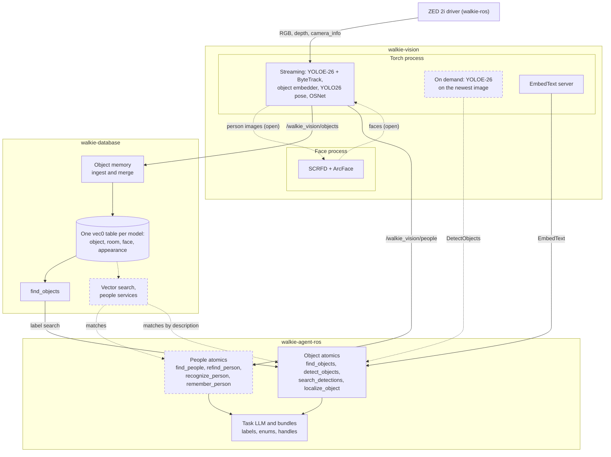
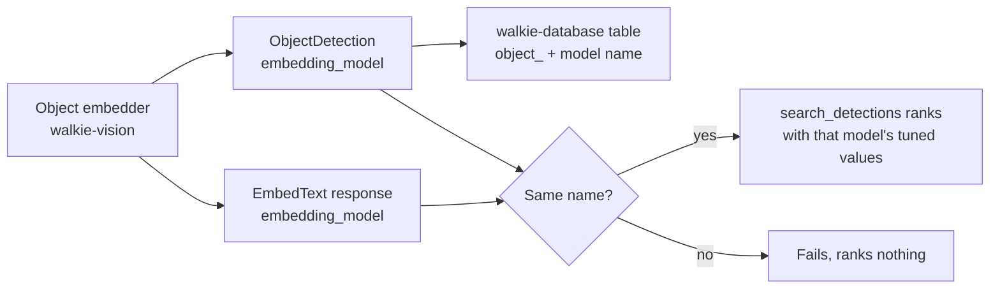
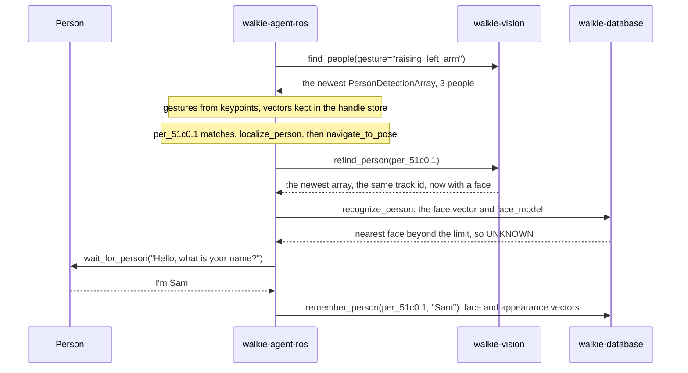
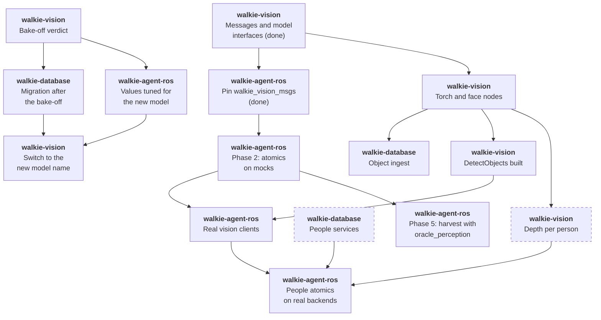

# Perception (Proposed)

!!! note "Status: Proposed"
    Apart from the simulation's oracle ([In simulation](#in-simulation)), the live
    people reader behind `find_people` ([What is built](#what-is-built)) and the live
    object reader behind `find_objects` ([Objects in view](#objects-in-view)),
    nothing on this page is built yet. It is the design for team review. Each
    of the [open questions](#open-questions) says what it blocks.

    Today `find_objects` is a live-view atomic. It reads `/walkie_vision/objects` and
    `find_people` reads `/walkie_vision/people` when the agent runs with `--vision`;
    both answer `UNAVAILABLE` otherwise. The old tool that read remembered rows is retired. Where this page
    describes a memory stage named `find_objects`, read it as a proposed tool that needs its
    own name. A remembered row is never presented as a current view
    ([The Agent](agent.md#tools)).

walkie-vision runs the robot's vision models, and walkie-database
remembers what they saw
([ADR-0034](decisions/0034-vision-models-in-walkie-vision.md)). This page
plans how the [self-evolving agent](self-evolving-agent.md) uses both. It
follows walkie-vision's model choices (walkie-vision ADR-0008, proposed,
pending its [embedding bake-off](https://eic-robocup-2026.github.io/walkie-vision/guides/bakeoff/))
and its on-demand `DetectObjects` service (walkie-vision ADR-0009,
proposed).

## Summary

- **Atomics only.** The agent reaches walkie-vision through perception
  atomics. The LLM sees labels, enums, scores and handles, never vectors or
  images ([ADR-0050](decisions/0050-perception-atomics-over-walkie-vision.md)).
- **Objects: memory, then the camera.** `find_objects` asks walkie-database,
  `detect_objects` asks `DetectObjects`, and `search_detections` ranks with
  `EmbedText`
  ([Finding objects](self-evolving-agent.md#finding-objects-with-search_detections)).
- **People are new.** `find_people` reads the newest `/walkie_vision/people`
  message and classifies gestures from its keypoints, as walkie-agent-v2
  did. walkie-database matches faces and appearance.
- **One embedding model at a time.** Every vector comes with its model's
  name, and the agent never compares across models. After the bake-off,
  walkie-database migrates, the torch process switches, and the agent's
  thresholds are tuned again, together.
- **Gaps in other repositories.** A person's position needs depth, people
  need walkie-database services, and captions have no interface yet.

## How the pieces connect

Arrows show where data goes. A dashed box or arrow is proposed: on this
page, or in walkie-vision's ADR-0009. Florence-2 is left out, since nothing
serves its captions yet ([Captions](#captions)).

| Interface | Owner | Status | Used by |
| --------- | ----- | ------ | ------- |
| `/walkie_vision/objects` (`ObjectDetectionArray`) | walkie-vision | Published by the vision node in the pinned 64811fe | walkie-database's object memory, which `find_objects` reads |
| `/walkie_vision/people` (`PersonDetectionArray`) | walkie-vision | Published by the vision node in the pinned 64811fe | `find_people`, `refind_person` |
| `/walkie_vision/embed_text` (`EmbedText`) | walkie-vision | Served by the vision node in the pinned 64811fe | `search_detections` |
| `/walkie_vision/detect_objects` (`DetectObjects`) | walkie-vision | Served by the vision node in the pinned 64811fe (its ADR-0009) | `detect_objects` |
| `/walkie_database/find_objects` | walkie-database | Exists | `find_objects` |
| People services (`StartSession`, `RememberPerson`, `MatchPeople`) | walkie-database | Built in the pinned 45228e6 | `recognize_person`, `remember_person` |
| Object vector search | walkie-database | Object writes answer `NOT_READY` until its milestone M1 ([questions 2 and 6](#open-questions)) | A later `find_objects` by description |

The pins 64811fe and 45228e6 are commits on the local `feat/scene-graph-prep`
branches of the two repositories, used by the `feat/mahoraga-demo`
prototype. They are not on GitHub; see
[Local message pins](../setup/03-ros-and-rai.md#local-message-pins).

## From model to tool

Each model in walkie-vision's ADR-0008, and where the agent meets it:

| Model | Runs in | What the agent gets | Agent tools | Waits on |
| ----- | ------- | ------------------- | ----------- | -------- |
| YOLOE-26 s or m, streaming, with ByteTrack | torch process | Remembered objects, through walkie-database | `find_objects` | The torch node, walkie-database's ingest |
| YOLOE-26, on-demand instance | torch process | Boxes, embeddings, `points` and crops of the newest image | `detect_objects`, then `localize_object` | walkie-vision ADR-0009 |
| Object embedder: SigLIP 2 B/16 proposed, CLIP ViT-B/16 the baseline, EmbeddingGemma 2 the challenger | torch process | `ObjectDetection.embedding` and `EmbedText` vectors, with `embedding_model` | `search_detections` | The bake-off |
| YOLO26s-pose (or m) | torch process | 17 keypoints, box and track id per person | `find_people`, `refind_person` | The torch node |
| SCRFD + ArcFace (`buffalo_l`) | face process | `face_embedding`, `face_model` | `recognize_person`, `remember_person` | The face process interface, walkie-database services |
| OSNet x1.0, MSMT17 weights | torch process | `appearance_embedding`, `appearance_model` | `refind_person` when a track breaks, `remember_person` | walkie-database services |
| Florence-2 base | not placed yet | Nothing yet | `describe_person`, if it is built | An interface ([question 4](#open-questions)) |

The cascade for objects is on
[Self-Evolving Agent](self-evolving-agent.md#finding-objects-with-search_detections),
and the work it asks of walkie-vision is in walkie-vision's architecture
page, "Proposed: on-demand DetectObjects for the self-evolving agent".

## One embedding model at a time

A vector is only comparable with vectors from the same model. The model's
name travels with every vector, and three places must agree on it:

- **Tuned values per model.** The minimum score and the top-1 to top-2
  margin of `search_detections`, and the face distance limit of
  `recognize_person`, live in config keyed by model name. A model without
  tuned values fails the call. Margins compare only within one model, as
  the bake-off guide warns.
- **The switch after the bake-off.** walkie-database adds the winner's
  tables in one migration, renames the CLIP tables to name their weights,
  and computes new vectors for everything it remembers (bake-off guide,
  "Follow-up: the walkie-database migration"). The torch process emits the
  new model name only after that migration is on the robot, or the
  ingest finds no table. The agent's values for the new model are tuned on
  the bake-off data before the switch.
- **Sim never mixes in.** Fake and oracle vectors are named `fake_...`, so
  they never reach a real table (walkie-vision's open question 5).

## People

walkie-agent-v2 found people by gesture and posture in GPSR, and described
the seated host in its HRI task. Restaurant needs waving customers too,
which v2 left as a stub. It classified keypoints with plain functions in
`tasks/GPSR/gestures.py`, with eight ids: `waving`, `raising_left_arm`,
`raising_right_arm`, `pointing_left`, `pointing_right`, `sitting`,
`standing` and `lying_down`. The agent ports those functions and their
tests ([ADR-0050](decisions/0050-perception-atomics-over-walkie-vision.md)).

"Find the person raising their left arm and learn their name":

| Atomic | Effect | Reads | Returns to the LLM |
| ------ | ------ | ----- | ------------------ |
| `find_people(gesture=None)` | P | The newest `/walkie_vision/people` message, waiting at most 1 s | Person handles such as `per_51c0.1`, left to right, each with its gestures and postures. `NOT_FOUND` when no one matches |
| `refind_person(person)` | P | The newest message again | A new handle for the same person: same track id, else the closest appearance embedding over a limit. `NOT_FOUND` otherwise |
| `localize_person(person)`, internal | P | The person's depth, which the message lacks ([question 1](#open-questions)) | A pose handle for `navigate_to_pose`, as `localize_object` gives ([ADR-0043](decisions/0043-navigate-to-pose-provenance.md)) |
| `recognize_person(person)` | R | walkie-database's face table, then its appearance table | A name and stored facts, or `UNKNOWN`. Fails when the handle has no face. Also takes a whole set, giving each name to one person at most ([HRI Task](hri.md#atomics)) |
| `remember_person(person, name, facts={})` | write ([question 3](#open-questions)) | Writes the person, its facts such as a drink, and every face and appearance vector kept for the track, through walkie-database | Confirmation. The person is forgotten with the session (walkie-database ADR-0010) |

### What is built

S1 of the [see, remember and act roadmap](see-remember-act.md) built the first
step of this table, in a simpler form than the design above: `ctx.vision.people`
on the robot, which the existing `find_people(description="")` atomic calls. There
are no handles yet, and no vectors are kept. `RosVision` in `ros/vision.py` does it,
and the agent uses it only when started with `--vision`
([mahoraga-demo-decisions.md](mahoraga-demo-decisions.md#see-remember-and-act), S1-1 to S1-8).
S2 added each person's bearing, below.

- **The feed.** One subscription to `/walkie_vision/people`, best effort, depth 5
  and volatile, so it hears a reliable or a best-effort publisher. The callback
  keeps only the array with the newest header stamp. An array stamped more than
  5 s before it replaces it, since only a clock that went back, as in a simulation
  restart, stamps that far behind.
- **Freshness.** An array counts while its stamp is within 1 s of the node's
  clock ([ADR-0050](decisions/0050-perception-atomics-over-walkie-vision.md)).
  A call waits up to 1 s, or its `timeout_s` if that is shorter, then answers
  `UNAVAILABLE` with the reason: no array, an old one, or a stamp ahead of the
  clock, which means the two sides disagree on sim time.
- **People.** Left to right by the box's centre. The id is `person_<track_id>`,
  which lasts while walkie-vision's tracker keeps the track. An untracked person
  is `person_untracked_<n>`, numbered in that one image. The name is always
  null, because nothing identifies people yet.
- **Words.** The gesture rules give a set of names, which `perception/people.py`
  turns into FakeRobot's phrases: one pose, the most specific of lying, sitting
  and standing, and one gesture, pointing before a raised arm before waving. A
  query matches any of the person's phrases, ignoring case, so someone raising
  their left arm is reported with that gesture and is found as a "waving person"
  too. Left and right in a pointing gesture are the image's.
- **Room.** The room of the configured place nearest the robot's pose, read
  only when someone matches. A pose that cannot be read gives an empty room, and
  the people are still reported.
- **Bearing.** S2 adds `bearing_deg` to each person: degrees from straight ahead
  of the base, positive to the left. The rays through the shoulders and hips, or
  the box's centre when fewer than two are seen, are turned into the map frame
  with `camera_info` and TF at the image's stamp, and their mean yaw is the
  person's direction from the camera (`perception/geometry.py`, S2-1 to S2-3).
  The camera is 0.275 m ahead of the base's turning centre, so with an ankle in
  view the rays through the ankles, where they meet the plane 0.08 m above the
  floor, give the person's distance, and the bearing is their direction from the
  base's centre less its yaw now. With no ankle seen, it is the camera's
  direction less the base's yaw, a few degrees too wide for a person to the side.
  `find_people` does not show it; `face_person` turns by it. A transform that
  cannot be read gives None, and the people are still reported.
- **Not built.** `refind_person`, `localize_person`, the face and appearance
  vectors, and `NOT_FOUND` for nobody: the atomic returns an empty list, as
  FakeRobot does.

- **Why gestures live in the agent.** They are task words, not model
  output. Keeping them agent-side needs no message change, and the
  predicates run in tests without a GPU, as they did in walkie-agent-v2.
  The cost: a new gesture is an agent change, and walkie-database cannot
  search by gesture.
- **Why walkie-database matches faces.** It owns the face and appearance
  tables, and walkie-database ADR-0006 has callers send vectors. The
  database always returns a nearest face, so the agent applies a distance
  limit per `face_model`, tuned on the robot.
- **Re-finding.** The streaming tracker keeps a track id while it can see
  the person. Driving up to someone can break the track, so
  `refind_person` falls back to OSNet appearance, compared in the agent
  within one `appearance_model`.

## Objects in view

S4 of the [see, remember and act roadmap](see-remember-act.md) gave the existing
`find_objects(what="")` atomic a live backend, in a simpler form than the
memory-first design in the [summary](#summary): `RosVision.objects()` reads the
newest array on `/walkie_vision/objects`, or the topic `--objects-topic` names, with
the people feed's QoS, freshness and clock rules
([mahoraga-demo-decisions.md](mahoraga-demo-decisions.md#see-remember-and-act), S4-1
to S4-6). The agent uses it only when started with `--vision`, and the HRI set has
`find_objects` but not `object_info`.

- **Objects.** Left to right by the box's centre. The id is `<label>_<track_id>`,
  with spaces as underscores, so the oracle's mug is `mug_13`; an untracked object
  is `<label>_untracked_<n>`. An id lasts only while the object stays in view.
- **Words.** `perception/objects.py` gives each label FakeRobot's category, or
  `other`. A query matches the label, the category or its plural, ignoring case.
- **Place.** The configured place within 1 m of the robot, read only when an object
  matches, or `unknown`. Without depth, the place is where Walkie stands, so an
  object across the room carries the robot's place. Size, weight and thickness are
  null.
- **What the camera looks for.** A query that none of the array's `classes` could
  match answers `UNAVAILABLE` and lists the classes, since an empty list would say
  the object is absent. walkie-vision runs one task's classes at a time, and its
  `hri` task finds only seats.
- **In the simulation.** The oracle is the object source. walkie-vision's YOLOE
  on MuJoCo's images found cups, bottles and apples but called the sofa and the
  TV stand tables and the shelf a chair, so it is a trial only (S4-8).

## Captions

Florence-2 runs in walkie-vision, but nothing serves its captions.
walkie-agent-v2 captioned the seated host in its HRI task, then had an LLM
cut the caption down to the person. A caption is free text from the camera,
so a sign held up to it could carry instructions (threat T8 on
[Access Levels](access-levels.md#safety-model)). Generated tools never get
caption text at Competition. Whether reviewed atomics do is
[question 4](#open-questions).

## In simulation

The sim world has no person bodies, so walkie-vision's models would find no
one in it. `oracle_perception` in `src/walkie_agent/sim/` stands in: for
every image of the head camera it publishes both arrays, in
`walkie_vision_msgs` types, drawn from a scene it is given
([Sim Harvest](harvest.md)). It is a simulated scene, not perception.

- **The scene.** A TOML file of static people and objects in the map frame,
  loaded by `sim/scene_file.py`. A person has a position, a facing, a height,
  a gesture, a posture and face and appearance keys; an object has a label, a
  box, and optionally a view quality and a colour.
  `config/scenes/chula_living_room.toml` places a guest raising the left arm
  north of the sofa and the host sitting on it, with the sofa, the coffee
  table and a blue mug.
- **The drawing.** Each image's camera pose comes from TF at the image's
  stamp. People are drawn as COCO keypoints from a stick figure that the
  ported gesture rules (`perception/gestures.py`) classify as the scene
  says. Faces are drawn only for a person turned within 60° of the camera.
  Boxes and keypoints get pixel noise; face and appearance vectors are
  walkie-vision's `hash_vector` of the person's keys, with a little noise
  and a few random outliers. There is no occlusion: anything that projects
  into the image is seen, so a scene stays in one room.
- **The contract.** The object arrays follow walkie-vision 64811fe: a UUID
  `stream_id` per run, `classes` (the four seat classes unless the scene
  names others), empty point clouds in walkie-vision's layout, and one-hot
  `color_shares`. Tests check every array against those rules.
- **Running it.** `pixi run oracle-chula` starts it on sim time for the
  Chula scene; `python -m walkie_agent.sim.oracle_scene --help` lists the
  options. Start it after the simulation, in the same ROS graph, or let
  `scripts/chula-sim.sh` start both
  ([Run the Chula simulation](../setup/08-chula-simulation.md)). Against
  MuJoCo, from the living room place, it draws both people with the scene's
  gestures, and the sofa, the table and the mug. `find_people` reads its
  people and `find_objects` its objects when the agent runs with `--vision`,
  which `pixi run agent-sim-chula` passes ([What is built](#what-is-built),
  [Objects in view](#objects-in-view)).

Unit tests use `mock_vision.py` with walkie-vision's `hash_vector`, so
rankings are deterministic. Hash vectors match only on equal input, so a sim
detection's embedding and the query text must hash the same key
(walkie-vision's open question 7).

## Delivery order

What blocks what, across the three repositories. A dashed box is new work
this page asks for.

- **The HRI task goes first.** It needs only the people half of this graph,
  plus seats from the streaming detector, and skips `DetectObjects`, the
  bake-off and person depth ([HRI Task](hri.md#delivery-order)).
- **Pinned.** `walkie_vision_msgs` is pinned in `ros2_ws.repos` and built
  by `pixi run build-ros2`, as
  [ADR-0034](decisions/0034-vision-models-in-walkie-vision.md) planned.
  After a message change in walkie-vision, move the pin and build again.
  The prototype pins the local 64811fe, whose `ObjectDetectionArray` adds
  `stream_id`, whose `ObjectDetection` adds `view_quality` and
  `color_shares`, and which adds the `DetectObjects`, `EmbedCrop`,
  `DescribeCrop` and `GetPersonCrop` services.
- **Phase 2 of the self-evolving agent** adds `find_people` and
  `refind_person` next to the object atomics, on mocks. `recognize_person`
  and `remember_person` wait for walkie-database's services.
- **The real-backends track** adds the people clients next to the
  `DetectObjects` and `EmbedText` clients, and reruns the bundle tests.

## What changes in other repositories

| Repository | Change | Status |
| ---------- | ------ | ------ |
| walkie-vision | The torch and face nodes | Planned there |
| walkie-vision | `DetectObjects` with its own YOLOE instance | Proposed (its ADR-0009) |
| walkie-vision | Depth for each person, for example `points` as in `ObjectDetection` | New here ([question 1](#open-questions)) |
| walkie-vision | A captions interface, if `describe_person` is built | New here ([question 4](#open-questions)) |
| walkie-database | Ingest from `/walkie_vision/objects`, building `walkie_vision_msgs` | Proposed there |
| walkie-database | One migration after the bake-off | In the bake-off guide |
| walkie-database | Vector search for objects, and services to recognize and remember people | New here ([questions 2 and 6](#open-questions)) |

## Open questions

1. **Where a person's position comes from.** `PersonDetection` has a box
   and keypoints, but no depth. Recommended: walkie-vision adds `points`,
   cut from the depth image with the box or the keypoints, as
   `ObjectDetection` has. The alternative is a robot-side service, which
   needs the image the detection came from. Blocks: `localize_person`.
2. **walkie-database's people services.** Their requests, the session rules
   of walkie-database ADR-0010, and who tunes the face distance limit. The
   HRI task needs a person stored with facts and several vectors, and a
   set of faces recognized at once. Blocks: `recognize_person` and
   `remember_person`, and so the HRI task on the robot.
3. **No effect covers a memory write.** R, P, S, N and M cover reading,
   perceiving, speaking and moving. Proposed: `remember_person` stays a
   reviewed atomic that generated tools cannot call at any level, until a
   write effect is decided. Blocks: `remember_person`.
4. **Describing a person.** Either a Florence-2 caption service, its text
   capped and marked untrusted like web text, or attributes picked from a
   fixed list, such as shirt colours, with the object embedder on the
   person's crop. The second returns enums only, but needs a person-crop
   embedding in `PersonDetection`. Blocks: `describe_person`.
5. **Following a person.** Following is a closed loop at camera rate,
   which an LLM turn cannot run. A robot-side skill behind `run_skill`
   ([ADR-0027](decisions/0027-runskill-action.md)) fits, but nothing owns
   it yet. Blocks: tasks where the robot follows someone.
6. **Memory search by description.** "The red mug I saw in the kitchen"
   needs a walkie-database service that takes an `EmbedText` vector and its
   table name. Blocks: nothing in phase 2. `find_objects` stays
   label-only until then.
7. **Which people atomics Competition code may call.** `find_people`
   returns handles and enums only, like `detect_objects`, which
   Competition allows. Recommended: add it, and keep the rest out. Blocks:
   generated tools that look for people at Competition.
8. **How long a person handle stays valid.** People move, so the object
   rule (5 cm or 3° of base motion, 10 minutes) is too loose. Blocks:
   `localize_person`.

## Decisions

Click a decision to expand it. See [Architecture](index.md) for how
decisions work.

??? note "ADR-0050: Perceive objects and people through atomics over walkie-vision · Proposed"

    --8<-- "architecture/decisions/0050-perception-atomics-over-walkie-vision.md:body"

??? note "ADR-0070: Remember people through ctx.memory, with live ids and no vectors · Proposed"

    --8<-- "architecture/decisions/0070-people-memory-capability.md:body"
