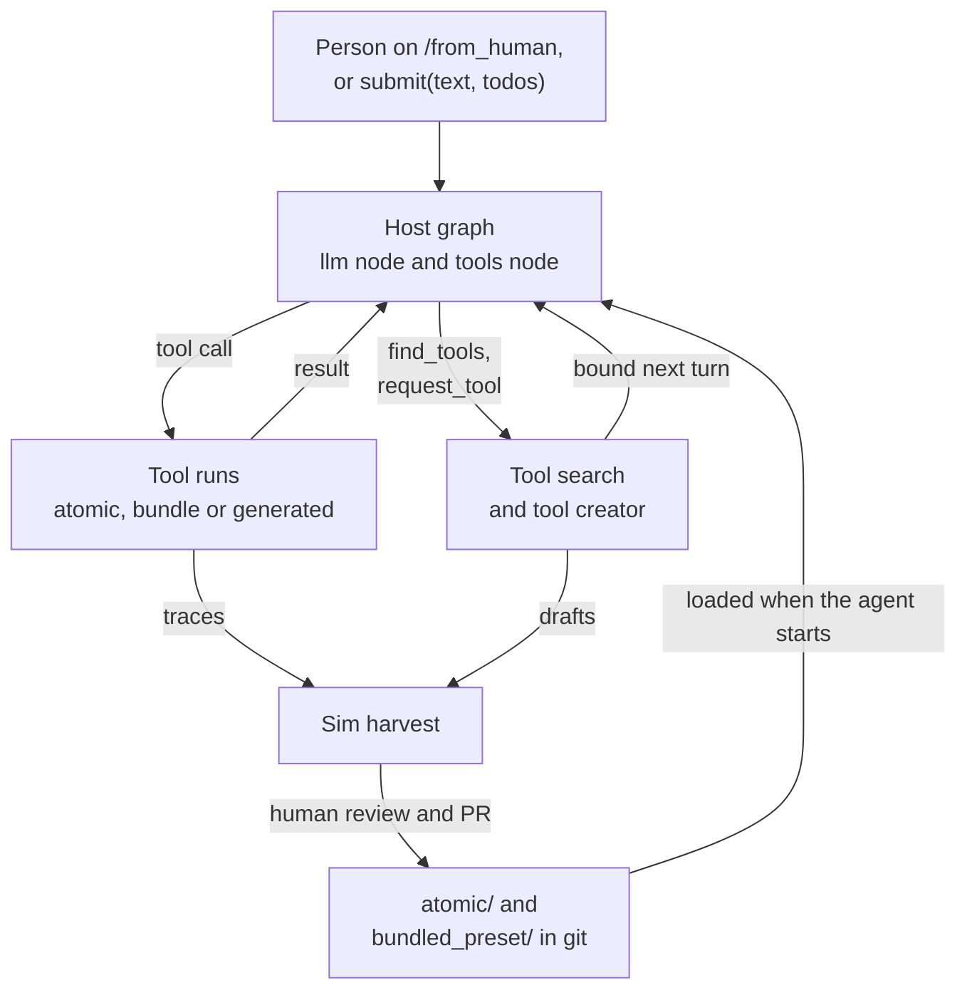
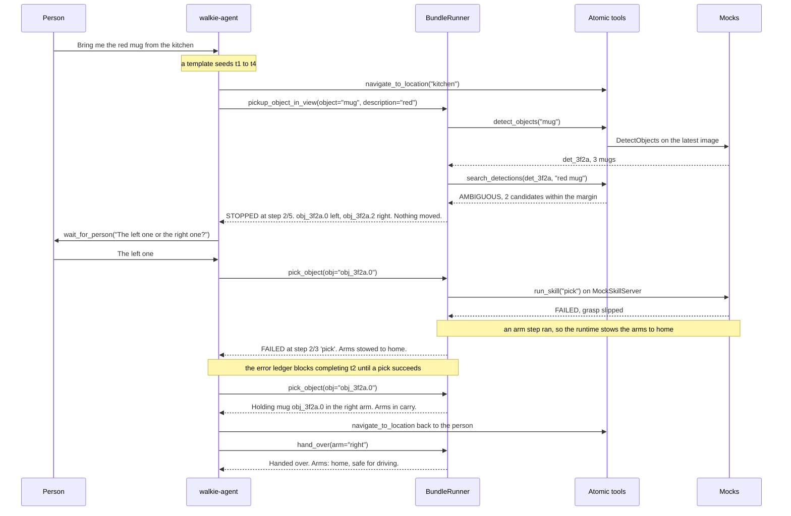
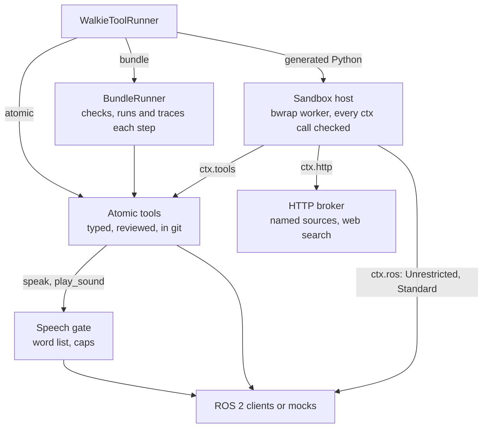
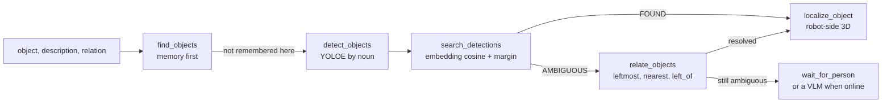
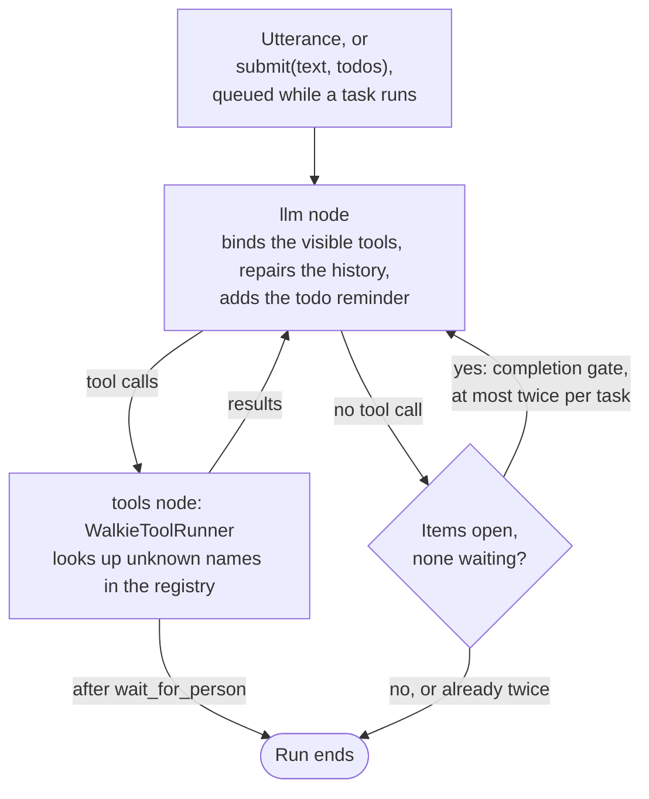
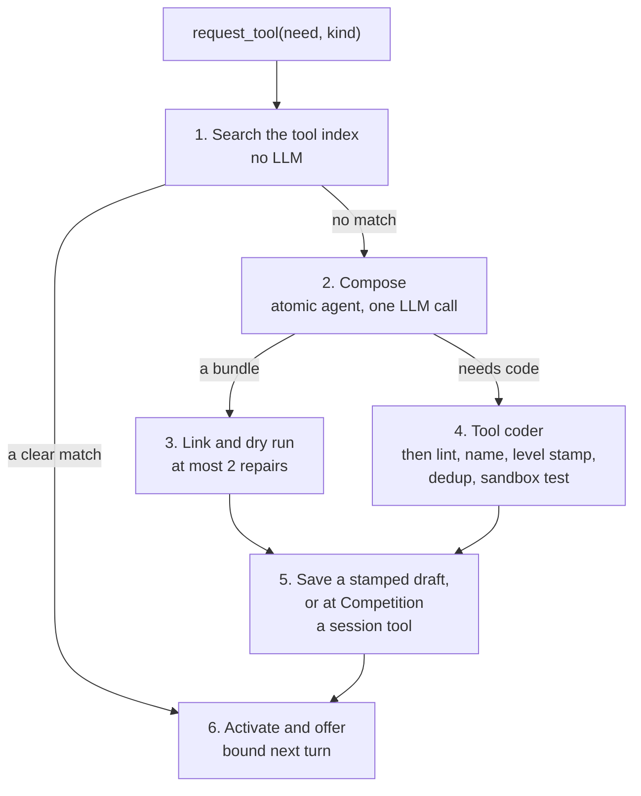

# Self-Evolving Agent (Proposed)

!!! note "Status: Proposed"
    Nothing on this page is built yet. It is the design for team review. Each
    of the [open questions](#open-questions) says which phase it blocks.

Today's agent has a fixed set of tools, bound once at startup (see
[The Agent](agent.md)). The self-evolving agent, nicknamed Mahoraga, can
also combine its tools into larger ones and create new tools while it runs.
The tools that work can later join the reviewed set. The levels and the
sandbox are on [Access Levels and Generated Tools](access-levels.md), the
competition rules on [Competition Mode](competition.md), promotion on
[Sim Harvest](harvest.md), and the arms on [Arm Manipulation](manipulation.md).

## Summary

- **Own graph, tools bound every turn**, so a tool found or created
  mid-task is callable on the next turn
  ([ADR-0038](decisions/0038-own-graph-per-turn-binding.md)).
- **A todo list for every task**, with its rules in code, seedable before
  the first turn ([ADR-0041](decisions/0041-todo-list-and-seeding.md)).
- **Typed atomic tools and bundles.** A bundle chains atomics. It is data,
  checked by a linker, and reports the step that failed
  ([ADR-0037](decisions/0037-tool-tiers-bundles-effects.md)).
- **Effects** (read, perceive, speak, drive, move an arm), allowed by tier
  and access level ([ADR-0039](decisions/0039-access-levels.md)).
- **Hybrid tool search.** At most 20 tools are bound per turn. The rest are
  found with BM25 and vectors ([ADR-0046](decisions/0046-hybrid-tool-index.md)).
- **A tool creator** that reuses, composes, or asks a bounded tool coder
  for a sandboxed tool ([ADR-0047](decisions/0047-sandbox-and-bridges.md)).
- **A model and key per role** ([ADR-0042](decisions/0042-per-role-models.md)),
  **no coordinates from the LLM** ([ADR-0043](decisions/0043-navigate-to-pose-provenance.md)),
  **mocked arm atomics first** ([ADR-0044](decisions/0044-mocked-arm-atomics.md)),
  and **human promotion** into git ([ADR-0048](decisions/0048-sim-harvest-promotion.md)).

## What changes from today's agent

| Area | Today | Proposed |
| ---- | ----- | -------- |
| Host | `WalkieAgent` subclasses RAI's `ReActAgent`, which binds the tools once | Subclasses `LangChainAgent` and runs its own graph, which binds the visible tools every turn |
| Tools | Eight tools from `build_walkie_tools()`, plus `search_robot_docs` after `pixi run whoami-build`. Most return one sentence | Typed atomics and reviewed bundles in git, plus generated tools outside it, in four tiers |
| Planning | None | A todo list with rules in code, seedable from templates or `/walkie/task` |
| Tool choice | Every tool is bound | At most 20 bound. The rest are found with `find_tools` |
| New tools | None at runtime | `request_tool`: reuse, compose or write code, as the access level allows |
| Models | One agent model in `config.toml` | A model, fallbacks, a timeout and an API key per role |
| Perception and arms | Memory only, through `find_objects` | Detection, matching, 3D position and arm skills as typed atomics, on mocks first |
| Sounds | Speech only | `play_sound` through `/to_human` ([ADR-0045](decisions/0045-play-sound-through-to-human.md)) |

## The loop

A task runs in the agent's own graph, which binds the visible tools on
every turn. When no bound tool fits, the agent finds one or has one made,
and it is bound on the next turn. Traces and drafts go to the sim harvest,
where a human decides what enters git. Every run starts from what is in
git.



Each box has its own diagram where it is described:

- [The host graph](#the-host-graph-and-interrupts): the llm node, the
  tools node and the completion gate.
- [How a tool call runs](#how-a-tool-call-runs): the three paths, the
  speech gate and the HTTP broker.
- [The tool creator](#the-tool-creator): reuse, compose or write code, as
  the access level allows.
- [Sim Harvest](harvest.md#pipeline): from traces to a pull request.

## One task, end to end

"Bring me the red mug from the kitchen." A template seeds four todo items,
and the first drives to the kitchen. Two mugs match, so the bundle stops
and the agent asks. The first pick fails in the mock, the runtime stows the
arm, and the retry succeeds.



The task uses only presets from git, so it runs the same at every level.
The `carry` pose needs `travel_safe = true` in `config/arm_poses.toml`, or
[ADR-0025](decisions/0025-travel-safe-interlock.md) blocks the drive back.

## Tiers and folders

Two tiers are in git and reviewed. Two are generated, and live under
`$WALKIE_TOOLS_HOME` (default `~/.local/share/walkie/tools`, set with
`[walkie.toolbox] root`), never in the repository. A **generated tool** is
any tool the agent made itself: a bundle draft in `bundled`, or Python in
`temporary`. Generated Python is also called a vibed tool (internally:
temporary tool). The **atomic agent** is
the compose stage of `request_tool`: one structured LLM call that writes a
bundle ([The tool creator](#the-tool-creator)).

| Tier | Folder | Format | Written by | Runs in | Loads at |
| ---- | ------ | ------ | ---------- | ------- | -------- |
| atomic | `src/walkie_agent/tools/atomic/` | Python: `META`, `Args`, `Out`, `run(ctx, args)` | a human, or a promoted generated tool | the agent process if `META.runtime = "inprocess"`, otherwise a sandbox worker | every level, within its reviewed manifest |
| bundled_preset | `src/walkie_agent/tools/bundled_preset/` | Bundle DSL | a human, often from a promoted bundle | `BundleRunner` | every level, if its backends are real or the run is a simulation |
| bundled | `$WALKIE_TOOLS_HOME/bundled/` | Bundle DSL, rendered from JSON | the atomic agent | `BundleRunner` | Unrestricted and Standard: drafts stamped at or below the level. Competition: this session's only |
| temporary | `$WALKIE_TOOLS_HOME/temporary/` | Python, same shape as atomic | the tool coder | a sandbox worker | as for bundled |

A Competition run builds its index in memory from the git tiers and loads
no generated file, so a sim draft cannot reach a competition by accident.
Today's `navigation.py`, `memory.py` and `speech.py` gain a typed `core()`
in place and keep their sentences. The registry scans them and
`tools/atomic/`, so there is one catalogue without a large file move.

### How a tool call runs

`WalkieToolRunner` sends each call down one of three paths. Everything
spoken passes the [speech gate](competition.md#speech-gate). Generated code
reaches tools, ROS and the web only through a `ctx` that the parent checks
on every call ([The shared ctx API](access-levels.md#the-shared-ctx-api)).



## Effects

| Effect | Meaning | Examples |
| ------ | ------- | -------- |
| R | reads stored or robot state | `list_locations`, `find_objects`, `get_current_pose`, `get_arm_state` |
| P | perceives or computes | `detect_objects`, `search_detections`, `relate_objects`, `localize_object` |
| S | speaks or plays a sound ([ADR-0007](decisions/0007-speak-tool-and-console.md)) | `speak`, `play_sound` |
| N | moves the base | `navigate_to_location`, `move_relative`, `navigate_to_pose` |
| M | moves an arm or gripper | `move_arm_to_pose`, `set_gripper`, `run_skill` |

A bundle's effects are the union of its steps, and retries are allowed only
on idempotent R or P steps. Every generated tool carries a
[level stamp](access-levels.md#level-stamps), the lowest level that allows
all its calls. At Competition, generated tools may only read, perceive and
speak.

## File formats

**Shared types.** `StepError` has 13 codes, such as `NOT_FOUND`,
`AMBIGUOUS`, `STALE` and `SKILL_FAILED`. Every `Out` has a `summary` line,
which is all the LLM sees on success. An atomic's `META` also holds
`questions`: 3 to 5 spoken-style requests it answers, for tool search.

**Bundles** hold one `BUNDLE = Bundle(...)`. The bundle's `description` and
each parameter's `description` make up the schema the LLM sees, so both are
required.

```python title="tools/bundled_preset/pickup_object_in_view.py"
"""Find an object the head camera sees now, described in words, and pick it up."""
from walkie_agent.toolbox.dsl import Arg, Bundle, Fmt, Param, Ref, Step

BUNDLE = Bundle(
    name="pickup_object_in_view",
    description=(
        "Find the object matching `object` and `description` in front of the robot "
        "and pick it up. Stops before any arm motion with AMBIGUOUS (up to 3 "
        "candidates) or NOT_FOUND (labels seen). Ends with the arm in 'carry'."
    ),
    params={
        "object": Param("str", description="Noun the detector knows, e.g. 'mug'."),
        "description": Param("str", default="", description="Attributes, e.g. 'red'."),
        "arm": Param("Literal['left','right','auto']", default="auto",
                     description="Arm to use."),
    },
    steps=[
        Step("dets", "detect_objects", args={"classes": [Arg("object")]},
             on={"NOT_FOUND": "return"}),                                  # P
        Step("match", "search_detections",
             args={"detections": Ref("dets.set"),
                   "text": Fmt("{d} {o}", d=Arg("description"), o=Arg("object"))},
             on={"NOT_FOUND": "return", "AMBIGUOUS": "return"}),           # P
        Step("where", "localize_object", args={"obj": Ref("match.best")},
             on={"OUT_OF_REACH": "return"}),                               # P
        Step("pick", "run_skill",
             args={"skill": "pick", "target": Ref("match.best"), "arm": Arg("arm")},
             expect={"holding": True}),                                    # M, mocked
        Step("carry", "move_arm_to_pose", args={"pose": "carry"}),         # M, mocked
    ],
    returns="Holding {match.label} {match.best} in the {pick.arm} arm.",
    meta={"status": "verified", "created_by": "human"},
)
```

The loader runs `ast.parse` and accepts only the docstring, one import from
`walkie_agent.toolbox.dsl` and that assignment. The agent never imports the
file. An LLM never writes this text: it emits a JSON `BundleSpec`, and
`dsl.render()` writes a canonical file. The other presets are
`find_object_in_view`, `pick_object(obj, arm)` and `hand_over(arm)`.

**Generated Python tools** (the `temporary` tier) have the atomic shape, for what a bundle cannot
express: a loop, arithmetic, a new data source or raw ROS access. They
reach tools, ROS and the web only through a `ctx` that the parent checks
on every call ([The shared ctx API](access-levels.md#the-shared-ctx-api)).

**Promotion.** `pixi run toolbox promote <id> --tier atomic` (planned)
moves a draft into a git tier on a branch. Generated code enters the agent
process only after a human rewrite: the lint is a hint, not a boundary
(`statistics.sys` reaches `sys` without a dunder).

## The bundle runtime and traces

`link()` turns a bundle into a `LinkedPlan` when it loads, and adds its
step chain to the tool's description, such as `Steps: detect_objects →
search_detections → …`. A symbolic dry run feeds each tool's example
output through the plan, which proves every `Ref` resolves.

The linker runs checks L01 to L15: shape, tools, references, inputs, types
and literals in phase 2; codes, provenance, effects, duplicates, templates,
wrappers, level and names in phase 3; the Competition Rule of Two (L14) in
phase 6. The table and the AST lint for generated code are on
[Access Levels: Lint](access-levels.md#lint). Diagnostics go back to the
atomic agent for at most two repairs. Templates use a small substituter,
never `str.format`, so `{x.__class__...}` cannot reach module globals.

For each step the runner checks the cancel token and the session level,
validates the inputs, runs it with a deadline, checks `expect` and traces
it. Atomic cores bound their own waits, as `Nav2GoalTool` does today. RAI's
`@timeout` is not used, because its thread pool waits on exit, so it does
not actually time out. A code in `on` stops the bundle as `STOPPED`, not
`FAILED`. Each step also writes one line to `/walkie/console`, so a person
watching sees progress during a long bundle.

**Recovery.** The runtime always stows. If any arm step started, it calls
`get_arm_state` and, unless the arms are travel-safe,
`move_arm_to_pose("home")`. The same stow runs when the sim interlock
demotes the session in the middle of a bundle. A preset may add
`Recover(tool, args, if_ran="pick")`, which runs only if the `pick` step
started, so a perception failure never moves an arm. Full results go to
`$WALKIE_TOOLS_HOME/runs/<tool>/<ts>.json`, never to
`ToolMessage.artifact`, because RAI pickles every artifact into
`./artifact_database.pkl`, which also needs adding to `.gitignore`.

```text title="ToolMessage at a decision point (status=success)"
pickup_object_in_view STOPPED at step 2/5 'match' (search_detections): AMBIGUOUS
2 objects match 'red mug' (margin 0.02 < 0.05):
  obj_3f2a.0  mug  score 0.81  0.62 m ahead, 0.15 m left
  obj_3f2a.2  mug  score 0.79  0.70 m ahead, 0.30 m right
Nothing moved. Arms: safe for driving.
Ask the person with wait_for_person, then call pick_object(obj=...).
```

**Handles.** A `HandleStore` keeps payloads with the robot pose at capture.
A handle is `STALE` once the base has moved more than 5 cm or 3°, with a
soft age limit of 10 minutes to allow a spoken clarification. Handles clear
on reset and when a new task replaces the todo list.

## How today's tools map to atomics

| Today | Proposed | Note |
| ----- | -------- | ---- |
| `speak`, `list_locations`, `navigate_to_location`, `move_relative`, `find_objects` | core atomics, bound every turn | Each gains a typed `core()` and keeps its sentence |
| RAI's `WaitForSecondsTool` | core, bound as `wait_for_seconds` | Its tool name today is `WaitForSecondsTool`. The rename to the name that the lint and level policy use is planned |
| RAI's `get_current_pose` | reached through `find_tools` | Exposed to generated code through `ctx.tools` at every level. Counts as local sensing for the Rule of Two |
| RAI's `get_ros2_topics_names_and_types` | never shown to the task LLM | The tool coder gets level-filtered `ros_list` and `ros_describe` instead |
| `search_robot_docs` | reached through `find_tools` | Keeps today's OpenRouter embeddings, so it needs the network |

The early design named some tools differently:

| Early name | Becomes | Note |
| ---------- | ------- | ---- |
| `move_absolute` | internal `navigate_to_pose(pose: PoseRef)` | Never shown to the task LLM. Reviewed presets use it, and in sim at Standard or Unrestricted generated code may call it through `ctx.tools`. It drives to a stand-off approach pose and refuses far or off-map targets. The pose comes from memory or perception ([ADR-0043](decisions/0043-navigate-to-pose-provenance.md)) |
| `move_relative` | today's `move_relative` | Already bounded to 3 m ([ADR-0031](decisions/0031-bounded-relative-moves.md)) |
| `query_objects` | `find_objects` (memory), then `detect_objects` (live view) | Memory is checked first |
| `query_rooms` | today's `list_locations` | A rooms query needs its own walkie-database interface and ADR |
| `set_arms_pose` | `move_arm_to_pose(pose, arm)` | Named poses, starting from the SRDF presets walkie-agent-v2 used ([ADR-0022](decisions/0022-named-arm-poses.md)), no lift motion or `*_lift` groups ([ADR-0026](decisions/0026-exclude-lift.md)) |
| `capture_frame` | folded into `detect_objects` | No frames are kept ([ADR-0028](decisions/0028-images-and-policy-robot-side.md)) |
| `get_transform` | internal, stamp-aware | Used by `localize_object`, never shown to the LLM ([ADR-0010](decisions/0010-bounded-navigation-tool.md)) |
| pick as a chain of poses | `run_skill("pick", target)` | Picks run robot-side ([ADR-0027](decisions/0027-runskill-action.md)) |

Sound, time and web atomics are on [Competition Mode](competition.md).

## Finding objects with search_detections

Ranking detection embeddings against the request is the right core, as one
stage of a cascade that runs on the robot.



| Stage | How | Why |
| ----- | --- | --- |
| Detect | YOLOE through a new on-demand `DetectObjects` service (walkie-vision's ADR-0009, proposed) | The streaming detector's classes, which walkie-database reads, never change |
| Rank | Cosine against `EmbedText` of the request, top-1 to top-2 margin 0.05 (to be tuned) | The model is open in walkie-vision's ADR-0008: SigLIP 2 proposed, EmbeddingGemma 2 the challenger, CLIP ViT-B/16 the baseline, chosen by a bake-off |
| Relate | Positions in `base_footprint` (REP-103: +y is left) | CLIP-family models are near chance on spatial words |
| Locate | Robot-side 3D position | Through a walkie-ros interface that is not settled. Its `/get_3d_poses` service samples its own newest depth image, not the detection's image |

## The todo list

The LLM edits the list by id with `update_todos(ops)`.
`wait_for_person(question)` speaks a question, marks the item `waiting` and
ends the turn. The rules are enforced in code
([ADR-0041](decisions/0041-todo-list-and-seeding.md)). Before each LLM
call, the list goes out as one trailing message that is not saved:

```text title="Trailing reminder"
<todos>
[x] t1 Go to the kitchen
[?] t2 Pick up the red mug  waiting: "The left one or the right one?"
[ ] t3 Come back to the person
[ ] t4 Hand over the mug  needs: hand_over
</todos>
```

Seeds come from `WalkieAgent.submit(text, todos=None)`, a template in
`config/task_templates.toml`, or `/walkie/task`. `/walkie/todos` publishes
a JSON snapshot, and both topics join `FORBIDDEN_NAMES`.

## The host graph and interrupts

`WalkieAgent` subclasses `LangChainAgent` and builds its own graph
([ADR-0038](decisions/0038-own-graph-per-turn-binding.md)). The **llm
node** binds the visible tools for this turn, repairs the history and adds
the reminder. The **tools node**, `WalkieToolRunner`, looks up unknown
names in the registry and reports each result to the error ledger. With no
tool call while items are open and none is waiting, a **completion gate**
sends the LLM back, at most twice.



**A new utterance.** Phase 1 switches from RAI's default,
`interrupt_keep_last`, to its `queue` behaviour: an utterance that arrives
mid-task waits until the task ends. Only a reset, or an utterance that is
just "stop" or "never mind", interrupts. It sets the interrupt event and
the cancel token, so it also aborts a running tool creation. A correction
such as "no, the red one" waits, but overheard booth speech can no longer
cancel a pick. RAI checks the interrupt only between graph steps, so a
running tool or bundle finishes first. A break right after the llm node
leaves tool calls with no results, which OpenAI-compatible endpoints
reject, so phase 1 also adds a **history repair** that answers each with an
error ToolMessage.

**Reset.** `reset()` keeps clearing the history and starting a new Langfuse
session. It also trips the cancel token; clears the todo list (publishing
`[]`), active tools, handles, the error ledger and the taint flag; stops a
running sandbox worker, whose bridge cancels that invocation's goals and
stops what it commanded; aborts a running tool coder; and flushes queued
audio. Draft files under `bundled/` and `temporary/` survive a reset. At
Competition, session tools survive it too, and end only with the agent or
on the new `/walkie/reset_session` topic. After a demotion, tools above the
new level drop out of the next bind, and the reminder carries one line:
`[level] Running at Competition level: <reason>`.

## What the agent sees each turn

| Group | Tools | Count |
| ----- | ----- | ----- |
| Core | `speak`, `list_locations`, `navigate_to_location`, `move_relative`, `find_objects`, `wait_for_seconds`, `update_todos`, `wait_for_person`, `get_arm_state`, `move_arm_to_pose` | 10 |
| Presets | `find_object_in_view`, `pick_object`, `pickup_object_in_view`, `hand_over` | 4 |
| Discovery | `find_tools`, `request_tool` | 2 |
| Session slots | tools activated by `find_tools` or `request_tool` for this task | 4 |

`request_tool` is hidden when no creation path is on at this level, profile
and network state. Other tools are reached through `find_tools`.
`navigate_to_pose`, `get_transform` and RAI's
`get_ros2_topics_names_and_types` are never shown, and the system prompt
and the whoami docs need updating to match. At Competition, a turn with a
web result hides every N and M tool and `request_tool`, and `find_tools`
activates nothing ([Turn taint](competition.md#turn-taint-and-the-history-scrub)).

## Roles and models

Each role gets a model, fallbacks, a timeout and an API key in a
`[walkie.models.<role>]` table ([ADR-0042](decisions/0042-per-role-models.md)).

| Role | Used for | Model | Key | Timeout |
| ---- | -------- | ----- | --- | ------- |
| `agent` | the task agent | `google/gemini-3-flash-preview`, a local 7 to 14B fallback | `OPENAI_API_KEY` | 20 s |
| `atomic_agent` | compose, one structured call | a flash model, no fallback | `WALKIE_TOOLSMITH_API_KEY` (new) | 10 s |
| `tool_coder` | the coder in sim | the strongest coding model on OpenRouter | `WALKIE_TOOLSMITH_API_KEY` | 60 s |
| `tool_coder_competition` | the coder at Competition | a fast flash-class coding model | `WALKIE_TOOLSMITH_API_KEY` | 10 s |
| `query_writer` | the query for `look_up_online` ([Competition Mode](competition.md#web-search)) | a small, fast model | not set yet | not set yet |
| `judge` | harvest v1 only | a different family from the agent | `WALKIE_HARVEST_API_KEY` (new) | 60 s |

Every OpenAI-compatible model is built with `max_retries=0` and an explicit
timeout, because the OpenAI SDK defaults, 600 s and 2 retries, would freeze
the robot. Ollama models get the timeout through `client_kwargs`.
Today's `[ollama] complex_model`, `llama3.1:70b`, needs about 40 GB at q4
and does not fit on the 32 GB GPU beside walkie-vision, so the fallback
must be 7 to 14B (a 14B at q4 is about 9 GB, an estimate).

## Tool search

One index serves `find_tools`, the atomic agent, the coder and, in sim, a
generated tool's read-only `ctx.tools.search`
([ADR-0046](decisions/0046-hybrid-tool-index.md)). Keyword search alone
fails on spoken requests: "can you make a cat noise" shares no word with
`play_sound`. BM25 stays, because it finds exact identifiers offline.

- **Activation.** `find_tools(query, name_guess="")` returns the top 5 as
  name, description, signature and example. It activates only the top hit,
  or at most 2 above a score threshold, so one search cannot evict what
  `request_tool` just made. Its `query` asks the task LLM for a one-sentence
  description of the ideal tool, like a docstring.
- **Query path.** Exact name match, then a filter on stamp, tier and
  effects. BM25 (FTS5, tokens quoted) and cosine each take a top 30, fused
  by 1/(60 + rank), with at most 2 per namespace in the top 5.
- **Embedder ([open question 6](#open-questions), settled).**
  `qwen/qwen3-embedding-8b` through OpenRouter, in sim and on the robot,
  with one provider pinned and vectors cut to 1024 dimensions. BM25 runs
  alongside, and answers alone when the embedding takes over 1 s or the
  network probe finds no internet.
- **Store.** `index.sqlite` in sim, in memory at Competition. Numpy brute
  force took 10.7 ms for 15,000 × 1024 vectors on the dev machine.
- **Eval.** `pixi run eval-toolbox` (planned) reports Recall@5 and MRR.
  Hybrid must beat BM25-only before it is enabled at Competition.

## The tool creator

`request_tool(need, kind)` takes a need of at most 200 characters and a
`kind` (`data`, `sound`, `computation`, `perception` or `behaviour`). It is
a fixed pipeline, not an agent loop, and no task depends on it succeeding.
The access level decides which stages are on (the table below). Code from
the tool coder lands in the `temporary` tier.



1. **Search**, no LLM. An exact name, or a top hit both branches rank
   first above a calibrated cosine, is reused.
2. **Compose** in one structured LLM call by the atomic agent. The step
   `tool` field is a `Literal` of the registry's names, so the model cannot
   invent a tool.
3. **Link and dry run**, with at most 2 repair calls.
4. **Write code.** When code is needed, the brief goes to the tool coder.
5. **Save** a stamped draft, or at Competition a session tool.
6. **Offer.** Activate it and say how to call it, for example "Created
   find_left_of (bundle, draft). Args: object, anchor. Call it next." Tools
   the agent is not told about tend to go unused.

| | Unrestricted | Standard | Competition |
| - | ------------ | -------- | ----------- |
| Reuse | on | on | on |
| Compose | on | on | when online and the run profile allows it |
| Write code | on | on | when online, allowed, within budget and the sandbox started |
| Calls per task | 3 | 2 | 1 |
| Time | 10 s per compose call, coder 15 min | 10 s per compose call, coder 10 min | 30 s in total, the request stopped at 40 s |

Offline, or with creation off, it only searches. The cancel token is
checked between stages, and a reset kills the coder's sandbox runs.

**At Competition** `request_tool` first speaks a fixed filler, "Let me see
if I can learn that. One moment.", so the person hears something within one
agent turn. The creator gets the raw speech recognition text of the
triggering utterance, the typed kind, and the need only after it passes the
speech gate's text checks and holds no text from this task's tool results.
It never gets the task LLM's prose
([The decision ladder](competition.md#the-decision-ladder)). Compose is
skipped when search found nothing above the threshold and the kind is
`data`, `sound` or `computation`, because a bundle cannot add a data source,
a sound or arithmetic. A `sound` request gets `fetch_sound` guidance
instead. The offer comes from a fixed template: name, typed arguments,
effects, any literal sentence the tool will speak, and a checked summary of
at most 100 characters. The coder's own docstring and examples never reach
the task LLM.

## The tool coder

A bounded agent built with LangChain's `create_agent`, with
`ModelCallLimitMiddleware(exit_behavior="end")`, `ToolCallLimitMiddleware`
(overall, and per tool for `web_search`, `web_fetch` and `run_draft`) and a
callback for wall clock and cost. Its tools are plain function tools, so
the middleware counts every call. It is not the host.

| Tool | Unrestricted | Standard | Competition |
| ---- | ------------ | -------- | ----------- |
| `search_tools` | all tiers, drafts, deprecated | all tiers, draft representatives | git tiers and this session's tools |
| `read_tool_source` (at most 400 lines, secret-scanned) | the tool roots and `ctx` stubs | same | git tiers only |
| `read_ctx_api` | the Unrestricted `ctx` stub and the public rule table | the Standard stub | the Competition stub and the human-written API notes |
| `ros_list`, `ros_describe` | level-filtered | level-filtered | not available |
| `ros_sample` | R and P names | R and P names, no images | not available |
| `web_search` | the search client on the sim key, at most 20, untrusted | the same, at most 10 | not available (recommended) |
| `web_fetch` | public hosts, through the broker, untrusted | public hosts | named sources, through their templates |
| `fetch_asset` | public hosts | public hosts | audio ≤ 5 s and ≤ 1 MiB from `commons_media`, JSON and text ≤ 200 KB from named sources |
| `run_draft` | against the live sim | against the live sim | against recorded fakes, speech recorded, not played |
| `submit_draft`, `submit_asset`, `give_up` | yes | yes | yes, session-scoped |

At Competition the first message is pre-filled with the Competition stub,
the API notes in `toolsmith/api_notes/`, the top 8 search hits and the
source of the two most relevant atomics. The job then usually needs two or
three model calls, and must fit in about 25 s. There is no open web: a
visitor could name a URL that leaks data or injects instructions
([The Competition coder](competition.md#the-competition-coder)). In sim, an
end-of-run reflection asks whether a reusable tool was possible, and the
answer goes into the trace for the harvest. Offline, there is no coder.

It never sees secrets, files outside the tool roots, hidden tests, the
harvest checkers, personal data or the quarantine lane.

## Testing

Tests still need no API key and no hardware
([ADR-0019](decisions/0019-test-fakes-fast-dds.md)). `ScriptedChatModel`
also records the bound tool names and the reminder per call. Bundles and
atomics run against `FakeScene` and the mocks, and tests assert both the
structured result (step, tool, code) and the exact text. Every new path
takes a root argument (`tmp_path`). Every new LLM call goes through RAI's
`invoke_llm_with_tracing`, so the `no_tracing` fixture covers it, and no
new tool returns an artifact.

| New test file | What it pins | Phase |
| ------------- | ------------ | ----- |
| `test_todo.py` | the todo list and its rules | 1 |
| `test_graph.py` | two tasks in a row, reset, an interrupt between llm and tools, an unknown tool, per-turn binding, no completion gate after `wait_for_person` | 1 |
| `test_dsl.py` | the DSL loader and renderer | 2 |
| `test_linker.py` | one case per L-code | 2, 3 |
| `test_runner.py` | `BundleRunner` against `FakeScene` and the mocks | 2 |
| `test_index.py` | FTS5 quoting, fusion, exact name first, the BM25-only fallback with a deterministic hash embedder, git tiers only at Competition | 3 |
| `test_atomic_agent.py` | a `ScriptedChatModel` that returns the `Decision` schema; the first test pins that shape | 3 |
| `test_names.py` | L15 names, `O_NOFOLLOW` and `O_EXCL` writes, symlinks ignored | 3 |
| `test_coder.py` | the call budget per level, source limits, the secret scanner, lint failures, `give_up` | 4a |

The level, interlock, stamp, sandbox and HTTP tests are on
[Access Levels](access-levels.md), the speech and web search tests on
[Competition Mode](competition.md#rollout-and-tests), and the harvest's on
[Sim Harvest](harvest.md#testing). Model quality is measured by
`pixi run eval-toolbox`, outside `pixi run test`: Recall@5 and MRR for
BM25-only, dense-only and hybrid search, per level.

## Roadmap

| Phase | What ships (MVP) | Deferred | Done when |
| ----- | ---------------- | -------- | --------- |
| 0. Decisions | These ADRs. `artifact_database.pkl` in `.gitignore`. A draft `config/arm_poses.toml` copying the seven SRDF arm presets, plus `carry`, with `travel_safe` flags ([Pose configuration](manipulation.md#pose-configuration)). `robot_check.sh` run on the robot PC. `/etc/walkie/sim-host` installed on dev machines | — | ADRs reviewed. The `robot_check.sh` result is known |
| 1. Host, todos, roles | `graph.py` and the base swap, the `_run_agent` override, `todo.py`, seeding, `/walkie/todos`, `models.py`, `FORBIDDEN_NAMES` additions, the `--access-level` flag and profile plumbing, per-role keys, Ollama with an sm_120 check | — | All 65 existing tests pass, plus `test_todo.py` and `test_graph.py`. An eval with the chosen local fallback model. A seeded run on `agent-sim` |
| 2. Typed atomics, mocks, bundles, levels | `toolbox/` core, linker L01 to L06, `core()` for today's tools, perception and arm atomics, internal `navigate_to_pose`, the four presets, `META.requires`, `walkie_toolbox_facade`, the level policy, interlock checks 1, 2, 3, 5 and 6, the local speech gate, `play_sound`, `tell_time`, `tell_date`. `agent-sim` passes `--access-level standard` | Interlock checks 4 and 7 to 9, periodic re-checks | `test_dsl`, `test_linker`, `test_runner`, `test_nav_interlock`, `test_levels`, `test_interlock`, `test_play_sound` and `test_speech_gate` pass. A mock fetch with injected faults on `agent-sim`. The interlock grants Standard on a marked dev machine, and Competition without the marker or with the robot marker |
| 3. Index and atomic agent | `find_tools`, `request_tool` with compose, linker L07 to L13 and L15, stamped drafts, run traces, the cloud embedder with its pinned provider and startup check, 100 spoken requests for the eval | A second embedding provider | `test_index`, `test_atomic_agent` and `test_names` pass. Hybrid beats BM25-only on Recall@5, or the team decides. Embedding latency measured from the robot PC |
| 4a. Sandbox and coder (sim) | Sandbox, bridges, lint, the tool coder and the assets store at Standard and Unrestricted, interlock checks 4 and 7 to 9 and the fresh checks before motion | `restrict_self` (Landlock, seccomp) | `test_sandbox`, `test_http_policy`, `test_web_search`, `test_ros_bridge`, `test_stamps` and `test_coder` pass. In sim the coder makes a scan-reading tool at Standard and an action-using navigation tool at Unrestricted. The Unrestricted one never loads at Standard |
| 4b. Unrestricted extras | Raw base commands with a stop on cleanup, `ctx.handles.load`, `cv2` in the lint, only on harvest evidence. Arm controllers stay on the never-list | — | A raw-publish tool is cleaned up on worker death in a test |
| 5. Harvest v0 | See [Sim Harvest](harvest.md). Needs the walkie-ros world change merged to main and pinned | Harvest v1, start poses away from the origin, keepout in sim Nav2, an object-pose publisher | One 100-episode run with a report a human has read, failures split into agent, navigation and localization. At least one candidate promoted by pull request |
| 6. Competition level | See [Competition Mode](competition.md), ending with the Competition coder | — | Red-team set: 0 escapes. A booth dry run with no audible test failures. Offline, creation is refused within 2 s. `Say <slur>` is refused. 20 long-tail questions answered with site-name attribution. `look_up_online` returns `UNAVAILABLE` within 1 s when search is blocked. A red-team snippet does not change the next tool call |
| Real backends, from phase 2 | walkie-vision `DetectObjects` and `EmbedText` clients, the skill server ([ADR-0027](decisions/0027-runskill-action.md)), the commander ([ADR-0021](decisions/0021-arm-control-through-commander.md), [ADR-0023](decisions/0023-motion-supervisor.md)), ROS-level fakes | — | Bundle tests rerun on real clients |

Deferred until something needs them: a runs table, the rest of the toolbox
CLI (`deprecate`, `gc`, evidence export), a circuit breaker that switches
to the local model for 120 s after 2 cloud failures, and the `RunTask`
action. The real-backends track runs in parallel, so the team does not
reach RoboCup with a tool factory and no real perception. Phase 5 needs the
chula_pat14_6 world. Its assets and world tools are on a walkie-ros branch,
not on main, so those paths may change
([Sim Harvest](harvest.md#the-world-chula_pat14_6)).

## Risks

| Area | Risk | Mitigation |
| ---- | ---- | ---------- |
| Core | History or state lost in the new graph | Keep RAI's in-place state. Tests for two tasks in a row, reset and an interrupt between llm and tools land first, in phase 1 |
| Core | A bundle links but does the wrong thing, such as left and right swapped | Postconditions, stops at decision points, no generated motion at Competition, generated arm motion only in sim through mocked `run_skill`, drafts until traced runs, human promotion. Expect slow growth: published self-evolving agents keep a small share of what they generate |
| Core | Tool creation is slow or flaky mid-task | Honest budgets: writing code takes 20 to 35 s, `request_tool` has 30 s at Competition, and the request stops at 40 s. A filler within one turn, progress lines, cancel by voice, a fast model at Competition, `fetch_sound` without an LLM, pre-baked tools. Creation is never required |
| Core | The local fallback model cannot handle the tool set | At most 20 bound tools, presets, a phase 1 eval with the exact model the robot runs |
| Core | Mocks drift from the real interfaces | Mocks follow the ADR-0027 outcomes, the [Arm Manipulation](manipulation.md) sentences and the `walkie_vision_msgs` fields. ROS-level fakes in phase 5, reruns on the real-backends track |
| Core | The perception chain does not exist yet | Presets stay mock-backed, and `META.requires` keeps them out of real runs |
| Core | Scope too large for the season | MVP and deferred items per phase, harvest v0 before v1, Unrestricted extras only on evidence, real backends in parallel |
| Core | A reset during a long step | Cancel checks between steps. A running skill or Nav2 goal stops only when its own wait checks the token. [ADR-0023](decisions/0023-motion-supervisor.md) is the real fix |
| Core | Coupling to private RAI members | `_run_agent`, `_interrupt_event` and the `ToolRunner` internals stay under the `<2.13` pin. `create_agent` stays in reserve |
| Core | Ollama missing or unsupported on the robot (RTX 5090, sm_120) | Install and check in phase 1. Only the local fallback model needs it |
| Core | The cloud embedder is slow, down or unreachable | BM25 runs alongside and answers alone after 1 s, or at once when the network probe fails. `META.questions` keeps spoken phrasings in BM25. The trace counts BM25-only answers |
| Core | The model behind the embedder's name changes silently | The startup check re-embeds 20 fixed strings. Below a cosine of 0.99, the dense branch stays off until re-embedded |
| Core | Drafts crowd retrieval | Cluster representatives only, per-namespace caps, stamps and level filters, deprecation flags |
| Core | Cloud LLM dependency for creation | Creation is never on a scored task's success path. Separate keys with their own limits, fixed hard stops |
| Levels | The interlock grants a sim level on the real robot | The CLI flag only, a sim-host marker that fails closed, robot-marker and domain-23 vetoes, fresh checks before motion, sticky demotion. Tests per signal |
| Levels | The sim-host marker is installed on the wrong machine | Root-owned and installed by hand. `robot_check.sh` fails if it exists on the robot, and the robot marker vetoes it anyway |
| Levels | The sandbox is unavailable on the robot | `robot_check.sh` in phase 0, the AppArmor profile if bwrap fails, refusal rather than running unsandboxed. Reuse, compose and pre-baked tools still work. Whether `fetch_sound` does is open, because its decode step needs bwrap ([Competition Mode](competition.md#open-questions), question 10) |
| Levels | The bwrap copy drifts from apt updates | `robot_check.sh` compares versions |
| Levels | Promoted generated code escapes in-process | It stays in the sandbox (`runtime = "sandbox"`) until a human rewrite. A CI provenance check |
| Levels | Unrestricted code mistaken for a promotion candidate | Stamped Unrestricted and reported as a wishlist only. `toolbox promote` refuses it for `--tier atomic` without `--rewrite`. A CI check |
| Levels | Policy lists drift from the real launch graphs | Competition allow-lists generated from the robot launch graph, a property test with a captured name list, review on interface ADRs |
| Competition | Prompt injection through web content | Named sources with templates, typed results, turn taint, the speech gate, the Rule of Two, the query writer, small snippets and the history scrub |
| Competition | No internet at the venue | An offline probe, creation off, reuse only, BM25-only tool search, pre-baked tools and the sound pack. `look_up_online` fails fast with `UNAVAILABLE` |
| Competition | Harmful text built from clean words reaches the speaker, since the speech gate has no cloud check | The query writer's topic refusals, strict safe search, the denylist, short snippets, the 200-character cap, clean-word cases in the red-team set. A guard model on OpenRouter is the drop-in if they get through |
| Harvest | The interlock demotes during harvest runs by mistake | A pause is not a demotion, viewers do not count as drivers, the agent stops before each relaunch and starts once the new sim is ready, check values are logged, a smoke run over consecutive episodes |
| Harvest | Low or costly yield | Start at 100 episodes, the harvest key's limit, tool-step scoring. Expect a minority of drafts to survive |
| Harvest | Sim localization distorts navigation results | Position checks read `/mujoco_ground_truth/odom`. Each check and every Nav2 abort logs the localization error, and the relaunch from the origin resets drift. Ask walkie-ros for ground-truth localization if more than about 10% of first-run episodes fail on localization |
| Harvest | The harvest world is not landed | Phase 5 starts once the walkie-ros world change is merged to main and its commit pinned. If the assets move back to walkie-worlds, that repository is pushed and pinned too. The report header records the commits and the world-generation command |
| Harvest | Every episode starts through a narrow doorway | It is 0.75 m clear and about 0.64 m past the open door leaf, for a 0.478 m footprint plus 0.02 m padding. The sofa approach has 13 mm in walkie-ros's connectivity check. The smoke run drives from the origin to `living_room`, and navigation failures are reported apart. If the doorway fails often, start in the living room with a spawn-matched static map → odom |
| Harvest | The LLM judge is miscalibrated (harvest v1) | Programmatic checkers first, a different model family, kappa on 100 labels reported per run |
| Harvest | The GPSR generator is unstable | A pinned commit, a thin wrapper that records template keys, a harvest-only environment |

The web search, fetched sound and TTS risks are on
[Competition Mode](competition.md#rollout-and-tests), and the threats T1 to
T12 on [Access Levels](access-levels.md#safety-model).

## What lives where

| Piece | Repository | Location |
| ----- | ---------- | -------- |
| Host graph, session state, todo list | walkie-agent-ros | `src/walkie_agent/agent.py` (changed), `graph.py`, `session.py`, `todo.py` (new) |
| Per-role models | walkie-agent-ros | `src/walkie_agent/models.py` (new), `[walkie.*]` tables in `config.toml` |
| Linker, runner, registry, index, sandbox | walkie-agent-ros | `src/walkie_agent/toolbox/` (new) |
| Tool creator, coder and harvest | walkie-agent-ros | `src/walkie_agent/toolsmith/` (new) |
| Atomic tools and presets | walkie-agent-ros | `src/walkie_agent/tools/atomic/`, `tools/bundled_preset/` (new) |
| Protocol mocks and ROS-level fakes | walkie-agent-ros | `src/walkie_agent/sim/`: `fake_scene.py`, `mock_vision.py`, `mock_skill.py`, `mock_arm.py`, `fake_skill_server.py`, `oracle_perception.py` (new files beside today's `fake_walkie.py`) |
| Client package for sandboxed code | walkie-agent-ros | `src/walkie_toolbox_facade/` (new) |
| Templates, level policy, arm poses | walkie-agent-ros | `config/task_templates.toml`, `config/access_levels.toml`, `config/arm_poses.toml` (new) |
| Generated tools, index, traces | each machine, never git | `$WALKIE_TOOLS_HOME` |
| `DetectObjects`, `EmbedText` | walkie-vision | `walkie_vision_msgs`. `DetectObjects` is proposed |
| Object memory | walkie-database | `/walkie_database/find_objects` (exists) |
| Skill server, commander, grasps | walkie-ros | robot-side. The commander and `/grasp/from_cloud` exist. The skill server is proposed ([ADR-0027](decisions/0027-runskill-action.md)) |
| Embedding model | none, a cloud service | `qwen/qwen3-embedding-8b` through OpenRouter, set in `[walkie.toolbox.embedder]` |

## Open questions

ADR-0037, ADR-0038, ADR-0041 and ADR-0043 propose the recommended answers
to questions 2, 3, 4 and 5, so reviewing them settles those.

1. **What does a new utterance do mid-task?** Settled: RAI's `queue`
   behaviour, with only reset, "stop" or "never mind" as interrupts
   ([ADR-0038](decisions/0038-own-graph-per-turn-binding.md)).
2. **Bundle syntax.** Proposed: the `ast`-parsed DSL, over YAML (no IDE
   help) or plain Python (every bundle needs the sandbox). Blocks phase 2.
3. **Host.** Proposed: our own graph on `LangChainAgent`, over
   `create_agent` with middleware. Blocks phase 1.
4. **Seeding.** Recommended: templates, `submit()` and `/walkie/task` now,
   a typed `RunTask` action later. Blocks phase 1.
5. **`move_absolute`.** Proposed: an internal `navigate_to_pose` with a
   stand-off, used by presets and, in sim at Standard and Unrestricted, by
   generated code through `ctx.tools`. The alternative gives the LLM
   coordinates and supersedes ADR-0010. Blocks phase 2.
6. **Embedder.** Settled: `qwen/qwen3-embedding-8b` through OpenRouter
   everywhere, Competition included, with BM25 alone when offline or after
   1 s. The local `qwen3-embedding:0.6b` on Ollama was dropped
   ([ADR-0046](decisions/0046-hybrid-tool-index.md)).
7. **Search inside a generated tool.** Open on
   [Access Levels](access-levels.md#open-questions), question 2.
8. **Trivial requests such as "say Meow!".** Open on
   [Competition Mode](competition.md#open-questions), question 7.
9. **The local fallback model.** 7 to 14B, chosen by a phase 1 eval.
   Blocks phase 1.
10. **Ollama on the robot PC.** Whether a build with RTX 5090 (sm_120)
    support runs there is unverified. Blocks the local fallback model in
    phase 1.
11. **Hybrid against BM25-only.** Not measured until the phase 3 eval.
    Blocks enabling vectors at Competition.
12. **`search_robot_docs` offline.** Settled with question 6: it keeps
    embedding through OpenRouter, so docs search needs the network. Whether
    it fails fast offline, rather than after a timeout, is unverified and
    checked in phase 3.

## Decisions

Click a decision to expand it. All of these are proposed. See
[Architecture](index.md) for how decisions work.

??? note "ADR-0037: Split tools into atomic and bundled tiers, keep bundles as data, and gate them by effect · Proposed"

    --8<-- "architecture/decisions/0037-tool-tiers-bundles-effects.md:body"

??? note "ADR-0038: Run our own graph on LangChainAgent and bind the visible tools every turn · Proposed"

    --8<-- "architecture/decisions/0038-own-graph-per-turn-binding.md:body"

??? note "ADR-0041: Keep a seedable todo list for every task · Proposed"

    --8<-- "architecture/decisions/0041-todo-list-and-seeding.md:body"

??? note "ADR-0042: Pick a model and an API key per role · Proposed"

    --8<-- "architecture/decisions/0042-per-role-models.md:body"

??? note "ADR-0043: Add an internal navigate_to_pose that takes only poses with handle provenance · Proposed"

    --8<-- "architecture/decisions/0043-navigate-to-pose-provenance.md:body"

??? note "ADR-0046: Find tools with a hybrid keyword and vector index · Proposed"

    --8<-- "architecture/decisions/0046-hybrid-tool-index.md:body"
