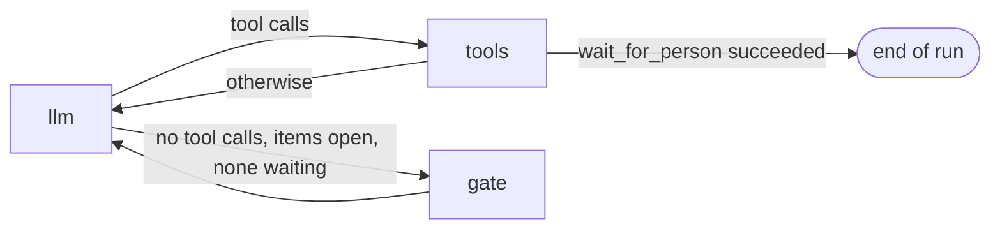

# Asking a Question

`wait_for_person` lets the agent pause a task to ask the person something,
and pick the same step up again when the answer comes. It speaks the
question, marks the current step `waiting`, and ends the run. The answer
arrives later as an ordinary message, and the step goes back to
`in_progress`.

## What the tool does

The system prompt tells the LLM to call `wait_for_person` instead of `speak`
when it cannot go on without an answer, and never to say the question, a
rewording of it, or a request it waits on with `speak` as well. `speak`'s
own description makes the same exception. A person asked twice answers
twice, and each answer waits in the queue as its own message, so the second
one reaches the LLM later as the answer to whatever it asks next.
`WaitForPersonTool` in
`src/walkie_agent/tools/todos.py` holds the task's `TodoList` and a
`speak_tool`, the same `speak` tool that the LLM calls. Its `_run` takes
three steps:

1. It speaks with `speak_tool.invoke({"text": question})`.
2. If the result does not start with `"Said:"`, it raises `ToolException`.
   The list does not change, because nobody heard the question.
3. Otherwise it calls `todos.set_waiting(question)` and returns
   `"Asked: <question>"`.

The fake `speak` below returns what the real `SpeakTool` returns on success,
and plays nothing.

```pycon
>>> from langchain_core.tools import tool
>>> from walkie_agent.todo import TodoList
>>> from walkie_agent.tools.todos import WaitForPersonTool
>>> @tool
... def speak(text: str) -> str:
...     """Say something out loud."""
...     return f"Said: {text}"
...
>>> todos = TodoList()
>>> todos.seed(["Go to the kitchen", "Find the cup", "Come back and tell the person"])
>>> print(todos.apply([
...     {"op": "update", "id": "t1", "status": "completed"},
...     {"op": "update", "id": "t2", "status": "in_progress"},
... ]))
Updated: t1 → completed, t2 → in_progress. Open: t2, t3.
>>> ask = WaitForPersonTool(todos=todos, speak_tool=speak)
>>> ask.invoke({"question": "Is yours the red cup or the blue one?"})
'Asked: Is yours the red cup or the blue one?'
>>> print(todos.render())
<todos>
[x] t1 Go to the kitchen
[?] t2 Find the cup  waiting: "Is yours the red cup or the blue one?"
[ ] t3 Come back and tell the person
</todos>

```

`set_waiting` only marks the item that is `in_progress`. With none, the list
does not change, but the question was spoken, so the tool still returns
`"Asked: ..."`. No `update_todos` op may set `waiting` itself.

## The answer resumes the step

The answer is the next message the person sends. When it starts,
`WalkieAgent._prepare_todos` calls `todos.resume_waiting()` for any message
without a seed. That puts the waiting item back `in_progress` and clears its
question.

```pycon
>>> todos.resume_waiting()
>>> print(todos.render())
<todos>
[x] t1 Go to the kitchen
[>] t2 Find the cup
[ ] t3 Come back and tell the person
</todos>

```

`resume_waiting` keeps the item's ledger window, because the answer continues
the same attempt, so a failure from before the question still counts. An op
that sets `in_progress` starts a new window instead (see
[The Rules: Ledger and Window](todo-rules.md)). A seeded message skips
`resume_waiting` and replaces the whole list.

## The graph ends the run

The tool only marks the item; ending the turn is the graph's job.
`route_after_tools` in `src/walkie_agent/graph.py` returns `END` when
`_person_was_asked` finds a `success` result of `wait_for_person` for the
last AI message. Any other result goes back to `llm`, so a failed question
lets the LLM go on.



An AI message can hold more calls after the question. `WalkieToolRunner`
answers each of them with `AFTER_QUESTION` instead of running it. A drive
before the answer would act on a guess, and give the waiting item evidence
it has not earned.

Here the LLM, after hearing "the red one", asks a second question and tries
to drive in the same message. RAI's `ToolRunner` logs each call to stderr, so
expect a few log lines around the output.

```pycon
>>> from langchain_core.messages import AIMessage
>>> from walkie_agent.graph import ToolSet, WalkieToolRunner, _person_was_asked
>>> @tool
... def navigate_to_location(location: str) -> str:
...     """Drive to a named place."""
...     return f"Arrived at {location}."
...
>>> runner = WalkieToolRunner(ToolSet([speak, navigate_to_location, ask]), todos)
>>> reply = AIMessage(content="", tool_calls=[
...     {"name": "wait_for_person", "args": {"question": "Shall I bring it to you?"}, "id": "c1"},
...     {"name": "navigate_to_location", "args": {"location": "start"}, "id": "c2"},
... ])
>>> state = {"messages": [reply]}
>>> _ = runner.invoke(state)
>>> for result in state["messages"][1:]:
...     print(result.tool_call_id, result.status, "|", result.content)
...
c1 success | Asked: Shall I bring it to you?
c2 error | Not run: you asked the person a question, so the task stopped to wait for the answer. Call it again after the answer if it is still needed.
>>> _person_was_asked(state["messages"])
True

```

The skipped call is not a tool failure, so the error ledger never hears of
it. The completion gate also stays shut while an item waits:
`route_after_llm` picks `gate` only when `todos.has_waiting()` is false. In
the agent, `route_after_tools` has usually ended the run already, so this is
a second guard against pushing the LLM to guess instead of waiting.

!!! example "Try it"
    Make a `speak` tool that returns `"Nothing was said."`, give it to a
    `WaitForPersonTool`, and run a question through a `WalkieToolRunner`
    while an item is `in_progress`. Then try to mark that item `completed`.
    A failed question goes into the ledger like any failed tool, so predict
    the refusal before you read it.

Previous: [The Rules: Ledger and Window](todo-rules.md) · Next: [Queue, Stop, Reset and Repair](queue-stop-reset.md)
