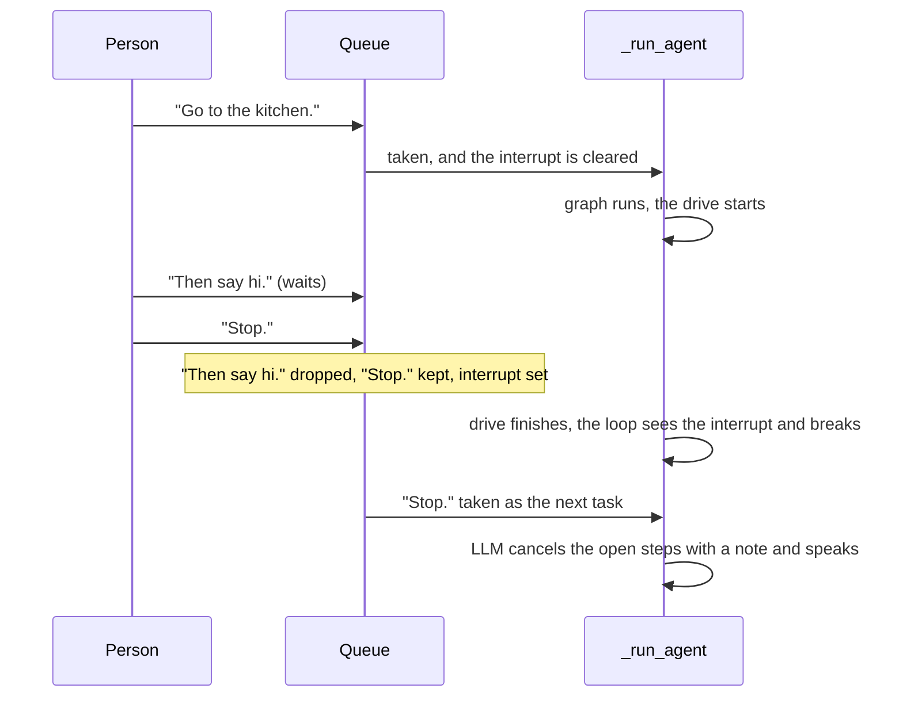

# Queue, Stop, Reset and Repair

A message that arrives during a task waits its turn, and only a bare "stop",
a bare "never mind" or a reset interrupts the task. Around that queue, the
agent survives its own errors and repairs the history before every LLM call.
Most of these rules exist because the robot is physical: a drive cannot be
undone, and a venue is noisy.

## The queue and "stop"

`WalkieAgent` passes `new_message_behavior="queue"` to RAI's `LangChainAgent`.
Both `__call__`, which RAI calls for every utterance, and `submit` go through
`_enqueue`, and `_run_agent` takes one message per task, oldest first. A
message's seed waits in `_seeds`, keyed by `id(msg)` and stored under the
same `_buffer_lock`, so a reset can never separate the two.

`is_stop_utterance` decides what counts as a stop. It lowercases the text,
trims spaces and `. , ! ?` from both ends, and collapses inner spaces. The
result must be exactly `stop`, `never mind` or `nevermind`.

```pycon
>>> from walkie_agent.agent import is_stop_utterance
>>> for text in ["Stop.", "  NEVER   mind! ", "nevermind?", "Walkie, stop", "stop the music", "never-mind"]:
...     print(repr(text), is_stop_utterance(text))
...
'Stop.' True
'  NEVER   mind! ' True
'nevermind?' True
'Walkie, stop' False
'stop the music' False
'never-mind' False

```

A stop counts only while a task runs. `_enqueue` then drops the older queued
messages and their seeds, keeps the stop itself queued, and sets
`_interrupt_event`. While the agent is idle, "stop" is an ordinary message.



The loop in `_run_agent` checks the interrupt between graph steps, so a
running drive finishes first. If the stop lands during the LLM call, its tool
calls never run, and the history repair below answers them.

## Reset, stop() and errors

| Event | What happens at once | What the agent thread does next |
| --- | --- | --- |
| `reset()`, or `std_msgs/Empty` on `/walkie/reset` | Under `_buffer_lock`: clears the queue and `_seeds`, sets `_reset_requested` and the interrupt | At the top of the next `_run_agent`: clears the history and the todo list, which publishes `[]`, and starts a new Langfuse session |
| `stop()` | Under `_buffer_lock`: sets `_stop_event` and the interrupt, then calls RAI's `stop()`, which joins the thread | Starts no new run, because taking a message checks `_stop_event` |
| An LLM or graph error | `_run_agent` catches any `Exception`, including LangGraph's error at `RECURSION_LIMIT` | Logs it and serves the next message |

The lock in `stop()` closes a race. A starting run clears the interrupt under
that lock, so without it an interrupt set in between would be lost, and a
whole task would run before the thread stopped. Taking a message also checks
`_reset_requested`, so a message sent after a reset never runs on the old
history.

```bash
pixi run ros2 topic pub --once /walkie/reset std_msgs/msg/Empty
```

## History repair

An interrupted turn can leave an AI message whose tool calls have no
`ToolMessage`. OpenAI-compatible endpoints reject that history on the next
call. So `repair_history` in `src/walkie_agent/graph.py` runs at the start
of every `llm` node, and answers each missing call with an `error` result.

```pycon
>>> from langchain_core.messages import AIMessage, HumanMessage, ToolMessage
>>> from walkie_agent.graph import INTERRUPTED, repair_history
>>> history = [
...     HumanMessage("Go to the kitchen and say hi."),
...     AIMessage(content="", tool_calls=[
...         {"name": "navigate_to_location", "args": {"location": "kitchen"}, "id": "c1"},
...         {"name": "speak", "args": {"text": "Hi!"}, "id": "c2"},
...     ]),
...     HumanMessage("Stop."),
... ]
>>> repair_history(history)
2
>>> [type(m).__name__ for m in history]
['HumanMessage', 'AIMessage', 'ToolMessage', 'ToolMessage', 'HumanMessage']
>>> print(history[2].tool_call_id, history[2].status, history[2].content)
c1 error Interrupted before it ran.
>>> history[3].content == INTERRUPTED
True
>>> repair_history(history)
0

```

Each answer goes at the end of the block of tool messages right after its AI
message, before anything that follows. A call whose arguments were not valid
JSON gets `UNREADABLE_ARGUMENTS` instead of `INTERRUPTED`.

## One update_todos per message

If one AI message holds several `update_todos` calls, `WalkieToolRunner` runs
only the first. Each call applies on its own, so a model that splits its ops
would get a half-applied plan. The others get `ONE_UPDATE_TODOS`.

```pycon
>>> from walkie_agent.graph import ToolSet, WalkieToolRunner
>>> from walkie_agent.todo import TodoList
>>> from walkie_agent.tools.todos import UpdateTodosTool
>>> todos = TodoList()
>>> runner = WalkieToolRunner(ToolSet([UpdateTodosTool(todos=todos)]), todos)
>>> split = AIMessage(content="", tool_calls=[
...     {"name": "update_todos", "args": {"ops": [{"op": "add", "content": "Go to the kitchen"}]}, "id": "u1"},
...     {"name": "update_todos", "args": {"ops": [{"op": "add", "content": "Say hi"}]}, "id": "u2"},
... ])
>>> state = {"messages": [split]}
>>> _ = runner.invoke(state)
>>> for result in state["messages"][1:]:
...     print(result.tool_call_id, result.status, "|", result.content)
...
u1 success | Added: t1. Open: t1.
u2 error | Only one update_todos call per message is accepted, so this one was not applied. Put all ops in one call.
>>> print(todos.render())
<todos>
[ ] t1 Go to the kitchen
</todos>

```

!!! example "Try it"
    Give `repair_history` an `AIMessage` with
    `invalid_tool_calls=[{"name": "navigate_to_location", "args": '{"location": kitchen', "id": "c3", "error": None}]`
    and no tool messages after it. Print the answer it inserts, then read
    `route_after_llm` in `src/walkie_agent/graph.py` to see why such a reply
    goes straight back to `llm`.

Previous: [Asking a Question](asking-questions.md) · Next: [Seeding a Task](seeding.md)
