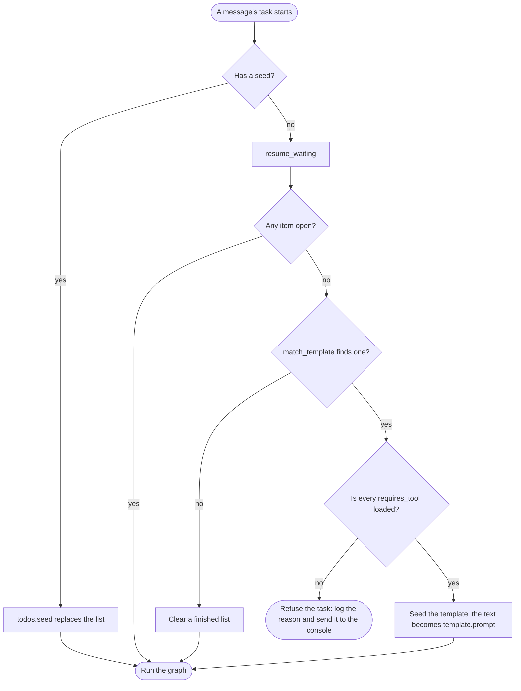

# Seeding a Task

A seed puts a task's steps on the todo list before the LLM sees the task.
Seeded items are locked: the LLM can complete or cancel them, but it cannot
reword or remove them, so a fixed task such as Receptionist cannot lose a
step ([ADR-0041](../architecture/decisions/0041-todo-list-and-seeding.md)).

## Four ways to seed

| Way | Item `source` | When the seed applies |
| --- | --- | --- |
| `agent.submit(text, todos)` from Python | `seed` | When that message's task starts |
| `/walkie/task` with `todos` | `operator` | When that message's task starts |
| `/walkie/task` with `template` | `operator` | When that message's task starts |
| A template keyword in an utterance | `seed` | When the task starts and no item is open |

Every way ends in `TodoList.seed`. It replaces the whole list, restarts the
ids at `t1` and empties the error ledger. Each item is a string, or a dict
with `content` and optionally `active_form` and `requires_tool`.

```pycon
>>> from walkie_agent.todo import TodoList, TodoRejected
>>> todos = TodoList()
>>> todos.seed(["Go to the kitchen", {"content": "Say hi", "requires_tool": "speak"}])
>>> [(item.id, item.source, item.locked, item.requires_tool) for item in todos.snapshot()]
[('t1', 'seed', True, ''), ('t2', 'seed', True, 'speak')]
>>> try:
...     todos.seed([{"content": "Say hi", "require_tool": "speak"}])
... except TodoRejected as e:
...     print(e)
Seed item t1 has unknown keys: require_tool.

```

Any other key is refused, because a typo such as `require_tool` would
silently drop a check.

## When a seed applies

`WalkieAgent.submit` does not touch the list. It checks the seed on a
scratch `TodoList`, so a bad seed raises `TodoRejected` in the caller, not
later on the agent thread. Then it queues the message with its seed.

```pycon
>>> from langchain_core.language_models import FakeListChatModel
>>> from walkie_agent.agent import WalkieAgent
>>> agent = WalkieAgent(target_connectors={}, llm=FakeListChatModel(responses=[]))
>>> agent.submit("Go to the kitchen and say hi.", todos=["Go to the kitchen", "Say hi"])
>>> agent.todos.is_empty
True
>>> try:
...     agent.submit("Say hi.", todos="Say hi")
... except TodoRejected as e:
...     print(e)
A seed is a list of items, not a single string.

```

RAI also logs a `Received message` line for each `submit`. The agent thread
applies the seed when the task starts: `_run_agent` takes the message with
its seed and calls `_prepare_todos`. `todos=None` keeps the current list, as
an utterance does; `todos=[]` starts with an empty list.



A seed wins over open items: it replaces the list even if the previous task
left steps open. A template only starts when no step is open, so an answer
that contains a keyword stays an answer. The check runs at task start, not
on arrival, because a task queued earlier may still open or finish items.

## Steps whose tool is not loaded

A seeded step with `requires_tool` can only be completed after a success of
that tool ([The Rules](todo-rules.md#the-window-and-requires_tool)). If
the run did not load the tool, the step can never be completed. For
example, the arm tools load only with `--arms`, so the `hri` template's
bag step, which needs `set_gripper`, could never finish without it. So a
seed is refused before the task starts, with the step, the tool and,
where it is known, the flag that loads it:

```pycon
>>> from walkie_agent.toolbox import Toolbox
>>> agent = WalkieAgent(
...     target_connectors={}, llm=FakeListChatModel(responses=[]), toolbox=Toolbox(connector=None)
... )
>>> try:
...     agent.submit("Take the bag.", todos=[
...         {"content": "Say hi", "requires_tool": "speak"},
...         {"content": "Take the bag", "requires_tool": "set_gripper"},
...     ])
... except TodoRejected as e:
...     print(e)
The task cannot start in this run: t1 (Say hi) needs speak, which is not a tool of this agent; t2 (Take the bag) needs set_gripper, which loads only with --arms.

```

This agent has no tools. Its toolbox, built without a connector, has no
arm backend, as in a run without `--arms`, so the message can name the
flag. The check runs in three places:

- **`submit`**, for a seed from Python or `/walkie/task`, so the caller
  gets the error, as for a malformed seed. A message on `/walkie/task` is
  then ignored with a warning that holds the reason.
- **`_prepare_todos`**, for a template that a keyword picks, since the
  template is picked only when the task starts. The task does not run.
  The reason is logged as an error and sent to the target connectors,
  the operator console, and the list stays as it was.
- **`WalkieAgent`'s constructor** logs a warning for each template that
  cannot start in this run, so the operator sees it at startup.

The constructor only warns. `pixi run agent` and `agent-robot-hri` run
without `--arms`, and they still serve every other task. The check is not
in `TodoList.seed` or `load_task_templates`, which do not know the run's
tools. The LLM never sets `requires_tool`, since `update_todos`'s ops have
no such field, so its own steps need no check.

## Operator tasks on /walkie/task

The topic takes a `std_msgs/msg/String` holding a JSON object. It needs a
non-empty `task`, exactly one of `todos` or `template`, and no other keys.
`parse_task_message` turns it into the text to run and the seed.

```pycon
>>> from walkie_agent.tasks import parse_task_message
>>> parse_task_message('{"task": "Say hi.", "todos": ["Go to the kitchen", "Say hi"]}', {})
('Say hi.', ['Go to the kitchen', 'Say hi'])
>>> for data in ['{"task": "Say hi."}', '{"task": "Say hi.", "todo": []}', "say hi"]:
...     try:
...         parse_task_message(data, {})
...     except ValueError as e:
...         print(e)
The message needs exactly one of todos and template.
The message has unknown keys: todo.
The message is not valid JSON: Expecting value: line 1 column 1 (char 0).

```

On the robot or in the sim, send one with:

```bash
pixi run ros2 topic pub --once /walkie/task std_msgs/msg/String \
  "{data: '{\"task\": \"Go to the kitchen and say hi.\", \"todos\": [\"Go to the kitchen\", \"Say hi\"]}'}"
```

`subscribe_task` hands each message to `_submit_task_message`, which runs
`parse_task_message` and `submit(text, todos, source="operator")`. A bad
message or seed, a seed whose tool is not loaded included, is logged as a
warning and ignored. Every exception is
caught there, because in the connector's executor it would end the thread
that serves all of the node's subscriptions.

## Templates

Templates live in `config/task_templates.toml`, one `[templates.<name>]`
table each; the shipped file holds the `hri` template and a commented
`tour` example. `main.py` loads it at startup with `load_task_templates`,
which seeds each template on a scratch list. A bad template raises
`ValueError` there, not mid-task. Whether a template's tools are loaded is
checked later, by the agent ([Steps whose tool is not
loaded](#steps-whose-tool-is-not-loaded)).

```pycon
>>> import tempfile
>>> from pathlib import Path
>>> from walkie_agent.tasks import load_task_templates, match_template
>>> toml = '''
... [templates.tour]
... keywords = ["house tour", "show me around"]
... task = "Give the person a short tour, then come back to the start."
... todos = ["Go to the kitchen", { content = "Come back", requires_tool = "navigate_to_location" }]
... '''
>>> with tempfile.TemporaryDirectory() as tmp:
...     path = Path(tmp) / "task_templates.toml"
...     _ = path.write_text(toml)
...     templates = load_task_templates(path)
>>> template = match_template("Can you give me a HOUSE TOUR?", templates)
>>> template.prompt("Can you give me a HOUSE TOUR?")
'Can you give me a HOUSE TOUR?\n\nGive the person a short tour, then come back to the start.'
>>> print(match_template("Is the greenhouse tour open?", templates))
None
>>> text, seed = parse_task_message('{"task": "Show me the house.", "template": "tour"}', templates)
>>> seed
['Go to the kitchen', {'content': 'Come back', 'requires_tool': 'navigate_to_location'}]

```

Keywords match as whole words in any case, so "greenhouse tour" does not
pick `tour`. The first matching template in file order wins. The LLM gets
the utterance, a blank line, then the template's `task`, and the operator's
`template` form builds the same `text`. The full format is on
[The Agent](../architecture/agent.md#task-templates).

!!! example "Try it"
    In `pixi run python`, add a second template, `[templates.short_tour]`,
    after `tour` in the TOML above. Give it `keywords = ["tour"]`, and copy
    `task` and `todos` from `tour`, because the loader refuses a template
    without them. Which one does
    `match_template("Give me a house tour.", templates)` return, and why?
    Then change `requires_tool` to `require_tool` and load the file again.

Previous: [Queue, Stop, Reset and Repair](queue-stop-reset.md) · Next: [Watching Progress](watching-progress.md)
