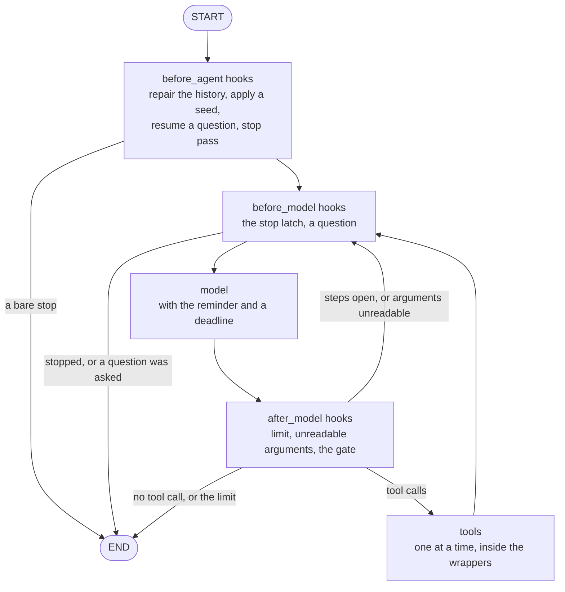

# The Graph: create_agent and Middleware

The agent's graph comes from LangChain's `create_agent`. It's a loop of a model node and a
tools node. Walkie adds no node by hand. Each rule is a small middleware that hooks into
that loop, and `build_middleware` in `src/walkie_agent/runtime/agent.py` fixes their order.

## The picture



## The middleware stack

The order matters, and `tests/test_runtime.py` pins it.

```pycon
>>> from walkie_agent.capabilities.fake import FakeRobot
>>> from walkie_agent.runtime import build_middleware
>>> robot = FakeRobot()
>>> for layer in build_middleware(robot.ctx, run_limit=25, deadline_s=60.0):
...     print(type(layer).__name__)
...
StopLatch
SerialGuard
AnswerEmptyReply
WalkieTodos
EndAfterQuestion
RepairHistory
ModelCallLimitMiddleware
Deadline
ToolErrorMiddleware

```

An optional `ToolLog` goes first and an optional `ModelFallbackMiddleware` goes before
`Deadline`. No fallback model has been selected.

| Middleware | Guards against |
| ---------- | --------------- |
| `StopLatch` | A model call or a tool call after a stop |
| `SerialGuard` | Later calls of one message after a failed call or a question, and a second `update_todos` |
| `AnswerEmptyReply` | A final message with no text, which the person never hears. It asks the model once per run, unless the robot already spoke |
| `WalkieTodos` | Dropped steps and false "done". It holds the list, the reminder, the gate and the ledger |
| `EndAfterQuestion` | Going on without the answer |
| `RepairHistory` | A provider's refusal of a tool call with no answer |
| `ModelCallLimitMiddleware` | A model that loops forever |
| `Deadline` | A model call that never returns |
| `ToolErrorMiddleware` | A tool's exception ending the run. The model gets the error as text instead |

`create_agent` runs `before_agent` and `before_model` hooks in list order and `after_model`
hooks in reverse, and it makes the first wrapper the outermost. That gives three reasons
for this order:

- **The limit comes after anything that can jump from `after_model`.** Reverse order then
  runs it first, so it counts every call, gate calls included.
- **`AnswerEmptyReply` comes before `WalkieTodos`.** A jump skips the `after_model` hooks
  that have not run yet, so when the todo gate sends the model back, the empty-reply
  check does not also fire.
- **The refusals sit outside the ledger.** A call that `StopLatch` or `SerialGuard` refuses
  never ran, so it must not count as a failed step. `WalkieTodos` is inside them.
- **`ToolErrorMiddleware` is innermost,** so the ledger sees an error as a result.

## Build it and run it

The agent needs a chat model and a `ctx`. The block defines the same scripted model as the
last page, so no LLM key is needed:

```pycon
>>> import asyncio
>>> from langchain_core.language_models import BaseChatModel
>>> from langchain_core.messages import AIMessage, HumanMessage
>>> from langchain_core.outputs import ChatGeneration, ChatResult
>>> from walkie_agent.runtime import Session, build_agent
>>> class Scripted(BaseChatModel):
...     script: list
...     seen: list = []
...     @property
...     def _llm_type(self):
...         return "scripted"
...     def bind_tools(self, tools, **kwargs):
...         return self
...     def _generate(self, *args, **kwargs):
...         raise NotImplementedError("The runtime only uses the async path.")
...     async def _agenerate(self, messages, *args, **kwargs):
...         self.seen.append(list(messages))
...         reply = self.script.pop(0).model_copy(update={"id": None})
...         return ChatResult(generations=[ChatGeneration(message=reply)])
...
>>> agent = build_agent(Scripted(script=[AIMessage("Done.")]), robot.ctx)
>>> result = asyncio.run(agent.ainvoke({"messages": [HumanMessage("Hello.")]}, Session().config()))
>>> [(type(m).__name__, m.content) for m in result["messages"]]
[('HumanMessage', 'Hello.'), ('AIMessage', 'Done.')]

```

The runtime is async only. `ainvoke` is the one way in, and the Runner is what calls it.

## One call at a time

`Session.config()` holds the setting that makes a message's calls run in order:

```pycon
>>> config = Session().config()
>>> config["max_concurrency"]
1
>>> def call(name, call_id, **args):
...     return {"name": name, "args": args, "id": call_id, "type": "tool_call"}
...
>>> robot = FakeRobot()
>>> script = [
...     AIMessage("", tool_calls=[call("go_to", "c1", place="sofa"), call("say", "c2", text="I am here.")]),
...     AIMessage("Done."),
... ]
>>> agent = build_agent(Scripted(script=script), robot.ctx)
>>> result = asyncio.run(agent.ainvoke({"messages": [HumanMessage("Go to the sofa and say so.")]}, config))
>>> [entry["verb"] for entry in robot.calls]
['base.go_to', 'speech.say']
>>> robot.said
['I am here.']

```

A robot can't drive and speak in an unplanned order, so this matters. Without the setting,
the calls overlap. `test_control_without_max_concurrency_calls_overlap` shows that.

## The limits on a run

Two limits stop a model that never finishes. Their defaults, 25 model calls and 60 s per
attempt, are provisional. `[agent]` in `config.toml` overrides them.

`ModelCallLimitMiddleware` ends the run with a final message that names the limit:

```pycon
>>> loop = [AIMessage("", tool_calls=[call("say", f"c{n}", text="Again.")]) for n in range(5)]
>>> agent = build_agent(Scripted(script=loop), FakeRobot().ctx, run_limit=2)
>>> result = asyncio.run(agent.ainvoke({"messages": [HumanMessage("Talk.")]}, Session().config()))
>>> "run limit (2/2)" in result["messages"][-1].content
True

```

`Deadline` bounds one model attempt with `asyncio.timeout`. With no fallback, the
`TimeoutError` leaves the graph, and the Runner turns it into a failed task
([Queue, Stop, Reset and Repair](queue-stop-reset.md#reset-stop-and-errors)):

```pycon
>>> class Hung(Scripted):
...     async def _agenerate(self, messages, *args, **kwargs):
...         await asyncio.sleep(30)
...
>>> agent = build_agent(Hung(script=[]), FakeRobot().ctx, deadline_s=0.01)
>>> try:
...     asyncio.run(agent.ainvoke({"messages": [HumanMessage("Hello.")]}, Session().config()))
... except TimeoutError as error:
...     print(type(error).__name__)
...
TimeoutError

```

The deadline is cooperative. It ends the client's wait, which doesn't prove the provider
stopped computing, and blocking code on the loop delays it.

!!! example "Try it"
    Print `sorted(agent.get_graph().nodes)`. Each hook is a node with its middleware's name.
    Which middlewares have a `before_agent` node? Check your answer against the table above.

Previous: [RAI's Connector, Our Runtime](rai-and-our-graph.md) · Next: [One Task, Start to Finish](one-task.md)
