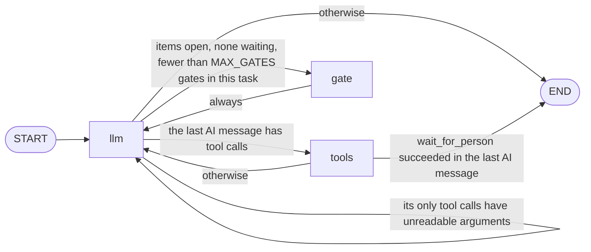

# The Graph: llm, tools and gate

The agent's graph has three nodes, `llm`, `tools` and `gate`, and every arrow
between them is one branch of two routing functions. The nodes and both
functions are built inside `build_walkie_graph` in `src/walkie_agent/graph.py`.

## The picture

Each label is the condition that picks that arrow. `route_after_llm` tries
its conditions in the table's order, and the first that holds wins.



| Function | Returns | When |
| --- | --- | --- |
| `route_after_llm` | `"tools"` | The last message is an `AIMessage` with `tool_calls` |
| `route_after_llm` | `"llm"` | It has no valid calls, only `invalid_tool_calls` |
| `route_after_llm` | `"gate"` | `todos.open_ids()` is not empty, `todos.has_waiting()` is false, and `_gates_since_task_start` is below `MAX_GATES` (2) |
| `route_after_llm` | `END` | None of the above |
| `route_after_tools` | `END` | `_person_was_asked` finds a successful `wait_for_person` result |
| `route_after_tools` | `"llm"` | Any other tool results |

## The three nodes

- **`llm`** puts the system prompt first once, runs `repair_history`, binds
  `toolset.visible()` and calls the model. It appends the AI message to
  `state["messages"]` in place and returns `None`, as RAI's own node does.
- **The reminder is sent, never saved.** `todos.render()` goes on the outgoing
  list only, as a `HumanMessage`, because some providers reject a system
  message that is not the first. An empty list sends no reminder.
- **`tools`** is a `WalkieToolRunner`, a subclass of RAI's `ToolRunner`. Its
  `tools_by_name` is a live view of the `ToolSet`, so an unknown name gets
  "Unknown tool X." instead of a `KeyError`. It reports every known tool's
  result to the todo list's ledger.
- **`gate`** appends one `HumanMessage` that starts with `GATE_PREFIX`, such
  as "[todo] Open items: t3, t4. Finish them, or mark them failed or
  cancelled with a note." Unlike the reminder, this message stays in the
  history.

The self-loop on `llm` exists for calls whose arguments are not valid JSON.
LangChain keeps them in `invalid_tool_calls`, which `ToolRunner` never runs.
Going back to `llm` lets `repair_history` answer them, so the model sees the
error and can retry.

The gate count lives in the history, not in a variable. `_gates_since_task_start`
walks back and counts gate messages until the first other `HumanMessage`,
skipping the image message that RAI's `ToolRunner` adds, which carries a
`tool_call_id`. So the count holds when a test invokes the graph directly, and
each new message from the person starts it again at zero.

## Build it and run it

The graph needs only a chat model, a `ToolSet` and a `TodoList`. The fake
model below always answers "Done." and calls no tool, so no LLM key is needed.

```pycon
>>> from langchain_core.language_models import BaseChatModel
>>> from langchain_core.messages import AIMessage, HumanMessage
>>> from langchain_core.outputs import ChatGeneration, ChatResult
>>> from walkie_agent.graph import GATE_PREFIX, MAX_GATES, ToolSet, build_walkie_graph
>>> from walkie_agent.todo import TodoList
>>> class SaysDone(BaseChatModel):
...     @property
...     def _llm_type(self):
...         return "says-done"
...     def bind_tools(self, tools, **kwargs):
...         return self
...     def _generate(self, messages, stop=None, run_manager=None, **kwargs):
...         return ChatResult(generations=[ChatGeneration(message=AIMessage("Done."))])
...
>>> todos = TodoList()
>>> graph = build_walkie_graph(SaysDone(), ToolSet(), todos)
>>> list(graph.get_graph().nodes)
['__start__', 'llm', 'tools', 'gate', '__end__']
>>> GATE_PREFIX, MAX_GATES
('[todo] Open items', 2)

```

With an empty list, a reply without tool calls ends the run. With two open
items, the gate sends the model back twice, and then the run ends anyway.

```pycon
>>> state = {"messages": [HumanMessage("Hello.")]}
>>> _ = graph.invoke(state)
>>> [m.content for m in state["messages"]]
['Hello.', 'Done.']
>>> todos.seed(["Go to the kitchen", "Come back"])
>>> state = {"messages": [HumanMessage("Go and come back.")]}
>>> _ = graph.invoke(state)
>>> for m in state["messages"]:
...     print(f"{type(m).__name__}: {m.content}")
HumanMessage: Go and come back.
AIMessage: Done.
HumanMessage: [todo] Open items: t1, t2. Finish them, or mark them failed or cancelled with a note.
AIMessage: Done.
HumanMessage: [todo] Open items: t1, t2. Finish them, or mark them failed or cancelled with a note.
AIMessage: Done.
>>> any("<todos>" in m.content for m in state["messages"])
False

```

The reminder went out with all three LLM calls, but none of it was saved.

## RECURSION_LIMIT

LangGraph stops a run after a number of steps and raises `GraphRecursionError`.
Each node run is one step, so a tool round costs two. `src/walkie_agent/agent.py`
sets `RECURSION_LIMIT = 100`, about 50 tool rounds, in `_start_session` with
`with_config(recursion_limit=RECURSION_LIMIT)`.

LangGraph's own default, 10007 steps in LangGraph 1.2, is no real bound, so
a graph you build yourself, as above, can loop for a long time. In the agent,
100 is a cap on a runaway loop. When a run hits it, `_run_agent` logs the
error and serves the next message.

!!! example "Try it"
    Continue the session above. Put t1 in progress with
    `todos.apply([{"op": "update", "id": "t1", "status": "in_progress"}])`,
    then call `todos.set_waiting("Which kitchen?")`. Invoke the graph on a
    fresh state and count the gate messages. There are none: while an item
    waits, a gate would push the model to guess instead of waiting.

For the full design, see [The Agent](../architecture/agent.md) and
[ADR-0038](../architecture/decisions/0038-own-graph-per-turn-binding.md).

Previous: [What Changed from the Old Agent](old-vs-new.md) · Next: [One Task, Start to Finish](one-task.md)
