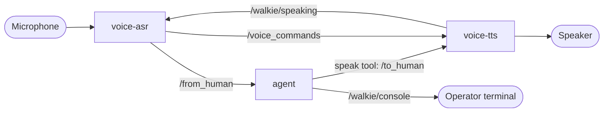

# 7. Talk to Walkie by Voice

**Goal:** speak a task into a microphone, and hear Walkie answer through a
speaker. This follows RAI's
[voice interface tutorial](https://robotecai.github.io/rai/tutorials/voice_interface/).

## Background

Voice runs as two extra processes next to the agent. They only use ROS
topics, so the agent does not know whether a task was typed or spoken.



- **voice-asr** (speech to text) listens on the microphone. A voice
  activity detector (Silero VAD) finds speech, Whisper turns it into text,
  and the text goes to `/from_human`.
- **voice-tts** (text to speech) speaks every message on `/to_human`. We use
  Kokoro, which runs locally and is free.
- While voice-tts plays, it says so on `/walkie/speaking`, and voice-asr
  ignores the microphone. Otherwise Walkie would hear itself.
- The agent says things out loud **only** with its `speak` tool. Its final
  text reply goes to `/walkie/console`, so a summary is not read out twice.

## Step 1: Install

```toml title="pixi.toml"
[dependencies]
portaudio = "*"   # sounddevice needs the PortAudio library
wget = "*"        # Kokoro downloads its model files with wget

[pypi-dependencies]
rai-s2s = { git = "https://github.com/RobotecAI/rai.git", tag = "2.12.2", subdirectory = "src/rai_s2s", extras = [
  "elevenlabs", "whisper", "fasterwhisper", "wakeword", "kokoro",
] }
```

- `rai_s2s` imports every speech backend when it loads, so all the extras
  are needed, even the ones we do not use.
- See [6. Give Walkie an Identity](06-whoami.md#step-1-install-rai_whoami)
  for why the tag is 2.12.2.
- This adds about 4 GB to the environment, mostly PyTorch and the NVIDIA
  CUDA libraries.

??? info "GPU and CPU"
    `rai_s2s` pins `torchaudio` 2.3.1, which brings PyTorch 2.3.1. Its PyPI
    wheels are built for CUDA 12.1, so Whisper runs on the GPU when there is
    one (NVIDIA driver 525 or newer) and on the CPU otherwise. Check with:

    ```bash
    pixi run python -c "import torch; print(torch.cuda.is_available())"
    ```

    Kokoro uses `onnxruntime`, and Silero VAD is a small PyTorch model. Both
    stay on the CPU, which is fast enough. `rai_s2s` has a `gpu` extra that
    adds `onnxruntime-gpu`, but it conflicts with the CPU `onnxruntime` that
    other packages need, so we do not use it.

??? info "Why `scripts/activate.sh` sets `ALSA_PLUGIN_DIR`"
    PortAudio uses the environment's own ALSA library (`alsa-lib` from
    conda-forge). It reads the system's sound configuration, but looks for
    ALSA plugins only inside the environment. The `default` and `pipewire`
    devices come from the system's PipeWire plugin, so without help they do
    not exist, and PortAudio lists mostly the sound cards' own `hw:`
    devices.

    `scripts/activate.sh` points `ALSA_PLUGIN_DIR` at the system plugins
    (`/usr/lib/x86_64-linux-gnu/alsa-lib` on Ubuntu), unless it is already
    set. Every task in the default environment gets it.

## Step 2: Configure

The `[asr]` and `[tts]` sections of `config.toml` choose the devices and
models. Both device names are `"default"`: the system's default microphone
and speaker, through PipeWire. Choose those with `wpctl`:

```bash
wpctl status                              # (1)!
wpctl set-default 57                      # (2)!
wpctl get-volume @DEFAULT_AUDIO_SOURCE@   # (3)!
wpctl set-mute @DEFAULT_AUDIO_SOURCE@ 0   # (4)!
```

1. Lists the speakers under **Sinks** and the microphones under
   **Sources**, each with an ID. A `*` marks the default.
2. Makes ID 57 the default. WirePlumber remembers it after a reboot.
3. Shows the default microphone's volume. `[MUTED]` means it hears
   nothing.
4. Unmutes the default microphone.

To use a specific device instead, list the names with
`pixi run list-audio-devices` and put one in `recording_device_name` or
`speaker_device_name`. The name must match exactly. Avoid names ending in
`(hw:N,M)`: they open the sound card directly, so they fail while PipeWire
is using the card, and the card number N can change between boots. If a
name is wrong, `voice-asr` and `voice-tts` stop at start-up and list the
devices they can use.

The settings you are most likely to change:

| Setting                     | Meaning                                                    |
| --------------------------- | ---------------------------------------------------------- |
| `transcription_model`       | `LocalWhisper`, `FasterWhisper` (local) or `OpenAI` (cloud) |
| `transcription_model_name`  | Whisper size: `tiny`, `base`, `small`, ... Bigger is more accurate and slower |
| `silence_grace_period`      | Seconds of silence before a sentence is sent. Too short splits sentences |
| `vad_threshold`             | Raise it in a noisy room                                   |
| `vendor` (in `[tts]`)       | `KokoroTTS`, `OpenTTS` or `ElevenLabs`                     |

!!! note "`OpenAI` transcription needs a real OpenAI key"
    RAI's `OpenAIWhisper` always calls api.openai.com and ignores the
    `base_url` in `config.toml`, so the OpenRouter key in `OPENAI_API_KEY`
    will be rejected. Stay with the local models.

## Step 3: Run

Start a Zenoh router first, unless one already runs, as in
[Getting Started](../getting-started.md#6-run-the-agent-with-the-fake-robot).
Then open four terminals:

```bash title="Terminal 1"
pixi run fake-walkie   # or the real robot
```

```bash title="Terminal 2"
pixi run agent
```

```bash title="Terminal 3"
pixi run voice-tts
```

```bash title="Terminal 4"
pixi run voice-asr
```

The first `voice-tts` start downloads about 300 MB of Kokoro model files.
The first `voice-asr` start downloads the Whisper model, and Silero VAD
from GitHub through `torch.hub`. PyTorch warns that it is about to "run
code from an untrusted repository". Both are cached in `~/.cache`, so later
starts skip the downloads and also work offline.

Say something like _"Go to the kitchen and say hello."_ The ASR terminal
prints `starting recording...` when it hears you, then what it understood.
The speaker says the agent's `speak` lines. If ASR never reacts to your
voice, the default microphone is the wrong one or muted: check it with
`wpctl` (Step 2).

??? info "Why voice-tts buffers 0.2 s of audio"
    RAI opens sound streams with sounddevice's `"low"` latency, about 9 ms
    per buffer. Some sound cards cannot keep up with that: PipeWire's log
    (`journalctl --user -u pipewire`) repeats
    `snd_pcm_avail after recover: Broken pipe`, the speaker stream stops,
    and nothing plays.

    With sounddevice's `"high"` latency, about 35 ms, it plays but
    stutters. While Kokoro synthesizes the next sentence, voice-tts pauses
    for tens of milliseconds. The buffer runs dry, the stream repeats old
    audio, and the terminal prints `Flags set:output_underflow`.

    So voice-tts buffers 0.2 s (`SPEAKER_LATENCY` in
    `src/walkie_agent/half_duplex.py`). Speech does not need a lower
    latency. voice-asr reads the microphone in fixed 80 ms blocks, so it is
    not affected.

## How speaking and listening work together

Walkie does not listen while it speaks
([ADR-0029](../architecture/decisions/0029-half-duplex-voice.md)):

- While audio plays, voice-tts publishes `true` on `/walkie/speaking` every
  0.25 s, and `false` once when playback stops.
- voice-asr ignores the microphone meanwhile, and for 0.5 s after. Its
  terminal prints `Walkie is speaking, ignoring the microphone`. Without
  this, the microphone hears Walkie's speaker, and Walkie interrupts
  itself and hears its own words as a new task.
- So you cannot interrupt Walkie mid-sentence, and anything you say while
  it talks is lost. Wait until it finishes.

While Walkie is quiet, ASR controls TTS on `/voice_commands`, as in RAI:

- While you are talking, ASR sends `pause`. Anything the agent says
  meanwhile waits, so Walkie does not start talking over you. (RAI's own
  TTS would start anyway, so voice-tts holds new speech for up to 5 s after
  the last `pause`.)
- When you finish, ASR sends `stop`, and TTS drops whatever it still had to
  say, including anything that waited. Your new request matters more than
  the old answer.
- RAI's TTS plays messages from **one conversation ID at a time**. It locks
  onto the first ID it receives, and only accepts a new one after a `stop`.
- So the `speak` tool keeps one ID and changes it only when it sees `stop`.
  If every `speak` call used a new ID, only the first sentence would ever be
  played.

??? warning "Watching `/voice_commands` can break it"
    `ros2 topic echo /voice_commands`, started before ASR sends its first
    command, subscribes as best effort. RAI's ASR then also publishes best
    effort, and voice-tts, which subscribes as reliable, no longer receives
    `pause` or `stop`. Add `--qos-reliability reliable` when you watch this
    topic. `/walkie/speaking` uses fixed settings and is safe to watch.

## The doorbell detector

voice-asr will also listen for the doorbell, with YAMNet, a small sound
classifier that runs on the CPU
([ADR-0054](../architecture/decisions/0054-doorbell-yamnet-in-voice-asr.md)).
The detector (`src/walkie_agent/doorbell.py`) and its offline eval are
built. voice-asr does not run it yet.

### Fetch the model

```bash
pixi run fetch-doorbell-model
```

!!! warning "The release is still to be published"
    The release `doorbell-model-v1` is not on GitHub yet. Until a
    maintainer publishes it, as [Publish the model](#publish-the-model)
    describes, this task stops with a message that names the release, and
    the tests that run the model skip.

- It downloads `yamnet.onnx` (about 15 MB) and `yamnet_class_map.csv` from the
  walkie-agent-ros release `doorbell-model-v1` into `models/`, next to
  `config.toml`. git ignores `models/`, so run it once in every clone.
- It checks each file against the SHA-256 pinned in `pixi.toml`. On a
  mismatch it fails, and leaves the downloads as `.part` files.
- The model is TF-Hub's YAMNet, converted to ONNX by
  `tools/export_yamnet.py`. The release's NOTICE names the licences of
  the weights (Apache 2.0) and of AudioSet's class names (CC BY-SA 4.0).

Without the model, the tests that run it skip, and say so.

### Score the test clips

```bash
pixi run doorbell-eval   # (1)!
```

1. Runs `python -m walkie_agent.doorbell eval tests/data/audio`. Add
   `--config <file>` to try another `[walkie.doorbell.detector]` table.
   The model is then read from `models/` next to that file.

```text
clip                                               16000 Hz  48000 Hz  44100 Hz
bell/freesound_125967_dorrklocka.wav                    8/8       8/8       8/8  ok
bell/freesound_69386_doorbell_distant.wav               8/8       7/8       7/8  known failures
buzzer/freesound_164090_buzzer.wav                      4/8       5/8       5/8
...
none/freesound_369148_music_box.wav                     1/8       1/8       1/8  known failures
...
bell/freesound_69386_doorbell_distant.wav at 48000 Hz, onset 7: no ring, as known_failures.toml lists
...
none/freesound_369148_music_box.wav at 16000 Hz, onset 4: bell 0.42, as known_failures.toml lists
...
none/ at 48000 Hz: highest Knock 0.031, highest Tap 0.038
KNOWN FAILURES ONLY: 15 of 480 cases fail, each listed in known_failures.toml
```

- Each clip in `tests/data/audio` is scored three ways: as a 16 kHz
  microphone delivers it, and as RAI delivers it from a 48 kHz and a
  44.1 kHz microphone. At any rate other than 16 kHz, RAI resamples each
  80 ms block on its own, which lowers some chimes' scores.
- At each rate the clip plays at 8 onsets, after 0 to 7 eighths of a hop
  of silence (60 ms steps). A ring can start anywhere between two of
  YAMNet's windows, and each onset gives the rules other windows of it. A
  case is one clip at one rate and onset. Each column counts the onsets
  at which the clip rang.
- Every clip in `bell/`, `chime/` and `knock/` must ring in every case,
  and no clip in `none/` may. A chime may ring as a bell. Clips in other
  directories, such as `buzzer/`, are scored and not judged: the rules
  miss most buzzers (ADR-0054), and the table shows by how much.
- `tests/data/audio/known_failures.toml` lists the cases known to fail
  with the rules in `config.toml`, and why. A line under the table names
  each failing case, and each listed case that passes.
- The last line is `PASS` when no case fails, `KNOWN FAILURES ONLY` when
  only listed cases fail, and `FAIL` when a case fails that the file does
  not list, or a listed case passes. The exit code is 1 for `FAIL`, and 0
  otherwise.
- The `none/` lines give the highest Knock and Tap scores on speech, music
  and room tone. If they come near `knock_pair`, set `knock_pair = 1.1`
  to turn the knock rule off. A rule whose thresholds are all at 1.1 is
  off, and the eval does not judge its directory, and says so.

The rules read the thresholds in `[walkie.doorbell.detector]` of
`config.toml`. The values are starting points, to tune on the robot. After
changing a threshold, run the eval and bring `known_failures.toml` up to
date: the tests that run the model fail while it misses a failing case or
lists one that passes. No change to the thresholds clears the file (see
the comment at its top).

A new clip must be 16 kHz mono 16-bit WAV, CC0 or public domain, and listed
in `tests/data/audio/LICENSES.md`. The parity test also needs its
TensorFlow scores in `tests/data/audio/yamnet_reference.npz`, which
`tools/export_yamnet.py` writes. For a new clip, point its `--out` at a
scratch directory and keep the published release.

### Publish the model

The release `doorbell-model-v1` of `EIC-Robocup-2026/walkie-agent-ros` holds
`yamnet.onnx`, `yamnet_class_map.csv` and `NOTICE`. A maintainer with
write access to the repository publishes it once:

1. Make a throwaway Python 3.11 environment outside the repository, with
   the packages that the docstring of `tools/export_yamnet.py` lists.
   TensorFlow is not one of the project's dependencies, so pixi's
   environments do not have it.
2. Download TF-Hub's YAMNet weights (`google/yamnet/1`, Apache 2.0) from
   the Kaggle URL in the same docstring, check the archive against the
   SHA-256 given there, and extract it into an empty directory.
3. From the repository root, run the export into a directory outside the
   repository:

    ```bash
    python -I tools/export_yamnet.py --saved-model <extracted dir> \
        --out <release dir> --clips tests/data/audio \
        --reference tests/data/audio/yamnet_reference.npz
    ```

    It checks the export against the TF-Hub model on every test clip, and
    stops if a score differs by 1e-3 or more. It prints the largest
    differences and the SHA-256 of each file.

4. Publish the three files:

    ```bash
    gh release create doorbell-model-v1 --repo EIC-Robocup-2026/walkie-agent-ros \
        --title "Doorbell model v1" --notes-file <release dir>/NOTICE \
        <release dir>/yamnet.onnx <release dir>/yamnet_class_map.csv <release dir>/NOTICE
    ```

5. The sums in the `fetch-doorbell-model` task of `pixi.toml` belong to
   one export, since tf2onnx writes other bytes each time. If the
   published files come from a new export, put the sums it printed for
   `yamnet.onnx` and `yamnet_class_map.csv` into the task, and commit
   them. Then run `pixi run fetch-doorbell-model` and `pixi run test`: the
   tests that run the model no longer skip.

## Running on the robot PC

The voice nodes reach the sound card through PipeWire, which runs as part
of a user's login. Run them as the user who is logged in to the robot PC's
desktop. Turning on automatic login for that user is the simplest setup.
Once that user is logged in, starting the tasks over SSH as the same user
works too.

- **Not as root, through `sudo`, from cron or as a system service.** These
  cannot reach the user's PipeWire, so the `default` device does not
  exist. `voice-asr` and `voice-tts` point this out when they stop.
- **Without a desktop login,** only the user at the screen gets access to
  the sound card. Add the user to the `audio` group instead
  (`sudo usermod -aG audio <user>`), and make sure no other user's desktop
  is holding the card. Then reboot. Logging in again is not enough while
  the user's systemd manager keeps running (with linger, or another open
  session), because PipeWire runs under it and keeps its old groups.
- **To start at boot without a login,** run the tasks as a systemd user
  service (`systemctl --user`), and run `sudo loginctl enable-linger <user>`
  once so the user's services, PipeWire included, start at boot.

Check from the shell you will run the tasks in: `wpctl status` should list
the robot's microphone and speaker, not only "Dummy Output".

??? info "Why `voice-asr` is not built with RAI's `from_config()`"
    In `rai_s2s` 1.0.x, `SpeechRecognitionAgent.from_config()` expects
    model names like `"LocalWhisper (Free)"`, but the config loader only
    accepts `"LocalWhisper"`. So it fails for every valid config.
    `src/walkie_agent/voice.py` builds the agent by hand from the same
    config instead. `TextToSpeechAgent.from_config()` works, and the
    half-duplex subclass uses it.
