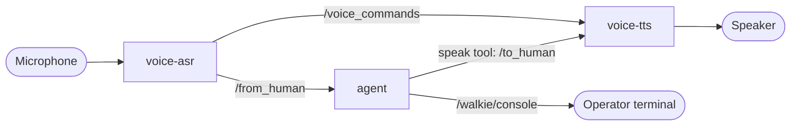

# 7. Talk to Walkie by Voice

**Goal:** speak a task into a microphone, and hear Walkie answer through a
speaker. This follows RAI's
[voice interface tutorial](https://robotecai.github.io/rai/tutorials/voice_interface/).

## Background

Voice runs as two extra processes next to the agent. They only use ROS
topics, so the agent does not know whether a task was typed or spoken.



- **voice-asr** (speech to text) listens on the microphone. A voice
  activity detector (Silero VAD) finds speech, Whisper turns it into text,
  and the text goes to `/from_human`.
- **voice-tts** (text to speech) speaks every message on `/to_human`. We use
  Kokoro, which runs locally and is free.
- The agent says things out loud **only** with its `speak` tool. Its final
  text reply goes to `/walkie/console`, so a summary is not read out twice.

## Step 1: Install

```toml title="pixi.toml"
[dependencies]
portaudio = "*"   # sounddevice needs the PortAudio library
wget = "*"        # Kokoro downloads its model files with wget

[pypi-dependencies]
rai-s2s = { git = "https://github.com/RobotecAI/rai.git", tag = "2.12.2", subdirectory = "src/rai_s2s", extras = [
  "elevenlabs", "whisper", "fasterwhisper", "wakeword", "kokoro",
] }
```

- `rai_s2s` imports every speech backend when it loads, so all the extras
  are needed, even the ones we do not use.
- See [6. Give Walkie an Identity](06-whoami.md#step-1-install-rai_whoami)
  for why the tag is 2.12.2.
- This adds about 4 GB to the environment, mostly PyTorch and the NVIDIA
  CUDA libraries.

??? info "GPU and CPU"
    `rai_s2s` pins `torchaudio` 2.3.1, which brings PyTorch 2.3.1. Its PyPI
    wheels are built for CUDA 12.1, so Whisper runs on the GPU when there is
    one (NVIDIA driver 525 or newer) and on the CPU otherwise. Check with:

    ```bash
    pixi run python -c "import torch; print(torch.cuda.is_available())"
    ```

    Kokoro uses `onnxruntime`, and Silero VAD is a small PyTorch model. Both
    stay on the CPU, which is fast enough. `rai_s2s` has a `gpu` extra that
    adds `onnxruntime-gpu`, but it conflicts with the CPU `onnxruntime` that
    other packages need, so we do not use it.

??? info "Why `scripts/activate.sh` sets `ALSA_PLUGIN_DIR`"
    PortAudio uses the environment's own ALSA library (`alsa-lib` from
    conda-forge). It reads the system's sound configuration, but looks for
    ALSA plugins only inside the environment. The `default` and `pipewire`
    devices come from the system's PipeWire plugin, so without help they do
    not exist, and PortAudio lists mostly the sound cards' own `hw:`
    devices.

    `scripts/activate.sh` points `ALSA_PLUGIN_DIR` at the system plugins
    (`/usr/lib/x86_64-linux-gnu/alsa-lib` on Ubuntu), unless it is already
    set. Every task in the default environment gets it.

## Step 2: Configure

The `[asr]` and `[tts]` sections of `config.toml` choose the devices and
models. Both device names are `"default"`: the system's default microphone
and speaker, through PipeWire. Choose those with `wpctl`:

```bash
wpctl status                              # (1)!
wpctl set-default 57                      # (2)!
wpctl get-volume @DEFAULT_AUDIO_SOURCE@   # (3)!
wpctl set-mute @DEFAULT_AUDIO_SOURCE@ 0   # (4)!
```

1. Lists the speakers under **Sinks** and the microphones under
   **Sources**, each with an ID. A `*` marks the default.
2. Makes ID 57 the default. WirePlumber remembers it after a reboot.
3. Shows the default microphone's volume. `[MUTED]` means it hears
   nothing.
4. Unmutes the default microphone.

To use a specific device instead, list the names with
`pixi run list-audio-devices` and put one in `recording_device_name` or
`speaker_device_name`. The name must match exactly. Avoid names ending in
`(hw:N,M)`: they open the sound card directly, so they fail while PipeWire
is using the card, and the card number N can change between boots. If a
name is wrong, `voice-asr` and `voice-tts` stop at start-up and list the
devices they can use.

The settings you are most likely to change:

| Setting                     | Meaning                                                    |
| --------------------------- | ---------------------------------------------------------- |
| `transcription_model`       | `LocalWhisper`, `FasterWhisper` (local) or `OpenAI` (cloud) |
| `transcription_model_name`  | Whisper size: `tiny`, `base`, `small`, ... Bigger is more accurate and slower |
| `silence_grace_period`      | Seconds of silence before a sentence is sent. Too short splits sentences |
| `vad_threshold`             | Raise it in a noisy room                                   |
| `vendor` (in `[tts]`)       | `KokoroTTS`, `OpenTTS` or `ElevenLabs`                     |

!!! note "`OpenAI` transcription needs a real OpenAI key"
    RAI's `OpenAIWhisper` always calls api.openai.com and ignores the
    `base_url` in `config.toml`, so the OpenRouter key in `OPENAI_API_KEY`
    will be rejected. Stay with the local models.

## Step 3: Run

Open four terminals:

```bash title="Terminal 1"
pixi run fake-walkie   # or the real robot
```

```bash title="Terminal 2"
pixi run agent
```

```bash title="Terminal 3"
pixi run voice-tts
```

```bash title="Terminal 4"
pixi run voice-asr
```

The first `voice-tts` start downloads about 300 MB of Kokoro model files.
The first `voice-asr` start downloads the Whisper model, and Silero VAD
from GitHub through `torch.hub`. PyTorch warns that it is about to "run
code from an untrusted repository". Both are cached in `~/.cache`, so later
starts skip the downloads and also work offline.

Say something like _"Go to the kitchen and say hello."_ The ASR terminal
prints `starting recording...` when it hears you, then what it understood.
The speaker says the agent's `speak` lines. If ASR never reacts to your
voice, the default microphone is the wrong one or muted: check it with
`wpctl` (Step 2).

## How speaking and listening work together

- While you are talking, ASR sends `pause` on `/voice_commands`, so Walkie
  does not talk over you.
- When you finish, ASR sends `stop`, and TTS drops whatever it still had to
  say. Your new request matters more than the old answer.
- RAI's TTS plays messages from **one conversation ID at a time**. It locks
  onto the first ID it receives, and only accepts a new one after a `stop`.
- So the `speak` tool keeps one ID and changes it only when it sees `stop`.
  If every `speak` call used a new ID, only the first sentence would ever be
  played.

??? warning "Watching `/voice_commands` can break it"
    `ros2 topic echo /voice_commands`, started before ASR sends its first
    command, subscribes as best effort. RAI's ASR then also publishes best
    effort, and voice-tts, which subscribes as reliable, no longer receives
    `pause` or `stop`. Add `--qos-reliability reliable` when you watch this
    topic.

## Running on the robot PC

The voice nodes reach the sound card through PipeWire, which runs as part
of a user's login. Run them as the user who is logged in to the robot PC's
desktop. Turning on automatic login for that user is the simplest setup.
Once that user is logged in, starting the tasks over SSH as the same user
works too.

- **Not as root, through `sudo`, from cron or as a system service.** These
  cannot reach the user's PipeWire, so the `default` device does not
  exist. `voice-asr` and `voice-tts` point this out when they stop.
- **Without a desktop login,** only the user at the screen gets access to
  the sound card. Add the user to the `audio` group instead
  (`sudo usermod -aG audio <user>`), and make sure no other user's desktop
  is holding the card. Then reboot. Logging in again is not enough while
  the user's systemd manager keeps running (with linger, or another open
  session), because PipeWire runs under it and keeps its old groups.
- **To start at boot without a login,** run the tasks as a systemd user
  service (`systemctl --user`), and run `sudo loginctl enable-linger <user>`
  once so the user's services, PipeWire included, start at boot.

Check from the shell you will run the tasks in: `wpctl status` should list
the robot's microphone and speaker, not only "Dummy Output".

??? info "Why `voice-asr` is not built with RAI's `from_config()`"
    In `rai_s2s` 1.0.x, `SpeechRecognitionAgent.from_config()` expects
    model names like `"LocalWhisper (Free)"`, but the config loader only
    accepts `"LocalWhisper"`. So it fails for every valid config.
    `src/walkie_agent/voice.py` builds the agent by hand from the same
    config instead. `TextToSpeechAgent.from_config()` works and is used
    as is.
